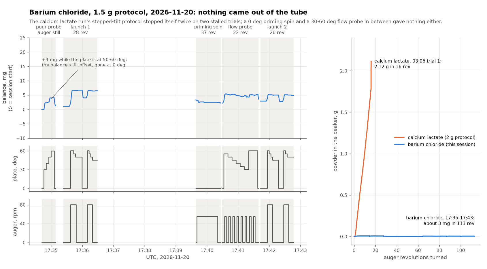
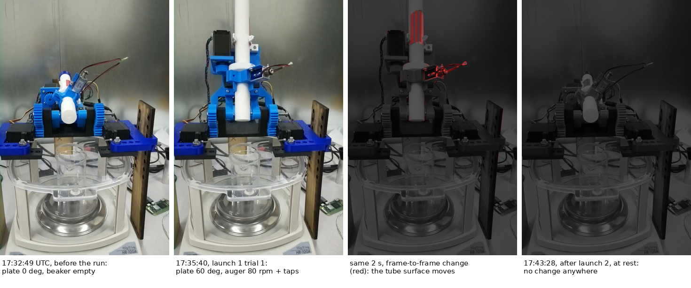

# 1.5 g barium chloride trials on the calcium lactate protocol: nothing came out of the tube (2026-11-20)

Asked by @XZaitzeff on [PR #131](https://github.com/vertical-cloud-lab/powder-doser/pull/131)
at 17:26 UTC: "I replaced the powder in the auger with barium chloride. Run the same experiment as
before except aim for 1.5 g this time". "Before" is the calcium lactate run of 03:05 UTC
([README](../2026-11-20_calcium-lactate_tilt-schedule-2g/README.md)): a static-tilt pour probe, then
up to 30 doses on the stepped-tilt three-phase protocol, unchanged apart from the target.

**Outcome:** no dose got past the bulk stage. Barium chloride did not come out of the tube at any
angle, speed or tap setting tried, in about **113 auger revolutions**:

- **Launch 1** (17:35) stalled trials 1 and 2 in the bulk (80 rpm with a tap every 300 ms, the plate
  stepping 60 → 45° on the no-flow rule) and stopped itself on its two-failed-trials rule.
- Then the recovery used on 11-18 and 11-19: a **priming spin** at 0° (55 rpm, 40 s, 36.7 revolutions)
  gave −0.9 mg, and the **flow probe** (2.75 revolutions at 55 rpm at each of 55, 50, 45, 40, 35, 30, 60
  and 60°) gave −0.5 to +0.6 mg per step.
- **Launch 2** (17:41), the same script, stalled trials 1 and 2 again and stopped.
- The balance read at 0° went from −0.0332 g at 17:34:40 to −0.0305 g at the start of the last trial
  (17:42): **about 3 mg** in all, about the size of the balance's wander over the session. Calcium lactate, on the same rig 14 hours
  earlier, gave 2.12 g in 16 revolutions in its first trial.
- **The drive works.** On camera the tube's surface streaks frame to frame while the auger runs and
  is still at rest, so the tube turns. Whatever holds the powder back is inside the tube or at its
  outlet, and needs someone at the bench (see [What's needed](#whats-needed-at-the-bench)).



- **Left, top:** the balance during every block, relative to the first reading of the pour probe.
  The steps of about 3–5 mg up and back down follow the plate (0° → 50–60° → 0°): the plate's tilt
  shifts the balance reading by that much (the pour probe shows it with the auger still), so they are
  not powder.
- **Left, middle and bottom:** the plate angle and the commanded auger speed. In both launches the
  bulk's no-flow rule stepped the plate down 60 → 55 → 50 (→ 45)° every 3 s, and the controller's stall
  rule (no 2 mg gain in 8 s of spinning) ended each trial after 13–15 revolutions.
- **Right:** powder in the beaker against auger revolutions turned: barium chloride's blocks one after
  another, against calcium lactate's first trial of the 03:06 run (same protocol, 2 g target).
- The figure comes from [`plot_session.py`](plot_session.py).



Bench camera (livestream segments fetched on the Zero, decoded on the runner):

1. **17:32:49, before the run:** plate at 0°, the beaker empty on the pan.
2. **17:35:40, launch 1 trial 1:** plate at 60°, auger at 80 rpm with taps; nothing falling.
3. **The same 2 s segment, frame-to-frame change in red:** the upper tube and the tapper move. Over the
   tube the mean change between frames is 5.95 grey levels; a segment of the tube at rest gives 0.00.
4. **17:43:28, after launch 2, at rest:** no change anywhere.

The camera can't show whether the outlet is open or where the powder sits in the opaque tube.

## What ran

[`three_phase_tilt_trials.py`](../../../hardware/test-module/firmware/three_phase_tilt_trials.py)
version `2026-11-20c` ([`3be1b2e`](https://github.com/vertical-cloud-lab/powder-doser/commit/3be1b2e)),
on the Pico's own `main_three_phase.py` (sha256 prefix `6b2111e1b2447096`, unchanged since 11-18).
Every stage setting, threshold and stall rule is the calcium lactate run's (`2026-11-20b`):

- **Bulk:** 80 rpm, continuous, with one 60 ms tap per 300 ms while the auger spins. The plate steps
  60 → 55 → 50 → 45 → 40°, one step per band, or after 3 s without a 2 mg gain. No anticipation;
  hand-off at 0.25 g to go, after an 800 ms settle.
- **Fine:** 30° and 25 rpm with the same taps, 20 mg anticipation; hand-off at 25 mg to go.
- **Tap stage, stall rules, thresholds and dose timeout (600 s):** stock.

What changed for 1.5 g, scaled as `2026-11-19e` scaled the 1 g protocol to 2 g:

- `POWDER_ID = "barium-chloride"`, `TARGET_G = 1.5`, trials numbered from 1, `N_TRIALS = 30`, with the
  extra trial if trial 1 only primes the tube (it was used in both launches).
- Bulk tilt bands of (1.5 − 0.25) / 5 = **0.25 g** (0.35 g at 2 g); the failed-trial floor
  `LOW_DELIVERY_G` is half the target, **0.75 g**; the start margin is the target + 0.6 g, **2.1 g**.
- The beaker caps are 20b's (no trial starts past 35.9 g in the beaker, any frame 40 g over the session
  start or 41 g displayed ends the launch): it is the same beaker, emptied. 30 × 1.5 g would not fit; the
  cap would have ended the launch after about 23 doses. `SESSION_BUDGET_S` 75 min.

The recovery between the launches (the 11-18 and 11-19 sequence, [`run2.sh`](run2.sh)):

- [`prime_spin.py`](prime_spin.py): 11-19's priming spin (0°, 55 rpm, 40 s), with its reading list
  bounded (on 11-19 the full list ran out of memory at 26.6 s) and an auger stop if 5 g lands.
- [`angle_probe.py`](angle_probe.py): 11-19's flow probe, with the display ceiling at 41 g for this
  beaker (95 g before) and the same bounded list.

Checks before the run:

- The Zero was idle, the Pico port free, the clock synchronised, and nobody else was logged in. Rig
  notice posted on the Zero.
- The Pico's controller files matched their 11-18 hashes; ten balance reads gave −0.0318 g, stable.
- CPython dry runs of `2026-11-20c` on copies of the Pico's controller files
  ([`tests/sim_three_phase_tilt_trials.py`](../../../hardware/test-module/firmware/tests/sim_three_phase_tilt_trials.py),
  start mass −0.032 g): the sim's salt plant ran 24 trials and stopped on the beaker cap at 36.0 g; a
  plant feeding 3× as much, 24 trials, cap at 36.1 g; a tube that feeds nothing for 15 revolutions made
  trial 1 a priming stall and ran on to the cap; a tube that never feeds stopped after trials 1 and 2.
  That last case is what happened on the bench.

## Trials and probes

| block | start (UTC) | result | auger revs | taps | reading at the end, minus the start |
|---|---|---|---|---|---|
| static-tilt pour probe | 17:34:40 | no pour; +2.3, +0.2, +1.5, 0.0 mg on the steps to 30/40/50/60°, back to +1.3 mg at 0° | 0 | 0 | +1.3 mg |
| launch 1, trial 1 | 17:35:27 | stalled in the bulk; plate 60 → 55 → 50° | 14.7 | 34 | +5.6 mg at 50° |
| launch 1, trial 2 | 17:35:59 | stalled in the bulk; plate 60 → 55 → 50 → 45° | 13.3 | 29 | +2.5 mg at 45° |
| priming spin | 17:39:38 | 0°, 55 rpm, 40 s | 36.7 | 0 | −0.9 mg |
| flow probe | 17:40:29 | 55° +0.6, 50° 0.0, 45° −0.3, 40° −0.2, 35° 0.0, 30° −0.5, 60° +0.3, 60° +0.1 mg | 22 | 0 | per step |
| launch 2, trial 1 | 17:41:46 | stalled in the bulk; plate 60 → 55 → 50 → 45° | 13.3 | 29 | +2.1 mg at 45° |
| launch 2, trial 2 | 17:42:17 | stalled in the bulk; plate 60 → 55 → 50° | 13.3 | 31 | +2.2 mg at 50° |

- The trial results are the script's own (`final_g`, a median of 8 readings after an 8 s post-roll).
  They are read with the plate still at the bulk's last angle, so they include the 3–5 mg tilt offset;
  each trial's baseline was read at 0°.
- Each trial's bulk ended on the controller's stall rule ("no powder flow for 8.0 s while spinning --
  hopper empty or jam") after 11.7–12.9 s in the bulk (14.8–16.0 s of dose time); no trial reached the
  fine stage.

## Timeline (UTC, 2026-11-20)

| time | what | result |
|---|---|---|
| 17:26 | Request | |
| 17:30–17:34 | Preflight, nothing moving | Zero idle, port free, clock synchronised; rig notice posted. Pico files unchanged; balance −0.0318 g stable (17:31). Camera (17:32:49): beaker empty, plate 0°. CPython dry runs. Script `2026-11-20c` pushed (`3be1b2e`, 17:34:32). |
| 17:34:40 | Static-tilt pour probe | No pour at 30–60°; net +1.3 mg back at 0°. |
| 17:35:20 | **Launch 1** ([`launch1_1735Z/`](launch1_1735Z/)) | Trials 1 and 2 stalled in the bulk; the launch stopped at 17:36:31 on two failed trials in a row. |
| 17:36–17:39 | Trace and camera checked | Nothing fell on camera at 60°; the trace held flat apart from the tilt offset. |
| 17:39:36 | Priming spin, then flow probe ([`launch2_1741Z/`](launch2_1741Z/)) | −0.9 mg in 36.7 revolutions at 0°; −0.5 to +0.6 mg per 2.75-revolution step at 30–60°. |
| 17:41:40 | **Launch 2**, the same script | Trials 1 and 2 stalled again; stopped at 17:42:49. |
| 17:43–17:45 | Camera motion check | The tube turns while the auger runs. |
| 17:45:24 | Rig restored | Pico soft-rebooted into its power-on `main.py` (`[rig] ready`, servo at 0.0°). Rig notice marked done at 17:46. |

## What's needed at the bench

The protocol isn't the problem here: the same settings dosed calcium lactate this morning, and
barium chloride came out at none of the angles (0–60°), speeds (55 and 80 rpm) or tap settings tried.
Before another run, someone at the rig needs to check:

- **The outlet end of the tube:** that it is open (no cap or tape) and not plugged with packed powder.
- **Where the powder is:** whether barium chloride reaches the outlet end, or sits caked or bridged
  further up the tube. If the crystals are coarse, whether they fit through the outlet.
- **How much went in:** the fill wasn't posted. Weighing the loaded tube (56.716 g empty, if it's the old
  tube) gives the amount; barium chloride is dense, so a full tube holds far more mass than a full tube of
  calcium lactate.

Barium chloride is toxic if swallowed and harmful if inhaled, so clearing a plugged outlet should be done
with gloves, in the hood the rig sits in.

Script `2026-11-20c` is ready to run again as it stands: comment `@claude` once the tube feeds.

## Files

- `launch1_1735Z/` and `launch2_1741Z/`: the same layout and columns as the earlier launches (see the
  [11-18 README](../2026-11-18_salt_tilt-schedule/README.md#files)).
  - `trial_NN_<date>_<HHMMSS>Z.csv`: every balance frame of one trial, 8–9 per second. Every row carries
    `powder_id` `barium-chloride`.
  - `trials_summary.csv`, `session_launchN.log` (the raw stamped telemetry; launch 2's starts with the
    priming spin and the flow probe), and the three figures from `scripts/analyze_tilt_trials.py`.
  - `launch2_1741Z/prime_spin_0deg.csv` and `flow_probe_by_angle.csv`: every balance frame of the
    priming spin and the probe, split out by [`prime_probe_csv.py`](prime_probe_csv.py) (11-19's, with
    the powder id set).
- `session.png` and its script [`plot_session.py`](plot_session.py).
- `camera_1732Z_1735Z_motion.png`: the camera frames and motion maps above.
- `static_tilt_probe.py` and `static_tilt_probe.log`: the pour probe (20b's, with a new header).
- `prime_spin.py`, `angle_probe.py`: the recovery scripts. Both run from Pico RAM.
- `run.sh` (launch 1) and `run2.sh` (priming spin, probe, launch 2): the Zero-side launchers. Each pipes
  `mpremote run` through `stamp.py` into the session log, as in the
  [11-18 morning reproduce section](../2026-11-18_salt_tilt-schedule/README.md#reproduce).

## Reproduce

```bash
mpremote connect /dev/ttyACM0 run static_tilt_probe.py | python -u stamp.py static_tilt_probe.log
./run.sh                 # launch 1
./run2.sh                # priming spin, flow probe, launch 2
python scripts/analyze_tilt_trials.py launch1_1735Z/session_launch1.log --out launch1_1735Z [--upload --extra-json '{...}']
python prime_probe_csv.py launch2_1741Z/session_launch2.log launch2_1741Z
python plot_session.py
```

MongoDB `powder_doser.dose_runs` has one document per trial (`doc_type: "three_phase_tilt_trial"`, 4) and
one per launch (`doc_type: "three_phase_tilt_session"`, 2), sessions `tilt30-2026-11-20T17:35:27`
(`launch: "ba1"`, with the pour probe's result) and `tilt30-2026-11-20T17:41:46` (`launch: "ba2"`, with the
priming spin and the flow probe in `preceded_by`), all with `powder_id: "barium-chloride"`,
`script_version: "2026-11-20c"`, `bulk_rpm: 80`, `requested_by: "XZaitzeff"` and `commit: "683abda"`;
read back after the upload.
