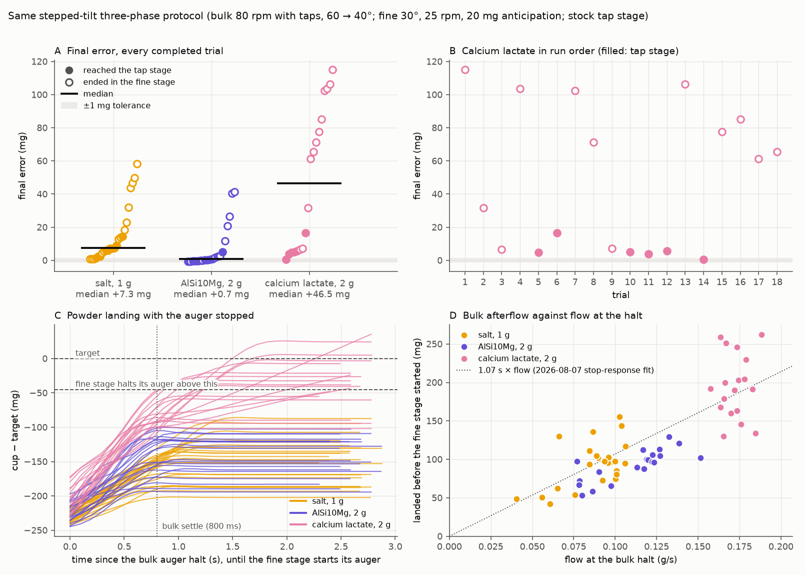
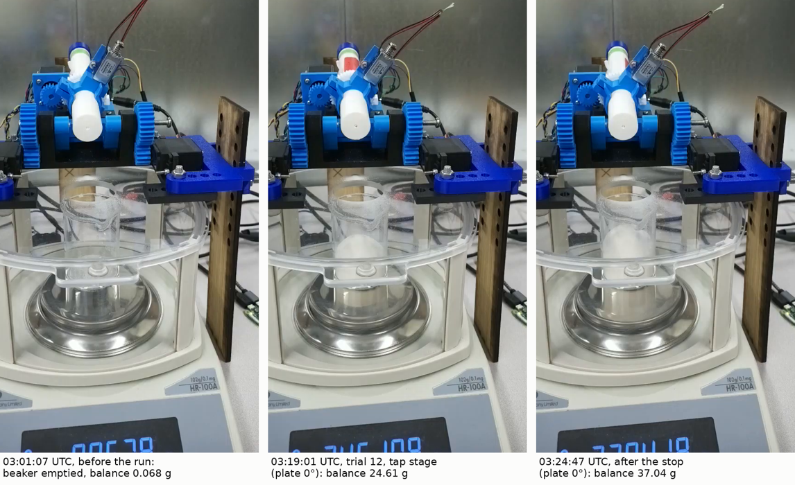

# 2 g calcium lactate trials on the salt/AlSi10Mg protocol: 18 doses, then the beaker was full (2026-11-20)

Asked by @XZaitzeff on [PR #131](https://github.com/vertical-cloud-lab/powder-doser/pull/131)
at 02:56 UTC: "calcium lactate is filled in the auger. Run the same experiment as before with new
powder. Aim for 2 gs". "Before" is the AlSi10Mg run of 2026-11-19/20
([README](../2026-11-19_alsi10mg_tilt-schedule-2g/README.md)): 30 × 2 g on the stepped-tilt
three-phase protocol, unchanged.

**Outcome:** trials 1–18 each delivered a full 2 g dose, with no priming trial, and then the launch
stopped itself on its cup cap at 03:24 (36.87 g in the beaker). With this beaker the balance goes over
range at about 43 g on its display, so 30 × 2 g can't fit; trials 19–30 need the beaker emptied.

- **Accuracy:** 1 of the 18 doses finished within ±1 mg (trial 14, +0.5 mg). The other 17 went over,
  by 4.0–115.1 mg; the median final error was **+46.5 mg**. None finished below the tolerance. On the
  same protocol AlSi10Mg landed 11 of 20 doses within ±1 mg (median +0.7 mg) and salt 3 of 24 at
  1 g (median +7.3 mg).
- **Calcium lactate keeps landing long after the bulk auger stops.** The bulk halts at 1.75 g
  (0.25 g to go) with no anticipation. By the time the fine stage started its auger, 2.3–2.8 s later,
  130–262 mg had landed (median 192 mg), about twice AlSi10Mg's 97 mg, and in four trials (1, 13, 16
  and 18) it was still landing at 25–68 mg/s. That used up most or all of the 0.25 g, so the trials
  split three ways:
  - **12 trials** found the cup already past the fine stage's halt point (1.955 g, 45 mg to go) when
    it started its auger, so the auger stopped at the first poll, about 0.2 s later. Then:
    - **6 of them** (1, 2, 3, 9, 16, 18) settled at 1.999 g or more, so the dose ended in the fine
      stage: +6.5 to +115.1 mg.
    - **6 of them** (5, 6, 10, 11, 12, 14) settled 4–38 mg short, so the tap stage took over and
      finished +0.5 to +16.4 mg (four of them +4.0 to +5.6 mg).
  - **6 trials** (4, 7, 8, 13, 15, 17) found the cup at 1.898–1.952 g, so the fine stage ran its auger
    for 0.5–2.1 s; 94–145 mg then landed after its halt, ending the dose +61.2 to +106.2 mg.
- **The tap stage doesn't walk calcium lactate in as finely as AlSi10Mg.** 57 of its 68 cycles (one tap
  and a 15° turn) added 3.3 mg or less (median of all 68: 1.0 mg), but 8 added 11–18.5 mg at once, and in 5 of
  the 6 tap-stage trials one of those came in the last three cycles.
- **Speed:** the median dose took 24 s (22–108 s). The bulk delivered 1.75 g in 15.4–16.6 s, at
  80 rpm with the plate stepping 60 → 40° on its 0.35 g bands in every trial (no no-flow steps). The
  12 doses that ended in the fine stage took 22–25 s; the tap stage, when it ran, took 31–85 s.
- **The bulk feeds fast and evenly:** a median 91 mg per auger revolution at 60° (83–103 mg across
  trials) and 118–127 mg at 55–40° (107–135 mg), i.e. 0.16–0.17 g/s; 16 revolutions per 2 g dose
  (AlSi10Mg 23, salt 12.5 per 1 g).
- **Moving the plate shakes calcium lactate loose.** In the static-tilt probe before the run (auger
  still, no taps), every tilt step from 0 to 60° dropped 11–44 mg, 105 mg in all, and the reading then
  held steady at each angle. AlSi10Mg gave 0.0 mg in the same probe.



All completed trials of three launches on the same stage settings: calcium lactate (2 g, this run),
AlSi10Mg (2 g, launches of 2026-11-19 22:43 and 2026-11-20 02:08) and salt (1 g, script `2026-11-19d`,
launch 2026-11-19 21:43, [README](../2026-11-19_salt_tilt-schedule-old-auger-80rpm/README.md)).

- **A:** final error of every completed trial, one strip per powder. Filled marks reached the tap
  stage; hollow marks ended in the fine stage. Black bars are the medians.
- **B:** calcium lactate's final error in run order. The three groups above alternate through the run;
  no drift with the falling tube level shows.
- **C:** the cup minus the target, from each bulk halt until the fine stage starts its auger, so
  only powder landing with the auger stopped. Dotted: the bulk's 800 ms settle, after which the
  controller reads the cup and hands off to the fine stage. Calcium lactate's curves cross the fine
  stage's halt line (45 mg to go) in 12 of 18 trials and the target in 6.
- **D:** the same afterflow (cup at the fine auger start minus the cup at the bulk halt) against the
  flow at the halt. Calcium lactate's flow at the halt was 0.16–0.19 g/s; its afterflow ÷ flow was
  1.13 s (median; 0.72–1.58 s), against 0.83 s for AlSi10Mg and 1.02 s for salt. Dotted line: the
  2026-08-07 stop-response fit, 1.07 s × flow.
- The figure comes from [`plot_three_powders.py`](plot_three_powders.py), which also prints the numbers
  above.



Bench camera, cropped to the tube, the beaker and the balance. Frames are the newest 2 s livestream
segment at each time, fetched on the Zero with the salt run's
[`camgrab.sh`](../2026-11-19_salt_tilt-schedule-old-auger-80rpm/camgrab.sh) and decoded on the runner;
the overlay clock (lab time, UTC−7) gives the times.

- **03:01:07, before the run:** the beaker is empty and the tube white with powder. The balance read
  0.068 g, stable, at 03:04.
- **03:19:01, trial 12's tap stage:** a white pile in the beaker; the balance reads 24.61 g.
- **03:24:47, after the stop:** plate at 0°, nothing moving; the balance reads 37.04 g.

## What ran

[`three_phase_tilt_trials.py`](../../../hardware/test-module/firmware/three_phase_tilt_trials.py)
version `2026-11-20b` ([`e18cd8d`](https://github.com/vertical-cloud-lab/powder-doser/commit/e18cd8d)),
on the Pico's own `main_three_phase.py` (sha256 prefix `6b2111e1b2447096`, unchanged since 11-18).
Every stage setting, threshold and stall rule is the AlSi10Mg run's (`2026-11-19e`/`2026-11-20a`):

- **Bulk:** 80 rpm, continuous, with one 60 ms tap per 300 ms while the auger spins. The plate steps
  60 → 55 → 50 → 45 → 40°, one step per 0.35 g, or after 3 s without a 2 mg gain. No anticipation;
  hand-off at 0.25 g to go (1.75 g), after an 800 ms settle.
- **Fine:** 30° and 25 rpm, steady, with the same taps. 20 mg anticipation, so the auger halts once
  the cup passes 1.955 g; hand-off to the tap stage at 25 mg to go (1.975 g), after a 1.5 s settle.
- **Tap stage:** stock (0°, one tap and a 15° turn at 25 rpm per cycle, ±1 mg tolerance).
- **Stall rules, thresholds and dose timeout (600 s):** stock.

What changed for this run:

- `POWDER_ID = "calcium-lactate"` (the id the #116 battery used), trials numbered from 1,
  `N_TRIALS = 30`, and 20a's extra trial if trial 1 only primed the tube (it didn't).
- **Safety stops sized to this beaker.** In the AlSi10Mg run's trial 26 the 102 g balance went over
  range at about 43.1 g on its display with this beaker on the pan. So: no trial starts once the cup
  holds more than 35.4 g (`CUP_CAP_G` 38.0 g less the 2.6 g start margin), any frame more than 40.0 g
  over the session start ends the launch, and so does any display over 41.0 g (`BAL_MAX_G`, 95 g
  before), or an overload frame. Also two failed trials in a row under 1 g, and a 90 min budget.

Checks before the run:

- The Zero was idle, the Pico port free, the clock synchronised; rig notice posted on the Zero.
- The Pico's controller files matched their 11-18 hashes; ten balance reads gave 0.068 g, stable
  (the beaker had been emptied since the AlSi10Mg run).
- CPython dry runs of `2026-11-20b` on copies of the Pico's controller files
  ([`tests/sim_three_phase_tilt_trials.py`](../../../hardware/test-module/firmware/tests/sim_three_phase_tilt_trials.py),
  with the plant's start mass set to 0.068 g): a plant feeding 3× the sim's salt ran 18 trials and
  stopped on the cup cap at 36.1 g; a tube that feeds nothing for its first 15 revolutions made trial 1
  a priming stall and the launch ran on to the cap; a tube that never feeds stopped after trials 1
  and 2.
- **Static-tilt pour probe** ([`static_tilt_probe.py`](static_tilt_probe.py),
  [log](static_tilt_probe.log), 03:05:08): plate 0 → 30 → 40 → 50 → 60 → 0°, 4 s at each angle, auger
  still, no taps, abort on a 0.5 g rise. Each step up dropped powder, then the reading held:

  | step | balance after the step | dropped |
  |---|---|---|
  | start, 0° | 0.0683 g | |
  | 0 → 30° | 0.1121 g | 43.8 mg |
  | 30 → 40° | 0.1230 g | 10.9 mg |
  | 40 → 50° | 0.1540 g | 31.0 mg |
  | 50 → 60° | 0.1730 g | 19.0 mg |
  | 60 → 0° | 0.1728 g | none |

  So calcium lactate doesn't pour from a still tube at the bulk angles (each angle held its reading
  for 4 s), but tilting the plate up knocks loose powder from the outlet. In every trial the plate goes
  0 → 60° after the baseline, so that powder counts towards the bulk.

## Trials

| trial | start (UTC) | result | final | error | dose | bulk | fine | tap stage | bulk afterflow at 800 ms | cup when the fine auger started | taps | auger revs |
|---|---|---|---|---|---|---|---|---|---|---|---|---|
| 1 | 03:06:05 | overshoot | 2.1151 g | +115.1 mg | 22.9 s | 16.4 s | 3.4 s | — | 133 mg | 2.0354 g | 36 | 16.0 |
| 2 | 03:06:43 | overshoot | 2.0317 g | +31.7 mg | 22.9 s | 16.0 s | 3.6 s | — | 135 mg | 2.0242 g | 33 | 16.4 |
| 3 | 03:07:22 | overshoot | 2.0065 g | +6.5 mg | 22.5 s | 15.9 s | 3.7 s | — | 140 mg | 1.9967 g | 33 | 16.4 |
| 4 | 03:08:00 | overshoot | 2.1037 g | +103.7 mg | 24.2 s | 15.7 s | 5.3 s | — | 143 mg | 1.9448 g | 39 | 15.5 |
| 5 | 03:08:40 | overshoot | 2.0049 g | +4.9 mg | 90.7 s | 15.9 s | 3.7 s | 12 cycles, 67.8 s | 148 mg | 1.9787 g | 47 | 15.2 |
| 6 | 03:10:25 | overshoot | 2.0164 g | +16.4 mg | 85.1 s | 16.3 s | 3.6 s | 11 cycles, 62.1 s | 168 mg | 1.9736 g | 46 | 16.9 |
| 7 | 03:12:05 | overshoot | 2.1024 g | +102.4 mg | 24.3 s | 15.6 s | 5.5 s | — | 145 mg | 1.9397 g | 42 | 15.5 |
| 8 | 03:12:45 | overshoot | 2.0713 g | +71.3 mg | 24.7 s | 16.2 s | 5.3 s | — | 131 mg | 1.9056 g | 38 | 15.5 |
| 9 | 03:13:25 | overshoot | 2.0072 g | +7.2 mg | 23.2 s | 16.4 s | 3.6 s | — | 133 mg | 2.0049 g | 37 | 16.0 |
| 10 | 03:14:04 | overshoot | 2.0050 g | +5.0 mg | 102.2 s | 16.6 s | 3.7 s | 14 cycles, 78.9 s | 135 mg | 1.9594 g | 50 | 16.6 |
| 11 | 03:16:01 | overshoot | 2.0040 g | +4.0 mg | 108.1 s | 16.0 s | 3.7 s | 15 cycles, 85.4 s | 138 mg | 1.9617 g | 49 | 16.6 |
| 12 | 03:18:03 | overshoot | 2.0056 g | +5.6 mg | 85.2 s | 16.2 s | 3.7 s | 11 cycles, 62.1 s | 147 mg | 1.9676 g | 47 | 16.5 |
| 13 | 03:19:43 | overshoot | 2.1062 g | +106.2 mg | 22.1 s | 15.4 s | 3.7 s | — | 139 mg | 1.9520 g | 34 | 14.7 |
| 14 | 03:20:21 | **ok** | 2.0005 g | +0.5 mg | 54.1 s | 15.9 s | 3.7 s | 5 cycles, 31.4 s | 146 mg | 1.9925 g | 39 | 16.2 |
| 15 | 03:21:30 | overshoot | 2.0776 g | +77.6 mg | 24.5 s | 15.9 s | 5.5 s | — | 146 mg | 1.9102 g | 40 | 15.5 |
| 16 | 03:22:10 | overshoot | 2.0852 g | +85.2 mg | 23.0 s | 16.1 s | 3.7 s | — | 142 mg | 1.9760 g | 33 | 16.0 |
| 17 | 03:22:49 | overshoot | 2.0612 g | +61.2 mg | 23.9 s | 15.8 s | 5.0 s | — | 134 mg | 1.8981 g | 37 | 15.1 |
| 18 | 03:23:28 | overshoot | 2.0654 g | +65.4 mg | 22.9 s | 16.0 s | 3.7 s | — | 138 mg | 1.9567 g | 35 | 16.4 |

- **Dose** runs from the start of the bulk to the controller's finish, and **final** is the median of
  8 readings taken 8 s after it.
- **Bulk afterflow at 800 ms** is the controller's own settled reading minus the cup at the halt, as
  in the earlier READMEs. More landed after it: **cup when the fine auger started** is the last
  balance frame before the fine stage's auger started, 2.3–2.8 s after the bulk halt.
- No trial needed priming, stalled, or took a no-flow tilt step.

### Bulk flow by plate angle

Computed as in the AlSi10Mg README (`bulk_by_angle` in
[`plot_alsi10mg_vs_salt.py`](../2026-11-19_alsi10mg_tilt-schedule-2g/plot_alsi10mg_vs_salt.py)): the mass
gained while the auger spins at each angle, over the time spent there, all 18 trials. Powder in flight
still lands after a step, so some of each angle's mass lands while the plate is at the next one.

| plate | calcium lactate per auger rev, median (range) | g/s, median | time at the angle | AlSi10Mg per rev | salt per rev (1 g run) |
|---|---|---|---|---|---|
| 60° | 91 mg (83–103) | 0.122 | 3.0 s | 71 mg | 58 mg |
| 55° | 118 mg (107–122) | 0.157 | 2.0 s | 76 mg | 78 mg |
| 50° | 121 mg (113–128) | 0.161 | 1.9 s | 86 mg | 70 mg |
| 45° | 124 mg (116–133) | 0.166 | 1.8 s | 89 mg | 71 mg |
| 40° | 127 mg (115–135) | 0.169 | 1.8 s | 84 mg | 69 mg |

The AlSi10Mg and salt columns are those READMEs' medians. In the #116 battery (2026-08-05, 30 rpm,
[report](../../../docs/battery-runs/2026-08-05-calcium-lactate.md)) calcium lactate gave 198 and
232 mg per revolution at tilt settings 45 and 90 (22.5° and 45° of tube tilt), with the tightest
spread of any powder; it gives less per revolution at higher speed, which fits the lower figures at
80 rpm here.

## Timeline (UTC, 2026-11-20)

| time | what | result |
|---|---|---|
| 02:56 | Request | |
| 02:57–03:05 | Preflight, nothing moving | Zero idle, port free, clock synchronised. Rig notice posted on the Zero. Camera (03:01): beaker empty, tube white with powder. Pico files unchanged, balance 0.068 g stable (03:04). CPython dry runs. Script `2026-11-20b` pushed (`e18cd8d`, 03:04:49). |
| 03:05:08 | Static-tilt pour probe | 105 mg dropped over the steps up to 60°; steady at every angle. |
| 03:05:58 | **Launch** ([`launch1_0305Z/`](launch1_0305Z/)) | Trials 1–18, 38–122 s each including the pre- and post-roll. |
| 03:19:01 | Bench-camera check | Trial 12's tap stage; a white pile in the beaker, balance 24.61 g. |
| 03:24:07 | Cup cap | 36.869 g in the cup after trial 18, over the 35.4 g start limit: the script stopped the auger and the taps, put the plate at 0° and exited. |
| 03:24–03:25 | Rig restored | Pico soft-rebooted into its power-on `main.py` (`[rig] ready`, servo at 0.0°). The rig notice on the Zero was marked done, asking for the beaker to be emptied. |

The balance read 0.0683 g before the probe, 0.1724 g at the session start, and 37.0411 g at the last
frame, so the beaker now holds about **37.0 g of calcium lactate** (36.869 g from the trials, 0.104 g
from the probe). It needs emptying before the next run.

## What the data say

- **The protocol that suits AlSi10Mg overshoots calcium lactate.** Same stages, speeds and
  thresholds: 1 of 18 doses within ±1 mg, median +46.5 mg, against 11 of 20 and +0.7 mg for AlSi10Mg.
- **The cause is afterflow, mostly the bulk's.** Calcium lactate feeds about 1.4× as much per
  revolution as AlSi10Mg at the same 80 rpm, and after the auger halts it keeps landing about as
  long relative to that flow (1.13 s against 0.83 s), so twice the mass lands: a median 192 mg of the
  bulk's 250 mg margin. The controller reads the cup after an 800 ms settle, while 50 mg or more is
  still to land, and hands a nearly full cup to the fine stage. The fine stage's 20 mg anticipation,
  set for salt, is far too small for what then lands after its own halt (94–145 mg in the six trials
  where it ran its auger).
- **The doses are fast and the bulk is very repeatable**: 22–25 s for the 12 doses that ended in the
  fine stage, and the bulk's flow at each angle varied much less than AlSi10Mg's (115–135 mg per
  revolution at 40° across trials, against 55–115 mg).
- **The tap stage reached ±1 mg once in 6 tries.** Its typical cycle (median 1.0 mg) is fine enough,
  but calcium lactate also comes off in 11–18.5 mg lumps.
- **Tilting the plate up drops powder** (the pour probe), so with this powder every tilt move is also a
  small, uncontrolled dose.

## What would let the 2 g doses land

These would change the experiment, so they are for the requester. Each is a one-line change in
[`three_phase_tilt_trials.py`](../../../hardware/test-module/firmware/three_phase_tilt_trials.py):

- **Bulk anticipation of about 0.20 g** (`"anticipation_g"` in `build_phases()`'s bulk dict, now 0),
  i.e. about 1.1 s × the 0.17 g/s flow at the halt, so the bulk's afterflow lands near 1.75 g rather
  than near 1.95 g. Raising the bulk hand-off instead (`t1`, now 0.25 g to go) would do the same.
- **A larger fine anticipation,** about 100–150 mg (`FINE_ANTICIPATION_G`), from the 94–145 mg that
  landed after the fine halts here.
- **A longer bulk settle** (800 ms now; the curves in panel C flatten after 1.5–2.5 s), so the fine
  stage starts from the real cup.
- **Smaller tap-stage turns** (15° now): at about 125 mg per revolution, 15° is about 5 mg on average
  and sometimes a lump.

To finish the 30 trials as they stand: empty the beaker (about 37 g of calcium lactate on the pan;
the balance goes over range at about 43 g displayed with this beaker), then comment `@claude`.
Trials 19–30 need about 25 g. How much calcium lactate went into the tube wasn't posted; weighing the
tube (56.716 g empty, if it's the old tube) would say how many more doses it holds. It was still
feeding normally at trial 18.

## Files

- `launch1_0305Z/`: the same layout and columns as the earlier launches (see the
  [11-18 README](../2026-11-18_salt_tilt-schedule/README.md#files)).
  - `trial_NN_<date>_<HHMMSS>Z.csv`: every balance frame of one trial, 8–9 per second. `taps_cum`
    counts the taps. Every row carries `powder_id` `calcium-lactate`.
  - `trials_summary.csv`
  - `session_launch1.log`: the raw stamped telemetry
  - the three figures from `scripts/analyze_tilt_trials.py` (`tilt_trials_overview.png`: one panel
    per trial; `tilt_trials_summary.png`; `tilt_trial_example.png`)
- `three_powders.png` and its script [`plot_three_powders.py`](plot_three_powders.py).
- `camera_0301Z_0319Z_0324Z.png`: the camera crops above.
- `static_tilt_probe.py` and `static_tilt_probe.log`: the pour probe (the AlSi10Mg run's
  `alsi_static_probe.py` with a new header).
- `run.sh`: the Zero-side launcher. It pipes `mpremote run` through `stamp.py` into the session log,
  as in the [11-18 morning reproduce section](../2026-11-18_salt_tilt-schedule/README.md#reproduce).

## Reproduce

```bash
mpremote connect /dev/ttyACM0 run static_tilt_probe.py | python -u stamp.py static_tilt_probe.log
mpremote connect /dev/ttyACM0 run three_phase_tilt_trials.py \
  | python -u stamp.py session.log      # stamp.py writes "<time.time()>\t<line>"
python scripts/analyze_tilt_trials.py session.log --out <dir> [--upload --extra-json '{...}']
python plot_three_powders.py
```

MongoDB `powder_doser.dose_runs` has one document per trial (`doc_type: "three_phase_tilt_trial"`, 18)
and one for the launch (`doc_type: "three_phase_tilt_session"`), all with
`session_id: "tilt30-2026-11-20T03:06:05"`, `powder_id: "calcium-lactate"`,
`script_version: "2026-11-20b"`, `bulk_rpm: 80`, `launch: "c1"`, `requested_by: "XZaitzeff"` and
`commit: "a52533b"`; read back after the upload.
