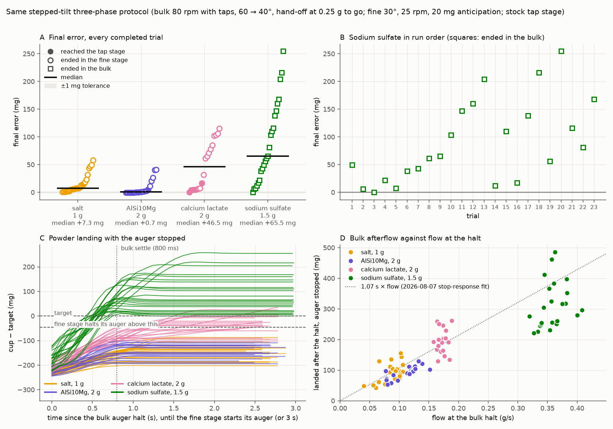
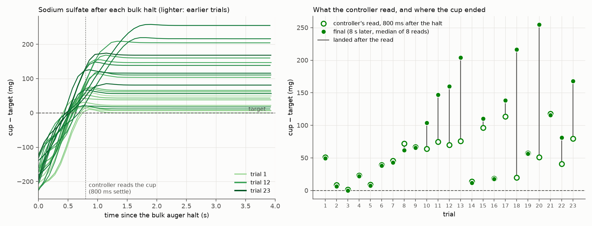
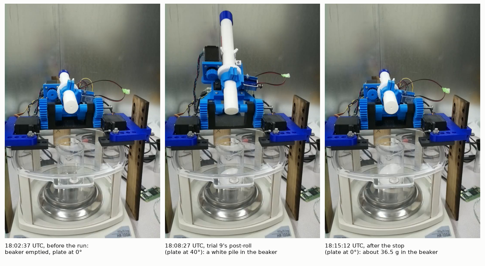

# 1.5 g sodium sulfate trials on the barium chloride protocol: 23 fast doses, all ended in the bulk (2026-11-20)

Asked by @XZaitzeff on [PR #131](https://github.com/vertical-cloud-lab/powder-doser/pull/131)
at 17:56 UTC: "Try again now that i replaced the BaCl auger with a sodium sulfate auger". "Again" is
the barium chloride run of 17:34 UTC ([README](../2026-11-20_barium-chloride_tilt-schedule-1p5g/README.md)),
which got nothing out of its tube: a static-tilt pour probe, then up to 30 × 1.5 g on the stepped-tilt
three-phase protocol (the calcium lactate run's settings), unchanged apart from the powder id.

**Outcome:** sodium sulfate fed readily. Trials 1–23 each delivered a dose in **11.2–12.6 s**, and the
launch stopped itself on its cup cap at 18:14:59 with **36.546 g** in the beaker (no trial starts past
35.9 g with this beaker). Every dose ended in the bulk stage: the fine and tap stages never ran.

- **Accuracy:** 1 of the 23 doses finished within ±1 mg (trial 3, −0.1 mg). The other 22 went over, by
  6.4–254.9 mg; the median final error was **+65.5 mg**. The controller marked all 23 `overshoot`, since
  its own read was over 1.501 g each time. On the same protocol calcium lactate's median was +46.5 mg
  (2 g), AlSi10Mg's +0.7 mg (2 g) and salt's +7.3 mg (1 g).
- **Sodium sulfate feeds fast:** about 0.34–0.45 g/s, or 250–340 mg per auger revolution, at 55–40° and
  80 rpm. That is about 2.3× calcium lactate per revolution, the fastest of the four powders. The bulk
  auger ran only 4.1–4.9 s (5.3–6.7 revolutions) to its halt at 0.25 g to go; the first powder reached
  the beaker about 0.9 s after it started.
- **The bulk's afterflow is bigger than its 0.25 g margin.** The bulk halts at 1.25 g with no
  anticipation and reads the cup after an 800 ms settle. By then 222–339 mg had landed (median 277 mg),
  so in every trial the cup was already at or past 1.5 g when the bulk handed over, and the dose ended
  there. Relative to the flow at the halt (0.32–0.41 g/s), the afterflow was 0.84 s × flow (median;
  0.65–1.34 s), close to the other powders (AlSi10Mg 0.83 s, salt 1.02 s, calcium lactate 1.13 s). It's
  the flow that is large.
- **The afterflow grew during the run.** In trials 1–9 nearly all of it had landed by the controller's
  read, which came within 10 mg of the final mass, and the cup was steady 1.0–1.2 s after the halt
  (median error +38.1 mg). From trial 10 on, in 10 of the 14 trials a second wave of **14–204 mg** landed
  after the read, until 1.2–2.1 s after the halt (median error +127.1 mg; total afterflow up to 485 mg). The flow at the halt rose
  only about 8% between the two groups (median 0.339 → 0.366 g/s).
- **No pour from a still tube:** in the static-tilt probe (auger still, no taps) sodium sulfate stayed in
  the tube from 0 to 60°, and the tilt steps knocked nothing loose (calcium lactate dropped 105 mg).



All completed trials of four launches on the same stage settings: sodium sulfate (1.5 g, this run),
calcium lactate (2 g, 03:05 UTC, [README](../2026-11-20_calcium-lactate_tilt-schedule-2g/README.md)),
AlSi10Mg (2 g, launches of 2026-11-19 22:43 and 2026-11-20 02:08) and salt (1 g, script `2026-11-19d`,
launch 2026-11-19 21:43). Barium chloride has no completed trials to show.

- **A:** final error of every completed trial, one strip per powder. Filled circles reached the tap stage,
  hollow circles ended in the fine stage, hollow squares ended in the bulk. Black bars are the medians.
- **B:** sodium sulfate's final error in run order.
- **C:** the cup minus the target from each bulk halt until the fine stage starts its auger, or for 3 s
  when no later stage turned it (all of sodium sulfate's trials), so only powder landing with the auger
  stopped. Dotted: the bulk's 800 ms settle, after which the controller reads the cup and hands over.
  Sodium sulfate's curves cross the target in every trial, 0.47–0.77 s after the halt, before the settle
  ends.
- **D:** that afterflow against the flow at the halt. Dotted line: the 2026-08-07 stop-response fit,
  1.07 s × flow.



- **Left:** the cup for 4 s after each bulk halt, lighter for earlier trials. The early trials level off
  about 1 s after the halt; several later ones keep rising until 1.5–2 s.
- **Right:** per trial, the cup at the controller's read (hollow, 800 ms after the halt) and the final
  mass (filled, the median of 8 readings 8 s later). The grey bar is what landed after the controller
  had read the cup. The readings are relative to each trial's baseline at 0°; the read and the final are
  taken at the bulk's last angle (40°), which adds about 1–2 mg of tilt offset on the balance (the
  baseline of the next trial, back at 0°, read 0.9–2.3 mg below the previous final).
- Both figures come from [`plot_four_powders.py`](plot_four_powders.py), which also prints the numbers
  quoted here.



Bench camera, cropped to the tube, the beaker and the balance. Frames are 2 s livestream segments fetched
on the Zero with the salt run's
[`camgrab.sh`](../2026-11-19_salt_tilt-schedule-old-auger-80rpm/camgrab.sh) and
[`camat.py`](../2026-11-19_salt_tilt-schedule-old-auger-80rpm/camat.py) and decoded on the runner; the
overlay clock (lab time, UTC−7) gives the times.

- **18:02:37, before the run:** plate at 0°, the beaker empty on the pan.
- **18:08:27, trial 9's post-roll:** plate at 40°, a white pile in the beaker.
- **18:15:12, after the stop:** plate at 0°, nothing moving; about 36.5 g in the beaker.

## What ran

[`three_phase_tilt_trials.py`](../../../hardware/test-module/firmware/three_phase_tilt_trials.py)
version `2026-11-20d` ([`10b5f0f`](https://github.com/vertical-cloud-lab/powder-doser/commit/10b5f0f)),
on the Pico's own `main_three_phase.py` (sha256 prefix `6b2111e1b2447096`, unchanged since 11-18).
The only change from the barium chloride run's `2026-11-20c` is `POWDER_ID = "sodium-sulfate"`:

- **Bulk:** 80 rpm, continuous, with one 60 ms tap per 300 ms while the auger spins. The plate steps
  60 → 55 → 50 → 45 → 40°, one step per 0.25 g band, or after 3 s without a 2 mg gain. No
  anticipation; hand-off at 0.25 g to go (1.25 g), after an 800 ms settle.
- **Fine:** 30° and 25 rpm with the same taps, 20 mg anticipation; hand-off at 25 mg to go.
- **Tap stage, stall rules, thresholds and dose timeout (600 s):** stock.
- **Target 1.5 g**, trials numbered from 1, `N_TRIALS = 30`, with the extra trial if trial 1 only
  primes the tube (it didn't).
- **Safety stops** (20b/20c's, same beaker): no trial starts once the cup holds more than 35.9 g
  (`CUP_CAP_G` 38.0 g less the 2.1 g start margin); any frame more than 40.0 g over the session start, any
  display over 41.0 g, or an overload frame ends the launch; so do two failed trials in a row under
  0.75 g, and a 75 min budget. 30 × 1.5 g can't fit in this beaker, so the cap ends the launch first.

Checks before the run:

- The Zero was idle, the Pico port free, the clock synchronised, and nobody else was logged in. Rig
  notice posted on the Zero (18:01).
- The Pico's controller files matched their 11-18 hashes; ten balance reads gave 0.0003 g, stable (the
  balance had been re-zeroed since the barium chloride run, which ended at −0.03 g with a few mg in the
  beaker).
- CPython dry runs of `2026-11-20d` on copies of the Pico's controller files
  ([`tests/sim_three_phase_tilt_trials.py`](../../../hardware/test-module/firmware/tests/sim_three_phase_tilt_trials.py),
  start mass 0.0003 g): the sim's salt plant ran 24 trials and stopped on the cup cap at 36.0 g; a plant
  feeding 3× as much, 24 trials, cap at 36.1 g; a tube that feeds nothing (auger or taps) for its first
  15 revolutions made trial 1 a priming stall and ran on to the cap; a tube that never feeds stopped
  after trials 1 and 2.
- **Static-tilt pour probe** ([`static_tilt_probe.py`](static_tilt_probe.py),
  [log](static_tilt_probe.log), 18:03:35): plate 0 → 30 → 40 → 50 → 60 → 0°, 4 s at each angle, auger
  still, no taps, abort on a 0.5 g rise. Sodium sulfate stayed in the tube:

  | step | balance after the step | change |
  |---|---|---|
  | start, 0° | 0.0002 g | |
  | 0 → 30° | 0.0015 g | +1.3 mg |
  | 30 → 40° | 0.0022 g | +0.7 mg |
  | 40 → 50° | 0.0029 g | +0.7 mg |
  | 50 → 60° | 0.0033 g | +0.4 mg |
  | 60 → 0° | 0.0007 g | −2.6 mg |

  The 3 mg rise and fall follows the plate (its tilt shifts the balance reading, as in the barium
  chloride probe), so nothing poured, and unlike calcium lactate (105 mg) the tilt steps knocked
  nothing loose.

## Trials

| trial | start (UTC) | result | final | error | dose | bulk | bulk halt read | controller's read (800 ms) | final − halt | flow at the halt | taps | auger revs |
|---|---|---|---|---|---|---|---|---|---|---|---|---|
| 1 | 18:04:17 | overshoot | 1.5493 g | +49.3 mg | 12.6 s | 9.4 s | 1.2739 g | 1.5510 g | 275 mg | 0.319 g/s | 13 | 6.7 |
| 2 | 18:04:46 | overshoot | 1.5064 g | +6.4 mg | 12.3 s | 9.4 s | 1.2615 g | 1.5086 g | 245 mg | 0.338 g/s | 13 | 5.3 |
| 3 | 18:05:14 | overshoot | 1.4999 g | -0.1 mg | 11.6 s | 8.7 s | 1.2507 g | 1.5015 g | 249 mg | 0.339 g/s | 13 | 5.3 |
| 4 | 18:05:42 | overshoot | 1.5219 g | +21.9 mg | 12.4 s | 9.3 s | 1.2954 g | 1.5233 g | 226 mg | 0.334 g/s | 12 | 5.3 |
| 5 | 18:06:10 | overshoot | 1.5074 g | +7.4 mg | 11.9 s | 8.7 s | 1.2531 g | 1.5091 g | 254 mg | 0.340 g/s | 11 | 6.7 |
| 6 | 18:06:38 | overshoot | 1.5381 g | +38.1 mg | 12.3 s | 9.1 s | 1.3169 g | 1.5393 g | 221 mg | 0.327 g/s | 11 | 6.7 |
| 7 | 18:07:06 | overshoot | 1.5432 g | +43.2 mg | 12.0 s | 8.9 s | 1.3123 g | 1.5455 g | 231 mg | 0.354 g/s | 11 | 5.3 |
| 8 | 18:07:34 | overshoot | 1.5616 g | +61.6 mg | 12.4 s | 9.2 s | 1.3061 g | 1.5719 g | 256 mg | 0.358 g/s | 13 | 6.7 |
| 9 | 18:08:02 | overshoot | 1.5655 g | +65.5 mg | 11.7 s | 8.9 s | 1.2611 g | 1.5665 g | 304 mg | 0.343 g/s | 12 | 5.3 |
| 10 | 18:08:30 | overshoot | 1.6036 g | +103.6 mg | 12.1 s | 9.0 s | 1.2785 g | 1.5642 g | 325 mg | 0.356 g/s | 12 | 5.3 |
| 11 | 18:08:58 | overshoot | 1.6467 g | +146.7 mg | 11.9 s | 8.7 s | 1.2806 g | 1.5750 g | 366 mg | 0.353 g/s | 12 | 6.7 |
| 12 | 18:09:26 | overshoot | 1.6601 g | +160.1 mg | 12.3 s | 9.0 s | 1.2768 g | 1.5699 g | 383 mg | 0.361 g/s | 11 | 5.3 |
| 13 | 18:09:54 | overshoot | 1.7043 g | +204.3 mg | 11.7 s | 9.0 s | 1.2922 g | 1.5761 g | 412 mg | 0.345 g/s | 12 | 6.7 |
| 14 | 18:10:22 | overshoot | 1.5117 g | +11.7 mg | 12.0 s | 8.7 s | 1.2613 g | 1.5141 g | 250 mg | 0.365 g/s | 12 | 5.3 |
| 15 | 18:10:49 | overshoot | 1.6104 g | +110.4 mg | 11.9 s | 8.6 s | 1.2578 g | 1.5965 g | 353 mg | 0.383 g/s | 14 | 5.3 |
| 16 | 18:11:17 | overshoot | 1.5175 g | +17.5 mg | 12.0 s | 8.9 s | 1.2566 g | 1.5182 g | 261 mg | 0.366 g/s | 11 | 6.7 |
| 17 | 18:11:45 | overshoot | 1.6384 g | +138.4 mg | 11.6 s | 8.4 s | 1.3206 g | 1.6133 g | 318 mg | 0.380 g/s | 10 | 6.7 |
| 18 | 18:12:13 | overshoot | 1.7163 g | +216.3 mg | 11.8 s | 8.8 s | 1.2540 g | 1.5199 g | 462 mg | 0.357 g/s | 10 | 5.3 |
| 19 | 18:12:41 | overshoot | 1.5564 g | +56.4 mg | 11.8 s | 8.6 s | 1.2603 g | 1.5572 g | 296 mg | 0.408 g/s | 11 | 5.3 |
| 20 | 18:13:08 | overshoot | 1.7549 g | +254.9 mg | 11.2 s | 8.4 s | 1.2696 g | 1.5508 g | 485 mg | 0.362 g/s | 12 | 5.3 |
| 21 | 18:13:35 | overshoot | 1.6158 g | +115.8 mg | 12.0 s | 8.8 s | 1.3358 g | 1.6176 g | 280 mg | 0.400 g/s | 12 | 6.7 |
| 22 | 18:14:03 | overshoot | 1.5811 g | +81.1 mg | 11.7 s | 8.7 s | 1.2642 g | 1.5408 g | 317 mg | 0.375 g/s | 11 | 5.3 |
| 23 | 18:14:31 | overshoot | 1.6682 g | +168.2 mg | 11.5 s | 8.2 s | 1.2702 g | 1.5798 g | 398 mg | 0.383 g/s | 10 | 5.3 |

- **Final** is the median of 8 readings taken after an 8 s post-roll. **Dose** is the controller's own
  elapsed time (its baseline read, the plate's move to 60°, the bulk, the settle and its read); **bulk** is
  the bulk stage alone, of which the auger ran 4.1–4.9 s.
- **Bulk halt read** is the controller's poll that halted the auger (0.25 g to go, i.e. 1.25 g); the
  **controller's read** is its bracket after the 800 ms settle, which decided the hand-off. The status is
  the controller's: its read was 1.5015–1.6176 g, all over the ±1 mg tolerance, so all 23 are `overshoot`,
  including trial 3, whose final mass was −0.1 mg.
- **Final − halt** is everything that landed after the auger stopped. **Flow at the halt** is the
  bulk's rate over its last polls, from `analyze_tilt_trials.py`.
- The plate stepped 60 → 55 → 50 → 45 → 40° on its 0.25 g bands in every trial, with no no-flow steps.
  No trial needed priming, stalled, or reached the fine stage.

### Bulk flow by plate angle

Computed as in the calcium lactate README (`bulk_by_angle` in
[`plot_four_powders.py`](plot_four_powders.py)): the mass gained while the auger spins at each angle, over
the time spent there, all 23 trials. At this flow the plate steps every 0.4–0.5 s after 60°, so each
angle has only a few frames, and powder in flight still lands after a step; read these as rough.

| plate | sodium sulfate per auger rev, median (range) | g/s, median | time at the angle | calcium lactate per rev | AlSi10Mg per rev | salt per rev (1 g run) |
|---|---|---|---|---|---|---|
| 60° | 127 mg (116–152) | 0.169 | 1.6 s | 91 mg | 71 mg | 58 mg |
| 55° | 337 mg (238–401) | 0.449 | 0.4 s | 118 mg | 76 mg | 78 mg |
| 50° | 291 mg (204–377) | 0.387 | 0.5 s | 121 mg | 86 mg | 70 mg |
| 45° | 287 mg (168–378) | 0.382 | 0.4 s | 124 mg | 89 mg | 71 mg |
| 40° | 253 mg (160–360) | 0.338 | 0.5 s | 127 mg | 84 mg | 69 mg |

The 60° row includes the start of each bulk, before the first powder reaches the beaker. The other
columns are those READMEs' medians.

## Timeline (UTC, 2026-11-20)

| time | what | result |
|---|---|---|
| 17:56 | Request | |
| 17:58–18:03 | Preflight, nothing moving | Zero idle, port free, clock synchronised, nobody else logged in. Rig notice posted on the Zero (18:01). Pico files unchanged; balance 0.0003 g stable (18:01). Camera (18:02:37): beaker empty, plate 0°. CPython dry runs. Script `2026-11-20d` pushed (`10b5f0f`, 18:03:14). |
| 18:03:35 | Static-tilt pour probe | No pour at 30–60°; net +0.5 mg back at 0°. |
| 18:04:11 | **Launch** ([`launch1_1804Z/`](launch1_1804Z/)) | Trials 1–23, 27–29 s each including the pre- and post-roll. |
| 18:04–18:11 | Bench-camera checks | Powder in the beaker from trial 1 on; the pile grows. |
| 18:14:59 | Cup cap | 36.546 g in the cup after trial 23, over the 35.9 g start limit: the script stopped the auger and the taps, put the plate at 0° and exited. |
| 18:15–18:16 | Rig restored | Pico soft-rebooted into its power-on `main.py` (`[rig] ready`, servo at 0.0°). The rig notice on the Zero was marked done, asking for the beaker to be emptied. |

The balance read 0.0003 g before the probe, 0.0008 g at the session start and 36.5464 g at the last
frame, so the beaker now holds about **36.55 g of sodium sulfate**. It needs emptying before the next run.

## What the data say

- **Sodium sulfate feeds where barium chloride didn't.** Same rig, same protocol, an hour apart: barium
  chloride gave about 3 mg in 113 auger revolutions; sodium sulfate gave 1.5 g in under 7 revolutions
  every time, from the first trial, with no priming.
- **It is the fastest powder so far on this protocol** (median dose 11.9 s; calcium lactate 24 s, salt 27 s,
  AlSi10Mg 47 s), because it feeds about 2.3× as much per revolution as calcium lactate.
- **The protocol's hand-off is too late for it.** The bulk's 0.25 g margin with no anticipation (the
  stock hand-off) leaves room for salt's 42–155 mg of afterflow; at 0.36 g/s the afterflow alone is
  0.22–0.49 g, so the cup reaches the target before
  the fine stage can start, and the doses land wherever the afterflow takes them.
- **The afterflow is not stable within a run.** The same settings gave a median of +38 mg in trials 1–9
  and +127 mg in trials 10–23, when a slower second wave started landing after the controller's 800 ms
  read. The flow at the halt changed little, so something in the tube changed as it emptied (about 1.6 g
  a trial); the camera can't show the inside of the tube.

## What would let the 1.5 g doses land

These would change the experiment, so they are for the requester. Each is a one-line change in
[`three_phase_tilt_trials.py`](../../../hardware/test-module/firmware/three_phase_tilt_trials.py):

- **Bulk anticipation of about 0.30 g** (`"anticipation_g"` in `build_phases()`'s bulk dict, now 0), i.e.
  about 0.84 s × the 0.36 g/s flow at the halt, so the afterflow lands near 1.25 g and the fine stage has
  something to do. Handing off earlier instead (`t1`, now 0.25 g to go, to about 0.55 g) would do the same.
- **A longer bulk settle** (800 ms now): from trial 10 on, powder kept landing until 1.2–2.1 s after the
  halt, so a settle of about 2.5 s would let the controller see it before deciding.
- **A slower bulk** (`BULK_RPM`, now 80): the afterflow scales with the flow, and the bulk auger runs
  only 4–5 s per dose at 80 rpm, so even half the speed would keep the doses well under 30 s.
- **A larger fine anticipation** if the fine stage then runs: at 25 rpm sodium sulfate would feed roughly
  0.1 g/s, i.e. about 85 mg of afterflow, against the 20 mg `FINE_ANTICIPATION_G` set for salt.

To run more trials as they stand: empty the beaker (about 36.5 g of sodium sulfate on the pan; the balance
goes over range at about 43 g displayed with this beaker), then comment `@claude`. How much sodium sulfate
went into the tube wasn't posted; at trial 23 it was still feeding at full rate.

## Files

- `launch1_1804Z/`: the same layout and columns as the earlier launches (see the
  [11-18 README](../2026-11-18_salt_tilt-schedule/README.md#files)).
  - `trial_NN_<date>_<HHMMSS>Z.csv`: every balance frame of one trial, 8–9 per second. `taps_cum`
    counts the taps. Every row carries `powder_id` `sodium-sulfate`.
  - `trials_summary.csv`
  - `session_launch1.log`: the raw stamped telemetry
  - the three figures from `scripts/analyze_tilt_trials.py` (`tilt_trials_overview.png`: one panel
    per trial; `tilt_trials_summary.png`; `tilt_trial_example.png`)
- `four_powders.png` and `sodium_sulfate_afterflow.png`, both from
  [`plot_four_powders.py`](plot_four_powders.py), which also prints the numbers quoted above.
- `camera_1802Z_1808Z_1815Z.png`: the camera crops above.
- `static_tilt_probe.py` and `static_tilt_probe.log`: the pour probe (the barium chloride run's, with a
  new header).
- `run.sh`: the Zero-side launcher. It pipes `mpremote run` through `stamp.py` into the session log,
  as in the [11-18 morning reproduce section](../2026-11-18_salt_tilt-schedule/README.md#reproduce).

## Reproduce

```bash
mpremote connect /dev/ttyACM0 run static_tilt_probe.py | python -u stamp.py static_tilt_probe.log
./run.sh
python scripts/analyze_tilt_trials.py launch1_1804Z/session_launch1.log --out launch1_1804Z [--upload --extra-json '{...}']
python plot_four_powders.py
```

MongoDB `powder_doser.dose_runs` has one document per trial (`doc_type: "three_phase_tilt_trial"`, 23)
and one for the launch (`doc_type: "three_phase_tilt_session"`, with the pour probe's result), all with
`session_id: "tilt30-2026-11-20T18:04:17"`, `powder_id: "sodium-sulfate"`, `script_version: "2026-11-20d"`,
`bulk_rpm: 80`, `launch: "ss1"`, `requested_by: "XZaitzeff"` and `commit: "c84cc06"`; read back after the
upload.
