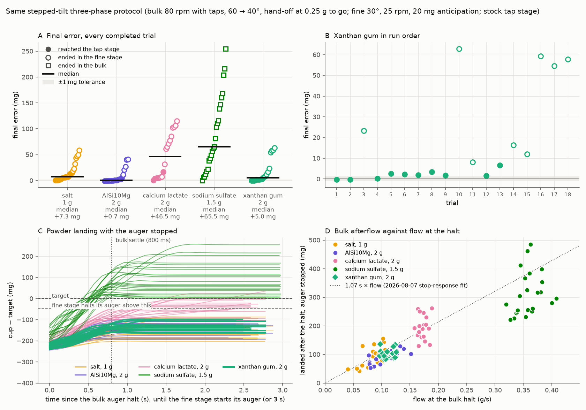
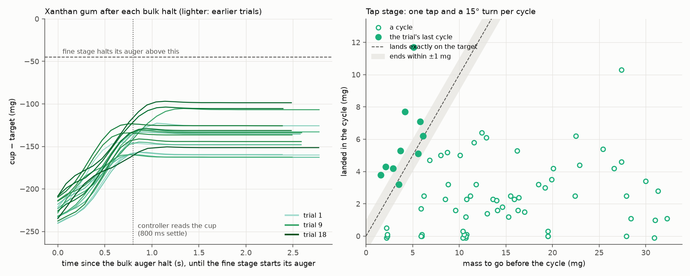
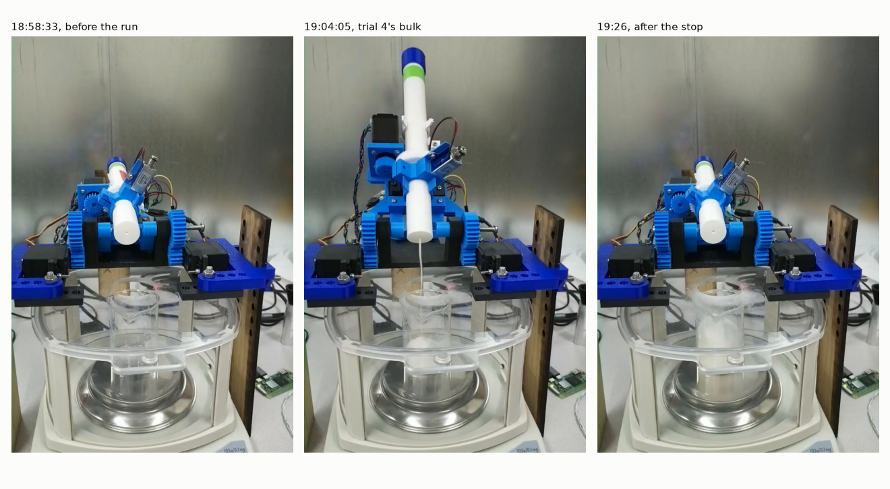

# 2 g xanthan gum trials on the sodium sulfate protocol: 18 doses, then the beaker was full (2026-11-20)

Asked by @XZaitzeff on [PR #131](https://github.com/vertical-cloud-lab/powder-doser/pull/131)
at 18:52 UTC: "I replaced the auger with xantham gum. Rerun the experiment aiming for 2 grams". "The
experiment" is the sodium sulfate run of 18:04 UTC ([README](../2026-11-20_sodium-sulfate_tilt-schedule-1p5g/README.md)):
a static-tilt pour probe, then up to 30 trials on the stepped-tilt three-phase protocol, unchanged apart
from the powder id and, here, the 2 g target (as in the calcium lactate run,
[README](../2026-11-20_calcium-lactate_tilt-schedule-2g/README.md)).

**Outcome:** xanthan gum fed from the first trial, with no priming. Trials 1–18 each delivered a 2 g dose,
and the launch stopped itself on its cup cap at 19:20:28 with **36.313 g** in the cup (no trial starts
past 35.4 g with this beaker).

- **Accuracy:** 3 of the 18 doses finished within ±1 mg (trials 1, 2 and 4: −0.3, −0.3 and +0.2 mg),
  6 within ±2 mg and 9 within ±5 mg. None finished more than 0.3 mg short. The median final error was
  **+5.0 mg** (range −0.3 to +62.9 mg). On the same protocol AlSi10Mg's median was +0.7 mg (2 g), salt's
  +7.3 mg (1 g), calcium lactate's +46.5 mg (2 g) and sodium sulfate's +65.5 mg (1.5 g).
- **The doses split by where they ended:**
  - **10 reached the tap stage** (trials 1, 2, 4–9, 12, 13) and finished −0.3 to +6.6 mg (median
    +1.8 mg), in 60–95 s.
  - **8 ended in the fine stage** (trials 3, 10, 11, 14–18), at +8.1 to +62.9 mg (median +39.0 mg), in
    30–33 s. Seven of them came in trials 10–18, and the last five trials all ended there.
- **The bulk is well behaved.** At 80 rpm with the plate stepping 60 → 40° on its 0.35 g bands, the
  bulk fed about 67–78 mg per auger revolution (0.09–0.105 g/s), similar to AlSi10Mg, and ran 21.4–23.5 s
  to its halt at 0.25 g to go. The afterflow, 84–136 mg (median 95 mg) by the time the fine stage started
  its auger 2.4–2.8 s after the halt, fitted inside the 0.25 g margin in every trial, so the fine stage
  always started with 99–163 mg to go. Relative to the flow at the halt (0.097–0.126 g/s) the afterflow
  was 0.87 s × flow (median), close to the other powders.
- **What decides the split is the fine stage's afterflow.** The fine auger halts once the cup passes
  1.955 g (45 mg to go, with 20 mg anticipation); it read 1.955–1.987 g at the halt. By its 1.5 s
  settle another 8–92 mg had landed. When that carried the cup past 2.001 g the dose ended there, over
  the target; when it didn't, the tap stage finished. That afterflow grew through the run: 8–36 mg in
  trials 1–9 except trial 3 (48 mg), 21–92 mg in trials 10–18, and 79–85 mg in trials 16–18, although
  the fine stage's flow at the halt was lower in those trials (0.032–0.037 g/s, against 0.05–0.08 g/s
  early on).
- **The tap stage walks xanthan gum in a few mg at a time.** Over its 73 cycles (one tap and a 15° turn
  at 0°) the median cycle added 2.5 mg (−0.1 to 11.7 mg; 17 cycles under 0.5 mg, and 3 lip-empty
  nudges). That step is wider than the ±1 mg window, so the last cycle usually went past it: in 7 of the
  10 tap-stage trials it ended +1.5 to +6.6 mg.
- **Tilting knocks some loose, but nothing pours:** in the static-tilt probe (auger still, no taps) the
  steps up to 60° dropped 88 mg in all, and the reading held at every angle.



All completed trials of five launches on the same stage settings: xanthan gum (2 g, this run), sodium
sulfate (1.5 g, 18:04 UTC), calcium lactate (2 g, 03:05 UTC), AlSi10Mg (2 g, launches of 2026-11-19
22:43 and 2026-11-20 02:08) and salt (1 g, script `2026-11-19d`, launch 2026-11-19 21:43). Barium
chloride has no completed trials to show.

- **A:** final error of every completed trial, one strip per powder. Filled circles reached the tap stage,
  hollow circles ended in the fine stage, hollow squares ended in the bulk. Black bars are the medians.
- **B:** xanthan gum's final error in run order.
- **C:** the cup minus the target from each bulk halt until the fine stage starts its auger (or for 3 s
  when no later stage turned it), so only powder landing with the auger stopped. Xanthan gum's curves are
  the thick ones. Dotted: the bulk's 800 ms settle.
- **D:** that afterflow against the flow at the halt (xanthan gum: diamonds). Dotted line: the 2026-08-07
  stop-response fit, 1.07 s × flow.



- **Left:** the cup for each trial from the bulk halt until the fine stage starts its auger, lighter for
  earlier trials. It levels off 1.0–1.3 s after the halt, 99–163 mg short of the target, well below the
  fine stage's halt line.
- **Right:** every tap-stage cycle: what landed in it against the mass to go before it. A cycle on the
  dashed line lands exactly on the target; the grey band ends within ±1 mg. Filled: each trial's last
  cycle. Most cycles land 1–6 mg whatever the gap, so the last one lands on the band only by chance.
- Both figures come from [`plot_five_powders.py`](plot_five_powders.py) (adapted from the sodium sulfate
  run's `plot_four_powders.py`), which also prints the numbers quoted here.



Bench camera, cropped to the tube, the beaker and the balance. Frames are the newest 2 s livestream
segment at each time, fetched on the Zero with the salt run's
[`camgrab.sh`](../2026-11-19_salt_tilt-schedule-old-auger-80rpm/camgrab.sh) and decoded on the runner; the
overlay clock (lab time, UTC−7) gives the first two times.

- **18:58:33, before the run:** plate at 0°, the beaker empty.
- **19:04:05, trial 4's bulk:** the tube near vertical, a thin stream of xanthan gum falling into the
  beaker.
- **19:26, after the stop:** plate at 0°, nothing moving; about 36.4 g in the beaker.

## What ran

[`three_phase_tilt_trials.py`](../../../hardware/test-module/firmware/three_phase_tilt_trials.py)
version `2026-11-20e` ([`ddd33e4`](https://github.com/vertical-cloud-lab/powder-doser/commit/ddd33e4)),
on the Pico's own `main_three_phase.py` (sha256 prefix `6b2111e1b2447096`, unchanged since 11-18).
Every stage setting, threshold and stall rule is the sodium sulfate run's (`2026-11-20d`), which are
the calcium lactate run's (`2026-11-20b`):

- **Bulk:** 80 rpm, continuous, with one 60 ms tap per 300 ms while the auger spins. The plate steps
  60 → 55 → 50 → 45 → 40°, one step per 0.35 g, or after 3 s without a 2 mg gain. No anticipation;
  hand-off at 0.25 g to go (1.75 g), after an 800 ms settle.
- **Fine:** 30° and 25 rpm, steady, with the same taps. 20 mg anticipation, so the auger halts once
  the cup passes 1.955 g; hand-off to the tap stage at 25 mg to go (1.975 g), after a 1.5 s settle.
- **Tap stage:** stock (0°, one tap and a 15° turn at 25 rpm per cycle, ±1 mg tolerance).
- **Stall rules, thresholds and dose timeout (600 s):** stock.

What changed for this run:

- `POWDER_ID = "xanthan-gum"` (the id the #116 battery used) and **`TARGET_G = 2.0`** (1.5 g for barium
  chloride and sodium sulfate). What scales with the target is the calcium lactate run's 2 g values
  again: 0.35 g tilt bands, a failed trial counts towards the two-in-a-row stop only if it delivered
  under 1.0 g, and no trial starts once the cup holds more than 35.4 g (`CUP_CAP_G` 38.0 g less the
  2.6 g start margin).
- The other safety stops are 20b–20d's, for the same beaker: any frame more than 40.0 g over the
  session start, any display over 41.0 g, or an overload frame ends the launch.
- **A 24 min time budget** (75 min in 20c/d): no trial starts after it, so the launch would end while
  this Actions session could still push the results. At calcium lactate's pace the cup cap would
  have ended it first.

Checks before the run:

- The Zero was idle, the Pico port free, the clock synchronised, and nobody else was logged in. Rig
  notice posted on the Zero (18:56).
- The Pico's controller files matched their 11-18 hashes; ten balance reads gave 0.0223 g, stable
  (18:57). The beaker had been emptied since the sodium sulfate run (36.5 g).
- CPython dry runs of `2026-11-20e` on copies of the Pico's controller files
  ([`tests/sim_three_phase_tilt_trials.py`](../../../hardware/test-module/firmware/tests/sim_three_phase_tilt_trials.py),
  start mass 0.0223 g): the sim's salt plant ran 13 trials and stopped on the 24 min budget (26.0 g);
  a plant feeding 3.5× as much, 18 trials, stopped on the cup cap at 36.2 g; a tube that feeds nothing
  for its first 15 revolutions ran 13 trials to the budget; a tube that never feeds stopped after
  trials 1 and 2.
- **Static-tilt pour probe** ([`static_tilt_probe.py`](static_tilt_probe.py),
  [log](static_tilt_probe.log), 18:58:40): plate 0 → 30 → 40 → 50 → 60 → 0°, 4 s at each angle, auger
  still, no taps, abort on a 0.5 g rise. Two of the steps up dropped powder; at every angle the reading
  then held:

  | step | balance after the step | change |
  |---|---|---|
  | start, 0° | 0.0223 g | |
  | 0 → 30° | 0.0271 g | +4.8 mg |
  | 30 → 40° | 0.0573 g | +30.2 mg |
  | 40 → 50° | 0.0573 g | 0.0 mg |
  | 50 → 60° | 0.1108 g | +53.5 mg |
  | 60 → 0° | 0.1107 g | −0.1 mg |

  So xanthan gum doesn't pour from a still tube at the bulk angles, but tilting the plate knocked
  88 mg loose from the outlet (calcium lactate 105 mg; sodium sulfate and barium chloride nothing).
  In every trial the plate goes 0 → 60° after the baseline, so that powder counts towards the bulk.

## Trials

| trial | start (UTC) | result | final | error | dose | bulk | fine | tap stage | bulk afterflow at 800 ms | cup when the fine auger started | taps | auger revs |
|---|---|---|---|---|---|---|---|---|---|---|---|---|
| 1 | 18:59:21 | **ok** | 1.9997 g | −0.3 mg | 82.8 s | 23.0 s | 5.9 s | 9 cycles, 50.6 s | 90 mg | 1.8520 g | 75 | 27.0 |
| 2 | 19:00:58 | **ok** | 1.9997 g | −0.3 mg | 94.7 s | 23.0 s | 6.1 s | 11 cycles, 62.5 s | 89 mg | 1.8399 g | 78 | 26.6 |
| 3 | 19:02:48 | overshoot | 2.0233 g | +23.3 mg | 33.0 s | 23.5 s | 6.4 s | — | 93 mg | 1.8743 g | 69 | 26.6 |
| 4 | 19:03:36 | **ok** | 2.0002 g | +0.2 mg | 71.9 s | 22.3 s | 6.4 s | 7 cycles, 40.1 s | 91 mg | 1.8404 g | 70 | 26.9 |
| 5 | 19:05:03 | overshoot | 2.0026 g | +2.6 mg | 63.1 s | 22.8 s | 6.1 s | 5 cycles, 31.2 s | 94 mg | 1.8645 g | 71 | 25.1 |
| 6 | 19:06:21 | overshoot | 2.0022 g | +2.2 mg | 67.0 s | 22.6 s | 6.7 s | 6 cycles, 34.6 s | 85 mg | 1.8372 g | 71 | 25.9 |
| 7 | 19:07:42 | overshoot | 2.0019 g | +1.9 mg | 82.6 s | 22.8 s | 5.8 s | 9 cycles, 50.8 s | 96 mg | 1.8520 g | 74 | 27.0 |
| 8 | 19:09:19 | overshoot | 2.0034 g | +3.4 mg | 63.4 s | 23.0 s | 6.1 s | 5 cycles, 31.2 s | 102 mg | 1.8671 g | 71 | 26.8 |
| 9 | 19:10:37 | overshoot | 2.0017 g | +1.7 mg | 82.6 s | 22.3 s | 6.2 s | 9 cycles, 50.9 s | 85 mg | 1.8374 g | 75 | 25.6 |
| 10 | 19:12:15 | overshoot | 2.0629 g | +62.9 mg | 32.7 s | 23.4 s | 6.3 s | — | 108 mg | 1.8932 g | 67 | 26.6 |
| 11 | 19:13:03 | overshoot | 2.0081 g | +8.1 mg | 32.0 s | 22.6 s | 6.3 s | — | 98 mg | 1.8661 g | 64 | 25.2 |
| 12 | 19:13:51 | overshoot | 2.0015 g | +1.5 mg | 72.7 s | 21.8 s | 5.4 s | 7 cycles, 42.3 s | 89 mg | 1.8635 g | 67 | 23.8 |
| 13 | 19:15:18 | overshoot | 2.0066 g | +6.6 mg | 60.0 s | 21.4 s | 6.1 s | 5 cycles, 29.3 s | 104 mg | 1.8557 g | 67 | 23.7 |
| 14 | 19:16:33 | overshoot | 2.0164 g | +16.4 mg | 30.3 s | 21.4 s | 5.6 s | — | 91 mg | 1.8744 g | 58 | 23.5 |
| 15 | 19:17:19 | overshoot | 2.0120 g | +12.0 mg | 30.5 s | 21.5 s | 6.0 s | — | 107 mg | 1.8687 g | 59 | 23.9 |
| 16 | 19:18:05 | overshoot | 2.0593 g | +59.3 mg | 30.9 s | 21.4 s | 6.2 s | — | 104 mg | 1.8945 g | 61 | 23.5 |
| 17 | 19:18:51 | overshoot | 2.0546 g | +54.6 mg | 31.6 s | 22.3 s | 6.2 s | — | 105 mg | 1.9014 g | 66 | 25.2 |
| 18 | 19:19:39 | overshoot | 2.0578 g | +57.8 mg | 33.0 s | 23.1 s | 6.6 s | — | 83 mg | 1.8486 g | 66 | 25.2 |

- **Dose** runs from the start of the bulk to the controller's finish, and **final** is the median of
  8 readings taken 8 s after it. The status is the controller's: it marks a dose `overshoot` once its own
  read is more than 1 mg over, so the 15 overshoots include trials that ended +1.5 to +3.4 mg.
- **Bulk afterflow at 800 ms** is the controller's own settled reading minus the cup at the halt. More
  landed after it: **cup when the fine auger started** is the last balance frame before the fine
  stage's auger started, 2.4–2.8 s after the bulk halt.
- The plate stepped 60 → 55 → 50 → 45 → 40° on its 0.35 g bands in every trial, with no no-flow steps.
  No trial needed priming or stalled. Trials 5, 8 and 12 each had one lip-empty nudge in the tap stage.
- The fine-stage trials took their final reading at 30° (the tap stage returns the plate to 0°); the
  plate's tilt shifts the balance by a mg or two, small against those trials' +8 to +63 mg.

### Bulk flow by plate angle

Computed as in the earlier READMEs (`bulk_by_angle` in [`plot_five_powders.py`](plot_five_powders.py)):
the mass gained while the auger spins at each angle, over the time spent there, all 18 trials. Powder in
flight still lands after a step, so some of each angle's mass lands while the plate is at the next one.

| plate | xanthan gum per auger rev, median (range) | g/s, median | time at the angle | calcium lactate per rev | AlSi10Mg per rev | salt per rev (1 g run) |
|---|---|---|---|---|---|---|
| 60° | 67 mg (63–75) | 0.090 | 3.8 s | 91 mg | 71 mg | 58 mg |
| 55° | 68 mg (63–73) | 0.091 | 3.5 s | 118 mg | 76 mg | 78 mg |
| 50° | 75 mg (71–81) | 0.099 | 3.2 s | 121 mg | 86 mg | 70 mg |
| 45° | 72 mg (67–80) | 0.096 | 3.3 s | 124 mg | 89 mg | 71 mg |
| 40° | 78 mg (69–93) | 0.105 | 3.0 s | 127 mg | 84 mg | 69 mg |

The other columns are those READMEs' medians. In the #116 battery (2026-08-06, 30 rpm,
[data](../../battery/20260806T140254Z_xanthan-gum/)) xanthan gum gave 161 and 187 mg per revolution at
tilt settings 45 and 90; the battery found it gives less per revolution at higher speed, which fits the
lower figures at 80 rpm here.

## Timeline (UTC, 2026-11-20)

| time | what | result |
|---|---|---|
| 18:52 | Request | |
| 18:53–18:58 | Preflight, nothing moving | Zero idle, port free, clock synchronised, nobody else logged in. Rig notice posted on the Zero (18:56). Pico files unchanged; balance 0.0223 g stable (18:57). CPython dry runs. Script `2026-11-20e` pushed (`ddd33e4`, 18:58). Camera (18:58:33): beaker empty, plate 0°. |
| 18:58:40 | Static-tilt pour probe | 88 mg dropped over the steps up to 60°; steady at every angle. |
| 18:59:15 | **Launch** ([`launch1_1859Z/`](launch1_1859Z/)) | Trials 1–18, 46–110 s each including the pre- and post-roll. |
| 19:04:05 | Bench-camera check | Trial 4's bulk; a thin stream into the beaker. |
| 19:20:28 | Cup cap | 36.313 g in the cup after trial 18, over the 35.4 g start limit: the script stopped the auger and the taps, put the plate at 0° and exited. |
| 19:26 | Rig restored | Pico soft-rebooted into its power-on `main.py` (`[rig] ready`, servo at 0.0°). The rig notice on the Zero was marked done, asking for the beaker to be emptied. |

The balance read 0.0223 g before the probe, 0.1108 g at the session start and 36.4238 g at the last
frame, so the beaker now holds about **36.4 g of xanthan gum** (36.313 g from the trials, 0.088 g from
the probe). It needs emptying before the next run.

## What the data say

- **Xanthan gum suits this protocol better than calcium lactate or sodium sulfate.** Its bulk feeds
  about as fast as AlSi10Mg's, so the bulk's afterflow (about 0.1 g) stays inside the 0.25 g hand-off
  margin and the fine stage always has work to do. The median error (+5.0 mg) is the second smallest of
  the five powders, after AlSi10Mg (+0.7 mg).
- **The misses come from the fine stage, not the bulk.** Its 20 mg anticipation and 25 mg exit halt
  the auger with at most 45 mg to go (14–45 mg here); when more than that lands after the halt, the
  dose is over. In the last five trials that happened every time, with 29–85 mg landing after the halt
  while the measured flow fell. More powder
  is landing after the auger stops than the flow before it predicts, which fits a cohesive powder
  building up at the outlet and dropping in clumps; the camera can't show the outlet closely enough to
  confirm it.
- **The tap stage is close, but its step is about 2.5 mg.** It never undershot, and 3 of its 10 trials
  ended within ±1 mg, but with one tap and a 15° turn per cycle most cycles add 1–6 mg.

## What would let more of the 2 g doses land

These would change the experiment, so they are for the requester. Each is a one-line change in
[`three_phase_tilt_trials.py`](../../../hardware/test-module/firmware/three_phase_tilt_trials.py):

- **A larger fine anticipation** (`FINE_ANTICIPATION_G`, now 20 mg, set for salt): about 60–80 mg would
  have kept the late trials' fine afterflow under the target, at the cost of a longer tap stage in the
  early ones. Or hand off earlier (`t2`, now 25 mg to go).
- **A slower fine stage** (`FINE_RPM`, now 25): the fine stage only runs about 6 s, so half the speed
  would cost a few seconds a dose.
- **A smaller tap-stage step:** taps without the 15° turn, or a smaller turn, once the cup is within
  about 5 mg.

To run more trials as they stand: empty the beaker (about 36.4 g of xanthan gum on the pan; the balance
goes over range at about 43 g displayed with this beaker), then comment `@claude`. How much xanthan gum
went into the tube wasn't posted; at trial 18 it was still feeding at full rate.

## Files

- `launch1_1859Z/`: the same layout and columns as the earlier launches (see the
  [11-18 README](../2026-11-18_salt_tilt-schedule/README.md#files)).
  - `trial_NN_<date>_<HHMMSS>Z.csv`: every balance frame of one trial, 8–9 per second. `taps_cum`
    counts the taps. Every row carries `powder_id` `xanthan-gum`.
  - `trials_summary.csv`
  - `session_launch1.log`: the raw stamped telemetry
  - the three figures from `scripts/analyze_tilt_trials.py` (`tilt_trials_overview.png`: one panel
    per trial; `tilt_trials_summary.png`; `tilt_trial_example.png`)
- `five_powders.png` and `xanthan_gum_bulk_halt_and_taps.png`, both from
  [`plot_five_powders.py`](plot_five_powders.py), which also prints the numbers quoted above.
- `camera_1858Z_1904Z_1926Z.png`: the camera crops above.
- `static_tilt_probe.py` and `static_tilt_probe.log`: the pour probe (the sodium sulfate run's, with a
  new header).
- `run.sh`: the Zero-side launcher. It pipes `mpremote run` through `stamp.py` into the session log,
  as in the [11-18 morning reproduce section](../2026-11-18_salt_tilt-schedule/README.md#reproduce).

## Reproduce

```bash
mpremote connect /dev/ttyACM0 run static_tilt_probe.py | python -u stamp.py static_tilt_probe.log
./run.sh
python scripts/analyze_tilt_trials.py launch1_1859Z/session_launch1.log --out launch1_1859Z [--upload --extra-json '{...}']
python plot_five_powders.py
```

MongoDB `powder_doser.dose_runs` has one document per trial (`doc_type: "three_phase_tilt_trial"`, 18)
and one for the launch (`doc_type: "three_phase_tilt_session"`), all with
`session_id: "tilt30-2026-11-20T18:59:21"`, `powder_id: "xanthan-gum"`, `script_version: "2026-11-20e"`,
`bulk_rpm: 80`, `launch: "xg1"`, `requested_by: "XZaitzeff"`, `commit: "b55dafa"` and the pour probe's
result; read back after the upload.
