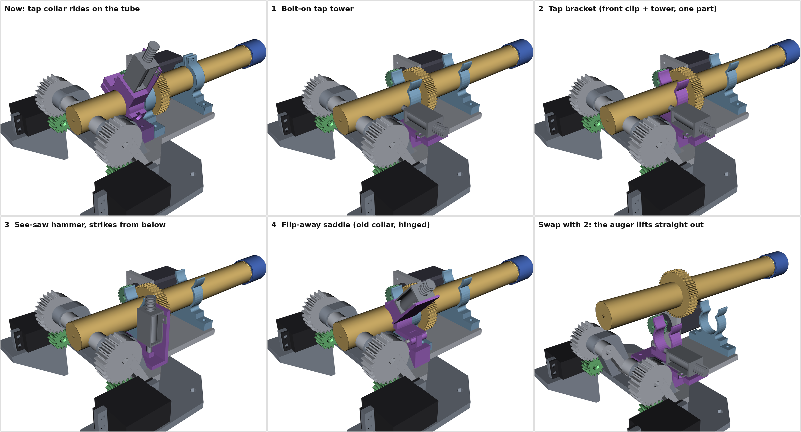
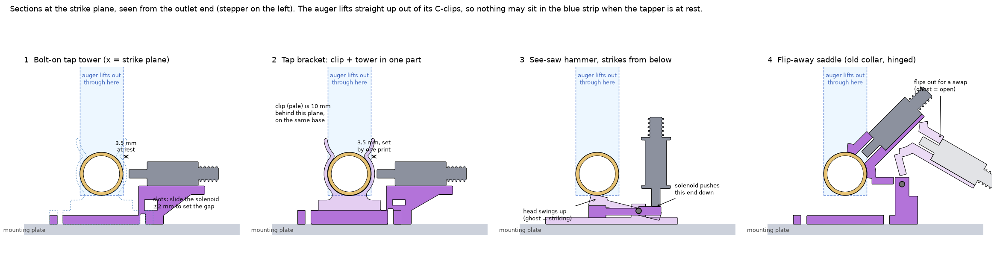

# Tapper on the mounting plate instead of around the auger (issue #203)

The tap collar rides on the auger tube, held from turning by the hard-stop
base. To swap an auger, the collar has to slide off over the outlet end,
which takes its clamp screw, solenoid and wiring with it. Now that the
brackets are snap-in C-clips (the Flexible Bracket), the collar is the only
thing that stops an auger from simply lifting out and dropping back in.

These four concepts keep the solenoid on the mounting plate, so the auger
lifts straight out and the tapper is never touched:





| | Concept | Mounts on | Gap set by | Auger swap | Extra parts |
|---|---|---|---|---|---|
| 1 | **Bolt-on tap tower.** The solenoid lies on a shelf beside the tube with its plunger level with the auger axis, and hits the side of the tube where the collar hits it now. | the old tap-collar base's two M3 holes, nothing else changes | slotted ear holes, ±2 mm, set once | lift out | 1 print, 2 + 2 screws |
| 2 | **Tap bracket.** Concept 1's tower and the front Flexible Bracket printed as one part, on both hole rows. | 4 M3 holes (front bracket row + tap row) | the print: the clip bore and the solenoid seat are on one part | lift out (the clip snaps open, as now) | replaces the front bracket |
| 3 | **See-saw hammer.** The solenoid stands beside the tube and pushes the short end of an arm down; the long end flips up and knocks the tube from underneath. | the tap row's 2 M3 holes | not critical: the 2.4:1 lever turns the 4.9 mm stroke into about 12 mm of head travel | lift out | frame, arm, M3 pivot screw, light return spring |
| 4 | **Flip-away saddle.** The old collar with its bottom half cut off, on a hinge pin beside the tube. It rests on the tube and swings out for a swap. | the tap row's 2 M3 holes | the saddle, which sits on the tube (about 3 mm, as on the collar now) | flip open, lift out, flip back | saddle, hinge post, M3 pin, detent or spring |

### What any plate-mounted tapper has to get right

* **Stay out of the lift path.** The auger snaps up and out of the C-clips,
  and its 44T gear rolls out of the stepper pinion as it rises. At rest,
  nothing may sit in the strip the tube sweeps (blue in the sections). A
  plunger beside or below the tube is fine. One above the tube's equator
  only clears if the rest gap is large enough: for a strike point α above
  the equator you need (12.5 + gap)·cos α > 12.5 mm, so about 30° at most
  with a 3.5 mm gap.
* **Hold the plunger gap.** The Adafruit 412 (TAU0730TM) has a 4.9 mm
  stroke and pulls about 0.5 N with 4 mm still to go, rising to at least 5 N
  when closed (12 V, datasheet in
  [`hardware/vendor-files/adafruit-412-jf-0530b-solenoid`](../../../hardware/vendor-files/adafruit-412-jf-0530b-solenoid)).
  Most of the strike energy comes from the last couple of millimetres, so
  the brass cap should start about 3–4 mm from the tube: far enough to build
  speed, close enough to land before the plunger bottoms out. That is a
  window about 1.5 mm wide. The collar got it for free because its bore sits
  on the tube. A plate-mounted tapper sits at the end of a tolerance chain
  instead: the clip's 0.5 mm clearance, the plate's holes and the print. So
  it needs one of three things: an adjustment (concept 1), the tapper and the
  clip on one part (concept 2), or a lever that widens the window
  (concept 3). Concept 4 keeps the collar's way of doing it.
* **Hit where the collar hits.** Every concept strikes 42.3 mm behind the
  hinge, between the front bracket and the outlet, where the collar's
  plunger lands now and close to the nozzle, where bridging starts. There
  are about 18 mm of floor there for a base, between the front bracket and
  the baseplate rib under the hinge comb, and about 32 mm of clear space
  above the floor, up to the hinge knuckles.
* **Tilt with the plate.** The tapper rides on the mounting plate, so its
  geometry doesn't change with tilt. Anything that falls back by gravity
  (concepts 3 and 4) needs a light spring above about 45°.
* **Wires and fasteners.** A tapper fixed to the plate needs no hard stop,
  and its wires never move. The rig shakes nuts loose (#117), so use
  locknuts, or print the tower into the mounting plate once its shape has
  settled. Sam's multi-doser plate already has its clips printed in.

### Recommendation

1. **Print concept 1 first and put it on the current rig.** It uses the two
   holes the hard-stop base uses now, and nothing else on the doser changes.
   Measure taps on the balance with the auger stopped (the 30 Jul
   attempt-2 protocol from #138) at a few gaps, for example 2.5, 3.5 and
   4.5 mm, to find the best one.
2. **For the new dosers, fold that gap into concept 2** (or into the
   mounting plate itself), so it is set by the print and there is one part
   and one pair of screws fewer.
3. **If side taps from a fixed plunger turn out weak, try concept 3.** The
   head finishes its swing in free flight, so nothing presses on the turning
   tube after the hit, and an M3 nut in the head adds mass.
4. **Concept 4 is the low-risk fallback.** It keeps the geometry that works
   today, but the swap still has a manual step (flip, not unscrew), and the
   saddle rubs on the turning tube the way the collar does now. It is also
   the only concept with a part touching the tube, so it is where a stronger
   vibration motor would go. The coin motor was found too weak (#117, #142).

Two ideas not modelled here:
* **Strike the clip, not the tube.** An anvil tab on the Flexible Bracket
  takes the hit. The gap would be fixed and the auger never touched, but the
  clip is compliant with 0.5 mm of clearance, so less of the knock reaches
  the powder.
* **Passive gear clicker.** A spring finger riding on the 44T gear taps 44
  times per auger turn, with no solenoid or wires. It only taps while the
  auger turns, though, and can't be switched off.

### Checks

[`check.py`](check.py) intersects every concept with the assembly (OCC
booleans) at 0° and 45° of tilt, and with the auger lifted 5–50 mm out of
its clips ([output](check_output.txt)):

* Concepts 1–3 clear everything at both tilts, and the auger lifts out past
  them at every step. For concept 2, only the tower is checked against the
  lift, because the tube snaps out through the clip's lips as it does with
  every Flexible Bracket.
* Concept 4 clears everything at rest but blocks the lift until the saddle
  is flipped open (75° here).
* All the bases stop 1 mm short of a baseplate rib that comes up through
  the mounting plate's comb at tilt 0. My first draft of concept 1, with the
  old tap-collar base's 18 mm footprint, touched it by 0.5 mm³.

### Files and how they were made

| File | What |
|---|---|
| [`concepts.py`](concepts.py) | CadQuery models of the four concepts, the Flexible Bracket and the solenoid |
| [`render.py`](render.py) | renders them on PR #170's assembly → `renders/concept*.png`, `renders/concepts_board.png`; writes `step/*.step` |
| [`sections.py`](sections.py) | the strike-plane sections → `renders/concept_sections.png` |
| [`check.py`](check.py) | the interference and lift-path checks → [`check_output.txt`](check_output.txt) |
| `step/concept*.step` | the printed parts of each concept, in the concept frame (auger axis on x, plate floor top at y = −29.25) |
| `step/flexible-bracket-recreation.step` | the Flexible Bracket rebuilt from its Onshape sketch |

```bash
pip install cadquery vtk matplotlib pillow
cd design/cad/tap-mount-concepts
xvfb-run -a python3 render.py   # fetches PR #170's cad/full-assembly at 7f5b3b7 on first run
python3 sections.py
python3 check.py
```

Where the geometry comes from:
* **Assembly** (baseplate, mounting plate, auger, cap, stepper, pinions,
  servos): PR #170's `cad/full-assembly` at
  [`7f5b3b7`](https://github.com/vertical-cloud-lab/powder-doser/tree/7f5b3b7/cad/full-assembly),
  placed by its `onshape/layout.py`. These are the lab's Fusion exports from
  1 Oct. Ethan's Onshape mounting plate (24 Oct) may differ in detail. The
  hole rows used here (48 mm apart, at 124, 58.3 and 42.3 mm behind the
  hinge) are PR #170's.
* **Flexible Bracket**: rebuilt from the "Outline Copy" sketch of the
  [Onshape Bracket Recreation](https://cad.onshape.com/documents/5e6db88e8a8d5328b172ba6d/w/7b4b2baa5fa65b95b0004aa0/e/59890746941ebde49fa31a66),
  read on 7 Nov 2026: a 60 × 8 mm base, Ø25.5 bore 29.25 mm up, 2 mm wall,
  R2.5 detents, flared lips, 12 mm wide, M3 holes 48 mm apart.
* **Tap collar** (for comparison): the
  [Onshape tap collar](https://cad.onshape.com/documents/b0b9aed3e11591e566530a68/w/7dc93c75a03ccff73030ba25/e/5698e113586ac646eea0efd1)
  is Ø33.5 × 17 mm with a Ø25.5 bore, a Ø6.9 plunger hole, a 1.2 mm
  solenoid plate and a Ø10.5 coin-motor pocket.
* **Solenoid**: modelled from the datasheet. The cap sticks out 10.5 mm at
  rest and 15.4 mm energised. PR #170's stand-in shows 6 mm.

The Onshape API key is over its call limit (HTTP 402), so nothing was
exported from Onshape. The documents are link-shared, which let me read
their feature trees and rendered views without the key.

These are concept models for choosing a direction. They have not been
printed, and they don't include tolerances, print orientation or the rig's
PCB, which isn't in the CAD. Check that the tower in concepts 1–2 clears
the PCB on the side away from the stepper, or mirror it to the stepper side.
