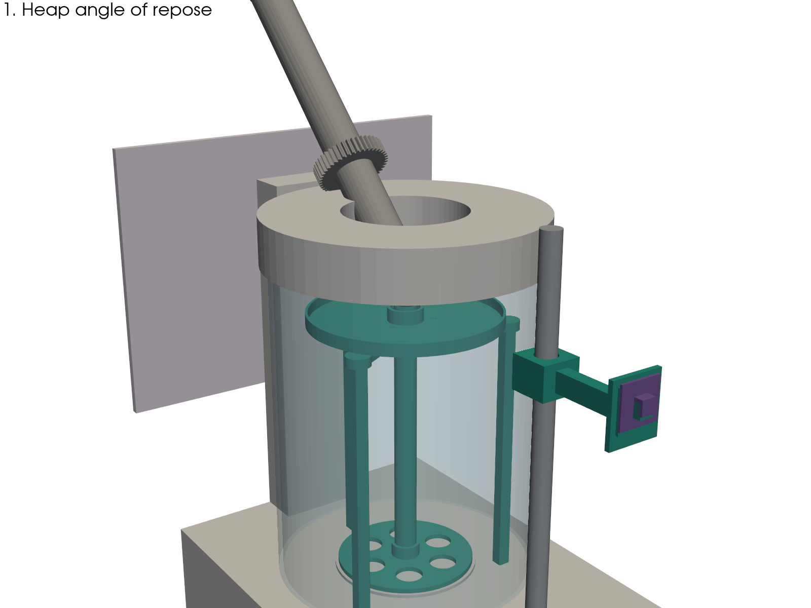
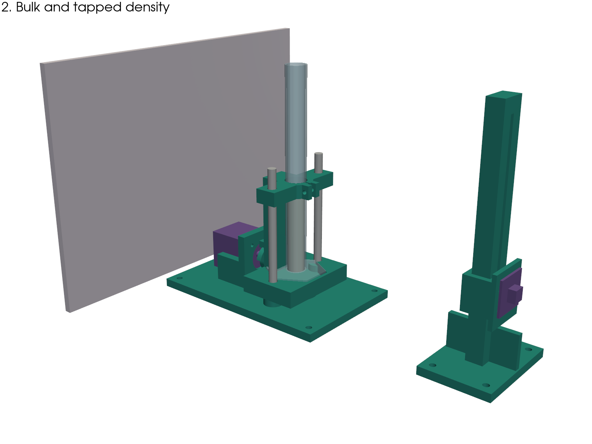
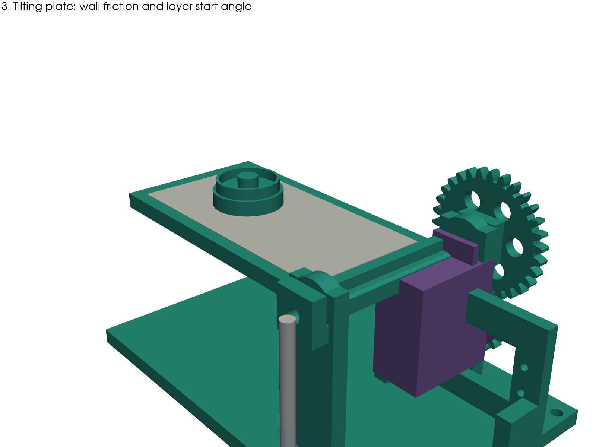
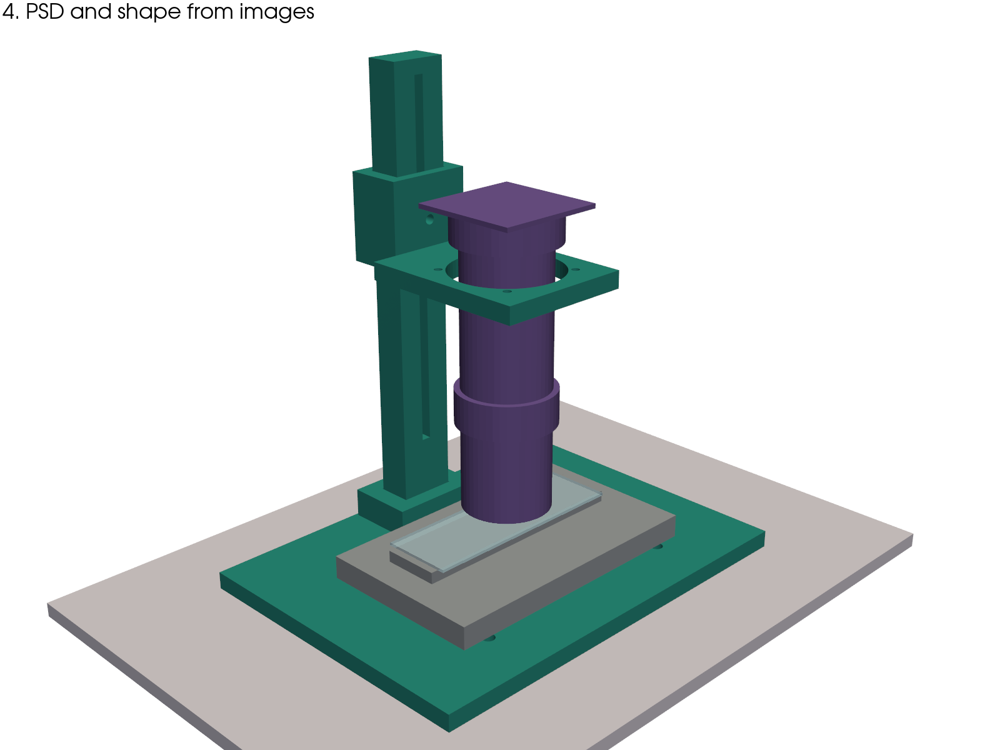
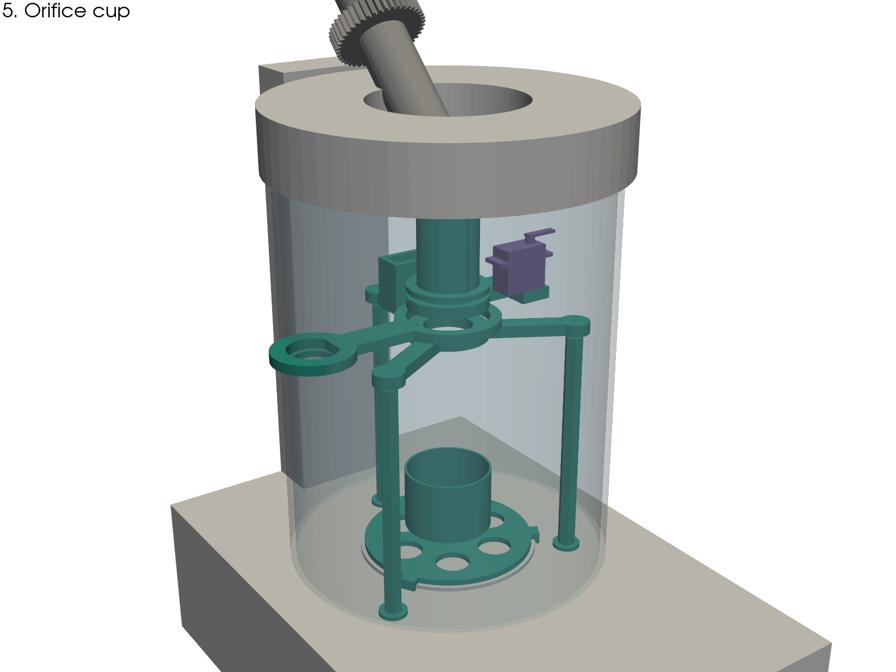
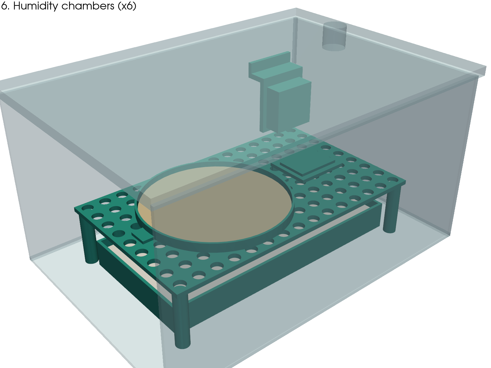
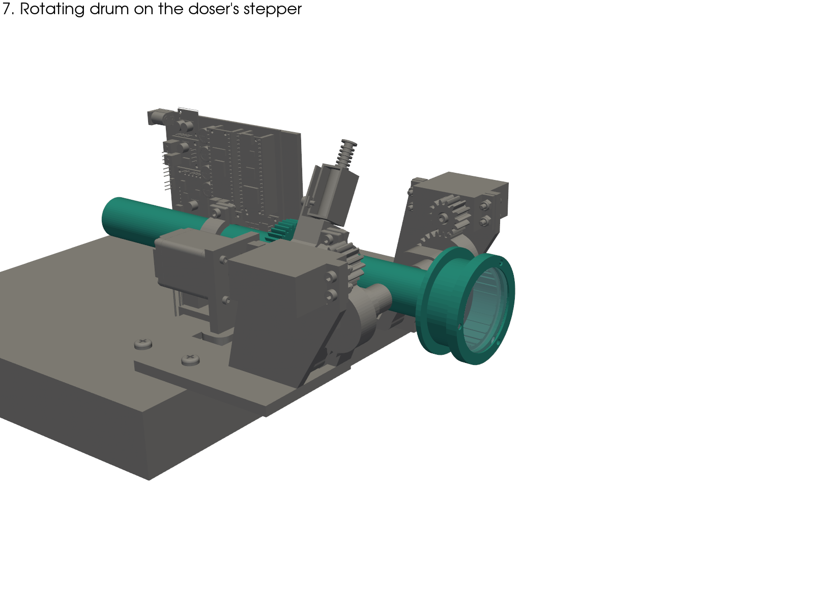
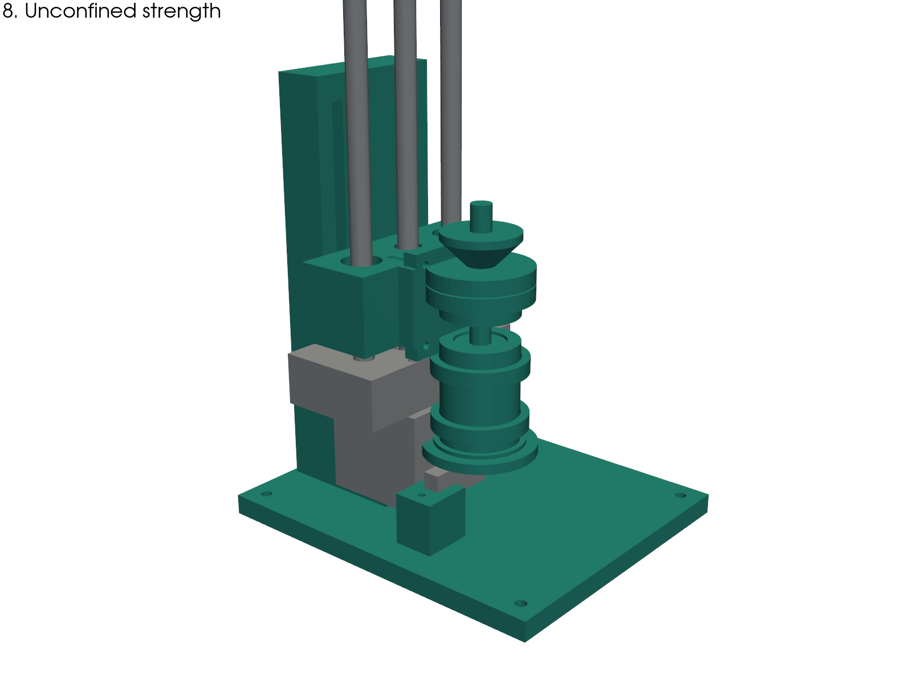
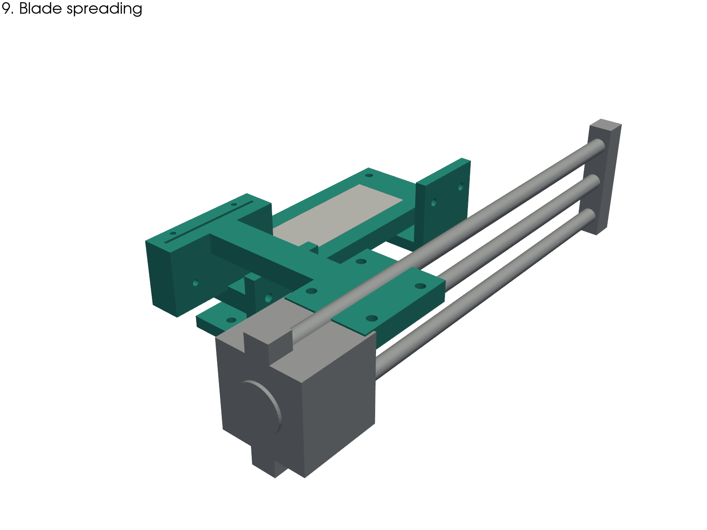
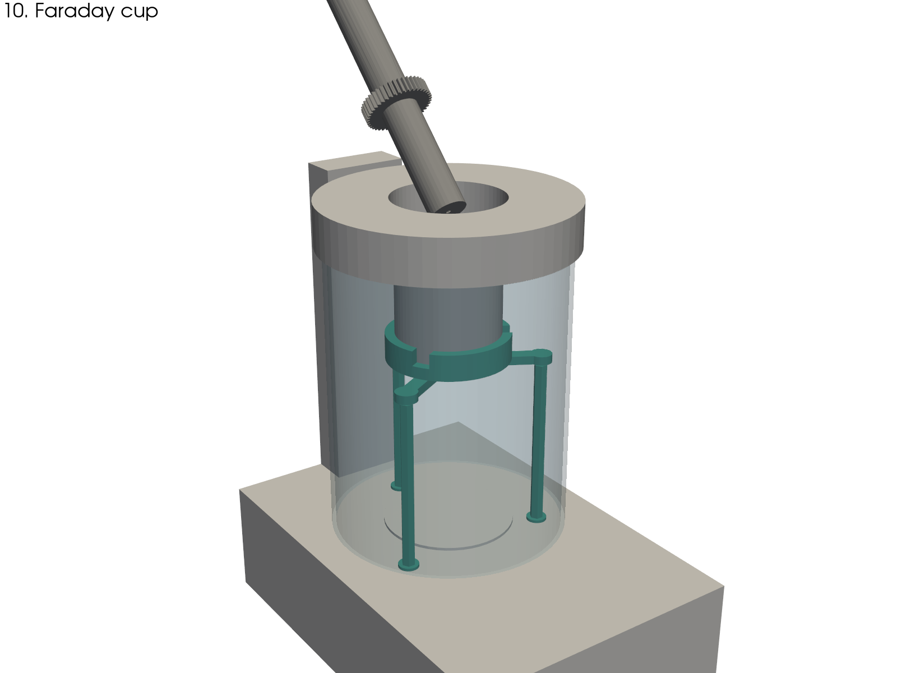

# Assembly, step by step

**Status: designed, not built.** These are the steps the assembly videos animate; the renders are from [`cad/assemblies.py`](cad/assemblies.py). Teal parts are printed (see [`cad/`](cad)), purple ones are bought (see [`bom/`](bom)), grey is the existing doser and balance. The SOPs that use each apparatus are in [`software/sop/`](software/sop).

## 1. Heap angle of repose

1. The HR-100A as it is: pan Ø90, breeze break Ø156
2. Pan adapter on the pan; centre it by eye (2 mm ring all round) *(pan adapter)*
3. 160 mm riser pushes into the adapter's socket *(riser 160 mm)*
4. Three 160 mm tripod legs stand on the chamber floor, clear of the pan *(tripod leg 160 mm; tripod leg 160 mm; tripod leg 160 mm)*
5. Tripod spider on the legs *(tripod spider)*
6. Overflow tray on the spider; the riser passes its chimney untouched *(overflow tray)*
7. Ø20 pedestal (powder glued on top) on the riser *(pedestal Ø20)*
8. Camera level with the pedestal, outside the glass *(camera on retort-stand clamp; Camera Module 3; retort stand rod)*
9. LED pad behind: the heap shows as a silhouette *(LED backlight pad)*
10. Doser at 45°, outlet 12 mm above the pedestal

## 2. Bulk and tapped density

1. Printed base: rod bosses, anvil pocket, motor plate *(tapper base)*
2. Glue the 1/4 in 304 stainless anvil disc in its pocket (1 mm proud) *(anvil, 304 SS Ø25.4 x 6.35)*
3. Press the two Ø6 mm rods into the bosses *(guide rod Ø6 x 100; guide rod Ø6 x 100)*
4. Bolt the NEMA 11 to the motor plate (4 x M2.5) *(NEMA 11 stepper)*
5. Two-lobe snail cam on the shaft, set screw on the flat *(snail cam (2 lobes, 3 mm drop))*
6. Slide the carriage down the rods; its lug rests over the cam *(carriage)*
7. Cylinder foot into the carriage pocket, tube through the collar *(10 mL Class A cylinder)*
8. Camera at the column, 120 mm away *(camera tower; camera carriage + Camera Module 3; Camera Module 3)*
9. Backlight behind: column height to about 0.05 mm *(LED backlight pad)*

## 3. Tilting plate: wall friction and layer start angle

1. Printed base with hinge towers and servo bracket *(tilt base)*
2. Servo through the bracket window, 4 x M2.5 *(15.5 kg·cm metal-gear servo (FS5115M))*
3. 15T m1.5 pinion screwed to the servo horn *(15T pinion on the horn)*
4. Plate between the towers *(tilt plate)*
5. Ø5 mm steel hinge pin through towers and lugs *(hinge pin Ø5)*
6. 30T gear on the plate's lug: servo 180° = table 90° *(30T gear on the plate lug)*
7. IMU under the plate reads the true angle *(LSM6DSOX IMU)*
8. Coupon (PLA, 304 SS or glass) in the pocket *(304 stainless coupon 100 x 50 x 1)*
9. Ring on 0.5 mm feeler-gauge shims, filled and struck off; shims out *(ring (Ø25 ID) filled with powder)*
10. Lid with washers: 70-450 Pa on the powder *(lid with washers (sets the stress))*

## 4. PSD and shape from images

1. LED pad flat on the bench *(LED backlight pad (flat))*
2. Printed base over the pad; window over the light *(microscope base)*
3. Column into the base socket *(column)*
4. Mechanical X-Y stage bolted to the base *(mechanical X-Y stage)*
5. Slide with a sparse layer of grains *(glass slide with grains)*
6. Camera carriage on the column, thumb screw *(camera carriage)*
7. IMX477 HQ camera + zoom lens, looking down; focus with the carriage *(Arducam IMX477 HQ camera + 0.12-1.8x zoom lens)*

## 5. Orifice cup

1. The HR-100A
2. Catch cup on the pan: the balance weighs only what flows *(catch cup)*
3. Tripod legs (120 mm) on the chamber floor *(tripod leg 120 mm; tripod leg 120 mm; tripod leg 120 mm)*
4. Spider on the legs *(tripod spider)*
5. Cup holder on the spider *(cup holder)*
6. Gate guide with the sliding gate *(gate guide; gate slide)*
7. 9 g servo moves the gate 10 mm *(9 g micro servo)*
8. Orifice disc (1-6 mm) under the cup *(orifice disc)*
9. Cup screwed down: disc clamped flat *(orifice cup)*
10. Second solenoid on the holder taps the cup *(JF-0530B solenoid tapper)*
11. Doser fills the cup to 5 g with the gate shut

## 6. Humidity chambers (x6)

1. Clear airtight box, about 1.2 L *(airtight box 1.2 L)*
2. Slurry tray on the floor *(slurry tray (saturated salt))*
3. Saturated slurry: MgCl2, Mg(NO3)2, NaNO3, NaCl or KCl; or silica gel
4. Perforated shelf 30 mm above the slurry *(perforated shelf)*
5. Ø80 dish: about 3 g in a layer under 1 mm *(sample dish Ø80, layer under 1 mm)*
6. SHT45 on its clip next to the sample *(SHT45 sensor on its clip)*
7. 25 mm fan mixes the air (10-50x faster equilibration) *(25 mm 5 V fan on its mount)*
8. Lid on; the sensor cable leaves through a PG7 gland *(lid with PG7 cable gland)*

## 7. Rotating drum on the doser's stepper

1. The doser with its auger taken out of the brackets
2. Drum shaft in the brackets: same tube, 44T gear at the auger's place *(drum shaft (replaces the auger))*
3. Drum body on the shaft flange, 3 x M3 into heat-set inserts *(drum body, 24 ribs)*
4. Black (or white) rear-wall disc for contrast *(rear-wall disc (black))*
5. Fill 40 % (about 7.5 mL)
6. Acrylic window over the open face *(acrylic window Ø50 x 2)*
7. Bezel, 3 x M3: the camera looks along the axis *(bezel, 3 x M3)*

## 8. Unconfined strength

1. Printed base with the load-cell block and stage column *(UCS base and column)*
2. 100 g bar load cell, cantilevered *(100 g load cell (TAL221))*
3. Sample base on the load cell's free end *(sample base)*
4. Two mould halves (Ø20 x 40) on dowels *(split mould half A; split mould half B)*
5. Two latch rings hold the mould shut *(2 latch rings)*
6. Fill by doser; piston + weights: 0.2-2 kPa *(piston + slotted weights)*
7. DIY lead-screw stage on the column *(DIY lead-screw stage (vertical); stage carriage)*
8. Platen arm on the slider; lower at 0.1 mm/s after the mould opens *(platen arm)*

## 9. Blade spreading

1. DIY stage: NEMA 17 lead screw, two Ø8 rods, 4 x LM8UU *(DIY lead-screw stage (horizontal))*
2. Two printed brackets tie the coupon bed to the stage *(2 brackets)*
3. Coupon bed, parallel to the travel *(coupon bed)*
4. Coupon (304 SS or PLA), flush with the bed *(304 stainless coupon 100 x 30 x 0.91)*
5. Blade carriage on the slider *(stage carriage; blade carriage)*
6. Blade clamped at a 0.10-0.20 mm gap (feeler gauges) *(blade, 304 SS 1.5 x 25 x 52)*
7. Doser lays a 0.2-0.5 g line; the blade spreads it

## 10. Faraday cup

1. The HR-100A (the cup is not weighed during dosing)
2. Tripod legs on the chamber floor *(tripod leg 120 mm; tripod leg 120 mm; tripod leg 120 mm)*
3. Spider on the legs *(tripod spider)*
4. Can cradle on the spider *(can cradle)*
5. Grounded aluminium outer can *(outer can (grounded shield))*
6. Printed insulator base *(insulator base)*
7. Three PTFE standoffs *(3 PTFE standoffs)*
8. Inner aluminium cup on the standoffs; BNC lead to the cup *(inner cup (aluminium))*
9. Lid with the inlet funnel (aluminium tape inside: shield) *(lid with inlet funnel)*
10. FC-1 charge amplifier beside the balance *(FC-1 charge amplifier in its box)*
11. Doser outlet over the funnel
