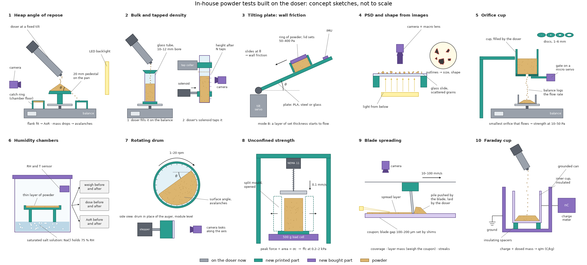

# In-house powder property tests built on the doser

**Status: concept designs for discussion.** Nothing here has been built or run. The dimensions
are starting points for CAD, not final numbers. This folder was opened from
[PR #196](https://github.com/vertical-cloud-lab/powder-doser/pull/196) (physics simulations and
ML models of the doser) at William's request, as the place to design these tests.

*Concept sketches, not to scale. Grey: parts the doser already has. Teal: new printed parts.
Purple: new bought parts. Redraw with `python concepts.py`.*

## In short

- **Why.** On #196, run 33 trained models in both directions (dosing → properties, properties →
  dosing) on the 12 battery powders. The property values they learned from are handbook values for
  each material class, not measurements on our jars, and that is what limits them. The handbook
  angle of repose (AoR) ranges are 6–16° wide, which caps any model at about 3.7° error.
- **What.** Ten tests that reuse the doser's motor, tilt servo, tapper, 0.1 mg balance, Raspberry
  Pi and camera, plus small printed fixtures and a few cheap parts. Each one measures a property on
  the same jar, on the same day as its dosing fingerprint, with a few grams of powder that mostly go
  back in the jar.
- **What they feed.**
  - **The DEM simulation:** measured inputs (size distribution, wall friction), calibration targets
    (AoR, packing), and held-out checks (smallest orifice that flows, strength at low stress).
  - **The ML predictors:** measured labels instead of handbook ones, more properties that can be
    learned, and the 25–30 jars run 33 says are needed.
  - **Dosing and the BO:** flow or no flow for a new powder, its search range, and when humidity
    means a calibration must be redone.
- **Build first (tier 1):** heap AoR, bulk and tapped density, the tilting plate (wall friction)
  and PSD from images. These are the properties the models say matter most, and they are the
  cheapest to build.

## What we have to build with

| Doser part | What it can do for a test |
|---|---|
| Auger on a NEMA 11 stepper (Tic T500 driver), 1:1 direct drive | Turn a drum, or a fill auger, at a set speed. Fill a vessel the same way every time |
| Tilt servo, 0–90° (`a <deg>`, presets `horizontal` / `tilt` / `vertical` / `tip`) | Tilt a plate slowly and repeatably |
| JF-0530B solenoid tapper on the tap collar (`t`) | Tap a cylinder held in the collar |
| ERM vibration motor (DRV2605L, `v`) | Shake a slide or a sieve lightly |
| A&D HR-100A balance: 102 g capacity, 0.1 mg, streamed at 5–10 Hz | Fill mass, discharge rate, mass changes on drying or humid air |
| Raspberry Pi on Tailscale, Pi camera (the `picam-d1pr` livestream) | Run tests remotely; photograph heaps, columns and drums |
| Pico W firmware with a one-line serial command set ([`main.py`](../../hardware/test-module/firmware/main.py)) | Script every test from the Pi with the commands that run the battery |
| Bambu A1 mini and H2D (PLA), SLA printing, a fume hood | Fixtures in the auger's own material; clear parts for windows |

## Design rules that come from the models

Each rule sets a number the designs have to meet.

| Rule | Why | Source |
|---|---|---|
| Measure every property on the jar that is dosed, on the same day, logging RH and temperature | The property labels limit today's predictors, not the doser. Salt's feed factor drifted about 10 % between days | [run 33](https://github.com/vertical-cloud-lab/powder-doser/blob/e8811bd/docs/physics-simulations/runs/ml-property-dose/README.md), [`CONSISTENCY.md`](https://github.com/vertical-cloud-lab/powder-doser/blob/e8811bd/docs/physics-simulations/runs/ml-property-dose/CONSISTENCY.md), [`OUTLINE.md` §4.A5](https://github.com/vertical-cloud-lab/powder-doser/blob/ec30713/paper/optimization/OUTLINE.md#L90) |
| AoR to ±2° or better, one method for every jar, at least 3 pours | Predicting mg/rev within 2× needs AoR within about ±2° (0.157 decades of mg/rev per degree) | [`SAME_JAR.md`](https://github.com/vertical-cloud-lab/powder-doser/blob/e8811bd/docs/physics-simulations/runs/heldout-powders/SAME_JAR.md) |
| Fill density vessels the same way every time, and record the whole tap curve | In DEM run 5, the fill method alone moved packing from 0.577 to 0.632, and the cohesive bed was still compacting at 30 taps | [run 5](https://github.com/vertical-cloud-lab/powder-doser/blob/e8811bd/docs/physics-simulations/runs/dem-liggghts-tap/README.md) |
| Include a test that pins wall friction, to about ±2° of slip angle | The tilt sweep alone leaves rolling friction unidentified. A wall-friction test pinned sliding friction to ±0.05 | [run 29](https://github.com/vertical-cloud-lab/powder-doser/blob/e8811bd/docs/physics-simulations/runs/bayes-gp-emulator-mcmc/README.md), [Edison q2](https://github.com/vertical-cloud-lab/powder-doser/blob/e8811bd/docs/physics-simulations/edison/q2_dem_calibration_standard_tests.answer.md) |
| Test at the doser's own stresses, tens to hundreds of Pa | The reservoir stress levels off at 320–534 Pa, and about 14 Pa is available to break an arch over the exit. Shear cells test at kPa | runs [6](https://github.com/vertical-cloud-lab/powder-doser/blob/e8811bd/docs/physics-simulations/runs/dem-liggghts-shear/README.md), [22](https://github.com/vertical-cloud-lab/powder-doser/blob/e8811bd/docs/physics-simulations/runs/fem-druckerprager/README.md), [24](https://github.com/vertical-cloud-lab/powder-doser/blob/e8811bd/docs/physics-simulations/runs/analytic-orifice-screw/README.md) |
| Keep fixtures at least 25–30 grain diameters across | A rule of thumb against wall effects. Salt (d50 0.425 mm) needs at least 11–13 mm. The DEM AoR base was 28 grains across | run 2 |
| Use a few grams and give them back | A battery uses 4–10 g per jar, and some jars are small | `OUTLINE.md` §4.A3 |
| Build fixtures the DEM can simulate as built | Virtual versions of these tests took 1–10 CPU-min each (runs 2–7). Each test can then be a calibration target or a held-out check | #196, runs 2–7 |

## The tests at a glance

"Standard counterpart" is the test it would be checked against, with costs from
[#190](https://github.com/vertical-cloud-lab/powder-doser/blob/1e0d6f8/docs/powder-tests/README.md)
(in-house route / outsourced per sample, 28 Oct 2026).

| # | Test | What it looks like | What it measures | Standard counterpart | Powder | Tier |
|---|---|---|---|---|---|---|
| 1 | Heap angle of repose | The doser builds a heap on a 20 mm pedestal on the balance. A camera photographs its silhouette against a backlight | AoR of both flanks; avalanche sizes; heap density | Fixed-base cone, ISO 4324 ($35–60 / $175) | about 1 g a pour, returned | 1 |
| 2 | Bulk and tapped density | The doser fills a clear cylinder on the balance. The doser's tapper taps it; the camera reads the column height | Bulk and tapped density, Hausner ratio, compaction curve | ASTM B212 and B527 ($60 cylinders / $250) | 3–8 g, returned | 1 |
| 3 | Tilting plate | A plate on the tilt servo. A ring of powder slides off it, or a layer of set thickness starts to flow | Wall friction on PLA and steel at 50–400 Pa; layer start angle vs thickness | Jenike wall-friction test (in the $650 outsourced shear package) | about 1 g, returned | 1 |
| 4 | PSD and shape from images | A camera with a macro lens over a slide of scattered grains, lit from below | d10, d50, d90, aspect ratio, circularity | Sieving, ASTM B214 ($654 for six sieves, plus $2,250–3,460 for a shaker / $275); laser diffraction, ASTM B822 ($5.10–9.10 a sample plus $64.40 a job at Utah) | 10–50 mg | 1 |
| 5 | Orifice cup | A small cup with swappable orifice discs and a gate, emptying onto the balance | Flow rate vs orifice size; smallest orifice that flows, with and without taps | Hall and Carney funnels, ASTM B213 and B964 (kit $341–791) | 3–5 g, returned | 2 |
| 6 | Humidity chambers | Sealed boxes held at set RH by saturated salt solutions. Weigh, and dose, before and after | Water uptake vs RH; the RH where uptake jumps; change in dosing | Loss on drying, USP <731> ($833–908 oven / $150) | 2–10 g | 2 |
| 7 | Rotating drum | A short clear drum on the doser's stepper in place of the auger, held level | Dynamic angle, avalanche angles, cohesive index | GranuDrum, Revolution Powder Analyzer | 3–5 g, returned | 2 |
| 8 | Unconfined strength | A powder column formed in a split mould, then crushed by a platen on a small load cell | Strength at 0.2–2 kPa consolidation, i.e. a low-stress flow function | Shear cell *ff*c ($9,650–32,315 / $650) | 5–10 g | 3 |
| 9 | Blade spreading | The doser lays a weighed line of powder. A blade on a moving carriage spreads it over a coupon | Coverage, layer packing fraction, areal-mass scatter | None standard; powder-bed recoating | 0.2–0.5 g a layer | 3 |
| 10 | Faraday cup | An insulated metal cup in a grounded can, under the doser exit, read by a charge meter | Charge per mass of the dosed powder | Faraday cup with an electrometer | 0.5–1 g | 3 |

**Tiers.** Tier 1 measures what the models most need now: AoR (the only property dosing could
predict in run 33), density (to turn mg/rev into volume), wall friction (to separate friction
from cohesion) and size distribution (a DEM input). Tier 2 adds cohesion at low stress and
humidity. Tier 3 takes more engineering.

**Test 0 is the fingerprint itself** (protocols C, D and E, and afterflow; [draft
§2.3](https://github.com/vertical-cloud-lab/powder-doser/blob/ec30713/paper/optimization/main.tex#L157)).
The tests above are compared against it, so it needs a same-day salt reference, a drawdown check
of fill level, and a measured exit (see [below](#0-the-fingerprint-standardized)).

## The tests

Commands in `code` are the existing firmware commands. Every test is run by a script on the Pi
that sends them, logs the balance and takes photos.

### 1. Heap angle of repose, from the pile the doser makes

**What it looks like.**
- **Pedestal:** a printed 20 mm disc on the balance pan, with a sharp rim (chamfered underneath
  so grains fall clear) and a top roughened with a glued layer of the test powder. 12 and 30 mm
  discs for very fine or very coarse powders.
- **Catch ring:** around the pedestal, resting on the floor of the balance's draft chamber rather
  than on the pan, so the balance weighs only the heap.
- **Feed:** the doser exit 10–15 mm above where the apex will end up, at a fixed tilt.
- **Camera:** level with the pedestal, looking through the draft shield, with an LED panel behind
  the heap so it shows as a sharp silhouette.

The 28 Oct meeting suggested dosing into a glass vial. A vial's walls shape the pile, while a
pedestal gives a free cone, as in ISO 4324 and in DEM run 2.

**How it runs.** Tilt to 45° (`a 45`). Turn the auger a revolution at a time (`r 360`), taking a
photo and logging the balance after each, until the heap stops growing. Pour three heaps per jar,
tipping each back into the jar.

**What it gives.**
- **AoR:** straight lines fitted to both flanks of the silhouette, leaving out the rounded apex
  and the toe. Also the ISO apex angle, atan(2h/D), which run 2 found reads high, most of all
  for cohesive heaps.
- **Avalanches:** drops in heap mass on the balance as the heap grows. Cohesive powders slide in
  fewer, bigger avalanches. In DEM run 3, the avalanche size, not the mean angle, set the cohesive
  powder apart.
- **Heap density:** heap mass divided by the volume of the silhouette turned about its axis.

**Check against:** the ring-stand-and-funnel AoR test (#190: $35–60) on the same jar and base
size. That is the method behind most handbook values.

**What it feeds.**
- **ML:** the label for the inverse model and the input for flow / no flow (11 of 12 right from
  handbook AoR in run 33). Testing the criteria C1–C4 written down in `SAME_JAR.md` before any
  jar was measured.
- **DEM:** a target for sliding and rolling friction, and cohesion. Run 2 is this test in
  LIGGGHTS (21.9° dry, 39.3° cohesive).
- **BO:** the search range for a new powder.

**Open questions.**
- Is there room in the HR-100A's chamber for a catch ring that clears the pan? If not, weigh the
  pedestal on a separate load cell (as in test 8).
- Powders that barely leave the doser need many revolutions, or taps, to build a heap. White rice
  flour gives 37 mg/rev at 45°, so about 20 revolutions per heap. Do taps disturb the heap?

### 2. Bulk and tapped density, filled by the auger and tapped by the tapper

**What it looks like.**
- **Vessel:** a precision-bore glass tube (10–12 mm bore, about 60 mm tall) on a printed base,
  short enough to fit in the balance's draft chamber; or a 10 mL Class A graduated cylinder if it
  fits. Against the backlight, the camera reads the column height to about 0.1 mm, 0.25 % of a
  40 mm column.
- **Fill:** the cylinder stands on the balance under the doser exit, with a printed collar to
  centre the stream.
- **Tap:** a printed clamp holds the cylinder in the tap collar where the auger normally sits, so
  the doser's own solenoid taps it with the module vertical (`p vertical`).

**How it runs.**
1. **Fill:** the doser fills the cylinder at fixed settings (for example 45°, 30 rpm, exit 10 mm
   above the rim) to a set mass. The balance gives the mass and the camera the poured height. The
   auger becomes a filler that pours the same way every time, which a hand pour isn't.
2. **Tap:** move the cylinder to the clamp. Tap in log-spaced batches (1, 2, 5, 10, 20, 50, 100,
   200, 500 taps), photographing after each batch.

**What it gives.** Bulk density, tapped density, Hausner ratio and Carr index, and the whole
compaction curve. A Kawakita fit to the curve gives two constants: how far the powder compacts and
how easily.

**Check against:** ASTM B212 (the Hall funnel and density cup in the kit) and B527 / USP <616>
tap density, on a few jars. The doser taps sideways, not with the standard 3 mm drop, so the
numbers are compared, not assumed equal. If sideways taps don't compact reproducibly, version 2
adds a printed cam that lifts and drops the cylinder 3 mm, turned by a spare NEMA 11.

**What it feeds.**
- **ML:** Hausner ratio and bulk density as labels and inputs. Bulk density turns mg/rev into
  delivered volume: four battery powders deliver the same solid volume per revolution within
  ±6 % (`SAME_JAR.md`, panel b).
- **DEM:** packing and how it responds to taps depend on friction and cohesion together. Run 5 is
  this test (Hausner ratio 1.07 dry, 1.16 cohesive).
- **Dosing:** compaction under the doser's own taps relates to the mass freed per tap in the
  fingerprint, and to the tap stage of the controller.

### 3. Tilting plate: wall friction and layer start angle

**What it looks like.** A flat plate, about 100 × 40 mm, that bolts to the tilting mounting plate
in place of the auger module, so the existing servo tilts it slowly. A small accelerometer (IMU)
on the plate reads its true angle. Plates: PLA printed with the auger's own settings (the wall the
powder actually slides on), stainless steel and glass.

- **Mode A, wall friction.** A light printed ring (20 mm bore, 10 mm tall) filled with powder
  sits on the plate, held about 0.5 mm above it so only the powder touches the plate. Printed lids
  of known mass set the normal stress, for example 50, 150 and 400 Pa. Tilt at 0.5°/s until the
  ring slides.
- **Mode B, layer start angle.** A layer of set thickness (1, 2, 3 and 5 mm, struck off with a
  printed frame) on a plate roughened with glued powder. Tilt until the layer starts to flow.

**What it gives.** The wall friction angle (μw = its tangent) on PLA, steel and glass
at 50–400 Pa, with any wall adhesion; and the layer start angle against thickness.

**Check against:** the Jenike wall-friction test, part of the outsourced $650 shear package.

**What it feeds.**
- **DEM:** powder–wall friction is a direct input. The #180 twin assumed 0.4. Edison q2 calibrates
  it first, before cohesion. In run 29, adding a wall-friction observable pinned sliding friction
  to ±0.05 where the tilt sweep alone could not.
- **Run 23's thin-layer prediction:** a layer of salt-like powder 2.5 grains thick stops at 37.4°,
  and one 15 grains thick at 34.1°. Mode B tests this directly, at the 1–2 mm scale of the exit
  annulus.
- **ML:** a candidate second observable to separate friction from cohesion, as run 32
  recommended.

### 4. PSD and shape from images

**What it looks like.** A Pi HQ camera with a macro or microscope lens (or a USB microscope)
looking down at a glass slide lit from below. A few tens of mg are sprinkled onto the slide with
the doser's taps and spread into a sparse single layer. Cohesive powders can be dispersed in
isopropanol and dried.

**What it gives.** The size of every grain (as the diameter of a circle of the same area) for at
least 2,000 grains, giving d10, d50, d90 and span; and aspect ratio and circularity. A good lens
resolves grains down to about 20–30 µm. Finer powders (silicon under 44 µm, fumed silica) need SEM
or laser diffraction.

**Check against:** sieving for the coarse powders (sieves on order, byu-vcl#262), and laser
diffraction at the University of Utah (#190).

**What it feeds.**
- **DEM:** the PSD is an input, and the twin's match to salt rests on a salt PSD nobody has
  measured (#180). It sets how many grains span the 1.07 mm exit annulus (1.8–10.7 for BaCl₂
  across its handbook range), which decides whether a powder arches. Shape stands in for rolling
  friction: in run 15, cube-shaped clumps behaved like spheres with rolling resistance.
- **ML:** d50 could not be read from dosing (run 33), so it has to be measured. Size and shape
  are inputs for the forward model.

### 5. Orifice cup: flow rate, and the smallest orifice that flows

**What it looks like.** A printed flat-bottomed cup (25 mm bore, 40 mm tall) on a stand above the
balance, with:
- swappable orifice discs of 1, 1.5, 2, 2.54, 3, 4, 5.08 and 6 mm (2.54 and 5.08 mm match the Hall
  and Carney funnels);
- a sliding gate under the disc, moved by a micro servo on a spare Pico pin;
- optionally, the doser's solenoid against the stand, to tap it.

**How it runs.** With the gate shut, the doser fills the cup to a set mass. The gate opens and the
balance logs the mass arriving at 5–10 Hz. Step down from the largest disc until nothing flows,
then repeat with taps.

**What it gives.**
- Flow rate against orifice size, fitted with Beverloo's law (constants C and k).
- The smallest orifice that flows, Dc, and the smallest that flows when tapped. The
  Flodex tester reports the same kind of number.
- A low-stress strength. By Jenike's arching rule, a powder whose smallest flowing orifice is
  Dc has an unconfined strength of about ρb g Dc / H at the
  outlet, where H is a shape factor of about 2–2.5. For Dc = 3 mm and a bulk density
  of 1,000 kg/m³ that is 12–15 Pa: the stress level at the doser's own 3 mm exit, far below what
  a shear cell reaches.

**Check against:** the Hall/Carney funnel kit (50 g a test) on the jars that flow.

**What it feeds.**
- **DEM:** runs 4, 13, 14 and 16 are this test in four engines. They gave Beverloo constants and
  jamming widths: in MercuryDPM an orifice 5.9 grains wide clogged and one 8.2 grains wide flowed.
  Dc is a direct target for cohesion; the cohesive DEM Hall funnel jammed after 56
  grains.
- **Dosing:** C and k feed run 24's no-fit Beverloo model of the exit annulus, which already
  follows the tilt trend and could seed the BO. Dc compared with the 3 mm exit says
  whether a powder will need taps.

### 6. Humidity chambers: water uptake, and dosing before and after

**What it looks like.** Three or four airtight boxes, each with:
- a saturated salt solution that holds a set RH (at 25 °C: LiCl 11 %, MgCl₂ 33 %, K₂CO₃ 43 %,
  Mg(NO₃)₂ 53 %, NaCl 75 %, KCl 84 %);
- a logging RH and temperature sensor (an SHT4x on the Pi);
- a shallow printed dish for a thin layer of powder.

**How it runs.**
1. Fingerprint the jar as it is (protocol C at 45° and 22.5°, plus taps).
2. Spread a sample in the dish and weigh it. Hold it at one RH (for example 24 h), weighing at
   intervals.
3. Fingerprint it again straight away, and measure the heap AoR (test 1).
4. Dry it over silica gel and repeat, to see whether the change reverses or the powder cakes.

**What it gives.** Water uptake against RH (points for a sorption isotherm), the RH where a salt
starts taking up water fast (75 % for NaCl), and the change in mg/rev, no-flow events, mass per
tap and AoR. Loss on drying in an oven at 105 °C is optional. For hydrates such as BaCl₂·2H₂O it
measures crystal water as well as free moisture.

**What it feeds.**
- **Simulation:** run 27's sorption and liquid-bridge model predicts pure NaCl doses the same up
  to about 73.5 % RH, with bridges forming at 73.5–75.2 %. So the test should straddle 75 %. A
  change at lower RH would point to impurities such as MgCl₂ in table salt.
- **This is Sterling's moisture example** from the 28 Oct meeting: infer a moisture-related
  cohesion parameter from the change in dosing, then check it against the measured uptake.
- **ML:** the same powder dry and humid is one of run 33's confound-breaking pairs: only the
  moisture changes.
- **Dosing:** above which RH a calibration has to be redone.

### 7. Rotating drum on the doser's stepper

**What it looks like.** A short clear drum (30 mm bore, 15 mm deep; clear SLA resin, or acrylic
tube with a glass window) with a ribbed inner wall so the powder doesn't slip. It mounts on the
stepper coupling in place of the auger, with the module level (`p horizontal`). The camera looks
along the axis with a backlight behind. Fill it 35–50 % full.

**How it runs.** Turn it at 1, 2, 5, 10 and 20 rpm, recording 1–2 min at each speed.

**What it gives.** The angle of the free surface against speed (the dynamic AoR); avalanche
start and stop angles and how often avalanches come at low speed; and a cohesive index from how
much the surface fluctuates, as the GranuDrum and Revolution Powder Analyzer report.

**What it feeds.** **DEM:** run 3 is this test (dry 39.2° ± 4.4°; cohesive avalanches from 62°
down to 25°, ± 12.4°). The scatter, not the mean angle, carries the cohesion signal, as with the
fingerprint's interruption fraction.

### 8. Unconfined strength in a split mould

**What it looks like.**
- A split cylindrical mould (two printed halves, 20 mm bore, 20–30 mm tall, smooth SLA walls) on
  a 500 g load cell with an HX711 amplifier.
- Weights to consolidate the powder: on a 20 mm column, 1 kPa is 32 g.
- A flat platen lowered by a lead screw on a spare NEMA 11.

The HR-100A could read the force instead (up to its 102 g capacity, about 3 kPa here). A cheap
load cell keeps the doser's most expensive part out of harm's way.

**How it runs.** Fill the mould (with the doser), consolidate it under a weight, lift the weight,
open the mould, and lower the platen at about 0.1 mm/s until the column fails. The peak force
divided by the area is the unconfined strength σc. Repeat at 2–3 consolidation
stresses σ1 between 0.2 and 2 kPa.

**What it gives.** σc against σ1: a flow function at low stress,
*ff*c = σ1/σc. Free-flowing powders collapse when the mould
opens, which is itself the answer.

**Check against:** an outsourced shear cell on 2–3 jars ($650 with wall friction). Uniaxial tests
read lower strength than shear cells, so compare the ranking, not the values.

**What it feeds.**
- **DEM:** runs 6 and 9 measured the yield locus of salt-like grains at 25–200 Pa. With cohesion
  at Bo 5–10 they gave c of 8–12 Pa (run 12, in Yade, found none above its ±20 Pa noise). A DEM
  version of the mould test is simple.
- **Paper:** the low-stress strength for Fig. 6c (inferred cohesion against *ff*c),
  in the stress range the doser works in.

### 9. Blade spreading on a coupon

**What it looks like.** A flat coupon about 100 × 30 mm, steel and printed, since run 7 found the
substrate matters. A blade on a carriage sits over it, with the gap set by shims (100–200 µm). The
doser lays a weighed line of powder (0.2–0.5 g) in front of the blade. The carriage moves at
10–100 mm/s, driven by the CubXL or a small belt stage with a NEMA 17. The camera looks down with
light coming in at a low angle.

**What it gives.** Coverage (the share of the coupon covered), layer mass per area from weighing
the coupon before and after (and from that, the layer's packing fraction), the scatter in areal
mass from image brightness, and the area of streaks and voids.

**What it feeds.**
- **DEM:** run 7 is this test. Dry, it gave φ 0.34 and 90 % coverage. The cohesive powder made no
  layer on a smooth plate, and φ 0.26 with 72 % coverage on a cohesive one.
- **Edison q3:** DEM parameters calibrated on consolidation have produced an overly cohesive spread
  layer, so spreading needs its own check.
- **Paper:** the spreadability claim in the TMS abstract (meeting point 6). `OUTLINE.md` §4.A8
  lists what the protocol must fix: gap, speed, substrate, spread length, RH, replicate layers and
  image metrics.

### 10. Faraday cup: how much charge the dosed powder carries

**What it looks like.** An inner aluminium cup on insulating spacers (PTFE or printed) inside a
grounded outer can, where the collection cup normally goes. The inner cup is wired to a charge
meter: a home-built charge amplifier read by the Pico, or a handheld nanocoulomb meter. Weigh the
cup before and after, with the wire lifted off.

**What it gives.** The charge per mass (C/kg) and its sign, against tilt, speed, revolutions and
RH. Weighing the auger before and after also gives how much powder stays stuck to it.

**What it feeds.** **Simulation:** in LAMMPS (run 10), 1×10⁻⁵ C/kg barely changes a bed while
1×10⁻⁴ C/kg dominates it. The condenser model of run 19 puts salt on PLA at 1.4–2.8×10⁻⁵ C/kg, but
from assumed inputs. One measurement says which regime the doser is in (#84, #117), including
the static seen in the July glove-box trial.

### 0. The fingerprint, standardized

No new hardware, but the tests above are only as good as the dosing data they are compared with.

- **A same-day salt reference.** Salt's feed factor drifted about 10 % between days (§4.A5).
- **A drawdown test.** Dose one jar down at a fixed tilt, logging mg/rev against the mass left.
  Run 24 predicts the reservoir stress levels off after a few cm of fill, so mg/rev shouldn't
  depend on fill level beyond that; #140 saw 1.5–1.8× between sessions.
- **The as-printed exit.** Measure the bore and the core-tip gap: moving the tip 1 mm doubles
  delivery in the DEM (§4.A1).

## What the results contribute

### To the simulation

Calibrate in stages, as Edison q2 recommends: measured inputs first, then the dry contact
parameters from tests that depend on few of them, then cohesion. Keep some tests out of the fit,
to check it.

| DEM input or parameter | Set or calibrated from | Checked against (held out) | Virtual test on #196 |
|---|---|---|---|
| PSD and grain shape | Test 4 (an input) | Sieving or laser diffraction | input to all runs |
| Exit geometry | Calipers or a microscope photo (test 0) | – | #180 twin |
| Packing | Test 2 | – | run 5 |
| Wall friction (powder on PLA) | Test 3A | Outsourced wall friction | new, simple |
| Sliding and rolling friction | Tests 1, 3B and 7, plus the fingerprint's tilt sweep | Hall flow rate (test 5 or the kit) | runs 2, 3, 23 |
| Cohesion (SJKR energy density, or Bond number) | The fingerprint (no-flow events, mass per tap, low-speed mg/rev) and test 1 | Tests 5 (Dc), 7 (avalanche scatter) and 8 (σc); the shear cell | runs 4, 6, 9, 22 |
| Moisture multiplier on cohesion | Test 6, dosing before and after | Water uptake; loss on drying | runs 8, 11, 27 |
| Charge | Test 10 | – | runs 10, 19 |

- **Each test is cheap to simulate.** Tests 1, 2, 3, 5, 7, 8 and 9 each map to a DEM run of a
  few thousand grains, which took 1–10 CPU-min on #196. So the emulator workflow of
  [Edison q10](https://github.com/vertical-cloud-lab/powder-doser/blob/e8811bd/docs/physics-simulations/edison/q10_simulator_workflow_feasibility.answer.md)
  can predict all of them from one parameter set.
- **They supply q10's gate 3:** calibrate from the fingerprint, predict AoR and Hausner ratio, and
  compare with the same jar.

### To the ML predictors

- **Better labels.** Measured AoR replaces handbook ranges 6–16° wide. The ceiling on the inverse
  model (about 3.7°, set by the handbook spread) drops to the test's own repeatability, which the
  three pours of test 1 measure.
- **More properties to learn.** With handbook labels, AoR was the only property dosing could
  predict. Measured Hausner ratio, wall friction, Dc and the drum's cohesive index are
  each candidates. The learning curves in run 33 show how many jars each would need.
- **More jars, cheaply.** In run 33, 25–30 jars would support 4–6 inputs. At about 2–2.5 hours
  and 10–15 g per jar for tiers 1–2, that is a few weeks of mostly automated bench time.
- **Confound-breaking powders, made in-house.** Run 33 asked for powders that change one thing
  at a time: sieved fractions of one powder (test 4 checks the sizes), one powder dry and humid
  (test 6), and metals with AoR of 38–43° (test 1 finds them).

### To predicting dosing, and the BO

- **Flow or no flow:** from measured AoR, Dc, and grains across the exit annulus. A new
  powder's BO can then skip settings predicted to stall, and start in a sensible box.
- **A starting point:** measured friction and cohesion go into the twin, which predicts mg/rev.
  That prediction can warm-start the BO through the virtual plant, or serve as the powder's
  descriptor in the multi-task model ([draft §2.5](https://github.com/vertical-cloud-lab/powder-doser/blob/ec30713/paper/optimization/main.tex#L216)).
- **Volume, not just mass:** bulk density (test 2) turns mg/rev into the volume the screw meters.
- **Humidity:** test 6 says when a calibration has to be redone.

### To the paper (#184)

- **Fig. 6a:** measured AoR in place of literature AoR, testing `SAME_JAR.md`'s criteria C1–C4.
- **Fig. 6c:** inferred cohesion against low-stress strength (tests 5 and 8) and the outsourced
  *ff*c.
- **`OUTLINE.md` items:** §4.A2 (characterize the dosed lots), §4.A5 (standardize the
  fingerprint) and §4.A8 (spreadability).

## A test day for one jar

| Order | Step | Time | Powder |
|---|---|---|---|
| 1 | Log RH and temperature. PSD images (test 4) | 15 min | 50 mg, kept |
| 2 | Fingerprint: protocol C and taps, after the day's salt reference | 40 min | 4–10 g |
| 3 | Bulk and tapped density (test 2) | 20 min | 3–8 g |
| 4 | Heap AoR, three pours (test 1) | 15 min | about 1 g each |
| 5 | Tilting plate (test 3) | 15 min | about 1 g |
| 6 | Orifice cup (test 5) | 20 min | 3–5 g |
| 7 | Humidity: condition overnight (test 6), then fingerprint again | next day | 2–10 g |

- **Order matters.** Tapping and humid air change a powder, so run the gentlest tests first,
  loosen the powder (stir or sieve gently) between tests, and record the order.
- **Cross-contamination** is the project's governing constraint. Fixtures need to wipe clean
  (smooth SLA) or be cheap enough to keep one per powder.

## Parts to get

Rough prices to plan with, not quotes.

| Part | Tests | Rough cost (USD) |
|---|---|---|
| A second Pi camera (Camera Module 3, or HQ camera with a lens) | 1, 2, 3, 4, 7, 9 | 25–100 |
| LED backlight panel | 1, 2, 4, 7 | 10–20 |
| RH and temperature sensors (SHT4x), one per chamber plus one at the doser | 6, all | 10–15 each |
| Salts for fixed-RH solutions (LiCl, MgCl₂, K₂CO₃, Mg(NO₃)₂, KCl) | 6 | 10–30 each |
| Precision-bore glass tube, or a 10 mL Class A cylinder | 2 | 10–40 |
| IMU (accelerometer) board | 3 | 5–15 |
| Micro servo | 5 | 5 |
| 500 g load cell with HX711 | 8 | 10 |
| Spare NEMA 11 with Tic T500, or reuse the doser's | 2 (version 2), 8 | – |
| Aluminium cups, PTFE spacers, charge-amplifier parts | 10 | 30–80 |

The standard kits to check against are priced in #190: ring stand and funnel ($35–60), density
cylinders ($60) and the Hall/Carney kit ($341–791).

## Next steps in this PR

1. Agree on the list and the tiers (comments on this PR).
2. CAD for the tier 1 fixtures: pedestal and catch ring, cylinder clamp for the tap collar, tilt
   plate with rings and lids, and camera and backlight mounts. Print in PLA on the A1 mini or H2D,
   with clear SLA for windows.
3. Pi scripts: camera capture, balance logging and firmware sequences, plus the image analysis
   (heap flanks, column height, slip angle).
4. Pilot on salt and AlSi10Mg, against the bought ring-stand AoR, Hall/Carney kit and density
   cylinders.
5. DEM versions of the fixtures as built, reusing runs 2–7.
6. The 13 battery jars, testing `SAME_JAR.md`'s C1–C4.
7. Tier 2, then tier 3.

## Open questions

1. Is there room in the HR-100A's draft chamber for a catch ring that clears the pan (test 1)?
2. Can the livestream camera be moved for these tests, or should there be a second camera?
3. Which Pico pins are free for a second servo (test 5)? Is the tap solenoid repeatable enough
   for tap density (§4.A1 asks to confirm its voltage)?
4. Is the CubXL available for spreading, or should spreading use a small belt stage?
5. One set of fixtures per powder, or wipe-clean SLA parts?
6. Which jars first: the 13 battery jars (to test C1–C4) or the campaign powders (AlSi10Mg, 316L,
   Al 4047)?

## Limitations

- None of this has been built. The dimensions are first guesses for CAD.
- The in-house versions differ from the standards: sideways taps, smaller bases, an auger instead
  of a funnel. Each one is compared with its standard on a few jars before its numbers are used as
  labels.
- Small fixtures favour coarse powders. Fine, cohesive powders (under 50 µm) are the hard case:
  they clump on slides, and walls matter more.
- The links between tests and DEM parameters come from #196's small runs and the literature, not
  from calibrations on these fixtures.

## Sources

- #196 (`claude/physics-sims-20261031` at `e8811bd`): [runs](https://github.com/vertical-cloud-lab/powder-doser/tree/e8811bd/docs/physics-simulations/runs),
  [`SAME_JAR.md`](https://github.com/vertical-cloud-lab/powder-doser/blob/e8811bd/docs/physics-simulations/runs/heldout-powders/SAME_JAR.md),
  [run 33](https://github.com/vertical-cloud-lab/powder-doser/blob/e8811bd/docs/physics-simulations/runs/ml-property-dose/README.md),
  Edison answers [q2](https://github.com/vertical-cloud-lab/powder-doser/blob/e8811bd/docs/physics-simulations/edison/q2_dem_calibration_standard_tests.answer.md),
  [q3](https://github.com/vertical-cloud-lab/powder-doser/blob/e8811bd/docs/physics-simulations/edison/q3_spreadability_simulation.answer.md) and
  [q10](https://github.com/vertical-cloud-lab/powder-doser/blob/e8811bd/docs/physics-simulations/edison/q10_simulator_workflow_feasibility.answer.md).
- #190 (at `1e0d6f8`): [standard tests and costs](https://github.com/vertical-cloud-lab/powder-doser/blob/1e0d6f8/docs/powder-tests/README.md),
  [`costs.csv`](https://github.com/vertical-cloud-lab/powder-doser/blob/1e0d6f8/docs/powder-tests/costs.csv).
- #184: [28 Oct meeting](https://github.com/vertical-cloud-lab/powder-doser/blob/252f75f/paper/optimization/meetings/2026-10-28-sterling-will.md),
  [`OUTLINE.md` §4.A](https://github.com/vertical-cloud-lab/powder-doser/blob/ec30713/paper/optimization/OUTLINE.md#L90),
  [draft §2.3](https://github.com/vertical-cloud-lab/powder-doser/blob/ec30713/paper/optimization/main.tex#L157).
- Saturated salt solutions: Greenspan, L. (1977), *J. Res. Natl. Bur. Stand.* 81A, 89–96.
