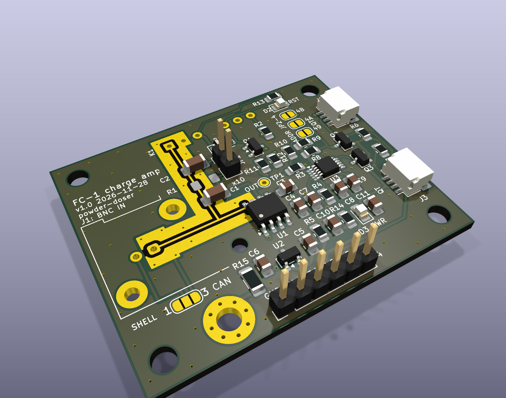
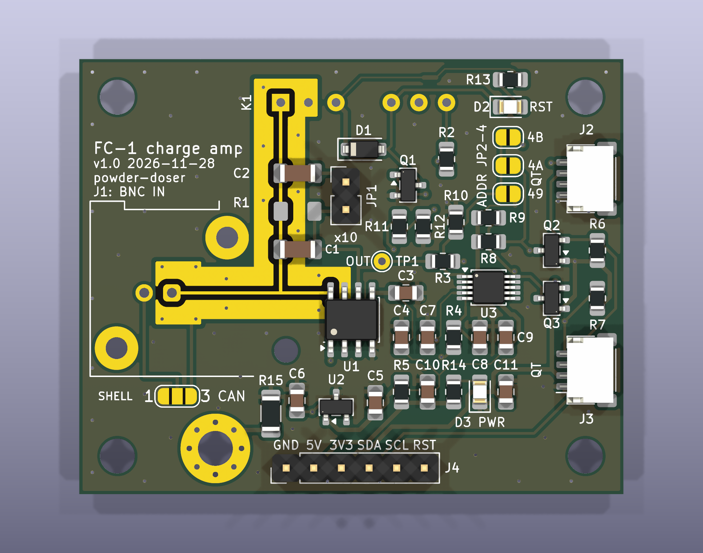
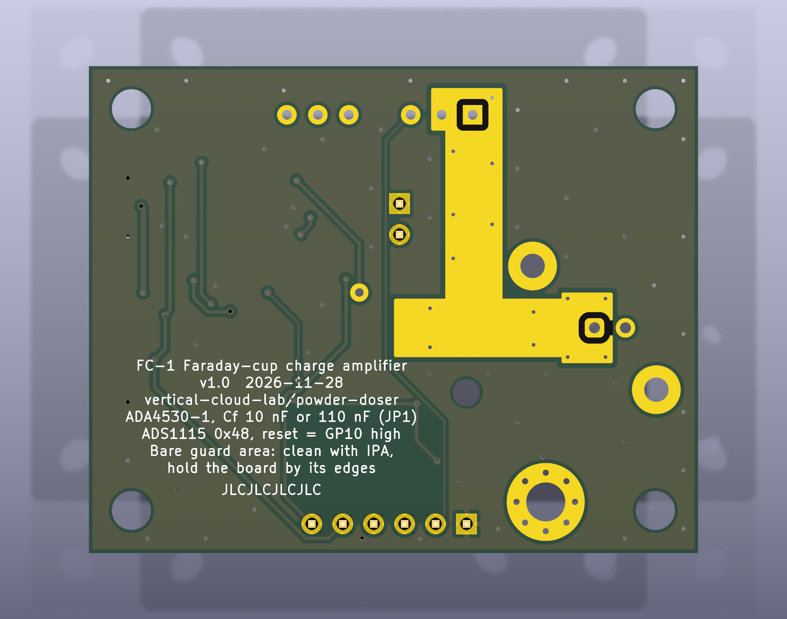

# FC-1: Faraday-cup charge amplifier board

**Status: design v1.0, 2026-11-28. Not built or tested.** KiCad 9.0.8 project for test 10 of
[`../SPEC.md`](../SPEC.md) (Faraday cup). ERC: 0 errors, 0 warnings. DRC: 0 errors, 0 unconnected pads,
schematic parity clean; 55 warnings, all the deliberate solder-mask opening over the guard (see
[Checks](#checks)).



| Top | Bottom (mirrored) |
|---|---|
|  |  |

Schematic: [`fc1-schematic.pdf`](fc1-schematic.pdf) ([SVG](fc1-schematic.svg), [PNG](fc1-schematic.png)).

## What it does

The inner cup of the Faraday cup is wired to the BNC. The board holds the cup at a virtual ground
and moves every coulomb that lands in the cup onto a feedback capacitor C_f. The output voltage is
proportional to the charge:

    Q_cup = -C_f * (V_OUT - V_REF)

An ADS1115 on the board reads V_OUT - V_REF differentially. It sits on the accessory Pico 2 W's
I2C chain (STEMMA QT, 3.3 V) at address 0x48. A reed relay across C_f zeroes the integrator when
the Pico drives GP10 high.

## The circuit in words

- **Input (guarded).** BNC J1 (Amphenol RF 031-5539, polypropylene insulator) centre pin to the
  inverting input of U1 (ADA4530-1, femtoampere electrometer op-amp, SOIC-8). This node, SUM, also
  goes to one side of C1, C2, R1 and the reed contact K1 pin 1, and nothing else. It is routed on the
  top layer only, with no vias. The only plated holes on it are the BNC centre pin and K1 pin 1.
- **Guard.** U1's guard-buffer pins (2 and 7) drive a GUARD copper fill around every SUM pad and
  trace, on both layers, 0.5 mm from SUM. The relay's coaxial shield (K1 pin 5) is on GUARD, so leakage
  from the coil lands on the guard, not on SUM. There is no solder mask over the guarded area (top and
  bottom), so surface leakage from other copper is caught by bare guard copper. A 2.2 mm hole (H6)
  next to U1 takes a Keystone 11301 PTFE turret if you want to air-wire the input instead.
- **Integrator.** C1 = 10 nF C0G 1 % is always in the feedback. Fitting the shunt on JP1 adds
  C2 = 100 nF C0G in parallel (C_f = 110 nF). R1 (1206, not fitted) is a place for a 10 G bleed
  resistor if slow drift ever matters more than holding a reading.
- **Reference.** U2 (REF3025, 2.500 V) sets U1's non-inverting input, the virtual ground, to mid-rail.
- **Reset.** K1 (Coto 9002-05-01: 1 Form A reed, 10^12 ohm minimum insulation, coaxial shield,
  internal coil diode) shorts C_f through R2 (100 R, limits the discharge current through the reed).
  GP10 high -> R11 4k7 -> Q1 (MMBT3904) pulls the 350 ohm, 5 V coil low (14 mA). D1 (1N4148W) is the
  flyback diode; R12 holds Q1 off if RESET_IN floats. D2 (yellow) lights while the relay is closed.
- **ADC.** U3 (ADS1115) runs at 5 V so it can see the whole 0-5 V output swing. AIN0 = OUT through
  R3 1k / C7 10 nF C0G, AIN1 = REF through the matching R4 / C8. AIN2, AIN3 and ALERT are unused.
  Address 0x48 through R10 (100k to GND); bridge one of JP2 / JP3 / JP4 for 0x49 / 0x4A / 0x4B.
- **I2C.** Q2, Q3 (BSS138) shift SDA and SCL between the 3.3 V bus (pull-ups R6, R7) and the ADC's
  5 V side (R8, R9). J2 and J3 are STEMMA QT / Qwiic sockets in parallel (pass-through).
- **Power.** 5 V from the Pico's VBUS on J4 pin 2. R5 (10 R) and C4 (10 uF) filter it into +5VA for
  U1, U2, U3. No LDO: U1's supply rejection and the differential read (REF noise cancels) make one
  unnecessary, and an LDO would leave too little headroom from 5 V (U1 needs at least 4.5 V). The
  relay coil and LEDs run on the unfiltered +5V. 3.3 V comes from the Pico (J4 pin 3 or the QT cable).
  D3 (green) shows 5 V.
- **Grounds.** One GND net poured on both layers and joined by 59 vias; no split planes (all
  currents are DC and under 20 mA). The outer can's M3 lug H5 joins GND only through R15 (0 R) near
  J4's GND pin: that is the single point where the shield meets circuit ground. Remove R15 to float the
  can, or replace it with an RC. JP5 sets the BNC shell: pads 1-2 bridged = shell on GND (default);
  2-3 = shell on GUARD (see [Leakage](#leakage-and-drift)).
- **Header J4** (2.54 mm): 1 GND, 2 5V, 3 3V3, 4 SDA, 5 SCL, 6 RESET_IN.

## Design numbers

### Range and resolution

U1's output swings to within about 0.1 V of the rails, so V_OUT - V_REF spans about +/-2.4 V.

| | C_f = 10 nF (JP1 open) | C_f = 110 nF (JP1 fitted) |
|---|---|---|
| Full scale | about +/-24 nC | about +/-264 nC |
| ADS1115 +/-4.096 V range (LSB 125 uV) | 1.25 pC per LSB | 13.8 pC per LSB |
| +/-2.048 V range (62.5 uV) | 0.63 pC | 6.9 pC |
| +/-0.256 V range (7.8 uV), for under 2.5 nC / 28 nC | 0.078 pC | 0.86 pC |

SPEC §10 expects 1-100 nC per gram, so a 0.1-1 g dose gives 0.1-100 nC: the 10 nF range for most
doses, 110 nF above about 20 nC. Auto-range in firmware by stepping the ADS1115's gain.

### Leakage and drift

A constant input current I moves the output by I * t / C_f.

| Source | Size | Drift on 10 nF | on 110 nF |
|---|---|---|---|
| U1 input bias (20 fA maximum: SPEC §10 and ADI's headline figure, not re-read here) | 20 fA | 1.2 pC/min = 0.12 mV/min | 0.011 mV/min |
| Reed contacts, open, 10^12 ohm minimum (10^13 typical) | proportional to the reading: 2.4 pA at full scale | at most 0.6 % of the reading per minute | same in % |
| Coil to contact | goes to the guarded shield, not to SUM | negligible | negligible |
| BNC and cable insulation, shell on GND (JP5 1-2) | 2.5 V across them; tens of fA when clean | about 0.1-1 pC/min | |
| FR-4 gap between the BNC centre and shell pins (0.94 mm, unguarded when JP5 is 1-2) | sub-pA clean and dry, can reach pA when humid or dirty | up to tens of pC/min | |

The last row is the weak point of a vertical BNC: its shell pin sits 2.54 mm from the centre pin, too
close for a guard trace. For charges under about 1 nC, or above about 50 % RH, bridge JP5 2-3 instead:
the shell (and the cable shield) then sit at the guard voltage, so there is no voltage across the BNC,
the cable or that gap. In that mode the cable shield must not touch the grounded outer can (use an
insulated feed-through at the can, ground the can with the lug H5), and the BNC must not touch a
grounded metal panel. The leakage figures for the gap are estimates, not measurements: measure the
drift with the drift test below and log RH with the SHT45.

The relay term acts like a 10^12 ohm resistor across C_f (time constant 10^4 s on 10 nF), so a reading
taken within a minute of the reset loses at most about 0.6 % and usually much less.

### Reset

- K1 closes in about 0.35 ms (Coto data sheet, typical, including bounce).
- C_f discharges through R2: time constant 1 us (10 nF) or 11 us (110 nF); U1 then holds OUT = REF.
- Recommended: GP10 high for 100 ms (1 s after a near-full-scale reading), then low, wait 50 ms, take
  the baseline reading.
- Opening the relay injects a small fixed charge (the coil swings 5 V; coil-to-contact capacitance
  is 0.5 pF with the shield guarded, so at most about 2.5 pC). The baseline taken after release
  removes it.

### Dielectric absorption

After a reset, a capacitor gives back a small fraction of its previous voltage over seconds to
minutes. C0G ceramic is among the best dielectrics for this (typically 0.1 % or less), with
polypropylene or polystyrene film better still. After a full-scale 2.4 V reading, expect at most a
few mV (tens of pC on 10 nF) to creep back. Hold the reset for 1 s after large readings and always
read a fresh baseline after the reset. If it matters, replace C1 with a 10 nF polypropylene film
capacitor on short leads (WIMA FKP2) on the same pads.

### Input capacitance and noise gain

C_in = cup to can (10-30 pF) + cable (RG-58 is about 100 pF/m: about 30 pF for 0.3 m) + BNC, PCB and
U1 (a few pF): about 50-70 pF. The charge amplifier collects the charge regardless of C_in (the cup
stays at the virtual ground), but C_in sets the noise gain 1 + C_in / C_f = 1.006 on 10 nF and
1.0006 on 110 nF. So U1's voltage noise reaches the output almost unamplified: a few uV, far below
the ADC's LSB. Because the cup sits at +2.5 V relative to the grounded can, a change in their
capacitance moves charge: 0.1 pF of vibration or powder gives 0.25 pC. That sets a floor for the
smallest charges, not for nC readings.

## Board

- 50 x 40 mm, 2 layers, 1.6 mm FR-4, 1 oz. Four M3 holes (NPTH) 3.5 mm from each corner
  (43 x 33 mm pattern), M3 plated lug H5 for the outer can, 2.2 mm hole H6 for the PTFE turret.
- Hand-solderable: 0805 and 1206 passives, SOT-23, SOD-123, SOIC-8, MSOP-10 (0.5 mm pitch, the
  hardest part), JST SH sockets, through-hole headers, relay and BNC.
- Design rules (JLCPCB- and OSH Park-safe): 0.15 mm minimum track and clearance, 0.6 / 0.3 mm vias,
  0.3 mm copper to edge. Default clearance 0.2 mm, SUM 0.5 mm. `fc1.kicad_dru` allows the MSOP-10's
  own 0.15 mm pad gaps.
- Silkscreen: name, version, date, J4 pin names, LED and range labels, address codes, JP5 pads, CAN.
  `JLCJLCJLCJLC` on the back marks where JLCPCB may print its order number (keep it off the guard).

## Ordering

| Fab | Price | Build + shipping to Utah | Source |
|---|---|---|---|
| JLCPCB | from $2 for 5 boards (2 layers, up to 100 x 100 mm, green, HASL); ENIG extra | 24 h build (green); DHL Express 3-5 business days, Global Standard Direct Line 8-10 | jlcpcb.com home page offer; shipping table at jlcpcb.com/help/article/Shipping-Methods-and-Delivery-Time (updated 2026-11-10) |
| OSH Park | $5 per square inch for 3: 3.10 in^2 = **$15.50 for 3** (ENIG, purple, 1.6 mm) | ships in 9-12 calendar days, free USPS First Class 1-5 business days; Super Swift $31.00, ships within 5 business days | docs.oshpark.com (services/two-layer, super-swift, shipping-information) |

Not verified: the exact JLCPCB quote for this board and the shipping cost (both need the quote page
in a browser). Expect about 1 week door to door from JLCPCB with DHL, about 2-2.5 weeks from OSH Park.

- **JLCPCB:** upload `fc1-gerbers.zip`; 2 layers, 1.6 mm, 50 x 40 mm, qty 5. Pick **ENIG** if you
  can (the guard area is bare copper; HASL works but is lumpier). Order number: "Specify a location".
  Do not let anyone "fix" the mask opening over the input: it is on purpose.
- **OSH Park:** upload `fc1-gerbers.zip` (or `fc1.kicad_pcb`). ENIG is standard.
- **Parts:** [`bom.csv`](bom.csv): 29 part lines (40 parts fitted, R1 not fitted) plus the optional PTFE turret and the PCB, with DigiKey part numbers, prices and stock read from
  DigiKey's own product pages on 2026-11-28. About **$72 per board** at single-unit prices, about
  $58 at 10-off prices, plus the PCB. The ADA4530-1 alone is $41.95 (103 in stock, 44-week factory
  lead time: buy it first). Out-of-stock first choices were swapped for in-stock equivalents (listed
  as alternates). The JST, header and Ohmite alternates were not checked.

## Assembly

[`solder_steps.json`](solder_steps.json) lists the 41 steps in order (also the source for the
soldering animation): ICs first (U3, U1), then SOT-23 and SOD-123 parts, the 0805 resistors and
capacitors, LEDs, the 1206 parts, the JP5 bridge, the JST sockets, the headers, the relay and
finally the BNC. Positions are in mm from the board's lower-left corner, y up.

- Use rosin or water-washable flux, not no-clean, and wash the whole board in 99 % IPA with a soft
  brush. Rinse the guard area last with fresh IPA, then dry it (warm air or 1 h at 50 C).
- Hold the board by its edges after washing; skin oil on the guard area is a leakage path.
- Bridge JP5 pads 1-2 (shell on GND) for the first tests. Leave JP2-JP4 open (address 0x48).
- R1 is not fitted. Fit the JP1 shunt only for the 110 nF range.

## Bench test

1. **Power.** Wire J4 to the Pico: GND, 5V to VBUS (pin 40), 3V3 to 3V3(OUT) (pin 36), SDA to GP0,
   SCL to GP1, RST to GP10. Always connect J4's 5 V: with 3.3 V but no 5 V, the BSS138 body diodes
   load the I2C bus and the other sensors on the chain stop answering. Check: D3 on; REF at C6 =
   2.500 V +/- 5 mV; the bare guard copper reads the same about 2.50 V on a DMM (never probe SUM);
   an I2C scan shows 0x48; D2 lights while GP10 is high.
2. **Drift (leakage).** Cap the BNC, reset, log OUT - REF at 8 SPS on the +/-0.256 V range for 10 min.
   Leakage I = C_f * slope. Clean and dry, expect under 0.12 mV/min on 10 nF (20 fA). Log RH and T.
3. **Known charge.** Put a 1.00 nF +/-1 % C0G capacitor in series with the BNC centre (a BNC tee or a
   short BNC-to-clip lead), its other end on a source that steps from 0 to 1.000 V, with the source's
   ground on the board's GND. Q = C_inj * dV = 1.00 nC, so V_OUT - V_REF should step by
   **-100.0 mV** on 10 nF and **-9.09 mV** on 110 nF. Stepping back to 0 V should return it to the
   baseline. Other useful points: 10.0 nF injection -> -1.000 V on 10 nF (gain -1: checks C1 against
   C_inj); 10 pF -> 10 pC -> -1.00 mV (use the +/-0.256 V range). The Pico can be the source: a GPIO
   step is 3.3 V, so 1 nF injects 3.3 nC (measure the GPIO's high level with a DMM first).
4. **Reset.** Inject 10 nC, pulse GP10 for 100 ms: the reading should come back to the baseline
   within a few LSB. Log the next 60 s to see the dielectric-absorption creep.
5. **Range.** Fit JP1 and repeat step 3 with a 10.0 nF injection: expect -90.9 mV.

## Reading it from the accessory Pico

I2C0 on GP0 (SDA) / GP1 (SCL), address 0x48. ADS1115 config register (0x01) for a single-shot
AIN0 - AIN1 conversion at 8 SPS, comparator off: `0x8303` (+/-4.096 V, the full swing), `0x8503`
(+/-2.048 V), `0x8B03` (+/-0.256 V). Use 8 SPS for single readings (lowest noise) and 128-860 SPS
for time series. Reset is GP10 (SPEC §0.2): high = relay closed.

```python
# MicroPython, accessory Pico 2 W
from machine import I2C, Pin
import struct, time

i2c = I2C(0, sda=Pin(0), scl=Pin(1), freq=100_000)
rst = Pin(10, Pin.OUT, value=0)
ADDR, C_F = 0x48, 10e-9            # 110e-9 with the JP1 shunt fitted
PGA = {4.096: 1, 2.048: 2, 1.024: 3, 0.512: 4, 0.256: 5}

def volts(fsr=4.096):
    """One AIN0-AIN1 reading at 8 SPS, in volts (V_OUT - V_REF)."""
    cfg = 0x8000 | (PGA[fsr] << 9) | 0x0100 | 0x0003   # OS, AIN0-AIN1, gain, single-shot, 8 SPS, comp off
    i2c.writeto_mem(ADDR, 0x01, struct.pack(">H", cfg))
    while not i2c.readfrom_mem(ADDR, 0x01, 2)[0] & 0x80:
        time.sleep_ms(5)
    return struct.unpack(">h", i2c.readfrom_mem(ADDR, 0x00, 2))[0] * fsr / 32768

def zero(hold_ms=100):
    rst.on(); time.sleep_ms(hold_ms); rst.off(); time.sleep_ms(50)
    return volts()

v0 = zero()
# ... dose N revs, wait 2 s after the last grain (SPEC §10) ...
q = -C_F * (volts() - v0)          # coulombs collected by the inner cup
```

## Files

| File | What |
|---|---|
| `fc1.kicad_pro`, `fc1.kicad_sch`, `fc1.kicad_pcb`, `fc1.kicad_dru` | KiCad 9 project |
| `fc1.kicad_sym`, `fc1.pretty/`, `sym-lib-table`, `fp-lib-table` | project library: the Coto 9002 symbol and SIP-6 footprint (drawn from the Coto data sheet; everything else is from KiCad's own libraries) |
| `fc1_design.py` | single source: parts, nets, MPNs, placement, guard polygon, silkscreen |
| `gen_sch.py`, `gen_pro.py`, `build_pcb.py`, `sexp.py` | generators for the schematic, project file and board |
| `fc1.dsn`, `fc1.ses` | autorouter input and result (FreeRouting 2.6.0) |
| `make_bom.py`, `bom.csv` | BOM with DigiKey data |
| `make_solder_steps.py`, `solder_steps.json` | soldering order and geometry for the animation |
| `export.sh` | ERC, DRC, schematic PDF/SVG, Gerbers, drill, position file and renders |
| `fc1-schematic.pdf/.svg/.png`, `fc1-top.png`, `fc1-bottom.png`, `fc1-iso.png` | outputs |
| `gerbers/`, `fc1-gerbers.zip`, `fc1-pos.csv` | fabrication outputs (position file origin = board lower-left, y up) |
| `erc.rpt`, `drc.rpt` | check reports |

To regenerate (KiCad 9 `pcbnew` needs the system Python):

```bash
python3 gen_pro.py && python3 gen_sch.py
/usr/bin/python3 build_pcb.py place          # footprints, nets, the hand-routed guarded input
/usr/bin/python3 build_pcb.py dsn            # fc1.dsn with the guard area kept out
java -jar freerouting-2.6.0.jar -de fc1.dsn -do fc1.ses -mp 40 -mt 1 --gui.enabled=false   # Java 25
/usr/bin/python3 build_pcb.py finish         # import routes, guard and GND pours, mask opening, silk
./export.sh && python3 make_bom.py && /usr/bin/python3 make_solder_steps.py
```

The hand-routed parts are the SUM traces, the guard link between U1 pins 7 and 2, U1's feedback
connections and the BNC shell link; FreeRouting routed the rest (some traces neck to 0.15 mm at the
MSOP-10 pins). The renders used the 12 KiCad 3D models this board needs, fetched from
gitlab.com/kicad/libraries/kicad-packages3D (tag 9.0.8); KiCad has no model for the BNC and the relay
footprint is the project's own, so those two show as bare pads.

## Checks

- **ERC** ([`erc.rpt`](erc.rpt)): 0 errors, 0 warnings. A netlist export was also compared pin by pin
  with `fc1_design.py`: no differences.
- **DRC** ([`drc.rpt`](drc.rpt), with schematic parity): 0 errors, 0 unconnected pads, 0 footprint or
  parity problems. 55 warnings, all `solder_mask_bridge`: the mask opening over the guarded area
  exposes SUM and GUARD copper (and 14 GUARD vias) in one aperture. That is the intended guard layout,
  not a fault.

## Not verified / open points

- **ADA4530-1 pinout** is from KiCad's library symbol (1 +IN, 2 and 7 guard, 3 "IC", 4 V-, 5 V+,
  6 OUT, 8 -IN); analog.com timed out from the runner, so the data sheet was not re-read. Pin 3 is
  left unconnected. Check pin 3 and the guard-buffer load limits against the data sheet before ordering.
- **Coto 9002 footprint** was drawn from the data sheet (6 pins on a 2.54 mm grid: 1, 5, 2, gap, 3,
  6, 4; body 19.3 x 5.08 mm, 5.6 mm with shell). Check it against a real relay or a 1:1 print.
- **BNC.** The first choice, TE 1-1478035-0 (right angle, PTFE), is obsolete, and no in-stock
  right-angle PTFE BNC could be matched to a verified footprint, so the board uses the vertical
  bulkhead Amphenol 031-5539 with KiCad's footprint for that part. Mount the board behind a panel with
  the BNC through it.
- Fab prices and shipping (above); the leakage of the BNC pin gap (estimate only); the body heights
  in `solder_steps.json` are approximate package outlines.
- The board has not been built. Build one, run the bench test, then update this file.
