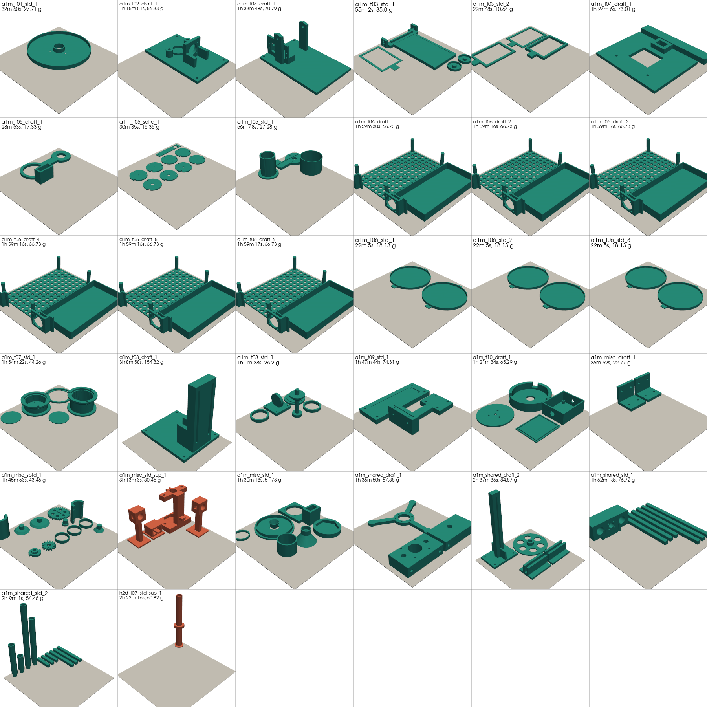

# Sliced plates for every printed part

**Status: sliced, not printed.** 80 printed-part designs (121 items counting quantities) on 32 plates:
31 for a Bambu Lab A1 mini and 1 for the H2D. All of them sliced without errors, and every plate's
extrusion stays inside the bed, as checked from the G-code. The estimate is **48.0 h of printing and
1.70 kg of PLA**. Tier 1 (tests 1-4) plus the shared parts take 10 plates and 14.3 h. On the lab's two
A1 minis that is one long day.

*How the packer laid out each plate. Orange: plates with tree supports. Redraw with `xvfb-run -a python report.py`.*

## Nozzles, read before slicing

Read live over LAN MQTT through the doser Pi at 09:01 UTC on 2026-11-28, with a read-only status
request ([`nozzle_check.py`](nozzle_check.py); nothing on the printers was changed):

| Printer | Nozzles | State |
|---|---|---|
| A1 mini (the one in `A1_MINI_IP`) | 0.4 mm stainless | IDLE, no HMS |
| H2D | **left (id 1): 0.4 mm** HS01; right (id 0): 0.6 mm HU01 | FINISH, 2 HMS alerts |

- Every A1 mini plate is sliced for its 0.4 mm nozzle.
- The 245 mm drum shaft (too tall for the A1 mini) is sliced for the H2D's **left** 0.4 mm nozzle. Its
  `filament_map = 1` (left) and the G-code has no tool change, so the 0.6 mm right nozzle isn't used.
  CLAUDE.md allows an unused nozzle of any size.
- At send time Studio may still flag the right nozzle's 0.6 mm against the 0.4 mm preset. If it does,
  that needs a person.
- Re-read both printers in the `@claude-print` run before sending, as CLAUDE.md requires. The two H2D
  HMS alerts weren't read in detail.

## How it was sliced

[`slice_all.py`](slice_all.py) packs the parts and slices each plate with Bambu Studio 02.09.02.62's
command line (Linux AppImage, extracted on the runner):

- **Presets:**
  - *Bambu Lab A1 mini 0.4 nozzle* (the H2D plate uses *Bambu Lab H2D 0.4 nozzle*);
  - *Bambu PLA Basic*;
  - textured PEI plate: 65 °C bed, 220 °C nozzle, as on the lab's earlier A1 mini prints;
  - 3 walls.

  Bambu's system presets inherit from base presets, and the command line doesn't resolve that, so
  `flatten()` merges each chain first. Before that fix, the slice silently used defaults: 0 g of
  filament and the wrong plate.
- **Three part classes:**
  - **Standard,** 0.20 mm and 25 %: anything that touches powder or sets a dimension.
  - **Solid,** 0.20 mm and 100 % (zig-zag): pedestals, rings, moulds, gears, cam, orifice discs, gate.
  - **Draft,** 0.24 mm and 15 %: bases, stands, trays, shelves, brackets, boxes. This saves about a
    quarter of the time on those plates.
- **Supports:** tree supports only where the overhang check needs them: the tapper carriage, the drum
  shaft and the two camera mounts.
- **Placement:** each plate is packed by `pack()` and merged into one pre-placed mesh, then sliced
  with arrange off.
  - The first run used Bambu's own arrange. It left 9 objects partly off the bed on 5 plates, and the
    slicer still reported success.
  - `gcode_extents()` now reads each plate's extrusion extents and checks them against the bed
    (`merged_bbox_ok` in [`plates.json`](plates.json)).
  - The H2D part is centred, because each H2D nozzle can't reach one edge of the bed.

## Checks and refinements

1. **Overhangs** ([`overhang_check.py`](overhang_check.py)): the first orientations had about 20 parts
   with large overhangs. They were redesigned rather than given supports:
   - spigots became pin-and-hole locators (tray, cradle, cup holder) or flat bottoms (fill holder,
     catch cup, pan adapter);
   - the tripod legs became square bars printed lying down;
   - the tilt plate's lugs moved flush with its underside;
   - the drum flange got a 45° chamfer;
   - the gate channel opens on top;
   - the piston's weight platform sits on a 45° cone;
   - the hooks print on their sides.
2. **Fit:**
   - the tilt base was shortened to 154 mm and the microscope column to 160 mm;
   - the humidity tray and shelf were shrunk so that one of each shares a plate (6 plates instead of 12);
   - every part is checked against the printer's bed in `../cad/out/parts.json` (`fits_printer`).
3. **Time:** the draft class and the plate packing brought the per-part time down. Adding the Ø40
   pedestal, the deep drum, the 6th humidity box and the DIY stage put the total back to 48.0 h.

## Plates

| Plate | Printer | Layers | Infill | Supports | Time | PLA (g) | Parts |
|---|---|---|---|---|---|---|---|
| [`a1m_t01_std_1`](plates/a1m_t01_std_1.gcode.3mf) | A1M | 0.20 Standard | 25 % | none | 32m 50s | 27.71 | overflow_tray |
| [`a1m_t02_draft_1`](plates/a1m_t02_draft_1.gcode.3mf) | A1M | 0.24 Draft | 15 % | none | 1h 15m 51s | 56.33 | tapper_base |
| [`a1m_t03_draft_1`](plates/a1m_t03_draft_1.gcode.3mf) | A1M | 0.24 Draft | 15 % | none | 1h 33m 48s | 70.79 | tilt_base |
| [`a1m_t03_std_1`](plates/a1m_t03_std_1.gcode.3mf) | A1M | 0.20 Standard | 25 % | none | 55m 2s | 35.0 | tilt_plate, strike_frame_1mm, ring_lid x2 |
| [`a1m_t03_std_2`](plates/a1m_t03_std_2.gcode.3mf) | A1M | 0.20 Standard | 25 % | none | 22m 48s | 10.64 | strike_frame_2mm, strike_frame_3mm, strike_frame_5mm |
| [`a1m_t04_draft_1`](plates/a1m_t04_draft_1.gcode.3mf) | A1M | 0.24 Draft | 15 % | none | 1h 24m 6s | 73.01 | micro_column, micro_base |
| [`a1m_t05_draft_1`](plates/a1m_t05_draft_1.gcode.3mf) | A1M | 0.24 Draft | 15 % | none | 28m 53s | 17.33 | cup_holder |
| [`a1m_t05_solid_1`](plates/a1m_t05_solid_1.gcode.3mf) | A1M | 0.20 Standard | 100 % | none | 30m 35s | 16.35 | gate_slide, orifice_disc_1p00, orifice_disc_1p50, orifice_disc_2p00, orifice_disc_2p54, orifice_disc_3p00, orifice_disc_4p00, orifice_disc_5p08, orifice_disc_6p00 |
| [`a1m_t05_std_1`](plates/a1m_t05_std_1.gcode.3mf) | A1M | 0.20 Standard | 25 % | none | 56m 48s | 27.28 | gate_guide, catch_cup, orifice_cup |
| [`a1m_t06_draft_1`](plates/a1m_t06_draft_1.gcode.3mf) | A1M | 0.24 Draft | 15 % | none | 1h 59m 30s | 66.73 | hc_shelf, hc_slurry_tray, hc_fan_mount, hc_sensor_clip |
| [`a1m_t06_draft_2`](plates/a1m_t06_draft_2.gcode.3mf) | A1M | 0.24 Draft | 15 % | none | 1h 59m 16s | 66.73 | hc_shelf, hc_slurry_tray, hc_fan_mount, hc_sensor_clip |
| [`a1m_t06_draft_3`](plates/a1m_t06_draft_3.gcode.3mf) | A1M | 0.24 Draft | 15 % | none | 1h 59m 16s | 66.73 | hc_shelf, hc_slurry_tray, hc_fan_mount, hc_sensor_clip |
| [`a1m_t06_draft_4`](plates/a1m_t06_draft_4.gcode.3mf) | A1M | 0.24 Draft | 15 % | none | 1h 59m 16s | 66.73 | hc_shelf, hc_slurry_tray, hc_fan_mount, hc_sensor_clip |
| [`a1m_t06_draft_5`](plates/a1m_t06_draft_5.gcode.3mf) | A1M | 0.24 Draft | 15 % | none | 1h 59m 16s | 66.73 | hc_shelf, hc_slurry_tray, hc_fan_mount, hc_sensor_clip |
| [`a1m_t06_draft_6`](plates/a1m_t06_draft_6.gcode.3mf) | A1M | 0.24 Draft | 15 % | none | 1h 59m 17s | 66.73 | hc_shelf, hc_slurry_tray, hc_fan_mount, hc_sensor_clip |
| [`a1m_t06_std_1`](plates/a1m_t06_std_1.gcode.3mf) | A1M | 0.20 Standard | 25 % | none | 22m 5s | 18.13 | hc_sample_dish x2 |
| [`a1m_t06_std_2`](plates/a1m_t06_std_2.gcode.3mf) | A1M | 0.20 Standard | 25 % | none | 22m 5s | 18.13 | hc_sample_dish x2 |
| [`a1m_t06_std_3`](plates/a1m_t06_std_3.gcode.3mf) | A1M | 0.20 Standard | 25 % | none | 22m 5s | 18.13 | hc_sample_dish x2 |
| [`a1m_t07_std_1`](plates/a1m_t07_std_1.gcode.3mf) | A1M | 0.20 Standard | 25 % | none | 1h 54m 22s | 44.26 | drum_bezel, drum_body, drum_body_d25, drum_backdisc x2 |
| [`a1m_t08_draft_1`](plates/a1m_t08_draft_1.gcode.3mf) | A1M | 0.24 Draft | 15 % | none | 3h 8m 58s | 154.32 | ucs_base |
| [`a1m_t08_std_1`](plates/a1m_t08_std_1.gcode.3mf) | A1M | 0.20 Standard | 25 % | none | 1h 0m 38s | 26.2 | ucs_sample_base, ucs_platen, mould_ring x2, ucs_piston |
| [`a1m_t09_std_1`](plates/a1m_t09_std_1.gcode.3mf) | A1M | 0.20 Standard | 25 % | none | 1h 47m 44s | 74.31 | coupon_bed, blade_carriage |
| [`a1m_t10_draft_1`](plates/a1m_t10_draft_1.gcode.3mf) | A1M | 0.24 Draft | 15 % | none | 1h 21m 34s | 65.29 | fc_cradle, fc_insulator_base, fc_pcb_box, fc_pcb_lid |
| [`a1m_misc_draft_1`](plates/a1m_misc_draft_1.gcode.3mf) | A1M | 0.24 Draft | 15 % | none | 36m 52s | 22.77 | spread_bracket x2 |
| [`a1m_misc_solid_1`](plates/a1m_misc_solid_1.gcode.3mf) | A1M | 0.20 Standard | 100 % | none | 1h 45m 53s | 43.46 | tilt_gear_30t, pedestal_d40, pedestal_d30, split_mould_A, split_mould_B, wall_ring x3, tilt_pinion_15t, tapper_cam, pedestal_d20, pedestal_d12 |
| [`a1m_misc_std_sup_1`](plates/a1m_misc_std_sup_1.gcode.3mf) | A1M | 0.20 Standard | 25 % | tree | 3h 13m 3s | 80.45 | tapper_carriage, camera_carriage, camera_rod_clamp x2 |
| [`a1m_misc_std_1`](plates/a1m_misc_std_1.gcode.3mf) | A1M | 0.20 Standard | 25 % | none | 1h 30m 18s | 51.73 | micro_carriage, fc_lid, cyl_fill_holder, funnel_collar, sieve_cup, sieve_ring |
| [`a1m_shared_draft_1`](plates/a1m_shared_draft_1.gcode.3mf) | A1M | 0.24 Draft | 15 % | none | 1h 36m 50s | 67.88 | tripod_spider, stage_end_block, stage_motor_block |
| [`a1m_shared_draft_2`](plates/a1m_shared_draft_2.gcode.3mf) | A1M | 0.24 Draft | 15 % | none | 2h 37m 35s | 84.87 | pan_adapter, camera_tower, backlight_foot x2 |
| [`a1m_shared_std_1`](plates/a1m_shared_std_1.gcode.3mf) | A1M | 0.20 Standard | 25 % | none | 1h 52m 18s | 76.72 | tripod_leg_160 x3, tripod_leg_120 x3, stage_carriage |
| [`a1m_shared_std_2`](plates/a1m_shared_std_2.gcode.3mf) | A1M | 0.20 Standard | 25 % | none | 2h 9m 1s | 54.46 | tripod_leg_80 x3, tripod_leg_40 x3, riser_120, riser_160, riser_40, riser_80 |
| [`h2d_t07_std_sup_1`](plates/h2d_t07_std_sup_1.gcode.3mf) | H2D | 0.20 Standard | 25 % | tree | 2h 22m 16s | 60.82 | drum_shaft |

## Before printing

- Send through `@claude-print`, naming the plate file (branch and path) and the printer.
- Print order for the lowest lead time:
  1. the shared plates and tests 1-4 (tier 1);
  2. tests 5-7;
  3. tests 8-10.

  The bought parts arrive in about 4-14 days (see `../bom/README.md`), so printing isn't the long pole.
- After printing:
  - drill or ream the orifice discs to size (1.0-6.0 mm);
  - press heat-set M3 inserts into the drum shaft flange, the drum and the stage carriage;
  - glue a layer of the test powder on the pedestals.
