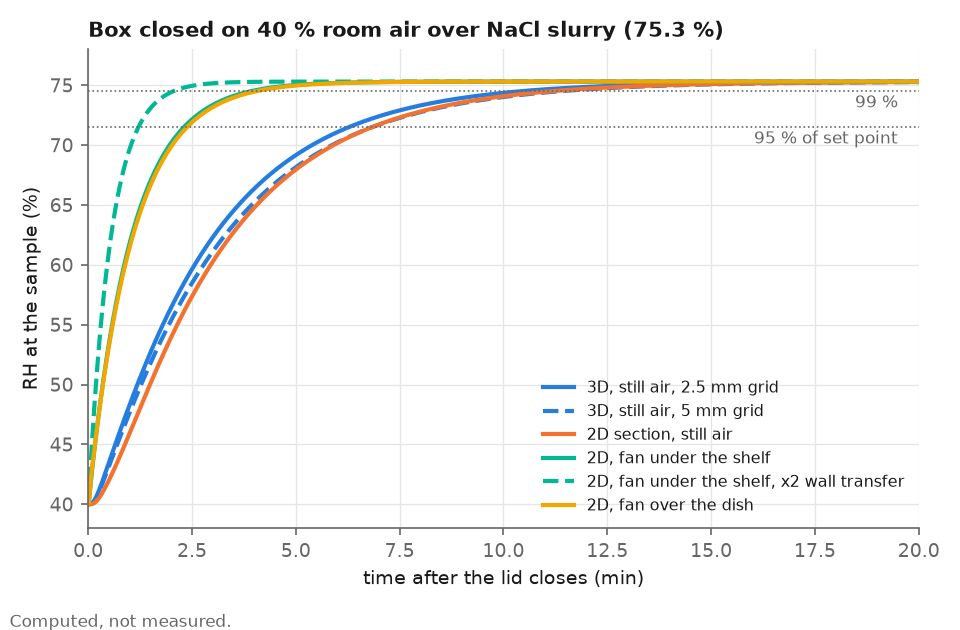
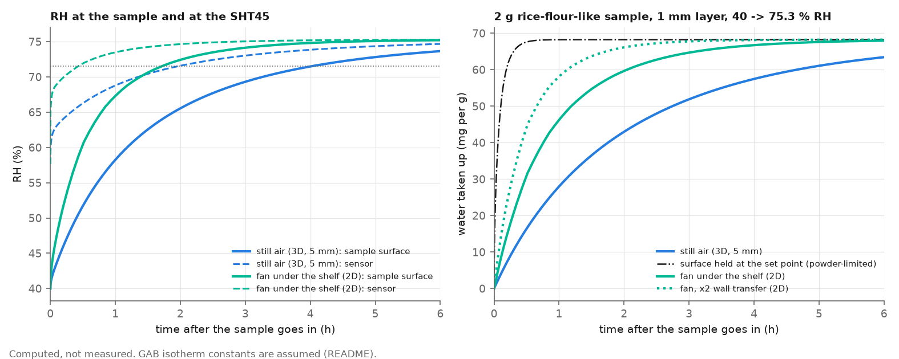
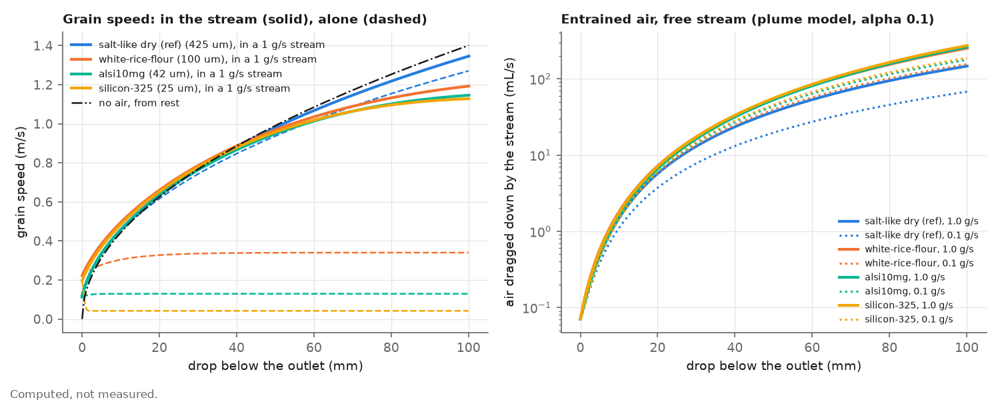
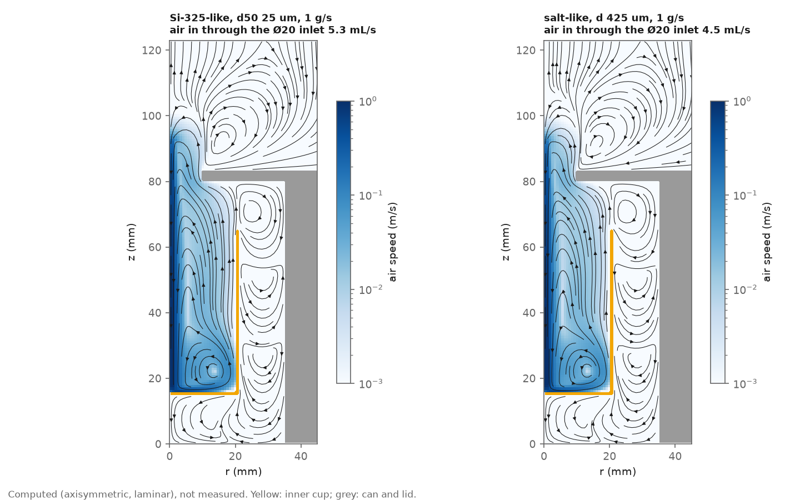
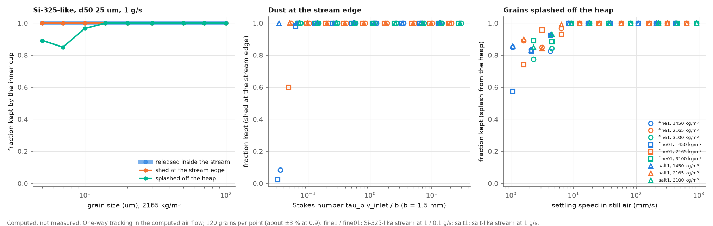
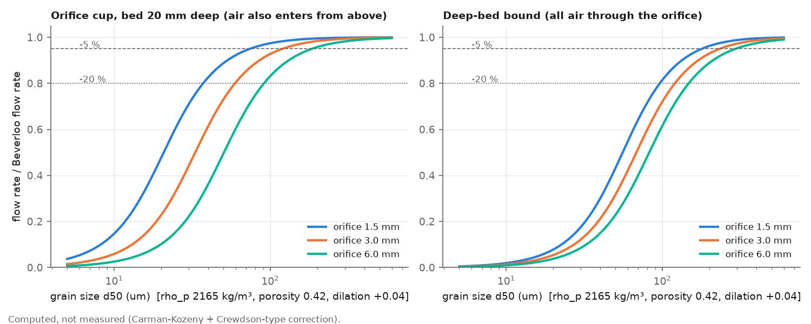

# CFD for the in-house tests: humidity chamber, falling stream and Faraday cup, orifice air

**Status: computed, not measured (2026-11-28).** Nothing here has been built. Every number below
comes from the scripts in this folder, run on a shared runner with numpy/scipy. Dimensions are from
[`../../SPEC.md`](../../SPEC.md). Where a constant is assumed, the text says so.

## In short

- **Solvers validated.** Own 2D Navier-Stokes solver: lid-driven cavity at Re = 100 within 0.005 (u)
  and 0.009 (v) of Ghia et al. (1982), and its extrema converge at second order to the published
  high-accuracy values. Axisymmetric pipe flow within 0.3 %. Transient diffusion within 0.5 % of the
  exact series.
- **Test 6, box to set point:** in still air the RH at the sample reaches 95 % of the NaCl set point
  6.3 min after the lid closes, 99 % after 10.6 min. A fan makes it 2.3 and 4.0 min. Not needed for that.
- **Test 6, uptake:** a 2 g hygroscopic sample needs four times the vapour the box holds, so its uptake
  curve is set by the box: half-time 1.2-1.3 h in still air against 2.6 min for the powder alone. A
  fan under the shelf cuts it to 0.3-0.6 h and the sensor-to-sample RH gap from 10 % to 2.5-6 % RH.
  **Fit the fan, run it all the time at reduced power, and use 0.5 g for kinetics; the 24 h point is
  an equilibrium value either way.**
- **Test 1:** grains in the stream land on the heap at 98-100 % of the free-fall speed (12 mm drop)
  for every powder and feed rate. The DEM can ignore air there.
- **Test 10:** the stream pumps 4.5-5.3 mL/s of air through the Faraday cup's Ø20 inlet (3-6 % of what
  it would drag in free fall). Every grain of 14 µm and up stays in the inner cup. Of 5-10 µm grains that
  splash off the heap, up to 22 % (1 g/s) or 43 % (0.1 g/s) end outside the inner cup within 6 s, mostly
  between its rim and the lid; 3 % or less leave through the lid. **A 60 mm tall inner cup (rim 5 mm
  under the lid) keeps 95-100 % of them.**
- **Test 5:** air counter-flow slows fine powders through the orifice discs: by more than 5 % below a
  d50 of 55-185 µm and more than 20 % below 28-91 µm (1-6 mm discs, 20 mm of powder). Salt and the
  coarse powders are unaffected; Si-325 runs at 0.50-0.93 of Beverloo, AlSi10Mg 0.59-0.95 (1-6 mm discs). **Fit those
  with the air term, keep the cup open and the fill at 5 g.**

## Files

| File | What |
|---|---|
| `mac2d.py` | 2D incompressible Navier-Stokes solver, planar or axisymmetric (r-z): staggered MAC grid, projection, blocked cells, body forces, central / upwind / hybrid differencing |
| `scalar.py` | Finite-volume transient transport (2D or 3D, backward Euler) of RH with extra nodes for a powder layer, advection from `mac2d`, Dirichlet faces |
| `validate_cavity.py`, `validate_pipe.py`, `validate_diffusion.py` | The three validations, with `*_validation.json` / `.png` |
| `humidity_3d.py` | Test 6, still air, 3D box with tray, shelf, dish; cases a, b, c → `humidity_3d_h5.0mm.json`, `humidity_3d_h2.5mm.json` |
| `humidity_fan2d.py` | Test 6 with a 25 mm fan: 2D flow, then vapour transport → `fanflow_*.json/.npz`, `humidity_fan2d.json` |
| `stream_model.py`, `stream_impact.py` | Falling stream: grain speed, entrained air, impact speed → `stream.json`, `stream.png` |
| `faraday_flow.py` | Test 10: axisymmetric air flow in the Faraday cup driven by the stream, then grain tracking → `faraday_flow_*.json/.npz`, `faraday_track_*.json` |
| `orifice_air.py` | Test 5: air counter-flow correction to Beverloo → `orifice_air.json`, `orifice_air.png` |
| `figures.py`, `summary.py` | Figures and `cfd_summary.json` (all key numbers) |
| `run_all.sh`, `log_*.txt` | Reruns everything in the order used; the logs of the runs behind the numbers |

Shared constants (the set given to all three `sim` folders): air at 25 °C, ρ 1.184 kg/m³, μ 1.85e-5 Pa s;
water vapour D = 2.5e-5 m²/s; saturation vapour density 23.0 g/m³; reference powders from #196
(salt-like: d 0.361/0.425/0.489 mm, ρ_p 2165 kg/m³, bulk 1249 kg/m³; cohesive: bulk 1023 kg/m³);
battery powders from #196's `literature_powder_properties.csv` (`e8811bd`).

## 1. Solvers and validation

Three checks against textbook solutions, all passed. Figures: [`cavity_validation.png`](cavity_validation.png),
[`pipe_validation.png`](pipe_validation.png), [`diffusion_validation.png`](diffusion_validation.png).

**Lid-driven cavity, Re = 100** (`mac2d`, central differences), against Ghia, Ghia and Shin (1982),
Tables I and II. The Ghia values were transcribed from the tables as they are usually reproduced; they
were not re-checked against the paper in this session.

| Grid | max abs(u − u_Ghia) on x = 0.5 | max abs(v − v_Ghia) on y = 0.5 | u_min | v_min | v_max | wall time |
|---|---|---|---|---|---|---|
| 32 × 32 | 0.0021 | 0.0084 | −0.20892 | −0.24872 | 0.17535 | 2 s |
| 64 × 64 | 0.0038 | 0.0085 | −0.21278 | −0.25265 | 0.17852 | 11 s |
| 128 × 128 | 0.0049 | 0.0091 | −0.21373 | −0.25356 | 0.17932 | 52 s |
| Richardson (2nd order) | | | −0.21404 | −0.25387 | 0.17958 | |
| Marchi et al. 2009 (1024², from memory) | | | −0.21404 | −0.25380 | 0.17957 | |
| Ghia et al. 1982 (129² points) | | | −0.21090 | −0.24533 | 0.17527 | |

- The profiles lie on Ghia's points within 0.005 (u) and 0.009 (v) of the lid speed on every grid.
- The extrema converge at second order (observed order 2.0 for u_min) to the high-accuracy values of
  Marchi, Suero and Araki (2009) to 4 digits. The small growth of the difference to Ghia with refinement
  is Ghia's own 129-point error (their u_min is 1.5 % low), not the solver's.

**Axisymmetric pipe flow** (`mac2d`, r-z mode), uniform inflow, Re = 10, 8 diameters long: the
profile at 6 D against u_z = 2U(1 − r²/R²) and the pressure gradient against 8 ν U / R².

| Cells across R | max abs error of the profile (fraction of 2U) | error in dp/dz | flow rate |
|---|---|---|---|
| 8 | 1.15 % | 1.54 % | exact |
| 12 | 0.52 % | 0.69 % | exact |
| 16 | 0.29 % | 0.39 % | exact |

Both errors fall 4× per halving of the cell size: second order, as designed.

**Transient diffusion** (`scalar.py`, the 3D solver run as a column): an 80 mm slab, fixed value at
one end, no flux at the other, D = 2.5e-5 m²/s, against the Fourier-series solution. Exact time for the
closed end to reach 95 % of the step: 335.9 s; 99 %: 502.9 s.

| Cells, time step | max abs error (fraction of the step) | t95 (s) | t99 (s) |
|---|---|---|---|
| 10 mm, 4 s | 0.017 | 343.1 (+2.1 %) | 513.8 (+2.2 %) |
| 5 mm, 2 s | 0.010 | 339.3 (+1.0 %) | 508.0 (+1.0 %) |
| 2.5 mm, 1 s | 0.006 | 337.5 (+0.5 %) | 505.4 (+0.5 %) |
| 2.5 mm, 0.25 s | 0.002 | 336.3 (+0.1 %) | 503.5 (+0.1 %) |

The humidity runs use 5 mm / 2 s and 2.5 mm / 1 s, so the time-stepping error in their t95 is about
1 %; the geometry (shelf, dish, tray walls on a 5 mm grid) adds more (see 2a).

## 2a. Test 6 humidity chamber

**Geometry** (from SPEC §6): box 180 × 120 × 90 mm inside (1.94 L), slurry tray 150 × 90 × 15 on the
floor with the slurry surface 10 mm up (12 600 mm² of free surface, held at the salt's RH), a perforated
shelf (2 mm, 30 % open) 30 mm above the tray rim and 5 mm clear of the walls, a Ø60 dish on the shelf
centre with the sample surface at z = 50 mm, and the SHT45 at (140, 60, 60) mm, 50 mm from the dish
centre. Room air 40 % RH, 25 °C. NaCl set point 75.3 % (Greenspan 1977).

**Cases.**
- **a. Lid closed** on room air over NaCl, no sample.
- **b. Sample in.** The box was at the set point; the lid opens for about 10 s (half the air above the
  shelf and a tenth below it replaced by room air) and a 2 g rice-flour-like sample, equilibrated
  with 40 % RH, goes in as a 1 mm layer (bulk 680 kg/m³). It takes up water by porous diffusion
  through the layer (D_eff = D ε/τ = 8.9e-6 m²/s, ε 0.53, τ 1.5) with local sorption equilibrium on a GAB
  isotherm (assumed constants for starchy flour: X_m 0.07 g/g, C 10, K 0.75): 68 mg/g, so 136 mg of
  water, four times the 34 mg of vapour the whole box holds at the set point. The layer is coupled to
  the air above the dish in one implicit system.
- **c. Deliquescent sample.** NaCl in the KCl box (84.3 %): its surface stays at its deliquescence RH,
  75.3 %, so it is a fixed sink. Steady supply rate.

**Still air** is solved in 3D (`humidity_3d.py`, 5 and 2.5 mm cells). **With the fan**
(`humidity_fan2d.py`) the flow is solved first in a 2D section through the box centre (1 mm cells),
then the vapour in the same section. Two fan positions: under the shelf blowing across the slurry
(recommended), and over the dish. The fan is 1.5 m/s mean (a 25 mm 5 V fan moves about 0.5-0.8 L/s);
in 2D it becomes a 25 mm slot with the same momentum flux per unit depth (0.61 m/s).

### Results



**Case a, lid closed on room air** (RH at the sample; the SHT45 reads within 10 s of it):

| Model | 95 % of set point (71.5 % RH) | 99 % (74.5 % RH) | 95 % of the step | 99 % of the step |
|---|---|---|---|---|
| 3D, still air, 2.5 mm cells | 6.3 min | 10.6 min | 8.3 min | 12.6 min |
| 3D, still air, 5 mm cells | 6.9 min | 11.6 min | 9.1 min | 13.8 min |
| 2D section, still air | 6.9 min | 11.3 min | 9.0 min | 13.5 min |
| 2D, fan under the shelf | 2.3 min | 4.0 min | 3.1 min | 4.8 min |
| 2D, fan under the shelf, ×2 wall transfer | 1.2 min | 2.1 min | 1.6 min | 2.5 min |
| 2D, fan over the dish | 2.4 min | 4.1 min | 3.2 min | 4.9 min |

- Still air brings the box to the set point in about 10 minutes, so for the 24 h conditioning the fan
  is not needed. The 2.5 and 5 mm grids differ by 9 %; the 2D section agrees with 3D within 9 %, which
  is why the fan is studied in 2D.
- With the fan the box is well mixed (one turnover every 2-3 s, 0.8 L/s through the fan) and the
  slurry surface limits the rate. A well-mixed box model with the same surface coefficient
  (k = 2.3 mm/s from the computed 6 cm/s over the slurry; τ = V/(kA) = 62 s) gives 138 s and 238 s
  for 95 % and 99 %, against 139 s and 239 s from the CFD.
- Uniformity: without a sink the box ends uniform. The spread is only during the first few minutes.



**Case b, 2 g rice-flour-like sample (1 mm layer, 136 mg of water to take up):**

| Model | Uptake half-time | 95 % of the uptake | Sample surface reaches 95 % of set point | SHT45 minus sample surface at 1 h |
|---|---|---|---|---|
| Powder alone (surface held at the set point) | 2.6 min | 18 min | at once | - |
| 3D, still air (2.5 / 5 mm cells) | 1.24 / 1.34 h | over 6 h (93 % at 6 h) | 3.7 / 4.0 h | +10.5 % RH |
| 2D, fan under the shelf | 0.58 h | 3.0 h | 1.7 h | +6.2 % RH |
| 2D, fan, ×2 wall transfer | 0.33 h | 1.7 h | 0.9 h | +2.5 % RH |

- The sample needs four times the vapour the whole box holds, so the slurry has to supply it through
  the air. In still air the uptake curve then measures the box, not the powder: it is 30× slower than
  the powder's own kinetics. The fan makes it 2-4× faster, still 8-13× slower than the powder.
- The SHT45 reads high while the sample takes up water (by 10 % RH at 1 h in still air), so it cannot
  stand in for the RH at the sample during uptake. It does say when the box is back at the set point.
- The 24 h point is an equilibrium value in every case (93 % of the uptake is in by 6 h even in still
  air). The 1, 2 and 4 h points are box-limited, and will differ between boxes and fan settings.

**Case c, deliquescent NaCl in the KCl box (84.3 %).** Supply-limited uptake: 21 mg/h (3D, 5 mm),
23 mg/h (3D, 2.5 mm), 25 mg/h (2D) in still air; 48 mg/h with the fan, 94 mg/h with ×2 wall transfer.
The air over the sample sits at 76 % (still) or 82 % (fan), and the SHT45 reads 80.8 % (still) or
82.3 % (fan), not 84.3 %. 2 g of NaCl could take up about 8 g of water at 84.3 % (4.2 mol/kg), so over
24 h the box delivers 0.5-2.2 g: the "uptake at 24 h" of a deliquescent salt is a property of the box.

### What it means for test 6

- **The fan is worth fitting, for the uptake curves, not for reaching the set point.** Put it under the
  shelf blowing along the slurry (it feeds the source and leaves 5 cm/s over the dish, too little to
  move powder). It halves to quarters the uptake time and shrinks the sensor-to-sample RH gap from
  10 % to 2.5-6 % RH. Over the dish works as well for the box, but blows on the sample.
- **Run the fan all the time at reduced power** (PWM about 50 % or 3.3 V) and log T at the SHT45:
  start a test only after the box has been closed with the fan on for an hour, so the fan's
  warming (0.5-1.2 K at full power, less at reduced power) is the same everywhere (see Limits). Do not
  switch it on and off during a test.
- **Sensor:** on the shelf at the sample's height, 10-20 mm from the dish edge, not over the slurry.
  Accept "box at set point" when it is within 1 % RH of the Greenspan value for 30 min.
- **Sample:** for kinetics use 0.5 g in a 0.25 mm layer, or more slurry area: when supply-limited the
  time scales with the water demand (0.5 g: about 4× faster), and the powder's own time with the
  layer thickness squared. Keep 2 g for the 24 h equilibrium point.
- **Deliquescent salts above their DRH:** report the uptake rate in mg/h with the box and fan setting
  named, and run every jar in an identical box.

## 2b. Test 10 and test 1: the falling stream, the Faraday cup

### The stream and the impact speed

**Model** (`stream_model.py`). The stream leaves the 6.6 mm² annulus at v0 = ṁ / (ρ_b A) (0.01-0.04 m/s
at 0.1 g/s, 0.1-0.4 m/s at 1 g/s) and falls as a 1D integral two-phase plume: grains feel gravity and
Schiller-Naumann drag; the air in the plume gains that drag as momentum and entrains still air at
α = 0.1 (the top-hat jet/plume value of Morton, Taylor and Turner, 1956). This is the momentum-balance
family of free-falling-plume models (e.g. Liu 2004; Ansart et al. 2009), but its constants are not fitted
to powder data. Check: for strongly coupled fines it reduces to a pure plume driven by the grains'
weight, and at 100 mm it gives 187 mL/s for 0.1 g/s of Si-325 against 233 mL/s from the
Morton-Taylor-Turner point-plume formula with buoyancy flux ṁg/ρ_a.



**Impact speed / free-fall speed** (`stream.json`; "alone" = one grain in still air, "stream" = the same
grain inside the stream's co-flowing air):

| Powder (d50) | 12 mm, alone | 12 mm, stream (0.1 / 1 g/s) | 77 mm, alone | 77 mm, stream (0.1 / 1 g/s) |
|---|---|---|---|---|
| salt-like, both references, BaCl₂ (300-425 µm) | 0.97-0.98 | 0.99 / 1.00 | 0.90-0.92 | 0.93-0.95 / 0.97 |
| Ca lactate (220), Na₂SO₄ (135) | 0.86-0.89 | 0.99 / 1.00 | 0.62-0.69 | 0.81-0.84 / 0.93 |
| rice flours, alginate, Si 110-200, xanthan (90-130) | 0.53-0.77 | 0.98 / 1.00 | 0.24-0.44 | 0.66-0.74 / 0.89-0.91 |
| CMC (60), AlSi10Mg (42) | 0.26-0.28 | 0.98 / 1.00 | 0.10-0.12 | 0.58-0.59 / 0.88 |
| Si-325 (25) | 0.08 | 0.98 / 1.00 | 0.03 | 0.53 / 0.87 |

Free-fall speed: 0.50-0.62 m/s at 12 mm, 1.23-1.29 m/s at 77 mm.

- **Test 1 (12 mm drop onto the heap):** grains in the stream land at 98-100 % of the free-fall
  speed for every powder and feed rate. The DEM twin can use the free-fall speed, and air need not be
  modelled. Only isolated fines (dust, satellites) arrive slowly, at their settling speed.
- **Test 10 (77 mm from the outlet to the cup floor):** the stream still carries fines at 53-97 % of
  the free-fall speed, but a single fine grain would arrive at 3-12 %. So fines arrive inside the
  stream; how many leave again is set by the air flow in the cup (below).
- **Entrained air in free fall:** 2-3 mL/s at 12 mm, 37-56 mL/s at 50 mm, 88-150 mL/s at 77 mm,
  146-272 mL/s at 100 mm (1 g/s; 0.1 g/s gives 30-75 % of that for fines). The cup confines this
  flow, so far less enters it (below).

### Air in the Faraday cup, and which grains stay in it

**Model** (`faraday_flow.py`). Axisymmetric laminar air flow (`mac2d`, r-z, hybrid differencing,
ν = 1.56e-5 m²/s) in the SPEC §10 geometry: grounded can Ø70 × 80 (1 mm wall), printed lid 3 mm thick
with a Ø20 inlet, inner cup Ø40 × 50 (1 mm wall and floor) on 15 mm standoffs (floor at z = 15-16 mm,
rim at 65 mm), doser outlet on the axis 10 mm above the lid, open air above the lid to r = 60 mm.
The stream is a 1.5 mm-radius column in which the air is pulled towards the grain speed v_p(z) of
the 1D model at the local drag rate c = ṁ f / (v_p π b² ρ_a τ_p) (implicit; this is the two-way
momentum coupling). The drag stops 1.5 mm above the floor, where the air turns over the heap. Grid
0.75 mm (80 × 164 cells, the stream edge on a cell face) for the three cases (Si-325-like at 1 g/s and
0.1 g/s, salt-like at 1 g/s), 2 s of flow averaged over the last 0.5 s (the inflow settles within
0.3 s); 0.5 mm for a grid check. The PTFE standoffs, the tripod and the doser tube are left out.

Then grains of 5-100 µm (ρ_p 1450, 2165 and 3100 kg/m³, 120 per size) are tracked one-way in the
averaged flow for 6 s (drag + gravity, exact exponential velocity update, steps of at most 0.4 ms and
0.15 cell): (1) released inside the stream at the lid with the stream's speed; (2) shed at the
stream's edge (r 1.5-4 mm) moving with the local air; (3) splashed off the heap at 0.1-0.5 m/s,
10-80° above the floor. "Kept" = touched the inner cup (inside or outside; it is weighed with it and its charge is
on it) or still airborne inside it at 6 s. "Lost" = touched the can or the lid, or left through the
inlet.



**Air.** The stream pumps air down the axis, it turns over the heap and comes back up inside the inner
cup as a ring vortex, and part of it leaves through the inlet around the stream.

| Case | Air in (= out) through the Ø20 inlet | Up through the inner cup's mouth | Up-speed in the inlet annulus, max | Up-speed in the cup's outer half, mean |
|---|---|---|---|---|
| Si-325-like, 1 g/s | 5.3 mL/s | 9.8 mL/s | 26 mm/s | 13 mm/s |
| Si-325-like, 0.1 g/s | 4.8 mL/s | 9.3 mL/s | 24 mm/s | 13 mm/s |
| salt-like, 1 g/s | 4.5 mL/s | 8.7 mL/s | 22 mm/s | 12 mm/s |
| Si-325-like, 1 g/s, inner cup 60 mm tall | 5.3 mL/s | 6.9 mL/s | 26 mm/s | 13 mm/s |

GRIDCHECK

The free stream would drag 88-150 mL/s down by the same depth (77 mm); the closed cup lets in only
3-6 % of that, because the air has to come back out through the same Ø20 hole.



**Grains** (fraction kept by the inner cup; range over 1450-3100 kg/m³; 120 grains a point, about ±3 %):

| Case | Released | 5 µm | 7 µm | 10 µm | 14 µm and up |
|---|---|---|---|---|---|
| Si-325-like, 1 g/s | inside the stream | 1.00 | 1.00 | 1.00 | 1.00 |
| | at the stream edge | 0.08-1.00 | 1.00 | 1.00 | 1.00 |
| | splashed off the heap | 0.78-0.89 | 0.83-0.85 | 0.82-1.00 | 1.00 |
| Si-325-like, 0.1 g/s | at the stream edge | 0.03-1.00 | 0.98-1.00 | 1.00 | 1.00 |
| | splashed | 0.57-0.89 | 0.82-0.96 | 0.93-1.00 | 1.00 |
| salt-like, 1 g/s | at the stream edge | 1.00 | 1.00 | 1.00 | 1.00 |
| | splashed | 0.85-0.90 | 0.83-0.93 | 0.93-1.00 | 1.00 |
| Si-325-like, 1 g/s, inner cup 60 mm tall | splashed | 0.97 | 0.95-0.98 | 0.96-1.00 | 1.00 |
| | at the stream edge | 1.00 | 1.00 | 1.00 | 1.00 |

- **Everything of 14 µm and up stays in the inner cup** in every case: its settling speed (12 mm/s at
  2165 kg/m³) beats the 12-13 mm/s mean return air.
- **Grains inside the stream all reach the heap**, down to 5 µm: the jet carries them to within
  microns of the floor at the stagnation point, and they settle out there. In a steady laminar jet
  that is the optimistic limit; a fluctuating real stream will shed some of them.
- **The fines at risk are those that leave the stream**: splashed off the heap or shed at its edge.
  Up to 22 % of 5-10 µm splash grains at 1 g/s, and up to 43 % at 0.1 g/s, are outside the inner cup
  after 6 s. Almost none leave through the lid (at most 3 %) or land on the can: they are still
  airborne outside the inner cup, above its rim or around it, where they induce only part of their
  charge on it and are not weighed with it.
- **A 60 mm tall inner cup (rim 5 mm under the lid) keeps 95-100 % of them**, with the same can: the
  return air then goes straight from the cup's mouth to the inlet, with no space above the rim for a
  vortex that holds fines (6.9 instead of 9.8 mL/s crosses the mouth upwards).
- Grains shed at the stream edge are pulled back into the jet unless they are very light: only 5 µm
  grains with a Stokes number below about 0.05 (settling under 2 mm/s) stayed outside the inner cup,
  most of them at 1450 kg/m³ and 40 % at 2165 kg/m³ and 0.1 g/s. None did with the 60 mm cup.
- **Bias on q/m.** If f₁₀ is the mass fraction of the powder below 10 µm, at most about 0.4 f₁₀ of the
  dose is outside the inner cup (all of those fines splashed, 40 % lost), so about 4 % for a powder with
  10 % below 10 µm. The bias on q/m is that times the difference in q/m between fines and the rest.
  It is zero for salt and the coarse powders.

### What it means for test 10

- **Make the inner cup 60 mm tall** (rim 5 mm below the lid; floor still on 15 mm PTFE standoffs in the
  Ø70 × 80 can). Then 95-100 % of 5-10 µm grains stay in it. The 5 mm rim-to-lid gap must still be
  insulated and is a question for the electrostatics FEA (capacitance to the lid and the can).
- **Keep the outlet close to the lid** (10 mm here): in free fall the pumping grows as drop^5/3, and
  the cup already confines it to 5 mL/s.
- **Check the loss directly** on fine powders: weigh or wipe the can and the lid after a run (the can is
  grounded and not on the charge amplifier, so anything on it is lost from both mass and charge).
- Feed rate barely changes the air flow (4.8 vs 5.3 mL/s for 0.1 and 1 g/s of fines): the stream's air
  moves with the grains either way.

## 2c. Test 5 orifice cup: air counter-flow for fine powders

**Model** (`orifice_air.py`). Beverloo, W_B = C ρ_b √g (D − k d)^2.5 with C = 0.58, k = 1.5. Crewdson,
Ormond and Nedderman (1977) found that fine powders discharge more slowly than this because an
interstitial pressure gradient at the orifice opposes gravity: W = W_B √(1 − |dp/dz| / (ρ_b g)). The
gradient is computed here, not fitted: the bed dilates from its poured porosity ε0 = 1 − ρ_b/ρ_p to
ε0 + Δε at the orifice (Δε = 0.04, range 0.02-0.06, assumed), so air must flow into the dilation zone at
Q_air = (W/ρ_p) Δe (Δe = change in void ratio). The zone is fed in parallel through the orifice zone
(length D/2, Carman-Kozeny permeability k = d² ε³ / (180 (1 − ε)²) at the dilated porosity) and down
through the packed bed above (height H, the Ø25 cup's area). Since |dp/dz| grows with W, W solves a
quadratic. Grain size d is the d50; a wide PSD has a smaller Sauter diameter and a lower permeability,
so real fines are affected at somewhat larger d50 than shown. Figure: [`orifice_air.png`](orifice_air.png).



**Grain size below which air slows the flow by more than 5 % and 20 %** (ρ_p 2165 kg/m³, poured
porosity 0.42, Δε 0.04; brackets: Δε 0.02-0.06):

| Orifice (mm) | Cup, bed 20 mm: −5 % | Cup, bed 20 mm: −20 % | Deep-bed bound: −5 % | Deep-bed bound: −20 % |
|---|---|---|---|---|
| 1.0 | 55 µm (40-67) | 28 µm (20-34) | 150 µm | 84 µm |
| 2.54 | 107 µm (77-128) | 53 µm (38-65) | 220 µm | 114 µm |
| 3.0 | 120 µm (87-143) | 59 µm (43-72) | 233 µm | 120 µm |
| 5.08 | 167 µm (122-199) | 83 µm (60-99) | 279 µm | 141 µm |
| 6.0 | 185 µm (135-219) | 91 µm (66-109) | 294 µm | 148 µm |

For ρ_p 1450 kg/m³ and porosity 0.53 (rice flour) the sizes are about 12 % smaller.

**Battery powders** (W/W_B in the cup, bed 20 mm, Δε 0.04, at 1.5 / 2.54 / 5.08 mm):

| Powder (d50) | 1.5 mm | 2.54 mm | 5.08 mm |
|---|---|---|---|
| salt, reference powders (425 µm), BaCl₂ (300), Ca lactate (220) | 1.00 | 1.00 | 0.99-1.00 |
| sodium sulfate (135), sodium alginate (120) | 0.99 | 0.98-0.99 | 0.96 |
| brown / white rice flour (130 / 100), Si 110-200 (106), xanthan (90) | 0.98-0.99 | 0.96-0.98 | 0.89-0.94 |
| CMC (60) | 0.97 | 0.93 | 0.83 |
| AlSi10Mg (42) | 0.92 | 0.83 | 0.65 |
| Si-325 (25) | 0.88 | 0.78 | 0.56 |

**The bed height matters.** Air comes in mostly from above through the short, wide bed, which is why
the cup is much less affected than a deep hopper. As the cup drains, that path gets shorter, so the
rate of a fine powder rises during a run: Si-325 through 2.54 mm goes from 0.66 W_B with 40 mm of
powder to 0.87 at 10 mm and 0.93 at 5 mm; AlSi10Mg from 0.74 to 0.90 and 0.95.

**What it means for test 5.**
- Coarse powders (d50 above about 150 µm: salt, BaCl₂, Ca lactate) follow Beverloo within 1 % in
  every disc: fit C and k directly.
- Powders with d50 below about 100 µm are slowed by 5-45 %, more in the larger discs. Fitting
  Beverloo to them would return a wrong exponent and k (the ratio falls with D). Fit W(D) with the
  air term included (two extra inputs: ρ_p and a permeability from the PSD), or report only D_c for them.
- Keep the fill low (5 g is 8-13 mm of powder) and the cup **open at the top**: a lid, or a deep fill,
  removes the air path from above and pushes the result toward the deep-bed bound (up to 3× worse).
- Log the rate against the mass left. A rate that rises as the cup empties is the signature of
  air-limited flow, and flags the run.
- D_c (the smallest disc that flows) is set by cohesion, not by air: air slows a flow but does not stop it.

## Design actions

| Check | Result (computed) | Margin | Design action |
|---|---|---|---|
| CFD solvers against textbook cases | Cavity within 0.005 / 0.009 of Ghia; extrema to 4 digits of Marchi 2009; pipe 0.3 %; diffusion t95 +0.5 % | pass | none |
| Test 6: box reaches the set point after closing | 6.3 / 10.6 min to 95 / 99 % (still air, 3D); 2.3 / 4.0 min with the fan | 24 h test, over 100× | wait 30 min after closing before timing |
| Test 6: 2 g hygroscopic sample, uptake kinetics | half-time 1.24 h (still) vs 2.6 min powder-limited; 0.33-0.58 h with fan | kinetics box-limited (fail); 24 h equilibrium pass | 25 mm fan under the shelf, along the slurry, always on at about 50 % PWM; 0.5 g samples for kinetics |
| Test 6: SHT45 vs the sample during uptake | reads 10.5 % RH high at 1 h (still), 2.5-6 % (fan) | sensor is not the sample RH | sensor on the shelf, 10-20 mm from the dish; use it for "box at set point" (within 1 % RH for 30 min) |
| Test 6: deliquescent NaCl at 84 % | 21-25 mg/h (still), 48-94 mg/h (fan); full deliquescence needs about 8 g | 24 h uptake is box-limited | report mg/h with box and fan named; identical boxes for all jars |
| Test 6: fan heat | 0.25-0.5 W gives 0.5-1.2 K in the box; 4.5 % RH per K of air-over-slurry warming | transient only | fan always on; log T; reduced power |
| Test 1: grain speed at the heap (12 mm drop) | 98-100 % of free fall in the stream, all powders, 0.1-1 g/s | pass | DEM uses the free-fall speed |
| Test 10: air through the Faraday cup | 4.5-5.3 mL/s in and out of the Ø20 inlet; return air 12-26 mm/s | - | keep the outlet 10 mm above the lid |
| Test 10: grains kept by the inner cup | 100 % at 14 µm and up; 5-10 µm splash 57-100 % (the rest outside the cup, 3 % or less out of the lid) | fines only; q/m bias about 4 % × (q/m_fines/q/m − 1) for 10 % fines | inner cup 60 mm tall (rim 5 mm under the lid): 95-100 %; weigh the can after fine powders |
| Test 5: air counter-flow at the orifice | −5 % below d50 55-185 µm, −20 % below 28-91 µm (1-6 mm discs) | salt, BaCl₂, Ca lactate pass (under 1 %); Si-325, AlSi10Mg, CMC run 2-50 % below Beverloo | fit with the air term for d50 under 100 µm; cup open, 5 g fill; log rate vs mass left |

## Limits

- **2D for the fan.** The fan cases are a vertical section with a slot fan of the same momentum flux
  per unit depth and a constant eddy viscosity (3e-4 m²/s, from the plane-jet value 0.037 U b). The
  2D still-air case is run too, and compared with the 3D one, to show how far 2D is off.
- **Wall transfer with the fan** comes from a laminar flat-plate correlation on the computed speed
  next to the slurry and the dish; ×2 is shown as the turbulent upper bound. The true value lies
  between them.
- **Isothermal.** Two heat effects are left out and estimated by hand instead:
  - *Fan heat.* A 25 mm 5 V fan dissipates about 0.25-0.5 W. The box loses heat at UA about
    0.4-0.5 W/K (0.097 m² of thin plastic, U about 4-5 W/m²K), so the air warms 0.5-1.2 K at full duty.
    The slurry (about 600 J/K) lags the air by tens of minutes, and RH at 75 % falls 4.5 % RH per K of
    air-over-slurry warming (Clausius-Clapeyron, 0.0595 /K). That is a transient: with the fan left on,
    slurry, sample and air settle at the same raised temperature within about an hour. Switching the
    fan on and off would repeat it each time (up to 2-5 % RH).
  - *Heat of sorption* (about 2.5 kJ per g of water) warms a sample taking up 30-40 mg/h by about
    1 K in still air, which lowers its surface RH by about 4 % and slows the uptake further. The computed
    uptake times are therefore lower bounds.
- **Sorbent.** The rice-flour-like GAB constants (X_m 0.07 g/g, C 10, K 0.75) and the layer
  tortuosity (1.5) are assumed, not fitted. They give 68 mg/g between 40 % and 75.3 % RH, in the range
  reported for starchy flours. Grain-scale diffusion is taken as fast (local equilibrium).
- **Lid opening.** The 10 s opening is modelled as replacing half the air above the shelf and a tenth
  below it with room air. The real exchange depends on how the lid is lifted.
- **Faraday cup flow is laminar and axisymmetric**, with the stream as a 1.5 mm column of fixed grain
  speed (from the 1D model). The doser tube above the lid, the tripod and the PTFE standoffs are left
  out. Grains are tracked one-way (they do not change the air), without Brownian motion or
  electrostatic forces, and stick where they touch a wall.
- **Orifice air model** uses an assumed dilation (Δε 0.02-0.06) and Carman-Kozeny at the d50, and a
  half-diameter length for the orifice zone. It gives the size scale at which air matters, not a
  fitted flow rate.
- **Grids.** Humidity 3D: 5 and 2.5 mm; fan 2D: 1 mm; Faraday cup: 0.75 and 0.5 mm.
  Differences between grids are given with each result.

## How to rerun

```bash
cd design/in-house-tests/sim/cfd
sh run_all.sh        # about 30 min on one free core; each step can also be run on its own
```
Python 3.12, numpy 2.5, scipy 1.18, matplotlib 3.11. `orifice_air.py` and `stream_impact.py` read the
battery CSV with `git show e8811bd:...`, so run them inside the repository. The 2.5 mm case b of
`humidity_3d.py` was taken from its log (`log_h3d_2.5_first.txt`): that run was stopped in case c when
the direct solver passed 1 GB, and case c now uses conjugate gradients.
