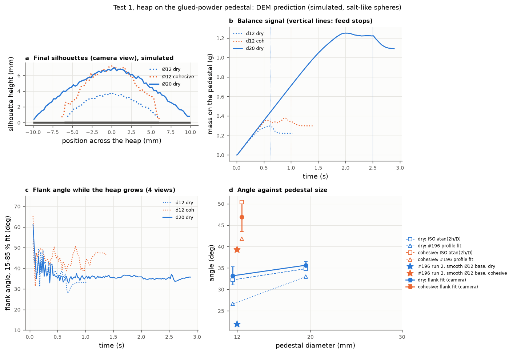

# DEM of the in-house tests as designed (simulated, not measured)

**Status: simulated, 2026-11-28.** Every number here is a DEM prediction for two reference powders.
Nothing was measured. The fixtures are the ones in [`../../SPEC.md`](../../SPEC.md).

The runs answer three questions per fixture:
(a) what it should read for a free-flowing and a cohesive reference powder,
(b) whether it is big enough (wall and size effects), and
(c) what the grains do, as decimated trajectories for the animations ([`frames/`](frames/)).

## In short

TBD_SUMMARY

## Common setup

- **Code:** LIGGGHTS-PUBLIC 3.8.0 (`/usr/bin/liggghts`), serial, `OMP_NUM_THREADS=1`. Two runs at a time
  on a runner shared with five other workers (load average 11-18 on 4 cores, so each run got about
  35-80 % of a core). Wall times below are for that runner.
- **Reference powders,** the same as PR #196 runs 2-7 (`docs/physics-simulations/runs/dem-liggghts-*` at
  `e8811bd`), so the numbers compare:
  - real-size salt-like spheres, diameters 0.361 / 0.425 / 0.489 mm, 0.3 / 0.4 / 0.3 by number,
    2165 kg/m³;
  - Hertz-Mindlin with tangential history, E = 2×10⁵ Pa (reduced, as in #180 / #196), ν = 0.3,
    e = 0.5, μ grain-grain 0.5, μ grain-wall 0.4, EPSD2 rolling friction 0.3;
  - **dry**: no cohesion; **cohesive**: SJKR k = 6000 J/m³ between grains (pull-off Bond number
    about 5 for the d50 grain at this stiffness; see #196 run 2). Grain-wall adhesion is off unless a
    section says otherwise.
  - Time step 2.06×10⁻⁵ s (20 % of the Rayleigh time of the smallest grain); 4.11×10⁻⁵ s for the 2×
    coarse-grained column of test 8.
- **Walls:** printed parts are PLA with μ_wall 0.4. Rough parts the SPEC roughens with glued powder
  (the heap pedestal, the mode-B coupon) are a frozen random monolayer of grains at 50 % area cover.
- **Files:** one script per test (`t1_heap.py`, `t7_drum.py`, `t2_tap.py`, `t5_orifice.py`,
  `t3_tilt.py`, `t8_ucs.py`, `t9_spread.py`), shared helpers in `demlib.py`, figures and videos in
  `figures.py`, the combined table in `collect.py`. The exact decks that ran are in [`decks/`](decks/),
  per-run results in [`results/`](results/), all of them in [`results.json`](results.json).

To rerun one case (dumps go to `/tmp/dem-scratch/runs/`, override with `DEM_SCRATCH`):

```
python t1_heap.py run d20_dry        # build the deck, run LIGGGHTS, analyse; 'analyze' re-reads the dumps
python t5_orifice.py fill dry && python t5_orifice.py run dry 6 4 3 2
python figures.py all && python collect.py
```

## Test 1: heap on the pedestal



**Setup.** Pedestal tops Ø20 (as designed) and Ø12 (#196's base size), each an STL top disk with a
0.4 mm land and a 45° chamfer underneath. The glued powder on top is a frozen random monolayer of
grains (1276 grains on Ø20, 478 on Ø12, 50 % cover). The feed stands in for the doser outlet 12 mm
above the top: grains appear in a 3 mm wide column 11-14 mm above the top, moving down at 0.1 m/s,
8000 grains/s (0.73 g/s, #196's rate), then settle for 0.4 s. Grains that fall off the rim leave the
box, as they would fall into the overflow tray. Poured: 5000 and 8000 grains on Ø12 (dry, cohesive),
20 000 and 32 000 on Ø20. Readings on the final heap:
- **flank angle**, the camera method: silhouettes from 8 directions, a line fitted to each flank
  between 15 and 85 % of the heap height, mean ± sd of the 16 fits;
- **ISO apex angle** atan(2h/D);
- **profile fit**, #196 run 2's method (radial top profile, 8 sectors), for comparison;
- **balance signal:** the mass on the pedestal every 5 ms; heap density from the mass and the volume
  of revolution of the silhouette.

**Runtime.** Ø12: 41 s (dry) and 117 s (cohesive) wall, 1.0 and 1.4 s physical. Ø20: 673 s and
1194 s wall, 2.9 and 4.4 s physical. A Ø30 dry run was started to test base-size independence and
stopped after 9 minutes at 1.7 s of 5.4 s physical (the runner was too slow); it has no result.

| case | heap mass (g) | flank angle, camera (°) | ISO atan(2h/D) (°) | profile fit, #196 method (°) | apex height (mm) | heap density from silhouette (kg/m³) |
|---|---|---|---|---|---|---|
| Ø12 dry | 0.222 | 33.2 ± 2.1 | 32.2 | 26.6 | 3.8 | 1030 (φ 0.48) |
| Ø12 cohesive | 0.299 | 46.9 ± 3.4 | 50.4 | 41.8 | 7.2 | 675 (φ 0.31) |
| **Ø20 dry** | **1.09** | **35.6 ± 0.9** | **34.8** | 33.0 | 7.0 | 1100 (φ 0.51) |
| **Ø20 cohesive** | **1.34** | **44.4 ± 3.2** | **48.9** | 40.2 | 11.5 (at the outlet) | 700 (φ 0.32) |
| #196 run 2, smooth Ø12 disk, dry | 0.23 | – | 27.5 (atan(h/R)) | 21.9 ± 1.4 | 3.1 | – |
| #196 run 2, smooth Ø12 disk, cohesive | 0.31 | – | 48.8 | 39.3 ± 3.6 | 6.9 | – |

Balance signal at the HR-100A's 10 Hz, over the last 0.6 s of feeding (heap full) and after the feed
stops:

| case | sd of 0.1 s mass steps (mg) | largest 0.1 s drop (mg) | mass lost after the feed stops (mg) |
|---|---|---|---|
| Ø20 dry | 18 | 15 | 131 (12 % of the heap) |
| Ø20 cohesive | 24 | 36 | 22 (2 %) |

**What it means for the fixture.**
- **The glued powder top matters.** On the same 12 mm base, the rough top raises the dry angle by
  about 5° over #196's smooth disk (profile fit 26.6° against 21.9°; apex angle 32.2° against 27.5°):
  the bottom layer can no longer slide out. Keep the glued layer, and renew it when it wears.
- **Ø20 against Ø12.** The dry flank angle reads 35.6° ± 0.9° on Ø20 and 33.2° ± 2.1° on Ø12; the
  cohesive one 44.4° ± 3.2° and 46.9° ± 3.4°. The Ø12 heap is only 9 grains tall, so its dry reading
  is 2.4° lower and twice as scattered. With no Ø30 run, the simulation cannot say Ø20 has reached the
  size-independent value; it says the size effect between 12 and 20 mm is about 2.5°, as large as the
  ±2° target. **Use one top size (Ø20) for every jar**, and keep Ø12 for powders too cohesive for Ø20
  (next point).
- **The 12 mm outlet gap is too small for cohesive powders on Ø20.** The cohesive heap grew to
  11.5 mm, into the feed, so its apex and upper flank were shaped by the outlet, and its ISO angle
  (48.9°) is capped by the gap. A heap with a 45-50° flank and a 1-2 mm cliff at the rim needs about
  12-14 mm on Ø20. Allow an outlet height of **18-20 mm** (a 6-8 mm longer riser option) for
  cohesive jars, or switch them to Ø12.
- **Weigh at rest.** A dry heap sheds 12 % of its mass in the 0.3 s after the feed stops (the flowing
  layer runs off); a cohesive one 2 %. Read the balance at least 0.5 s after each revolution.
- **Avalanches** show at 10 Hz: cohesive mass drops of up to 36 mg per 0.1 s against 15 mg dry
  (about 2.4×), with the HR-100A's 0.1 mg resolution far below either.
- **Heap density from the silhouette reads low** (φ 0.51 dry and 0.32 cohesive, against 0.58-0.62 in a
  poured bed), because the outline of a rough heap encloses its surface gaps. Use it as an index.
- **Mass on the pan:** 1.1-1.3 g per heap on Ø20, well inside the SPEC's 5 g allowance.

TBD_SECTIONS

## Trajectories for the animations

`frames/<test>_<variant>.npz` (numpy `np.load`): `t[F]` (s), `pos[F,N,3]` (mm, float16; NaN where a
grain is not in the box yet or has left it), `r[N]` (mm), `id[N]`, plus each test's wall poses and a
`note`. `pos` is stored frame-index-fastest so that grains at rest compress; `np.load` returns the
usual `[F,N,3]` array.

TBD_FRAMES

## Limitations

- **Two model powders, not real ones.** Spheres with rolling friction stand in for salt-like grains, and
  E is reduced 10⁵-fold. The cohesive powder is one SJKR setting (Bo about 5). Absolute numbers are
  for these model powders; the differences between fixtures and between dry and cohesive are the
  useful part.
- **Reduced sizes and times** where a run would not fit (each section says what): shallower beds,
  periodic slices, short pours, fast tilts and platens, one seed per case.
- **Shared runner.** Two planned runs (a Ø30 heap and the drum at 2 rpm) were stopped for time.
