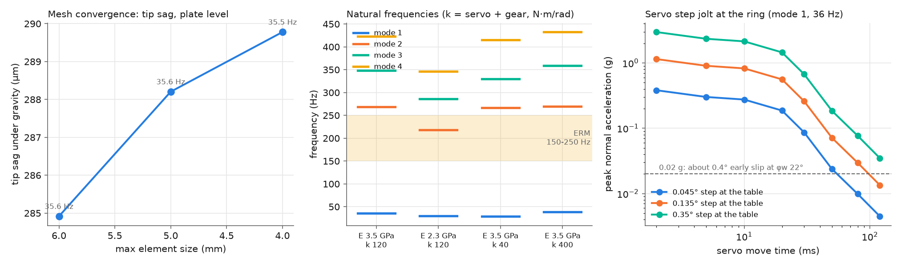
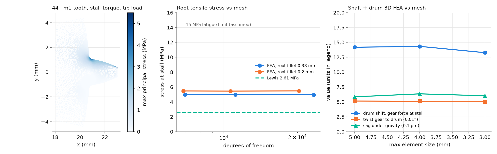

# sim/fea: structural and electrostatic checks of the in-house test fixtures

**Status: computed, not measured (2026-11-28).** Nothing here has been built or tested. Every number
below comes from a model, with its assumptions stated next to it.

Seven checks (a–g) from the task list, each with a mesh-convergence study and a hand-calculation
cross-check. Geometry is the CAD worker's parts (`../../cad/out/step/*.step`, or `cad/parts.py` when a
STEP was not yet exported); every result JSON records which file and its sha256. The CAD was still
changing during these runs (for example the UCS platen was reworked at 09:28 UTC), so check the
recorded sha against the current STEP before reusing a number.

## How to rerun

Tools: CalculiX 2.21 (`ccx`, C3D10 tetrahedra), gmsh 4.15 (Python API), scikit-fem 12 (2D plane stress
and axisymmetric electrostatics), Python 3.12 (`/tmp/venv`). Scratch decks go to `/tmp/fea-scratch/`
(`FEA_SCRATCH` overrides). One core, under 1.2 GB.

```bash
cd design/in-house-tests/sim/fea
python validate_pipeline.py      # gmsh -> CalculiX pipeline vs beam theory (seconds)
python a_tilt_table.py all       # a: about 3 min
python a_tilt_post.py            # a: servo-step jolt model + a_tilt_table.png
python b_drum_shaft.py all       # b: beam, tooth (scikit-fem) and 3D FEA, about 6 min
python b_drum_plot.py            # b: b_drum_shaft.png
python c_ucs.py all              # c: mould + platen + base, about 6 min
python d_blade.py                # d: about 3 min
python e_tapper.py               # e: about 4 min
python f_faraday.py              # f: about 20 s
python g_tripod.py all           # g: about 4 min
python summary_plot.py           # c, d, e, g figure
```

## Common setup

| Item | Value | Source |
|---|---|---|
| PLA, printed, rasters along the load | E 3.5 GPa, ν 0.36, ρ 1.24 g/cm³ | task brief |
| PLA lower bound (3 walls, 25 % infill) | E 2.3 GPa | task brief |
| PLA strength | 50 MPa along rasters, 25 MPa across layers | task brief |
| PLA fatigue limit | about 15 MPa at 10⁶–10⁷ cycles. **An assumption**: published fully reversed fatigue strengths of printed PLA at 10⁶ cycles fall around 10–25 MPa, depending on raster angle and infill (e.g. Ezeh and Susmel, *Fatigue Fract. Eng. Mater. Struct.* 2018/2019; Afrose et al., *Prog. Addit. Manuf.* 2016) | assumption |
| 304 stainless | E 193 GPa, ν 0.29 | handbook |
| Aluminium | E 69 GPa, ν 0.33 | handbook |
| Units in the CalculiX decks | mm, N, MPa, t/mm³, s | |

**Pipeline check** ([`validate_pipeline.py`](validate_pipeline.py), [`results`](validate_pipeline.json)):
a PLA cantilever 100 × 10 × 10 mm with a 1 N tip load. C3D10 gives 0.1139 mm against 0.1143 mm
(Euler–Bernoulli) and 0.1152 mm (with shear), and a first frequency of 271.2 Hz against 271.4 Hz.

Two pitfalls found and fixed on the way, for anyone extending these decks:
- CalculiX `SPRING1` acts on global degrees of freedom even on nodes that carry a cylindrical
  `*TRANSFORM` (a test gave exactly twice the intended rotation). Torsional springs are therefore built
  from global y and z springs, with Σk r² = k_θ.
- CalculiX sizes its arrays by the largest element number: keep spring and mass element numbers
  compact, or a 50k-node model asks for several GB.

## Summary

| Check | Result (computed) | Margin | Verdict | Design action |
|---|---|---|---|---|
| a. Tilt plate sag, plate level, full payload | 0.29 mm at the tip, almost all rigid rotation; ring site vs IMU 0.007° | ±2° target: 300× | pass | none |
| a. Tilt plate first mode | 35.6 Hz (rotation on the one-sided arm + gear + servo); 30 Hz at E 2.3 GPa | structure (40 N·m/rad) is softer than the servo (120 assumed) | weak | drive both lugs or thicken the arm |
| a. Second mode vs ERM 150–250 Hz | 268 Hz torsion (218 Hz at E 2.3 GPa) | 7 % above the band, inside it at low E | marginal | no ERM or doser vibration during test 3; rubber feet |
| a. Servo step jolt at the ring | 0.3–1.1 g for 0.045–0.135° steps done in 2–10 ms; under 0.02 g needs moves of 80–120 ms | 0.02 g gives 0.4° early slip | **fail** | smooth drive (worm or lead screw on the Tic T500), IMU jolt check |
| b. Drum sag and tilt (gravity) | 0.6 µm FEA, 2 µm beam (pinned bearings) | 35 µm/px camera: 15× | pass | none |
| b. Drum shift at NEMA 11 stall | 13–14 µm FEA, 33 µm beam (50 µm at E 2.3 GPa) | | pass | none |
| b. Twist gear to drum at stall | 0.051° FEA, 0.053° hand | 0.5° angle reading: 10× | pass | none |
| b. 44T tooth root at stall | 4.96 MPa (0.38 mm fillet), 5.47 MPa (0.2 mm); Lewis 2.61 MPa | 2.7–3.0 on 15 MPa fatigue | pass | add a 0.3 mm root fillet to `gear_profile` (now a sharp corner) |
| b. Drum runout | about 0.2 mm TIR radial and axial, from print eccentricity and flange tilt (geometric, assumed tolerances) | elastic part is 1 % of it | check on build | dial-gauge the drum, face the flange |
| c–g | see the sections below | | | |

## a. Test 3 tilt table: sag, natural frequencies, servo-step jolts

Scripts [`a_tilt_table.py`](a_tilt_table.py), [`a_tilt_post.py`](a_tilt_post.py); results
[`results/a_tilt_table_fea_all.json`](results/a_tilt_table_fea_all.json),
[`results/a_tilt_table_jolt.json`](results/a_tilt_table_jolt.json).



**Setup.**
- Geometry: `tilt_plate.step` (plate 120 × 60 × 6, coupon pocket 0.8 deep, hinge lugs at x = ±38–43.5
  on a Ø5 pin at z = 60, plate below the pin, the 30T gear bolted to the +x lug).
- Hinge: radial and axial restraint on the Ø5.1 bores of both lugs (a pin, free to rotate).
- Gear + servo: a torsional spring k_θ about the hinge axis on the +x lug face the gear bolts to.
  Nominal k_θ = 120 N·m/rad at the table, an assumption: a 20 kg·cm metal-gear servo reaching stall
  at about 3° error (about 40 N·m/rad), times 2² through the 1:2 pair, in series with the printed m1.5
  mesh (about 480 N·m/rad from a PLA-scaled ISO 6336 single-pair stiffness). Varied 40–400.
- Payload (mass only, no stiffness): steel coupon 39 g on the pocket floor; ring + powder + 15 g lid
  19 g on a Ø25 patch 90 mm from the hinge (the worst place).
- Load case: plate level (0°), the largest bending moment; gravity on everything.

**Convergence.** Tip sag 284.9 / 288.2 / 289.8 µm and first mode 35.6 / 35.6 / 35.5 Hz at element sizes
6 / 5 / 4 mm (17k–22k nodes): 0.5 % in the last step.

**Hand check.** The gravity moment about the hinge is 0.073 N·m. The gear face turns 0.033° (FEA)
against M/k_θ = 0.035°. The plate's own slope at the IMU is 0.140°, so the lugs, the one 6 mm arm that
carries the torque and the plate root add a structural stiffness of only about 40 N·m/rad. With the
hand inertia about the hinge (6.0 × 10⁻⁴ kg·m²) and the static stiffness (29.7 N·m/rad), f₁ = 35.3 Hz,
against 35.6 Hz from the modal FEA.

**Results.**
- Sag and angle error: 0.29 mm at the tip with the plate level, almost all of it a rotation that the
  IMU on the plate measures. The angle at the ring site differs from the IMU's by 0.007°, and the cross
  slope by 0.003°. Peak von Mises stress 1.8 MPa.
- Modes: 35.6 Hz (rotation of the plate about the hinge), 268 Hz (torsion of the plate about its long
  axis), 348 Hz and 423 Hz. With E = 2.3 GPa: 30.1, 218, 286 Hz. With k_θ = 40 or 400 N·m/rad, f₁ is
  29.2 or 39.0 Hz, so the printed drive path, not the servo, sets it.
- ERM: the doser's ERM (150–250 Hz) is not on the table, but its vibration through the bench, or an
  ERM used to agitate the plate, would sit just below the 268 Hz torsion mode, and on it at E 2.3 GPa.
- Servo step jolts (one-degree-of-freedom model on mode 1, damping ratio 0.05 assumed): a hobby servo
  moves in steps the size of its deadband. At about 11 µs per degree and the 1:2 pair, deadbands of 1,
  3 and 8 µs are 0.045°, 0.135° and 0.35° at the table. If such a step completes in 2–10 ms, the ring
  site sees peaks of 0.3–1.1 g normal to the plate. To stay under 0.02 g, each step must take at least
  80 ms (0.045°) or 120 ms (0.135°). A normal acceleration a lowers the slip threshold by about
  sin φ_w · a/g rad (0.4° at 0.02 g for φ_w = 22°), so the jolts cause early slip or creep, and they
  would disturb a mode B layer.

**What it means for the design.**
1. Drive the table smoothly: a worm or lead-screw drive on a stepper (the accessory Tic T500 is free
   during test 3), or a servo with a 1:20 or finer worm after it. Keep the IMU (LSM6DSOX at 1.66 kHz or
   more) logging normal acceleration during every tilt and reject runs with peaks over 0.02 g.
2. Stiffen the drive path: put the gear on both lugs (or a tube along the hinge between them) and make
   the arms 12 mm thick instead of 6. That moves f₁ from about 36 Hz towards 60–70 Hz, so servo
   steps excite less, and moves the torsion mode further from the ERM band.
3. Do not run the doser's ERM or tapper during test 3, and stand the table on rubber feet.
4. Sag is no concern: no change needed for stiffness against static loads.

## b. Test 7 drum shaft and drum

Scripts [`b_drum_shaft.py`](b_drum_shaft.py), [`b_drum_plot.py`](b_drum_plot.py); results
[`results/b_drum_shaft_beamfea.json`](results/b_drum_shaft_beamfea.json) (beam + 3D FEA),
[`results/b_drum_shaft_all.json`](results/b_drum_shaft_all.json) (tooth).



**Setup.**
- Shaft: `drum_shaft` from `cad/parts.py`, a Ø25/Ø21 PLA tube 245 long with a Ø40 × 4 flange at the
  drum end and the 44T gear at z = 98.3–108.3 (modelled as a solid ring to the root circle for the 3D
  model). Drum body `drum_body.step` fused to the flange; window, bezel, screws and 7.5 mL of powder
  add 22 g on the drum wall (41 g of drum in all).
- Bearings: not in the repo. Assumed 10 mm long at z = 30–40 (front) and 222.5–232.5 (rear), i.e. the
  auger's z = 10–20 and 202.5–212.5; the beam model varies the front one (z = 25, 35, 55).
- Loads: gravity; the gear force at the NEMA 11 holding torque (10 N·cm × 2.2 = 0.22 N·m at the 44T
  gear: F_t = 10 N, F_r = 3.6 N, applied as 10.6 N downwards, the worst direction); the same torque
  with the drum held (twist).
- Tooth: 2D plane stress, scikit-fem P2, one 44T m1 20° tooth on a ±1.5-pitch rim fixed at the bore,
  root fillets of 0.38 m and 0.2 mm, the normal load T/r_b = 10.6 N on the tooth tip (Lewis's worst
  case), 10 mm face.

**Convergence.** Tooth root stress 4.963 / 4.963 / 4.955 MPa (7k–23k DOF, 0.38 mm fillet) and
5.466 / 5.450 / 5.472 MPa (0.2 mm). 3D shaft (34k–70k nodes): twist 0.0514 / 0.0510 / 0.0505°, drum
shift at stall 14.2 / 14.3 / 13.3 µm, sag 0.58 / 0.64 / 0.60 µm.

**Hand checks.**
- Twist at stall: T L/(G J) = 0.053° (L = 103 mm to the drum, J = 19,260 mm⁴), FEA 0.051°.
- Sag: overhung beam on pinned bearings gives 2.0 µm and 0.003° of tilt at the drum. The FEA gives
  0.6 µm because its 10 mm bearing bands also resist rotation; real bushings with clearance sit between.
- Drum shift at stall: 33 µm (beam, pinned) against 14 µm (FEA, 10 mm bands).
- Lewis: σ = K_v F_t/(b m Y) = 2.61 MPa with Y = 0.399 (44T, 20° full depth, Shigley Table 14-2) and
  K_v = 1.04 at 0.25 m/s. The FEA root stress is 1.9× (0.38 mm fillet) to 2.1× (0.2 mm) Lewis, the
  fillet stress concentration Lewis leaves out.

**Results.**
- Elastic sag, tilt and twist of the drum are 0.6–3 µm, 0.003° and 0.05–0.08°: far below the camera's
  35 µm/px and the 0.5° resolution of the dynamic angle.
- In normal running the gear carries only the powder drag (a few mN·m), so the tooth stress at stall
  (5.0–5.5 MPa against an assumed 15 MPa fatigue limit, margin 2.7–3.0) is a worst case for a jam.
- Runout is geometric, not elastic. With 0.15 mm of radial clearance in each bushing the drum hangs
  0.22 mm low (constant, not rotating). A 0.05 mm journal eccentricity and a 0.2° flange tilt (assumed
  print tolerances) give about 0.22 mm TIR radial and 0.20 mm TIR axial at the drum rim.

**What it means for the design.**
1. The shaft is stiff enough; no change.
2. `cad/parts.py` `gear_profile` leaves a sharp corner where the flank meets the root chord (the 44T
   root circle is outside its base circle). Add a root fillet of at least 0.3 mm (0.38 m is standard);
   the stress above is for a filleted root.
3. Print the shaft flange down on the H2D (as planned), face the flange square, and check the drum with
   a dial gauge: aim for under 0.2 mm TIR.

## c. Test 8 split mould and the UCS force loop

Script [`c_ucs.py`](c_ucs.py); results [`results/c_ucs_all.json`](results/c_ucs_all.json) (Janssen,
mould), [`results/c_ucs_frame.json`](results/c_ucs_frame.json) (platen, base).

**Setup.**
- Wall stress: Janssen with a top load σ₁ (0.2 and 2 kPa) and the column's weight, K from Rankine's
  active coefficient on the #196 internal friction angles (0.41 dry, 0.30 cohesive), μ_w = 0.4 on PLA,
  bulk density 1249 / 1023 kg/m³, D = 20, H = 40.
- Mould: `split_mould_A.step` (one half, OD 30, ID 20, 40 tall) with the Janssen pressure on the bore.
  Case "closed": the parting faces bear on the other half (the rings hold it shut). Case "rings": the
  parting faces are free and the half is held only where the two 6 mm rings touch its crown.
- Force loop: platen `ucs_platen.step` (bolted to the stage carriage face by four M3 screws, 1 N on
  the Ø20 sample footprint); base + column `ucs_base.step` with the sample force carried into the
  load-cell block as a force plus the cell's lever moment (sample axis 30 mm from the block, assumed)
  and into the column's stage face as a force plus the platen's lever moment; base on the bench
  (bottom face supported) or on its four corner screws only. Rigid-body fits of the two patches give
  the change in platen-to-cell distance per newton.
- TAL221: not modelled. Estimated as a parallel-guided flexure, d_FS = ε_FS L_f²/(3 t), with ε_FS =
  500 µε (1 mV/V full bridge), L_f 8–12 mm, web 0.7–1.2 mm: 9–35 µm/N (17 µm/N nominal). An
  assumption: measure it.
- Sample: σ_c 100–1000 Pa on 314 mm², failure strain 1–3 % of 40 mm (assumed).

**Convergence and hand checks.**
- Mould, closed: bore growth at the top 4.1 / 2.8 / 7.3 nm at element sizes 2.5 / 1.8 / 1.3 mm (the
  nodal load lumping makes nm-level noise); thin ring p r²/(E t) = 4.7 nm. Rings case: parting-line
  opening 0.34 / 0.39 µm at 2.5 / 1.8 mm.
- Platen (the reworked bracket, STEP sha `d83ab1b4b4f7`): 0.88 / 0.89 / 0.98 µm/N at 4 / 3 / 2 mm
  (1.36 µm/N at E 2.3 GPa). Hand: the 6 mm disc as a 13 mm cantilever plus the bolted plate, about 0.9 µm/N.
- Base + column (sha `889ee1cb3a65`, column face at y = 60, 60 mm in front of the sample axis):
  4.47 / 4.41 / 4.43 µm/N at 8 / 6 / 4.5 mm on the bench; 6.6 µm/N on its four corner screws only;
  6.7 µm/N at E 2.3 GPa. Hand: the column (60 × 20, minus the two slots, I = 32,700 mm⁴) bending under
  F × 60 mm over 117 mm gives 3.7 µm/N at the sample axis; the base plate adds the rest.

**Results.**
- Janssen at σ₁ = 2 kPa: the wall sees 818 Pa at the top and 333 Pa at the foot (dry); the foot of the
  column carries only 41 % (dry) to 51 % (cohesive) of the top load. At 0.2 kPa the column's own
  weight dominates (the foot carries 330 Pa, 1.6× the top load).
- The mould itself does not deform measurably (nm). What opens the parting line is the ring clearance:
  `mould_ring` is ID 30.5 on a Ø30 mould, 0.25 mm radial clearance. The powder pushes the halves apart
  with 0.21 N per parting line at 2 kPa (dry) and only about 0.03 N of friction holds each 9.5 g half on
  the base, so the halves slide apart until the rings bear: a gap of up to 0.5 mm in total.
- Force loop: the printed frame adds 0.9 (platen) + 4.4–6.7 (base and column) µm/N, the TAL221 9–35
  µm/N (estimate), so the machine compliance is about 15–43 µm/N, dominated by the load cell. A
  powder column at failure (σ_c 100–1000 Pa, 1–3 % strain on 40 mm, 0.03–0.31 N) moves 400–1200 µm,
  i.e. 1,300–38,000 µm/N. The platen travel is therefore 97–99.9 % the sample's own: the frame is stiff
  enough. At the peak force the platen tilts 0.0016° (0.005°/N), and the frame stress is under
  0.2 MPa/N.

**What it means for the design.**
1. Make the mould rings snug: print `mould_ring` with ID = 30.0 (ream or sand to a light push fit), or
   use a split collar with an M3 clamp screw, so the parting line stays closed under 0.2 N. A 0.5 mm
   gap lets fines leak and leaves a fin on the column that changes σ_c.
2. No stiffening needed for the frame. Measure the machine compliance once (platen on a steel dummy
   in place of the sample, 0–1 N) and subtract it from the platen travel; most of it is the load cell.
   The 100 g cell is at full scale with the 64 g consolidation weight plus the mould and powder (theory):
   consolidate off the cell, or use a 500 g cell (5× stiffer as well).
3. Theory (`../theory/`) adds that the 40 mm PLA mould only stands powders with ff_c under about 1.5;
   its PTFE liner and 20–30 mm height recommendation also cuts the wall stress above by μ_w and H.

## d. Test 9 blade carriage: gap change under the spreading force and its own weight

Script [`d_blade.py`](d_blade.py); results [`results/d_blade.json`](results/d_blade.json).

**Setup.**
- Geometry: `blade_carriage.step` (base block bolted to the stage slider, a 16 × 10 arm 65 mm long, a
  clamp with a 1.6 mm slot). The 304 blade (25 tall, 50 long) is modelled 1.6 thick so it bonds in the
  slot; its edge is 3 mm below the clamp. The two M3 gap screws are assumed not to touch the bed (the
  worst case: a pure cantilever from the slider).
- Loads on the blade edge over the coupon's 30 mm width: 1 N up (lift), 1 N along the travel (drag),
  and gravity.
- Spreading force, from Rankine passive earth pressure with cohesion on the blade face,
  P = ½ K_p γ h² + 2c √K_p h, where h is the height of the feed heap (a 0.5 g line across 30 mm at
  the 32° handbook AoR gives h = 2.9–3.2 mm). K_p from the #196 internal friction angles (24.8° and
  32.3°) and c (6.6 and 11.9 Pa). Lift = drag × tan φ_w (21.8°). This is an estimate, not a literature
  measurement.
- Stage rods: two Ø8 steel rods over 200 mm carrying 150 g (assumed), simply supported.

**Convergence and hand check.** BLADE_CONV Hand: the arm as a cantilever, F L³/(3 E I) with L = 68 mm
and I = 16 × 10³/12 = 1333 mm⁴, gives 22.5 µm/N against 25 µm/N for the lift case (the base block and
clamp add the rest).

**Results.**
- Spreading force (passive pressure): drag 5.5 mN (dry) and 9.2 mN (cohesive), lift 2.2 and 3.7 mN.
- Gap change: BLADE_RESULTS
- The guide rods sag 3.2 µm (moving mass) + 2.1 µm (own weight) at mid-stroke, so the gap varies by
  about 5 µm along the stroke if the carriage hangs on the stage alone.

**What it means for the design.**
1. The carriage is stiff enough for normal spreading (sub-µm), so no change for that.
2. Set the gap with the feeler gauge at mid-stroke, or let the two M3 gap screws ride on the bed's
   rails: then the rods' 5 µm sag and the arm's compliance drop out of the gap. Theory asks for 1.5 mm
   of screw travel (gap about 2.5 × d50).
3. A grain jammed under the blade can push with far more than 1 N (a NEMA 17 on an 8 mm lead screw at 1 A pushes tens of newtons), and
   each newton opens the gap by about 25 µm: log the stage current or watch for streaks, and use a
   gap of at least 2.5 d90 for coarse powders.

## e. Test 2 cam-drop tapper: impact and fatigue

Script [`e_tapper.py`](e_tapper.py); results [`results/e_tapper.json`](results/e_tapper.json).

**Setup.**
- Geometry: `tapper_carriage.step` (striker face 64 × 44 at z = 11 resting on the anvil, foot pocket
  floor 5 mm above it) and `tapper_base.step` (Ø25 × 6.35 304 anvil in a pocket with a 4.65 mm PLA
  floor under it).
- Falling mass: carriage 49.4 cm³ at 65 % solid (40 % infill, 3 walls: an assumption) = 39.8 g, the
  10 mL Class A cylinder 36 g (glass tube 14 g + hex foot 22 g, an estimate: weigh the real one), powder
  6 g. Total 81.8 g, more than SPEC's 70 g; 70 and 110 g are also run.
- Impact: v = √(2gh) for h = 2.8 / 3.0 / 3.2 mm (PTFE-on-steel bushing friction neglected). Contact
  stiffness from FEA: the carriage floor under the Ø25 footprint (pocket floor held) in series with the
  base floor under the anvil (base on the bench); the 304 anvil is rigid in comparison. Spring-mass:
  F = v √(k m), contact time π √(m/k).
- Stress: the carriage at the peak deceleration, quasi-static: the anvil footprint pushes up, the
  cylinder and powder push down on the pocket floor, the carriage's own inertia is a body force; 3-2-1
  restraint (reactions near zero).
- Edge impact: with 0.25 mm radial clearance in the rod holes over a 69 mm bushing spacing, the
  carriage can tilt 0.42°, so one edge of the anvil can hit first (0.18 mm across Ø25). Hertz, PLA flat
  on the anvil's rounded edge (edge radius 0.2–2 mm along its Ø25 rim).
- Fatigue: each tap is a 0 → σ_max cycle (R = 0); Goodman against the assumed 15 MPa endurance limit and
  50 MPa strength; 1250 taps per test, 2000 tests a year (assumed) = 2.5 × 10⁶ taps a year.

**Convergence and hand checks.** TAP_CONV

**Results.** TAP_RESULTS

**What it means for the design.** TAP_ACTION

## g. In-chamber tripod: deflection, sway and tipping

Script [`g_tripod.py`](g_tripod.py); results [`results/g_tripod_all.json`](results/g_tripod_all.json).

**Setup.**
- Geometry rebuilt from `cad/parts.py` (`tripod_spider`, `tripod_leg`, `fc_cradle`): spider hub
  r 20/12 × 6, three 10 × 6 arms to legs at r = 62 (90°, 210°, 330°), legs 8 × 8 square, the top 4.5 mm
  of each leg bonded in its socket. The 160 mm legs are the worst case; 80 mm is also run.
- Heaviest payload, test 10: the printed cradle (31 g) and, as one stiff cylinder Ø70 × 80 on it, the
  aluminium can, inner cup, printed lid, insulator base and standoffs (120 g, estimated). Printed parts
  at 60 % solid. Gravity, 1 N sideways at the top of the can, and the first four modes.
- Feet: pinned at the centre of each leg's foot (it can rock) or fully fixed (glued), as bounds.
- Tipping (hand): a tripod tips about the edge between two feet. With feet at r = 62 the support
  triangle's inradius is 31 mm (pushing toward an edge) and 62 mm toward a leg. Test 5's holder as
  drawn in `cup_holder` (cup at x = 74 from the hub, solenoid cradle at (76, 32)) with estimated masses
  (holder 13.5 g, cup + disc + gate + powder 22 g, micro servo 13 g, JF-0530B 20 g).

**Convergence and hand checks.** TRI_CONV

**Results.** TRI_RESULTS

**What it means for the design.** TRI_ACTION
