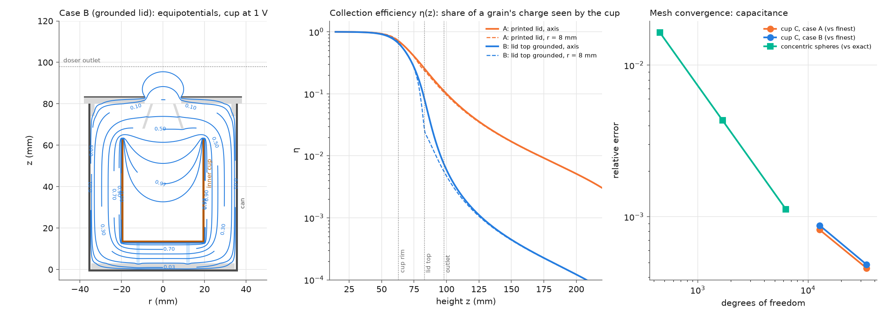

### f. Test 10 Faraday cup: capacitance, collection efficiency, shielding, field (computed, not measured)

Script [`f_faraday.py`](f_faraday.py) (about 20 s, 0.6 GB), results [`results/f_faraday.json`](results/f_faraday.json), figure [`f_faraday.png`](f_faraday.png).

**Setup.** Axisymmetric Laplace / Poisson in r-z, scikit-fem P2 triangles on a gmsh mesh, weak form
∫ ε_r ∇φ·∇v r dr dz = ∫ (ρ/ε0) v r dr dz. Geometry (mm, z = 0 at the top of the can floor):
- grounded can, ID 70 × 80, 1 mm wall and floor;
- printed base (PLA, ε_r 3.0), r < 34.5, z 0-3;
- PTFE standoffs, three Ø8 × 10 at r = 12, modelled as a ring r 11.15-12.85, z 3-13 with the same volume (ε_r 2.1). This is an assumption: the real standoffs are not axisymmetric;
- inner cup (the electrode), Ø40 × 50, 1 mm wall, bottom at z 13-14, rim at z 63;
- printed lid (PLA, ε_r 3.0) as in `cad/parts.py` `fc_lid`: plate z 80-83 with a Ø17.6 hole, skirt, and a re-entrant funnel shell with a Ø9.6 clear inlet at z 80, widening to Ø17.6 at z 68;
- air out to a grounded box (r 150, z -60 to 260) that stands for the balance chamber and the doser.

Two cases. **A:** the lid as printed (a dielectric, so the shield is open at the top). **B:** the lid's top
face, edge and overhang covered with grounded metal tape bonded to the can, so the shield's aperture is
the Ø17.6 hole.

Capacitance comes from the field energy, C = 2π ε0 uᵀKu, with the cup at 1 V. Collection efficiency
comes from Green reciprocity. A charge q at a point x induces −q·φ1(x) on the cup when the cup is held
at 0 V by the charge amplifier, where φ1 is the potential with the cup at 1 V and everything else at 0 V.
So η(x) = φ1(x).

**Validation.** Concentric spheres (a 10 mm, b 30 mm), exact C = 4π ε0 ab/(b − a) = 1.6690 pF.
FEA: 1.6416, 1.6617 and 1.6671 pF on meshes of 455, 1,677 and 6,297 DOF, so −1.64 %, −0.43 % and
−0.11 %. That is second-order convergence, from the straight-sided boundary.

**Mesh convergence on the cup** (12.8k, 33.9k, 92.2k DOF):

| Quantity | Coarse | Medium | Fine |
|---|---|---|---|
| C, case A (pF) | 7.861 | 7.858 | 7.855 |
| C, case B (pF) | 7.972 | 7.969 | 7.965 |
| η on the axis at z 70 mm, A / B | 0.524 / 0.425 | 0.524 / 0.425 | 0.523 / 0.424 |
| η at the doser outlet (z 98 mm), A / B | 0.1114 / 0.00734 | 0.1113 / 0.00736 | 0.1112 / 0.00738 |

**Results** (finest mesh):

- **Capacitance, cup to ground:** 7.85 pF (A) and 7.97 pF (B).
  - Hand check: the coaxial side (2π ε0 L / ln(b/a), L 50, a 20, b 35) gives 4.97 pF, and the bottom
    (10 mm air and PTFE plus 3 mm PLA) gives 1.11 pF, so 6.08 pF.
  - The FEA's extra 1.8-1.9 pF (30 %) is fringing at the mouth and rim.
  - With 100 pF of cable, the amplifier's input sees about 108 pF. The noise gain with C_f = 10 nF is
    1 + 108 pF / 10 nF = 1.01, so it is negligible.
- **Collection efficiency on the axis** (heights in mm; the cup rim is at 63, the lid top at 83, the doser outlet at 98):

  | η | Case A (printed lid) | Case B (grounded lid) |
  |---|---|---|
  | 0.99 | 33.9 | 32.7 |
  | 0.9 | 52.6 | 51.2 |
  | 0.5 | 70.9 | 67.7 |
  | 0.1 | 100.1 | 82.0 |
  | 0.01 | 171.5 | 95.5 |

  - Off the axis (r 4 and 8 mm) the heights are within 3 mm of these values.
  - Powder on the heap (z 17) is counted at 0.9993.
  - A grain is only counted to 99 % once it is 30 mm below the rim, because the cup is wide (Ø38 inside)
    for its depth.
- **Read-out time.** A grain leaving the outlet at 1 m/s passes η = 0.99 after 64-65 ms. SPEC's
  "read Q 2 s after the last grain" has a 30× margin as far as the field goes. Fines carried by the air
  are covered in `sim/cfd/`.
- **Charge outside the cup** (for example on the PLA auger tip), as nC induced on the cup per nC of that charge:

  | Height of the charge, on the axis | Case A | Case B | Shielding factor A/B |
  |---|---|---|---|
  | z 98 (outlet) | 0.111 | 0.0074 | 15 |
  | z 110 | 0.063 | 0.0026 | 25 |
  | z 130 | 0.030 | 0.0009 | 34 |
  | z 150 | 0.017 | 0.0004 | 38 |

  A ring of charge at r 12.5 (the auger tube) gives within 10 % of the same values in case A, and about
  half of them in case B.
- **Grains or tribo-charge on the printed funnel's inner surface** are counted at η 0.37-0.55 (A) and
  0.23-0.46 (B), but their mass is not weighed with the cup.
- **Field from the collected charge.** This is Q = 100 nC (the top of SPEC's range) spread through a
  Ø30 × 3 mm heap on the cup floor, with the cup at 0 V.
  - |E| at the inlet is 1.0-1.2 kV/m. At 1e-4 C/kg that gives qE/mg = 0.011-0.012, so incoming grains
    are not deflected.
  - The highest field in air is about 6 MV/m, at the foot of the heap. It reads 5.90, 5.95 and 6.09 MV/m
    on the three meshes and is still rising slowly, so treat it as a lower bound. Inside the heap it is
    14 MV/m.
  - That is about twice the 3 MV/m breakdown of air. For this heap, 3 MV/m is reached at about 49 nC,
    or about 70 µC/m² of heap footprint. Above that, partial discharge in the cup can lose charge, and
    the reading will be low.
- **Voltage mode instead of a charge amplifier:** 100 nC on 8 pF + 100 pF of cable gives 926 V. Use the
  charge amplifier (virtual ground) as specified.

**What it means for the design:**

1. **Metallize and ground the lid.** Put copper or aluminium tape over the top face, the edge and the
   overhang, bonded to the can (case B), and use a metal can.
   - The printed lid alone lets the cup see 11 % of any charge at the doser outlet and 1.7 % at 150 mm.
     A tribo-charged PLA auger then reads as drift.
   - Grounding the lid cuts this 15-38× for about 0.1 pF more capacitance.
2. **Make the funnel conductive and grounded too** (tape or conductive paint inside the cone), or leave
   the funnel out.
   - On a printed funnel, stuck grains and the funnel's own tribo-charge are counted at 23-55 %, while
     the mass that stays on the funnel is not weighed with the cup.
   - A grounded funnel sends that charge to ground, so Q/m stays self-consistent.
3. **Keep the collected charge per reading under about 40-50 nC,** for example about 0.4 g at 1e-4 C/kg.
   - Higher charge risks discharge in the cup.
   - Spreading the powder over the full Ø38 floor (a flat-bottomed cup, not a cone-shaped heap) raises
     the limit. A smaller heap lowers it, roughly in proportion to its footprint area.
4. **Wait about 0.1 s for the field to settle.** A grain is fully counted (η > 0.99) only 30 mm below the
   rim. The 2 s wait in the SOP is ample for the field. Do not read while powder is still in the top
   30 mm of the cup.
5. **The PTFE standoffs and the printed base** add 0.1-0.2 pF. Charge on them couples to the cup at
   η 0.2-0.9 along the standoffs (z 4-12) and 0.1 on the top of the base. Handle them with gloves and discharge them (an ionizer or a
   breath) before zeroing.
6. **CAD note:** in `cad/parts.py` `fc_lid`, the funnel cone (r 6 at the plate) does not touch the
   plate's Ø17.6 hole, so the STEP has 2 separate solids. Connect it with a flange, or print it as a
   separate insert.
