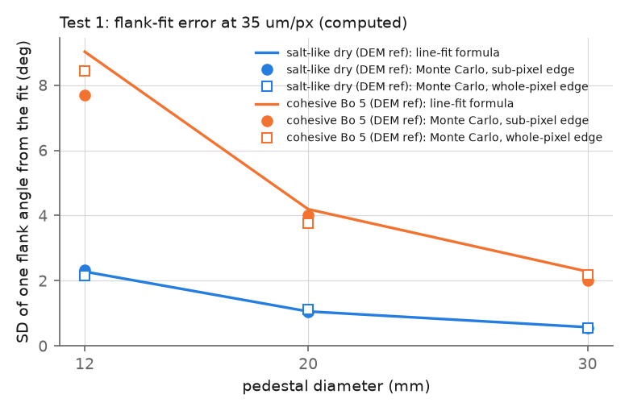
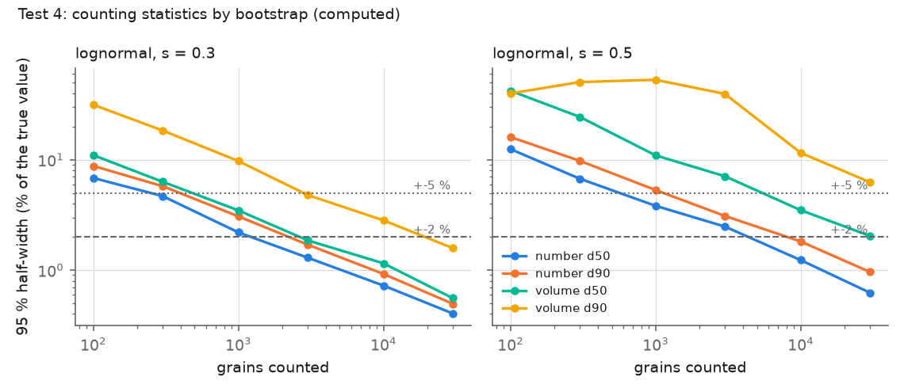
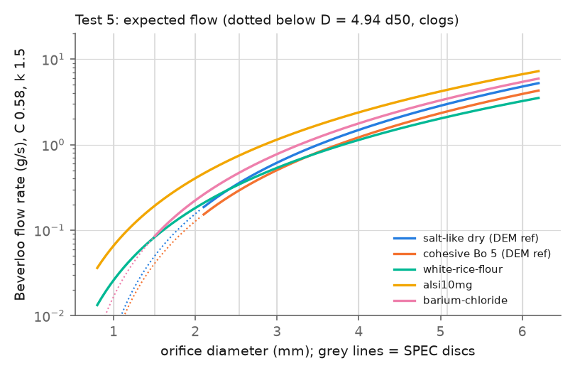
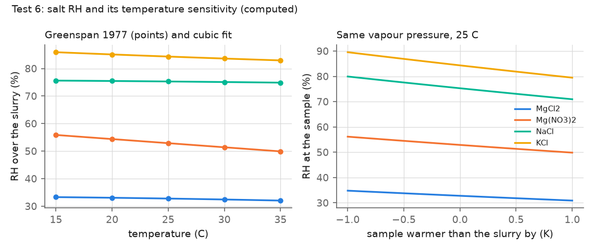
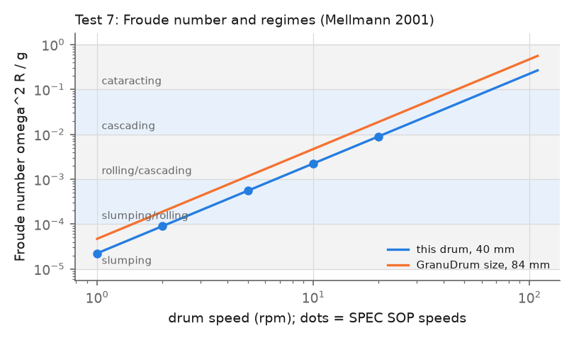
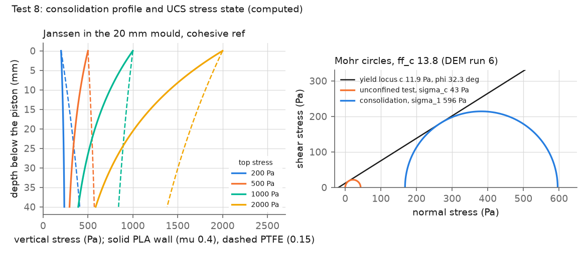
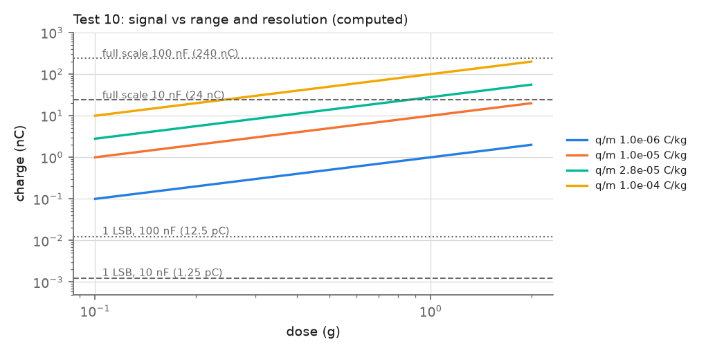

# Theory: equations, expected signals and uncertainty budgets for tests 1-10

**Status: computed, not measured.** Nothing here comes from a built fixture. The numbers are textbook
equations evaluated with the dimensions in [`SPEC.md`](../../SPEC.md), the two reference powders of #196
and handbook values for the 12 battery powders. Use them to size fixtures and to judge what a measurement
can resolve, not as property values.

| File | What |
|---|---|
| [`powder_theory.py`](powder_theory.py) | The equation set, one function per equation, each with its source in the docstring |
| [`run_theory.py`](run_theory.py) | Evaluates every test, runs the two Monte Carlo checks, writes `results.json` and the figures |
| [`tables.py`](tables.py) | Turns `results.json` into [`tables.md`](tables.md): every number below, for all 14 powders |
| [`results.json`](results.json) | All computed values |
| `fig_*.png` | Seven figures, shown below |

Run (about 10-30 s, under 0.5 GB):

```bash
cd design/in-house-tests/sim/theory
OMP_NUM_THREADS=1 /tmp/venv/bin/python run_theory.py && /tmp/venv/bin/python tables.py
```

## Inputs and assumptions

- **Reference powders (#196, DEM).** Salt-like dry: 0.361 / 0.425 / 0.489 mm spheres (number fractions
  0.3 / 0.4 / 0.3, so ln σ<sub>g</sub> = 0.118), 2165 kg/m³, poured 1249 and tapped 1337 kg/m³ (Hausner
  1.07), AoR 21.9° (32° handbook), μ<sub>wall</sub> 0.4, φ<sub>i</sub> 24.8°, c 6.6 Pa. Cohesive (Bo about
  5): same grains, 1023 / 1186 kg/m³ (Hausner 1.16), AoR 39.3°, φ<sub>i</sub> 32.3°, c 11.9 Pa.
- **Battery powders:** `literature_powder_properties.csv` of #196 (e8811bd): bulk and tapped density, d50,
  AoR, true density, moisture. Class or handbook values, not measurements on our jars.
- **Assumed here** (marked in the tables): the PSD width ln σ<sub>g</sub> by powder class (0.3 for sieved
  crystals and silicon 110-200, 0.4 for atomized metal, sodium sulfate and BaCl₂, 0.5-0.6 for flours,
  calcium lactate and hydrocolloids, 0.7 for silicon -325); μ<sub>wall</sub> = 0.4 on PLA for all powders;
  sorption classes (GAB parameters for starch and hydrocolloid classes; a monolayer for the inert and salt
  powders below their deliquescence RH); the silhouette roughness (SD 0.3 grain, or 3-grain clumps for
  powders with AoR of 38° or more).
- **Air at 25 °C:** ρ 1.184 kg/m³, μ 1.85×10⁻⁵ Pa s, vapour diffusivity 2.5×10⁻⁵ m²/s, saturation 23.0 g/m³.

## Summary table

| Test | Observable | Expected range | Resolution | Uncertainty (computed) | Dominant error |
|---|---|---|---|---|---|
| 1 Heap AoR | flank angle | 22-47° (refs 21.9° / 39.3°) | 35 µm/px; line-fit SD per flank 1.0° (dry) / 4.0° (cohesive) on Ø20, 0.5° / 2.0° on Ø30 | SE of 3 pours 0.7° dry, 2.2° cohesive (Ø20) | grain roughness of the silhouette and heap-to-heap scatter, not pixel size |
| 2 Bulk / tapped density | ρ<sub>b</sub>, ρ<sub>tap</sub>, Hausner | 400-1400 kg/m³; HR 1.07-1.38 | 0.05 mm on 26-60 mm columns (0.1-0.2 %) | ρ<sub>b</sub> 0.2-0.6 %, HR 0.2-0.9 % with the poured cone integrated | the poured cone on top: reading the apex biases ρ<sub>b</sub> by 5-8 % |
| 3 Tilting plate | slip angle → μ<sub>w</sub>, a<sub>w</sub> | μ<sub>w</sub> 0.3-0.7 at σ<sub>n</sub> 38-397 Pa | IMU about 0.1° after a flip calibration | μ<sub>w</sub> ±0.012, a<sub>w</sub> ±1.6 Pa from 3 lids at 0.5° per slip | stick-slip scatter; plate jolts (0.01 g moves the angle 0.2-0.3°); grains wedged under a 0.5 mm shim; a lid-less ring resting on the plate |
| 4 PSD images | d10 / d50 / d90, number and volume | 25-425 µm | 0.9-13 µm/px; a 10 px grain is sized to 0.8 % | number d50 ±2 % needs 1300 / 3700 / 6500 grains (ln σ<sub>g</sub> 0.3 / 0.5 / 0.7); volume d50 needs 2900 / 36,000 / 570,000 | counting statistics of the coarse tail (volume weighting) |
| 5 Orifice cup | W(D), D<sub>c</sub> → σ<sub>c</sub> | W 0.005-7 g/s; D<sub>c</sub> 1-6 mm; σ<sub>c</sub> 4-30 Pa | disc steps ±8 to ±20 % in D | σ<sub>c</sub> ±18-26 % (disc step and H(θ) 2.0-2.75); k 1.5 vs 2.9 moves W by 5 % (fine) to 50-75 % (coarse, D ≤ 3 mm), so k is fitted | H(θ) and the disc set; a 5 g fill leaves a 0.9-3.2 g heel and under 1 s of steady flow at 6 mm |
| 6 Humidity | uptake vs RH and time | 0.005-340 mg/g | 0.1 mg on 2-5 g (0.02-0.05 mg/g) | slurry RH ±0.1-0.3 %RH; SHT45 about ±1 %RH; a sample 1 K warmer than the slurry reads 1.9-4.9 %RH low | temperature differences in the box; above the DRH the uptake is limited by the chamber (18 mg/h in still air) |
| 7 Drum | dynamic angle, avalanche scatter | 30-60°; Fr 2×10⁻⁵ to 9×10⁻³ at 1-20 rpm | about 0.2° per frame | end-wall bias +0.9° (fine) to +3.7° (coarse) at 15 mm depth | end-wall friction; few cohesive avalanches in 90 s (SE 3.2° at 1 rpm); 10 fps under-samples dry avalanches below 5 rpm |
| 8 UCS | σ<sub>c</sub> vs σ<sub>1</sub> → ff<sub>c</sub> | σ<sub>c</sub> 20-1000 Pa | 0.06 Pa (2 mg) | PLA wall: the foot of the column sees 29 % of a 2 kPa top stress; columns stand only if ff<sub>c</sub> < 1.5 (PLA) or 3.4 (PTFE-lined) | Janssen wall friction and self-weight (390-490 Pa at H 40 mm) |
| 9 Spreading | areal mass, φ<sub>layer</sub>, coverage | 0.15-4 g per coupon layer | 0.1 mg | φ<sub>layer</sub> ±5 % at a 0.10 mm gap, ±2.5 % at 0.20 mm (5 µm gap setting) | gap setting and coupon flatness; a 0.20 mm gap is at least 2.5 d50 for only 3 of 12 battery powders |
| 10 Faraday cup | q/m | 10⁻⁶-10⁻⁴ C/kg → 0.5-100 nC per 0.5-1 g | 1.25 pC (10 nF), 12.5 pC (100 nF) | 0.3-1 % at 0.5 nC (LSB, 20 fA over 200 s, leakage at 10¹³ Ω, film C<sub>f</sub>); 5 % false charge after a full-scale reading with a C0G C<sub>f</sub> | leakage and dielectric absorption of C<sub>f</sub>; airborne grains at read time ([`../fea/`](../fea/)) |

## Design changes the theory points to

1. **Test 1: use the Ø30 pedestal for coarse (d50 over about 0.2 mm) and cohesive powders.** The flank fit
   error halves (salt 1.05° → 0.55° per flank; cohesive 4.0° → 2.0°) and D/d50 rises from 47 to 71. Pour
   3 heaps of a dry powder and 5-9 of a cohesive one (SE about 1°). Correct the camera perspective
   (−0.07° to −0.23°, formula below).
2. **Test 2: integrate the poured cone.** A centred pour leaves a cone 2.6-7 mm high on a 26-60 mm column.
   Volume from the silhouette of revolution, not the apex or wall height (biases −5 to −8 % and +2.5 to
   +4.6 %). Calibrate the bore at two water heights (0.16 %); the Hausner ratio does not need the bore.
3. **Test 3: a 1.0 mm shim set for d90 over 0.25 mm, and no lid-less runs.** The 0.5 mm shims are only
   0.8-1.0 d90 for salt and BaCl₂, so grains can wedge between the ring and the plate. Without a lid, wall
   friction carries only 0.1-0.4 g of the 0.73 g ring, so it sits on the plate: use lids of 3 g or more,
   or a 0.8 mm ring wall. Keep plate jolts under about 0.01 g at the ring (0.2-0.3° of early slip;
   [`../fea/`](../fea/) computes the jolts).
4. **Test 4: count 4000 grains, not 2000,** for number-weighted d50 ±2 % at ln σ<sub>g</sub> = 0.5 (6500 at
   0.7). Volume-weighted percentiles from images need 36,000 grains or more for broad powders: report them
   with a bootstrap interval, or take them from sieving or laser diffraction. The HQ camera's field at 1×
   is 6.29 × 4.71 mm (4056 × 3040 × 1.55 µm), not 7.1 × 5.4 mm.
5. **Test 5: a 5 g fill is too little for the large discs.** A flat-bottomed Ø25 cup keeps a heel of
   0.9-3.2 g, and at Ø6 the rest leaves in 0.4-2.3 s (4-23 balance samples). Fill 15 g for D ≥ 4 mm, or fit
   a 60° conical insert (Hall geometry) so the cup empties. σ<sub>c</sub> from D<sub>c</sub> carries
   ±18-26 % from the disc steps and H(θ).
6. **Test 6: hold the box isothermal to ±0.1 K** (each 0.1 K between slurry and sample is 0.2-0.5 %RH) and
   log T at the sample. Add NaNO₃ (74.3 %) and KI (68.9 %) boxes to bracket NaCl's 75.3 % DRH, where run 27
   puts the bridges (73.5-75.2 %). Above a DRH the uptake rate is set by the box: 18 mg/h in still air,
   310 mg/h with a 1 m/s fan, so run the fan or report the box's mass-transfer coefficient. Cap the dish
   or log the balance for 30 s and extrapolate: 30 s in room air moves 0.5-1.7 mg.
7. **Test 7: add 30 and 60 rpm** (the doser reaches 109). 2-60 rpm in an 84 mm GranuDrum is 2.9-87 rpm
   here at the same Froude number. Record at 30 fps below 5 rpm, and run cohesive powders for 300 s at
   1-2 rpm (15 avalanches in 90 s give the cohesive index to only ±18 %). The 15 mm depth adds about +0.9°
   (fine) to +3.7° (coarse) of end-wall friction; a 25 mm depth would cut the coarse case to +2.3°.
8. **Test 8: the 40 mm PLA mould can only test powders with ff<sub>c</sub> under about 1.5.** Wall friction
   (Janssen) leaves the foot of the column 23-29 % of a 2 kPa top stress, and the column's own weight
   (390-490 Pa at its foot) exceeds what such a powder can carry, so only ff<sub>c</sub> < 1.5 stands. Line
   the mould with PTFE film (μ<sub>w</sub> about 0.15), shorten it to H 20-30 mm (H/D 1-1.5), consolidate at
   2-8 kPa, and add ρ<sub>b</sub> g H at the failure plane to F/A. That lifts the limit to ff<sub>c</sub> 5-30
   (table below). At 2 kPa the cell carries the 64 g weight, 13 g of powder and the mould: about 100 g, the
   TAL221's full scale. Consolidate off the cell or use a 500 g cell.
9. **Test 9: the gap must scale with the powder.** A continuous layer needs a gap of about 2.5 d50
   (#196 run 7). 0.10-0.20 mm suits AlSi10Mg, silicon -325 and CMC only. Give the carriage gap screws
   1.5 mm of travel (salt needs 1.06 mm) and scale the feed line to 1.5 × the layer mass (0.2-3.6 g).
10. **Test 10: specify the leakage across C<sub>f</sub> at 10¹³ Ω or more** (C<sub>f</sub>, reset relay and
    guarded PCB together). A common C0G datasheet minimum, 100 GΩ, loses 18 % of a 10 nF reading over a
    200 s dose. Use polystyrene, polypropylene or PTFE for C<sub>f</sub> (false charge after a full-scale reading
    0.5-1.4 % of a 0.5 nC signal, against 5 % for C0G at an assumed 0.1 % absorption), and hold the reset at
    least 30 s after a large reading. Start on the 100 nF range: at 2.8×10⁻⁵ C/kg (run 19's salt on PLA) the
    10 nF range saturates above 0.86 g.

## Test by test

### 1. Heap angle of repose on a pedestal

Equations (`heap_on_pedestal`, `apparent_angle_finite_distance`, `aor_fit_sigma`, `aor_fit_mc`):

```
h = R tan(theta),   V = pi R^2 h / 3,   m = rho_b V              cone on a fixed base (ISO 4324)
tan(theta_app) = tan(theta) sqrt(1 - (R/D_cam)^2)                 silhouette of a cone, camera at D_cam
var(slope) = 12 sigma^2 / (N L^2)                                 straight-line fit, N points over L
  sigma_r = 0.3 d, N_r = L / (sqrt(pi) d)                         grain roughness, correlated over a grain
  sigma_px = 0.2 px sin(theta), N_px = rows in the fit window      sub-pixel edge noise
```

- **Signal.** Heaps on Ø20: 4.0 mm and 0.53 g (dry ref) to 8.2 mm and 0.88 g (cohesive); battery powders
  5.8-10.7 mm, 0.35-0.95 g. On Ø30: 6-16 mm, 1.2-3.2 g. All within the SPEC's 5 g heap budget.
- **Line fit (Monte Carlo, 300 synthetic silhouettes per case).** The roughness of the silhouette, not
  the 35 µm pixel, sets the error. One flank on Ø20: 1.05° for the salt-like grains, 4.0° for cohesive
  3-grain clumps. On Ø30: 0.55° and 2.0°. Whole-pixel and sub-pixel edges give the same answer. The
  line-fit formula agrees with the Monte Carlo once the roughness correlation length (√π d) is used:
  within 6 % for the dry ref and 4-17 % for the cohesive clumps. Powders with d50 of 120 µm or less fit
  to 0.03-0.6° on Ø20.
- **Perspective.** At 120 mm the silhouette reads low by 0.07-0.10° (Ø20) and 0.16-0.23° (Ø30). Correct it
  with the formula above.
- **Camera roll** cancels in the mean of the two flanks; their difference measures roll plus asymmetry.
- **Budget for one pour** (DEM run 2's sector scatter, 1.4° dry and 3.6° cohesive, taken as the
  flank-to-flank granular scatter):

| | Ø20, dry | Ø20, cohesive | Ø30, dry | Ø30, cohesive |
|---|---|---|---|---|
| fit, per flank | 1.05° | 4.0° | 0.55° | 2.0° |
| granular, per flank | 1.4° | 3.6° | 1.4° | 3.6° |
| one pour (mean of 2 flanks) | 1.2° | 3.8° | 1.1° | 2.9° |
| SE of 3 pours | 0.7° | 2.2° | 0.6° | 1.7° |
| pours for SE 1° | 2 | 15 | 2 | 9 |



### 2. Bulk and tapped density

```
H = m / (rho A),  A = pi ID^2 / 4                       column height
A = dm_w / (rho_w dH)                                   two-point water calibration (meniscus cancels)
sigma_A/A = sqrt((sigma_m/dm)^2 + 2 (sigma_H/dH)^2)
HR = rho_tap / rho_b = H_0 / H_N                         area cancels
Carr = 100 (1 - 1/HR) %                                  Carr 1965
C(N) = (V0 - VN)/V0 = a b N / (1 + b N), a = 1 - 1/HR_inf    Kawakita and Ludde 1971
v_impact = sqrt(2 g h) = 0.243 m/s at 3.0 mm (+-3.3 % for +-0.2 mm)
```

- **Signal.** 6 g (or 8 mL) in the 13 mm bore stands 32-60 mm tall and compacts by 2.4 mm (salt) to
  16.5 mm (calcium lactate). Kawakita a is 0.066 (dry ref) to 0.27 (calcium lactate).
- **The poured cone.** A centred pour leaves a cone of height (ID/2) tan θ: 2.6-7.0 mm. Its volume is a
  flat layer one third as tall. Read at the apex, ρ<sub>b</sub> comes out 4.6-8.0 % low; at the wall,
  2.5-4.6 % high. The silhouette shows the whole cone (the backlit outline is the highest grain on each
  line of sight), so integrate it as a solid of revolution. Taps flatten the top, so an uncorrected cone
  also inflates the Hausner ratio.
- **Budget.** Height 0.05 mm (SPEC) on 26-60 mm: 0.1-0.2 %. Bore, two-point calibration over 45 mm:
  0.16 %. Top roughness, taken as half a d50 (at least 0.05 mm) after the cone correction: 0.08-0.6 %.
  Mass: under 0.01 %. Total ρ<sub>b</sub> 0.2-0.6 %, Hausner 0.2-0.9 %. The smallest resolvable compaction is 0.08-0.15 % of
  the column, against Carr indices of 6.6-27 %.

### 3. Tilting plate: wall friction

```
sigma_n = (m_lid + m_powder + m_ring) g cos(theta) / (pi ID^2/4)    ring hangs on the powder (shims out)
tan(theta_slip) = mu_w + a_w / sigma_n                              Coulomb wall yield locus
tau_i = sigma_i tan(theta_i) = mu_w sigma_i + a_w                    weighted least squares over the lids
plate-normal jolt a_n: slip when sin(theta) = mu (cos(theta) - a_n/g)
```

- **Signal.** Ring 0.73 g, powder 1.2-4.1 g in the 25 × 6 mm ring. σ<sub>n</sub> 38-97 Pa with no lid,
  138-197 Pa with 5 g and 338-397 Pa with 15 g: the SPEC's 70-450 Pa reaches down to 38 Pa only for the
  lightest powder (calcium lactate, 0.40 g/mL). Slip at 21.8° for μ<sub>w</sub> 0.4; a 5 Pa wall adhesion
  (assumed for the cohesive ref) lifts it to 25.4° / 23.3° / 22.5° across the three lids.
- **Budget.** IMU (LSM6DSOX): offset up to about 20 mg (1.1°) as delivered; a two-position flip
  calibration leaves about 0.1°. Stick-slip scatter of the slip angle, assumed 0.5° per slip. Three lids
  give μ<sub>w</sub> ±0.012 and a<sub>w</sub> ±1.4-1.6 Pa (1 SD).
- **Jolts.** A plate-normal acceleration a<sub>n</sub> lowers the apparent slip angle: 0.21° at 0.01 g,
  0.64° at 0.03 g and 2.1° at 0.1 g for μ 0.4 (0.33°, 0.99°, 3.3° for μ 0.7).
- **Does the ring hang on the powder?** Wall friction on the ring's inner wall (μ 0.4, K 0.5, both
  assumed) carries 0.11-0.40 g with no lid, less than the 0.73 g ring, so without a lid the ring settles
  onto the plate and its own friction adds to the reading. With the 5 g lid it carries 1.07-1.36 g
  (margin 1.5-1.9). A lid of at least 3-5 g, or a 0.8 mm wall (0.48 g ring), keeps the ring off the plate.
- **Shim gap.** 0.5 mm is 0.8-1.0 d90 for salt, the dry and cohesive refs and BaCl₂: grains can bridge
  the gap and carry load into the ring. 2 × d90 needs 1.0-1.25 mm for these four (0.84 mm for calcium
  lactate).

### 4. PSD and shape from images

```
SE(ln d_q) = s sqrt(q (1-q) / N) / phi(z_q)            number-weighted quantile of a lognormal
N_eff / N = exp(-9 s^2)                                 Kish effective size of d^3 weights
volume median = number median x exp(3 s^2)              Hatch-Choate
d_eq = 2 sqrt(pixels / pi)                              area-equivalent diameter
```

- **Grains needed (bootstrap, 200 replicate samples per point, 95 % half-width).** The quantile formula
  matches the bootstrap within 3-24 % for number weighting.

| ln σ<sub>g</sub> | number d50 ±2 % | number d90 ±5 % | volume d50 ±2 % | volume d90 ±5 % |
|---|---|---|---|---|
| 0.118 (salt ref) | 196 | 58 | 231 | 113 |
| 0.3 | 1300 | 343 | 2900 | 3400 |
| 0.5 | 3700 | 1150 | 36,000 | 47,000 |
| 0.7 | 6500 | 2200 | 570,000 | 220,000 |

- **Pixels per grain (Monte Carlo).** The area-equivalent diameter of a disc scatters by 5.7 % at 3 px,
  2.4 % at 5 px, 0.8 % at 10 px and 0.3 % at 20 px, with no bias. 10 px across d10 is enough.
- **Imaging plan** (zoom for d10 = 10 px, 5 % area coverage; [`tables.md`](tables.md)): 0.4-13 fields for
  number statistics. Volume statistics need 0.6-1200 fields, or 0.3-4 g of imaged powder for the
  coarse powders, which favours sieving for them.
- **Image size vs sieve size.** A cube lying on a face reads 2/√π = 1.13 × its sieve aperture.



### 5. Orifice cup

```
W = C rho_b sqrt(g) (D - k d)^2.5, C = 0.58, k = 1.5 (spheres) to 2.9 (angular)    Beverloo 1961
D_jam = 4.94 d (cohesionless spheres, flat-bottomed silo)                          Zuriguel et al. 2005
sigma_c = rho_b g D_c / H(theta), H = 2 + theta/60 (2.0-2.75 for theta 0-45 deg)   Jenike 1964
heel = rho_b 2 pi tan(theta) (R^3/3 - r R^2/2 + r^3/6)                             ring at the drained angle
Bo = F_vdW(Rumpf asperity model) / (m g)                                           order of magnitude
```

- **Signal.** Beverloo rates at the SPEC discs: 0.005-0.07 g/s at 1 mm, 0.27-1.15 g/s at 3 mm, 1.8-6.7 g/s
  at 6 mm ([`tables.md`](tables.md)). Geometric jamming at 2.1 mm for salt (so 2.0 mm clogs and 2.54 mm
  flows, as in run 4's Hall funnel), 1.5 mm for BaCl₂, 1.1 mm for calcium lactate, and below the smallest
  disc for the rest. Rumpf Bond numbers: 0.02-0.6 for the coarse salts and calcium lactate, 1.3-3.7
  for silicon 110-200, the flours and the gums, 12-110 for CMC, AlSi10Mg and silicon -325. The last
  group are the powders whose D<sub>c</sub> will be set by cohesion, not jamming.
- **Strength bracket.** The disc set brackets D<sub>c</sub> to ±8-20 %, and H(θ) adds ±16 %: σ<sub>c</sub>
  ±18-26 %. For ρ<sub>b</sub> 1000 kg/m³ the discs span σ<sub>c</sub> 4.5-27 Pa.
- **DEM refs.** The cohesive ref's c and φ give σ<sub>c</sub> 43 Pa, so D<sub>c</sub> about 9.5 mm: it should
  not flow through any disc (run 4's cohesive Hall funnel jammed). The dry ref's c = 6.6 Pa would give 3.7
  mm, but dry salt flows at 2.54 mm, so that c is an artefact of a straight-line fit at 50-200 Pa.
- **Fill and heel.** 5 g fills the Ø25 cup 7-26 mm deep. 0.9-3.2 g stays as a heel at the drained angle
  (taken as the AoR, a lower bound). At 6 mm the rest leaves in 0.4-2.3 s: 4-23 samples at 10 Hz.
- **Cohesive powders** can rathole in a flat-bottomed cup: a pipe over the orifice empties and the rest
  stands, so "no flow" and "pipe emptied" have to be told apart on the camera.
- **Balance during flow.** The stream's impact force (W v) equals the weight of the grains in flight
  (2.7 mN each at 3 g/s from 40 mm), so the reading is the mass that has left the cup. No correction.



### 6. Humidity chambers

```
RH_salt(T): Greenspan 1977, cubic through 15-35 C
RH_sample = RH_slurry p_sat(T) / p_sat(T + dT),  p_sat = 6.1094 exp(17.625 T/(T + 243.04)) hPa
            (Alduchov and Eskridge 1996; d ln p_sat/dT = 0.0596 per K at 25 C)
GAB: X = Xm C K a / ((1 - K a)(1 - K a + C K a))
D_app = (D eps / tau) / (eps + rho_b (dq/dRH) / c_sat);  t95 = 1.129 L^2 / D_app     Crank, plane sheet
J = h_m A c_sat (RH_box - RH_surface)                                              supply to a deliquescing sample
h_m: D / 30 mm in still air; Sh = 0.664 Re^0.5 Sc^(1/3) over the dish with a fan
```

- **Salt RH at 25 °C** (Greenspan 1977): MgCl₂ 32.8 ± 0.16, Mg(NO₃)₂ 52.9 ± 0.22, NaCl 75.3 ± 0.12, KCl
  84.3 ± 0.26 %RH; dRH/dT −0.06, −0.30, −0.04 and −0.15 %RH/K. A ±1 °C room drift moves the equilibrium RH
  by at most 0.3 %RH. The silica-gel box (about 5 %) is not a fixed point: drying 2 g of a hydrocolloid
  from 53 % to 5 % releases about 260 mg of water, which needs about 9 g of gel at an assumed 3 % w/w
  capacity, so load 50 g or more and regenerate it when the SHT45 reads above about 10 %.
- **Temperature differences matter far more.** At the same vapour pressure, a sample 0.1 K warmer than the
  slurry sits 0.2-0.5 %RH lower; 1 K warmer, 1.9-4.9 %RH lower (NaCl box: 75.3 → 71.0 %). That is wider
  than run 27's 73.5-75.2 % bridge window.
- **Expected uptake** (class isotherms, assumed): flours 31-198 mg/g, hydrocolloids 32-339 mg/g, inert
  powders, hydrates and salts below their DRH 0.005-0.4 mg/g. On a 2 g sample the salt signal is
  0.02-0.2 mg, at the balance's 0.1 mg. NaCl's signal is the jump above 75.3 %.
- **Kinetics in a 2 mm layer.** Pore diffusion alone: about 4-7 s for inert powders, 54 min (starch) and
  85 min (hydrocolloid), because sorption holds back the vapour (capacity factors of 12,000-19,000). The
  box's air supply adds to this ([`../cfd/`](../cfd/) solves it).
- **Above the DRH the box sets the rate.** NaCl in the KCl box takes up 18 mg/h in still air and 310 mg/h
  with a 1 m/s fan over the dish; dissolving 2 g needs 5.6 g of water, so a 24 h reading is a chamber
  property. The box holds only 21 mg of vapour at 75 %, so the slurry must resupply it.
- **Weighing outside the box.** 30 s in 40 %RH room air exchanges up to 0.5-1.7 mg (upper bound, h<sub>m</sub>
  2×10⁻³ m/s assumed).
- **Budget at the sample.** Greenspan ±0.1-0.3 %RH; SHT45 about ±1 %RH (datasheet, typical); sample-slurry
  temperature offset −0.2 to −0.5 %RH per 0.1 K; approach to equilibrium after the lid closes
  ([`../cfd/`](../cfd/)).



### 7. Rotating drum

```
Fr = omega^2 R / g                                           Mellmann 2001 regime bands
rpm_here = rpm_GranuDrum sqrt(R_GD / R_here)                 same Fr
tan(theta_obs) = tan(theta) + mu_w h / W                     end-wall friction, Taberlet et al. 2003
```

- **Regimes.** 1-2 rpm: Fr 2×10⁻⁵ to 9×10⁻⁵, slumping (discrete avalanches); 5 rpm: slumping/rolling;
  10-20 rpm: rolling/cascading (2×10⁻³ to 9×10⁻³); 30-60 rpm: cascading; 109 rpm: cataracting (0.27).
- **Same Fr as a GranuDrum (84 mm).** Its 2 / 10 / 30 / 60 rpm match 2.9 / 14.5 / 43.5 / 87 rpm here.
- **Frame rate.** A 3° dry sawtooth lasts 0.5 s at 1 rpm: 5 frames at 10 fps, 2.5 at 2 rpm. Use 30 fps
  below 5 rpm. The cohesive 37° avalanches (run 3) are slow enough at any SOP speed.
- **Counting.** At 1 rpm a 90 s run sees about 180 dry avalanches (3° sawtooth, SE of the mean angle
  0.3°) but only 15 cohesive ones (37° range): SE 3.2° and ±18 % on the scatter that is the cohesive
  index. 300 s at 1 rpm gives 49 avalanches (SE 1.8°, ±10 %).
- **End walls.** With a flowing layer of 10 grains (coarse) the 15 mm depth adds +3.7°; with a 1 mm
  layer (fine), +0.9°. The camera sees the window, where the angle is highest.
- **Fill.** 40 % is 7.5 mL: 3.0 g (calcium lactate) to 10.6 g (sodium sulfate); 9.4 g of the dry ref.
  D/d50 = 94 for salt, enough.



### 8. Unconfined strength in a split mould

```
sigma_v(z) = s_inf + (sigma_0 - s_inf) exp(-z/lambda),  lambda = D / (4 mu_w K),  s_inf = rho_b g lambda
                                                      Janssen 1895; K = 1.1 (1 - sin phi_i), EN 1991-4
sigma_c = 2 c cos(phi) / (1 - sin(phi))                 Mohr-Coulomb, unconfined circle
ff_c = sigma_1 / sigma_c; classes < 1, 1-2, 2-4, 4-10, > 10   Jenike 1964
column stands if sigma_c(foot) > rho_b g H; largest ff_c that stands = sigma_v(H) / (rho_b g H)
```

- **Consolidation profile.** K = 0.64 (dry ref) and 0.51 (cohesive). With PLA walls (μ<sub>w</sub> 0.4),
  λ = 20-24 mm, so at 2 kPa the foot of a 40 mm column gets 23-29 % of the top stress and the column
  averages about half of it. PTFE film (μ<sub>w</sub> 0.15): 64-69 %. At 0.2 kPa the column's own weight
  dominates: the foot sees 235 Pa, more than the top.
- **Self-weight.** ρ<sub>b</sub> g H at the foot is 390-490 Pa for the refs (157-550 Pa for the battery
  powders) at H 40 mm, against σ<sub>c</sub> of 21 Pa (dry ref) and 43 Pa (cohesive ref, ff<sub>c</sub>
  13.8, "free-flowing" in Jenike's classes). Neither ref column can stand.
- **Largest ff<sub>c</sub> whose column stands** (cohesive ref, linear flow function through the origin):

| Mould | 2 kPa | 4 kPa | 8 kPa |
|---|---|---|---|
| H 40, PLA (μ<sub>w</sub> 0.4) | 1.5 | 2.4 | 4.4 |
| H 40, PTFE (0.15) | 3.4 | 6.1 | 11.5 |
| H 30, PTFE | 5.0 | 9.2 | 17.6 |
| H 20, PTFE | 8.2 | 15.5 | 30.2 |

- **Signal and resolution.** Platen forces of 6-14 mN (0.7-1.4 g) at the refs' σ<sub>c</sub>, 32 g at a
  σ<sub>c</sub> of 1 kPa. 2 mg of NAU7802 noise is 0.06 Pa. The piston face (Ø19.6) is 4 % smaller than
  the bore, so the SPEC weights give 208-2080 Pa under the piston.



### 9. Blade spreading

```
m_A = phi_layer rho_p gap                     areal mass (run 7's definition, layer referred to the gap)
P = 0.5 K_p rho_b g h^2 + 2 c sqrt(K_p) h,  K_p = (1 + sin phi)/(1 - sin phi)    Rankine passive push
```

- **Gap vs grains.** 0.10 mm is below d50 for 7 of 12 battery powders and 0.20 mm for 3; a continuous
  layer needs about 2.5 d50 (run 7): 1.06 mm for salt, 0.75 mm for BaCl₂, 0.06-0.15 mm for silicon -325,
  AlSi10Mg and CMC.
- **Mass.** At φ 0.34, a layer on 100 × 30 mm is 0.15-0.32 g at 0.10 mm and 0.30-0.63 g at 0.20 mm; at
  2.5 d50, 0.15 g (silicon -325) to 2.4 g (salt). Feed 1.5 × that: up to 3.5 g for salt.
- **Force.** The heap of a 0.5 g line is 2.3-6 mm tall and pushes back with 4-17 mN (passive pressure):
  small next to any jam of a grain under the blade ([`../fea/`](../fea/) sizes the carriage for both).
- **Budget.** Weighing 0.1-0.2 mg on 0.15-4 g: under 0.1 %. Gap set to ±5 µm (feeler and screw, assumed):
  ±5 % of φ at 0.10 mm, ±2.5 % at 0.20 mm, ±0.5 % at 1 mm. Coupon flatness adds directly: a 1 mm stainless
  sheet must be clamped or bonded flat.

### 10. Faraday cup and charge amplifier

```
V_out = -Q / C_f;   LSB = (FSR / 2^15) C_f                     ADS1115, FSR 4.096 V
Q_bias = I_b t;   Q_DA = DA V_prev C_f;   loss = 1 - exp(-t / (R_leak C_f))
noise gain = 1 + (C_cup + C_cable) / C_f
(q/m)_max = 6 eps0 E_b / (rho_p d)                              surface field at air breakdown
```

- **Signal.** 10⁻⁶-10⁻⁴ C/kg on 0.5-1 g is 0.5-100 nC. Full scale is 24 nC (10 nF) and 240 nC (100 nF) at
  2.4 V; one LSB is 1.25 pC and 12.5 pC. The 10 nF range saturates above 0.86 g at 2.8×10⁻⁵ C/kg and above
  0.24 g at 10⁻⁴ C/kg. A 0.425 mm salt grain (87 µg) at 10⁻⁵ C/kg carries 0.9 pC, close to one LSB.
- **Physical ceiling.** Air breakdown at the grain surface caps q/m at 1.7×10⁻⁴ C/kg for 0.425 mm salt and
  BaCl₂, rising to 2.7×10⁻³ C/kg for silicon -325. The SPEC's upper 10⁻⁴ is 60 % of the ceiling for coarse
  salts.
- **Bias current** (ADA4530-1 class): 20 fA worst case over a 200 s dose is 4 pC; 1 fA typical, 0.2 pC.
- **Leakage across C<sub>f</sub>.** τ = R C<sub>f</sub>. On 10 nF: 10¹¹ Ω (a common C0G datasheet
  minimum) loses 18 % over 202 s; 10¹² Ω, 2 %; 10¹³ Ω, 0.2 %.
- **Dielectric absorption** (assumed typical values: PTFE 0.01 %, polystyrene 0.02 %, polypropylene 0.03 %,
  C0G 0.1 %): after a 2.4 V reading, a short reset leaves 2.4-24 pC on 10 nF, that is 0.5-4.8 % of a 0.5
  nC reading.
- **Voltage mode is not an option.** The cup alone is about 6 pF (coaxial estimate; [`../fea/`](../fea/)
  solves it): with 1 m of cable, 100 nC would put 950 V on the cup. The charge amplifier holds it at
  virtual ground; with C<sub>f</sub> ≫ C<sub>in</sub> the noise gain is 1.01.
- **Cable.** Flexing ordinary coax generates triboelectric charge of the order of pC (Keithley, Low Level
  Measurements Handbook): fix the cable, use low-noise (graphite-layer) coax, or mount the amplifier on
  the can.



## Checks

- **Beverloo against #196.** C 0.58, k 1.5 give 0.358 g/s for the dry ref through the 2.54 mm Hall
  orifice, the value run 4 reported next to its DEM rate of 0.363 g/s.
- **Line-fit formula against the Monte Carlo:** 1.01 (dry) and 1.04 (cohesive) on Ø20.
- **Quantile formula against the bootstrap:** 1.03-1.24 (formula slightly conservative).
- **Pixel sizing:** no bias above 3 px (under 0.4 %).
- **Greenspan fit:** the cubic reproduces the tabulated values to 0.002 %RH.
- **SPEC numbers reproduced:** 6.4 g on 314 mm² is 200 Pa; a 3.0 mm drop lands at 0.243 m/s, the
  speed of run 5's fill.

## Limitations

- Every input is a DEM reference, a handbook or class value, or an assumption. None is a measurement on
  our jars.
- The roughness model of the heap silhouette, the stick-slip scatter of the tilting plate, the gap
  tolerance, the sorption classes and the dielectric absorption values are assumptions; each is named
  where it is used and can be replaced by a first measurement.
- Jenike's H(θ) and the Janssen K are design-code approximations. The flat-bottomed cup's flow channel is
  not known, hence the 2.0-2.75 band.
- The flow function is taken as linear through the origin for the "stands or collapses" limit of test 8.
- Fluid effects (air drag on falling grains, air counter-flow at small orifices, vapour transport in the
  box) are in [`../cfd/`](../cfd/); stresses and deflections of the fixtures are in [`../fea/`](../fea/).

## Sources

Beverloo, Leniger and van de Velde (1961) *Chem. Eng. Sci.* 15, 260-269. Carr (1965) *Chem. Eng.* 72(2),
163-168. Crank (1975) *The Mathematics of Diffusion*, 2nd ed. EN 1991-4:2006 (silo loads). Greenspan
(1977) *J. Res. NBS* 81A, 89-96. Alduchov and Eskridge (1996) *J. Appl. Meteorol.* 35, 601-609. Janssen
(1895) *Z. Ver. Dtsch. Ing.* 39, 1045. Jenike (1964) *Utah Eng. Exp. Stn. Bull.* 123. Kawakita and Lüdde
(1971) *Powder Technol.* 4, 61-68. Kish (1965) *Survey Sampling*. Matsusaka et al. (2010) *Chem. Eng. Sci.*
65, 5781-5807. Mellmann (2001) *Powder Technol.* 118, 251-270. Pease (1982) "Understand capacitor soakage
to optimize analog systems", *EDN*. Rabinovich et al. (2000) *J. Colloid Interface Sci.* 232, 10-16.
Rumpf (1990) *Particle Technology*. Schulze (2008) *Powders and Bulk Solids*. Taberlet et al. (2003) *Phys.
Rev. Lett.* 91, 264301. Zuriguel et al. (2005) *Phys. Rev. E* 71, 051303. Al-Muhtaseb, McMinn and Magee
(2002) *Food Bioprod. Process.* 80, 118-128 (GAB ranges). #196 runs 2-7, 19 and 27 (e8811bd) for the
reference powders.
