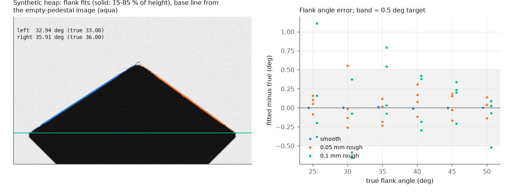
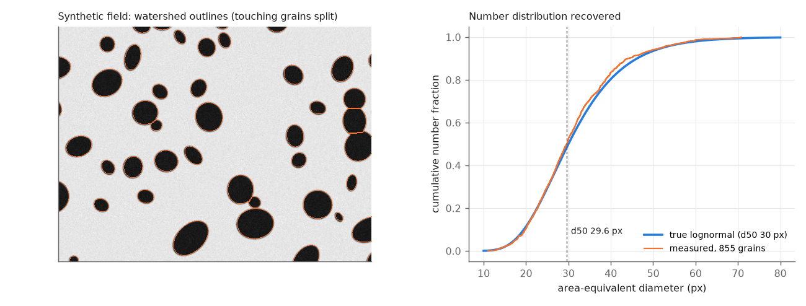

# Bench software for the in-house tests

**Status: design, 2026-11-28. Runs end to end in simulation only.** Nothing here has driven real
hardware yet. Numbers, pins and procedures come from [`../SPEC.md`](../SPEC.md).

| Where | What runs | This folder |
|---|---|---|
| Doser Pi Zero 2 W | the doser Pico (unchanged, plus one small patch), the livestream, **`doser_bridge.py`** | [`doser_bridge.py`](doser_bridge.py), [`doser_patches/`](doser_patches/) |
| Bench Pi 5 | cameras, image analysis, the SOP runners | [`bench/`](bench/) |
| Accessory Pico 2 W, on the Pi 5's USB | servos, stepper, tapper, sensors | [`../firmware/`](../firmware/) |

The Pi 5 reaches the doser through an SSH port forward to the bridge, which listens on 127.0.0.1
only. The production setup is not rewired.

## Install

### Doser Pi Zero 2 W: the bridge

1. Copy `doser_bridge.py` to the Zero (for example `/home/<user>/doser_bridge.py`) and install pyserial:
   `sudo apt install python3-serial`. Python 3.13, standard library otherwise.
2. Nothing else may hold the doser Pico's port (`/dev/ttyACM0`) while the bridge runs.
3. Run it: `python3 doser_bridge.py --port /dev/ttyACM0` (listens on 127.0.0.1:8765), or as a
   service:
   ```ini
   # /etc/systemd/system/doser-bridge.service  (record it in the repo docs when installed)
   [Unit]
   Description=Doser serial bridge (127.0.0.1:8765)
   After=network.target
   [Service]
   ExecStart=/usr/bin/python3 /home/<user>/doser_bridge.py --port /dev/ttyACM0
   Restart=on-failure
   User=<user>
   [Install]
   WantedBy=multi-user.target
   ```
4. Try it without hardware: `python3 doser_bridge.py --mock`.
5. **Doser firmware patch.** The drum (test 7) needs a set auger speed, and the fills read better at
   30 rpm. `r` has no speed argument, so [`doser_patches/0001-rpm-command.patch`](doser_patches/0001-rpm-command.patch)
   adds `rpm <auger rpm>` to `main_three_phase.py` (5 lines). Without it the runners use the doser's
   default speed and say so; the drum refuses to run.

The bridge protocol: send any doser command (`r 360`, `a 45`, `w`, `z`, `t`, `p horizontal`, `!`) or
JSON (`{"cmd": "r 3600", "timeout": 120, "id": 3}`), get one JSON line back (`ok`, `lines`,
`elapsed_s`, and for `w`: `status`, `grams`, `stable`). Bridge commands: `.ping`, `.info`,
`.weigh <Hz> <s>` (streams `{"ev": "w", ...}` lines, then a reply) and `.abort` (Ctrl-C and a soft
reset of the doser Pico; its boot moves the tilt servos to their default). The doser firmware prints
no prompt, so the bridge sends an unknown marker command (`zz_eoc_<n>`) after each command and
waits for the doser's "unknown command" reply to it: the Pico handles lines in order, so that reply
means the real command has finished.

### Bench Pi 5

```bash
sudo apt install python3-picamera2 python3-numpy python3-scipy python3-skimage python3-opencv \
    python3-matplotlib python3-serial python3-smbus2 python3-pil
git clone https://github.com/vertical-cloud-lab/powder-doser && cd powder-doser/design/in-house-tests/software
ssh -N -L 8765:127.0.0.1:8765 <user>@<zero> &       # Tailscale SSH; keep it up (autossh or a unit)
python -m bench.run status                            # bridge, balance, accessory, I2C, cameras
```

Cameras: index 0 is the silhouette Camera Module 3, index 1 the HQ microscope camera. The humidity
boxes' SHT45s hang off a TCA9548A (0x70) on the Pi 5's I2C bus 1, channels 0-4 =
MgCl2, MgNO3, NaCl, KCl, silica.

## Running the tests

Every test is `python -m bench.run <test> --jar <id> [options]`, from this folder. Add `--sim` to
practise with simulated devices and powder, `--yes` to skip prompts, `--operator`, `--note`.
`python -m bench.run <test> -h` lists all options. The exit code is 0 when every acceptance check
passes. Ctrl-C sends `estop` to the accessory and `!` to the doser.

| # | Test | Command (defaults from SPEC) | SOP |
|---|---|---|---|
| 1 | Heap AoR | `heap --jar NaCl-01 --pours 3 --tilt 45` | [sop/01-heap.md](sop/01-heap.md) |
| 2 | Bulk / tapped density | `watercal --jar cyl-A` once per cylinder, then `density --jar NaCl-01 --cal runs/<watercal run>/cylinder_cal.csv` | [sop/02-density.md](sop/02-density.md) |
| 3 | Tilting plate | `plate --jar NaCl-01 --mode A --coupon PLA --lids 0,5,15 --repeats 3`; mode B: `--mode B --coupon rough --depths 1,2,3,5` | [sop/03-plate.md](sop/03-plate.md) |
| 4 | PSD from images | `psdcal --jar NaCl-01 --spacing-um 10` (same day), then `psd --jar NaCl-01 --fields 10 --min-grains 2000` | [sop/04-psd.md](sop/04-psd.md) |
| 5 | Orifice cup | `orifice --jar NaCl-01 --rho-b <test 2> --d50-um <test 4>` | [sop/05-orifice.md](sop/05-orifice.md) |
| 6 | Humidity | `humidity --jar NaCl-01 --box NaCl --stage start`, then `--stage weigh --run-dir <dir>` at 1, 2, 4, 8, 24 h, then `--stage finish` | [sop/06-humidity.md](sop/06-humidity.md) |
| 7 | Rotating drum | `drum --jar NaCl-01 --rpms 1,2,5,10,20 --seconds 90 --fps 10` | [sop/07-drum.md](sop/07-drum.md) |
| 8 | Unconfined strength | `ucs --jar NaCl-01 --sigma1-kpa 0.2,0.5,1,2 --speed 0.1` | [sop/08-ucs.md](sop/08-ucs.md) |
| 9 | Blade spreading | `spread --jar NaCl-01 --gap-mm 0.15 --speeds 10,30,100 --rho-true <kg/m3>` | [sop/09-spread.md](sop/09-spread.md) |
| 10 | Faraday cup | `faraday --jar NaCl-01 --revs 3 --cf-nf 10 --repeats 3` | [sop/10-faraday.md](sop/10-faraday.md) |

[`sop/steps.json`](sop/steps.json) holds 6-12 captioned steps per test for the SOP videos.

Each run writes one folder, `runs/<UTC stamp>_<test>_<jar>/`:

| File | Contents |
|---|---|
| `manifest.json` | test, jar id, operator, UTC date, bench RH and T at start and end (accessory SHT45), git commit and dirty flag, all parameters, file list, status |
| `results.json` | results and the acceptance checks, each `{"check", "pass", "value", "limit"}`, and `all_pass` |
| `events.jsonl` | prompts, commands and notes with times |
| `*.csv` | streams: `balance`, `imu`, `ring`, `loadcell`, `charge`, `compaction`, `angles`, `grains`, ... |
| `images/*.png` | every image the analysis used (`--save-every` thins the drum frames) |

## Analysis API (`bench/analysis/`)

Pure functions: arrays in, results out. No devices, no files.

| Module | Main functions |
|---|---|
| `heap` | `analyze_heap(img, px_per_mm, ref=None, mass_g=None)` -> left / right flank angles (line fits 15-85 % of the height, sub-pixel edges), apex angle atan(2h/D), volume of revolution, density; `growth_stopped`, `avalanche_drops` |
| `column` | `column_top(img, px_per_mm, datum_row, x_range)` (volume-equivalent height of an axisymmetric surface; graduation lines skipped), `VolumeCalibration` (water table, meniscus correction), `densities(mass, taps, volumes)` -> bulk, tapped, Hausner, Carr, Kawakita a and 1/b |
| `plate` | `ring_displacement`, `detect_slip`, `jolt_time`, `ramp_angle_at` (IMU line fit before the event), `stresses_at_slip`, `wall_friction_fit` -> phi_w, mu_w, c_w with SEs; `layer_start` (mode B) |
| `psd` | `segment` (Otsu or adaptive), `split_touching` (watershed on the distance transform, h-maxima markers), `measure` (edge grains dropped, Miles-Lantuejoul weights, ECD, Feret max/min, aspect, circularity, solidity), `psd_summary` (number and volume d10/d50/d90, span, bootstrap CIs by grain or by field), `scale_from_micrometer` |
| `orifice` | `flow_rate(t, m, lag_s)` (middle 20-80 % of the discharge, balance lag corrected), `beverloo_fit` (C, k in log space), `critical_orifice`, `sigma_c_from_dc` (rho_b g D_c / H, H = 2.2) |
| `humidity` | `uptake_fit` (first order: u_eq, tau), `isotherm` (u_eq vs RH over the boxes), `deliquescence_onset`, `nominal_rh` (Greenspan 1977, 15-30 C) |
| `drum` | `find_drum` (Hough), `surface_profile`, `surface_angle`, `drum_angles`, `avalanches` (start/stop, frame-lag corrected), `cohesive_index` (interface fluctuation), `fill_fraction`, `froude` |
| `ucs` | `peak_force` (baseline, median filter, failure and detection flags) -> sigma_c; `consolidation_mass_g`; `flow_function` -> ff_c and Jenike class |
| `spread` | `covered_mask`, `coverage`, `streaks` (line opening along the blade direction), `brightness_cv`, `areal_mass_g_m2`, `packing_fraction` |
| `faraday` | `counts_to_nc`, `charge_step` (drift-corrected step, settled flag), `q_over_m` |

## The simulation (`--sim`)

`--sim` replaces every device but keeps the real code paths:

- the **accessory** is the real firmware (`accessory_main.Accessory`) on `firmware/sim_hw.py`'s
  register-level fakes: the IMU reads the tilt the servo B PWM commands, the fake Tic moves the stage
  and cam, the load cell sees the platen force;
- the **doser** is `doser_bridge.py`'s `DoserLink` and marker protocol talking to `MockDoserSerial`,
  which answers like `main_three_phase.py`;
- the **powder** (`bench/sim.py`) has known properties per jar name (`NaCl` salt-like, `flour`
  cohesive, anything else generic), and `bench/synth.py` renders the camera images (heaps, columns,
  rings, grains, drums, coupons) with blur, noise, roughness and touching grains.

All share one fake clock, so a 24 h humidity run or a 90 s drum run takes seconds.

## Tests and the synthetic accuracy

```bash
/tmp/venv/bin/python -m pytest -q tests           # 61 passed, about 2 min (1 core)
/tmp/venv/bin/python -m bench.accuracy             # the tables below, figures/accuracy.{json,md}, figures/*.png
```

`tests/` checks every analysis against synthetic data with known answers (heap angles within
0.5 deg, column heights within 0.05 mm, PSD d50 within 5 % with touching grains, drum angles,
avalanche angles, IMU slip, wall friction, Beverloo, uptake, peak force, coverage, charge), the
bridge (marker protocol, partial lines, timeouts, loopback-only TCP, the weigh stream), the bench's
hardware clients (`DoserClient` against a live mock bridge; `AccessoryClient` through pyserial to the
firmware behind a pseudo-terminal), the run logger, and every SOP end to end in `--sim`.

**Analysis on synthetic data** (`python -m bench.accuracy`, 2026-11-28):

| Test | Quantity | Cases | Max abs error | RMS | Target |
|---|---|---|---|---|---|
| 1 heap | flank angle, smooth surface | 24 | 0.011 deg | 0.005 deg | 0.5 deg |
| 1 heap | flank angle, 0.03 mm grain roughness | 24 | 0.22 deg | 0.10 deg | 0.5 deg |
| 1 heap | flank angle, 0.05 mm roughness | 24 | 0.55 deg | 0.18 deg | 0.5 deg |
| 1 heap | flank angle, 0.1 mm roughness | 24 | 1.11 deg | 0.42 deg | 0.5 deg |
| 1 heap | apex angle atan(2h/D) | 12 | 0.21 deg | 0.08 deg | |
| 1 heap | heap volume | 12 | 1.7 % | 0.7 % | |
| 2 density | column height, 16 px/mm (mound, crater, tilt, graduations) | 8 | 0.044 mm | 0.031 mm | 0.05 mm |
| 2 density | Kawakita a (0.003 mL volume noise) | 20 | 0.0008 | 0.0004 | |
| 2 density | Kawakita 1/b | 20 | 4.1 % | 1.3 % | |
| 3 plate | slip angle (5 fps camera, 20 Hz IMU) | 6 | 0.04 deg | 0.02 deg | |
| 3 plate | phi_w (3 lids x 3 repeats, 0.25 deg slip scatter) | 30 | 0.44 deg | 0.19 deg | 2 deg |
| 3 plate | wall adhesion c_w | 30 | 1.3 Pa | 0.6 Pa | |
| 4 PSD | d10 / d50 / d90, number (6 fields, 15 % touching) | 3 | 1.8 / 1.4 / 4.5 % | 1.6 / 1.3 / 2.8 % | 5 % |
| 4 PSD | d50, volume | 3 | 5.1 % | 3.0 % | |
| 4 PSD | grain count after the watershed | 3 | 0.9 % | 0.7 % | |
| 5 orifice | flow rate, 10 Hz, 0.25 s balance lag corrected | 7 | 0.27 % | 0.11 % | |
| 5 orifice | Beverloo C / k (2 % rate scatter) | 20 | 3.7 % / 0.10 | 1.8 % / 0.04 | |
| 6 humidity | u_eq / tau (6 weighings, 2 % noise) | 20 | 4.0 / 19 % | 2.2 / 8.7 % | |
| 7 drum | free-surface angle, 12 px/mm | 8 | 0.065 deg | 0.034 deg | 0.5 deg |
| 7 drum | avalanche start / stop (1 rpm, 10 fps) | 5 | 0.04 / 0.02 deg | 0.02 / 0.01 deg | |
| 8 UCS | peak force (2 mg noise, 80 Hz) | 5 | 0.6 % | 0.5 % | |
| 9 spread | coverage / streak area | 6 | 0.05 % points / 1.2 % | 0.03 / 0.6 % | |
| 10 Faraday | charge step, drift corrected | 10 | 0.10 nC | 0.04 nC | |

The heap fit is exact on a smooth surface; grain-scale roughness of the silhouette sets its error.
0.05 mm is about an eighth of a salt grain; coarse powders need the three pours, and both flanks,
to stay inside +-0.5 deg.

**Every SOP end to end in `--sim`** (simulated run vs the simulated powder's truth):

| Test | Quantity | Run | Truth | Checks passed |
|---|---|---|---|---|
| 1 heap | flank angle, 3 pours | 32.92 deg | 33.0 deg | 4/4 |
| 2 density | bulk density; Kawakita a, 1/b | 1249 kg/m3; 0.1400, 8.97 taps | 1250; 0.14, 9.0 | 5/5 |
| 3 plate | phi_w, c_w on PLA (3 lids x 2) | 22.4 deg, 6.9 Pa | 22.0 deg, 8.0 Pa | 5/5 |
| 4 PSD | d50, number (6 fields) | 420 um | 425 um | 4/4 |
| 5 orifice | C, k; D_c, D_c tapped | 0.602, 1.59; 1.22, 0.89 mm | 0.58, 1.5; 1.2, 0.9 mm | 5/5 |
| 6 humidity | u_eq in the NaCl box | 59.97 mg/g | 60.0 mg/g | 3/3 |
| 7 drum | dynamic angle at 10 rpm; avalanches at 1 rpm | 39.0 deg; 39.6 / 32.7 deg | 39.0; 40 / 33 deg | 3/3 |
| 8 UCS | sigma_c at sigma_1 = 1 kPa (cohesive preset) | 375 Pa | 377 Pa | 4/4 |
| 9 spread | coverage | 0.896 | 0.896 | 4/4 |
| 10 Faraday | q/m | 19.8 uC/kg | 20.0 uC/kg | 5/5 |





## Found while building this

- **Home the cam before loading the cylinder** (test 2). Homing lifts and drops the carriage; with
  the cylinder in, the 0-tap reading came after one or two taps and read bulk density 1.8 % high.
- **The IMU reads the slip's jolt as tilt** (test 3). Slip angles come from the IMU ramp fitted just
  before the slip, not from the sample at it (that was up to 1.3 deg off).
- **10 um micrometer lines do not resolve at the 0.12x zoom** (about 13 um/px). `psdcal` refuses line
  spacings under 4 px; use the 0.1 mm divisions (`--spacing-um 100`).
- **A fast discharge is short next to the balance's response**: 5 g through 6 mm takes about 1 s. The
  flow fit corrects a first-order lag (`--lag-s`, 0.25 s assumed); measure it once by dropping a
  weight on the pan.
- **The rig's `tic.py` never gets position replies** ("Get variable" lacks its length byte); see
  [`../firmware/README.md`](../firmware/README.md).

## Known gaps

- No hardware run. Camera exposure, Picamera2 frame rates (the drum asks for 1536 x 864 frames; a
  video configuration may be needed for a steady 10 fps), real heap and grain textures, and the
  balance's real response are untested.
- The bridge's `.weigh` polls `w` through the doser Pico; its real rate (5-10 Hz) is unmeasured.
- `.abort` soft-resets the doser Pico, which moves its tilt servos to their boot position.
- Humidity: weighings are run as separate commands; the isotherm across boxes is
  `analysis.humidity.isotherm` on the five boxes' `humidity_result.json`, not a command.
- Test 2 assumes the cylinder sits at the same place in the fill holder and the tapper (one camera
  geometry from `watercal`). If the tapper position differs, run `watercal` there too.
- Test 9 does not yet estimate areal-mass scatter in g/m2 from brightness (`brightness_cv` is the
  proxy).
- Test 8's contact check is weak for a column that collapses: it is reported as collapsed.
