# Fixed-base multi-auger doser: concepts (issue #204)

Issue [#204](https://github.com/vertical-cloud-lab/powder-doser/issues/204)
asks for 2–3 of the current dosing modules on one fixed base, so that 2–3
powders can go into one beaker (or crucible) without anyone swapping
augers. Two directions were proposed:

- **Idea A:** put two of the existing modules nose-to-nose over the beaker,
  and find a way round the big tilt gears at the front of the mounting plate.
- **Idea B:** drop the servos and gears, and tilt each mounting plate with a
  linear actuator pushing from underneath. It must fit 2 augers; 3 would be better.

Every number below comes from the module's real CAD: the STEP files and
placements of [PR #170](https://github.com/vertical-cloud-lab/powder-doser/pull/170)
(the same parts as the Onshape documents listed in
[#193](https://github.com/vertical-cloud-lab/powder-doser/issues/193)).
[`concepts.py`](concepts.py) places 2–3 copies of the module, tilts them, and
finds the closest spacing that keeps **2 mm between any two parts of
different modules**. It checks triangulated meshes with
[python-fcl](https://github.com/BerkeleyAutomation/python-fcl). The new parts
(shared base, towers, servo posts, clevis bracket, actuator, beaker) are
placeholders sized from the real parts. They are not ready to print.

## Summary

| | Augers | Spacing ¹ | Outlets apart at 0° / 45° / 90° ² | Beaker | What changes | Tilt drive |
|---|---|---|---|---|---|---|
| Current modules, each on its own baseplate | 2 | 93 mm | 70 / 77 / 93 mm | a 1 L beaker (Ø105 mm) to catch both at 90° | — | 2 servos each |
| **A1** Servos turned end for end | 2 | **41 mm** | 17.8 / 24.6 / 41.0 mm | 100 mL (50 mL up to about 60°) | new shared base only | 2 servos each (as now) |
| **A2** One gear and servo per module, on opposite flanks | 2 | **37 mm** | 13.8 / 20.6 / 37.0 mm | 100 mL (50 mL up to about 70°) | new base; each plate loses one gear | 1 servo each |
| **B1** Gearless pair, actuator underneath | 2 | **37 mm** | 13.8 / 20.6 / 37.0 mm | 100 mL | new base; plate without gears; clevis bracket | 1 linear actuator each |
| **B2** Gearless tri-star (3 at 120°) | **3** | **32 mm** ³ | Ø40.8 / Ø47.6 / Ø64.0 mm circle | 150 mL up to 60°, 250 mL for 90° | as B1, tapper rolled onto the flank | 1 linear actuator each |
| **B2 + #203's tap bracket** (10 Nov) | **3** | **32 mm** ³ | Ø40.8 / Ø47.6 / Ø64.0 mm circle | as B2 | as B2; the tap bracket replaces the front bracket and the collar | 1 linear actuator each |
| Three A1 modules at 120° | 3 | 66 mm ³ | Ø108 mm circle at 0° | none | | |

¹ Hinge to hinge for the pairs; hinge to beaker axis for three modules.
Clears every tilt up to 60° with all modules tilting together, and any one
module at 90° with the others at 0°. B2 also clears all three at 90° together.
² Pairs: outlet to outlet. Three modules: diameter of the circle through the outlets.
³ Hinge to the beaker axis.

**Short version**
- **Two augers, soonest:** A1. Every printed part of the module stays as it
  is. Only the base is new: it carries both modules' hinge towers, with the
  servo posts behind the hinge instead of in front.
- **Three augers:** only idea B fits a beaker. Three modules with servos and
  gears need the hinges 66 mm from the beaker axis.
- **For two modules, idea B brings the outlets only 4 mm closer than A1.**
  Its real gains are elsewhere: no printed gears to strip and no servo horn
  to loosen, a position readback from the actuator's potentiometer, and a
  tilt that holds when the power is off.
- **Whatever the layout, two facing modules can't both be at 90° at once.**
  At 90° the solenoid on top of the tube swings about 65 mm forward into the
  other module. A firmware interlock fixes this: only one module above 60°
  at a time. For three modules, rolling the tap collar onto the flank fixes
  it (B2). [#203](https://github.com/vertical-cloud-lab/powder-doser/issues/203)
  (tapper off the auger) bears on this; see below.

## Why two current modules don't fit nose-to-nose

The hinge sits 11.6 mm behind the outlet, on the auger's axis. How far each
part reaches **in front of the hinge**, measured on the CAD:

| Part | 0° | 45° | 90° |
|---|---|---|---|
| Baseplate (front arms, legs) | 45.4 mm | 45.4 | 45.4 |
| MG996R servos (under the hinge, case pointing forward) | 37.1 | 37.1 | 37.1 |
| 28T tilt gears | 19.5 | 19.5 | 19.5 |
| Auger tube end | 11.6 | 17.0 | 11.6 (peaks at 47°) |
| Tap collar / solenoid (on top of the tube) | behind | 2.1 / 17.5 | **52.6 / 64.6** |
| 44T auger gear | behind | behind | 23 (72 mm above the hinge) |

So the gears aren't what collides first. With their own baseplates, two
modules can't get their hinges closer than 93 mm, because the baseplates'
front arms (under the servos) hit. With the baseplates gone, the **servos**
hit next: each case reaches 37 mm in front of its hinge, on the same side
as the facing module's servo. The 28T gears only come into play at 41 mm.

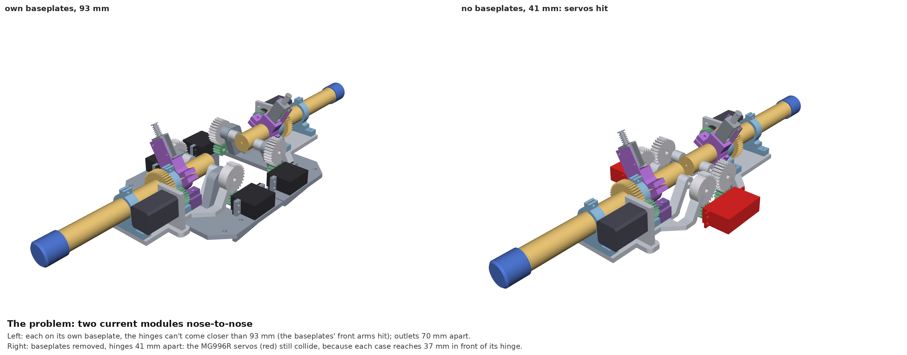

## Idea A: two current modules nose-to-nose

Both concepts share one new base: a flat plate (printed, HDPE or plywood)
carrying the two pairs of hinge towers face to face. A Ø60 window between
them lets the beaker rise to about 15 mm under the outlets. The baseplate's
front arms and legs are gone.

### A1. Turn each servo end for end so its case points back

The MG996R's spline sits 17.4 mm from one end of the case (with its flange)
and 37.1 mm from the other. On the current baseplate the long end points
forward. Turn the servo round so the long end points back, and its forward
reach drops from 37 to 17 mm. **The spline, pinion, gears and mounting plate
don't move,** so the gear mesh and the tilt firmware stay as they are. Only
the servo posts move, to behind the hinge on the new base.

- **Spacing 41 mm,** set by the two modules' 28T gears, which sit in the same
  planes (|x| = 41.8–54.1 mm). Outlets 17.8 mm apart at 0°, 24.6 at 45°, 41 at 90°.
- **Self-check:** over 0–90° the turned servos come no closer than 1.6 mm to
  anything that tilts. That gap is the spline boss to the 28T gear at 40°, the
  same as today. The case itself sits behind the hinge at |x| ≥ 56.6 mm,
  outside the plate (|x| ≤ 54.1 mm). The tightest pair on the whole module is
  still tower to gear, 0.6 mm, as on today's baseplate.
- **Cost:** one printed base. Every other part is a copy of today's module.

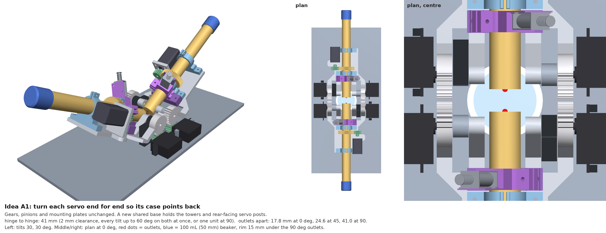

### A2. One gear and one servo per module, on opposite flanks

Delete the −X gear (and its web) from each mounting plate, and the −X servo
with it. Face to face, the two modules' remaining drives land on opposite
sides of the base, so each gear and servo passes beside the other module's
plain knuckle.

- **Spacing 37 mm,** set by the tubes themselves: at about 47° each tube's
  end reaches 17 mm in front of its hinge. Outlets 13.8 mm apart at 0°,
  20.6 at 45°, 37 at 90°.
- **Torque:** the repo's sizing
  ([`hardware/vibration-motor-and-solenoid.md`](../../hardware/vibration-motor-and-solenoid.md#servo-driven-baseplate-tilt--alternative-to-the-linear-actuator))
  puts one module at about 0.39 N·m about the hinge. Through the 14T:28T pair
  that is 0.2 N·m (2 kg·cm) at one servo, against the MG996R's roughly 9–11
  kg·cm stall. Adding 100–250 g of powder brings it to 2.5–3.3 kg·cm, so about
  3× margin. The weak spot is the printed 14T pinion, which has stripped
  before ([#65](https://github.com/vertical-cloud-lab/powder-doser/issues/65)):
  one pinion now carries twice the tooth load. Print it in a tougher material,
  or use a metal pinion.
- **It only gains 4 mm over A1,** for a new mounting plate and a one-sided
  drive. A1 is the better trade unless those 4 mm decide the beaker size.

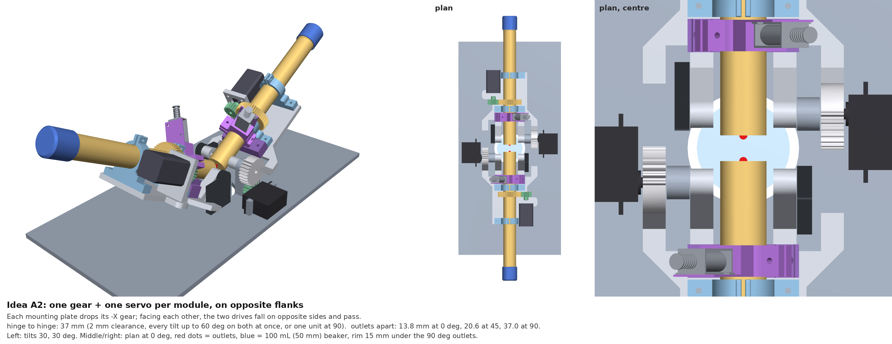

### Considered and dropped

- **Pinion behind the hinge, gear cut to a sector:** over 0–90° only a quarter
  of each 28T gear ever meshes. With the pinion behind the hinge, that quarter
  never comes in front of it. But the plate's gear web and floor wings (|x| up
  to 54 mm, 16–49 mm behind the hinge) sweep through that pinion position by
  45°. It needs a new mounting plate and gains nothing over A2.
- **Servos above the hinge** (the PR #176 variant): it clears the space under
  the outlet, but two modules facing each other still need the cases pointing
  back. That makes it A1 with the servos higher up.
- **Three servo modules at 120°:** with A1's turned servos, neighbouring
  modules' servo cases meet unless the hinges sit 66 mm from the beaker axis
  (outlet circle Ø108 mm at 0°). Idea A stops at two modules.

## Idea B: no servos or gears, a linear actuator underneath

Each mounting plate keeps its knuckles and pivots on the same hinge. The 28T
gears, servo pinions and servos are gone. An actuator underneath pushes the
plate's rear up. Without the gears and servos, a module is about 75 mm wide
at the front (towers at |x| ≤ 37 mm) instead of 190 mm (the servo cases).
That is what lets three modules close in on one beaker.

### Mounting the actuator

- **Rod-end clevis** on a small bracket under the plate floor, **95 mm behind
  and 45 mm below the hinge**, on the centreline (between the front and rear
  auger brackets).
- **Base clevis** straight below it, under the shelf. The rod passes through a
  slot in the shelf (y = 35–110 mm behind the hinge). With pins at both ends
  the actuator swings at most about 8° over 0–90°.
- **Stroke needed** (from closed, with 5 mm in hand at 0°):

| Tilt | 0° | 30° | 45° | 60° | 90° |
|---|---|---|---|---|---|
| Rod out | 5.0 mm | 58.7 | 85.4 | 109.9 | 148.6 |

- **Force:** about 0.4–0.65 N·m about the hinge (module plus powder) over
  95 mm is 4–7 N. Every candidate below is far stronger.

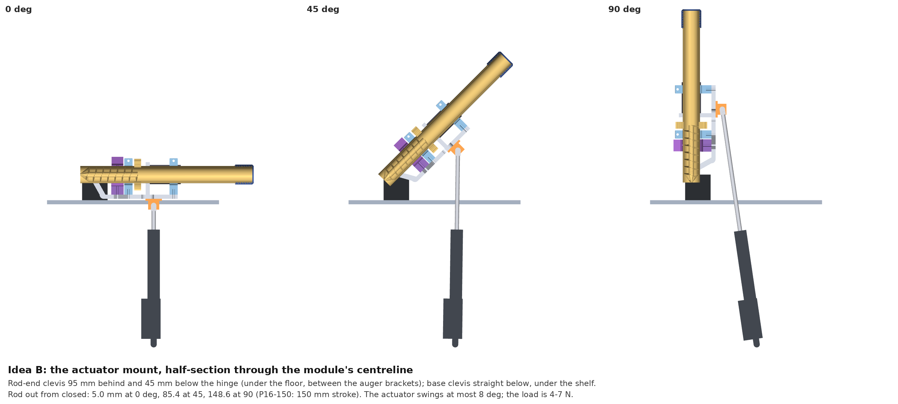

| Actuator | Stroke / closed | Range here | Control | Notes |
|---|---|---|---|---|
| Actuonix **P16-150-22-12-P** + LAC ([#202](https://github.com/vertical-cloud-lab/powder-doser/issues/202)'s pick) | 150 / 197 mm | 0–90° | LAC board (RC pulse, USB or analogue in), potentiometer feedback | $90 + $30 per module; holds 75 N with the power off |
| Actuonix **L16-140-35-6-R** | 140 / 208 mm | 0–90° with the clevis at about 85 mm | RC servo: 1.0 ms = fully in, 2.0 ms = fully out, from the same PWM pin the MG996R uses | 6 V, no LAC needed; holds 31 N with the power off; the datasheet's pulse is 5 V, so check it on the Pico's 3.3 V or add a level shifter |
| Actuonix L16-100-x-12-P / P16-100 | 100 / 147–168 mm | 0–about 54° | as above | if dosing stays at 20–40° (PR #185 v5 caps at 40°) |

L16 numbers are from Actuonix's
[L16 datasheet](https://cdn.robotshop.com/media/F/Fir/RB-Fir-111/pdf/ActuonixL16Datasheet.pdf):
35:1 gearing, 32 mm/s, 50 N lifted, 31 N back-drive, 20% duty, IP-54. P16
numbers are from #202's write-up.

- **A hobby servo also works here.** An MG996R with a horn and a pushrod to
  the same clevis is a 4-bar that can sweep the plate 0–90°. It costs $10
  instead of $90–120 and keeps today's firmware. It loses the position
  readback and the unpowered hold.

### B1. Gearless pair

- **Spacing 37 mm,** the same as A2 (the tubes are the limit). Outlets 13.8 /
  20.6 / 37 mm apart at 0° / 45° / 90°.
- **Actuators:** each hangs 113 mm from the beaker axis, outside the HR-100A's
  Ø172 mm breeze-break housing. Each needs about 210 mm under the shelf. With
  the shelf above the balance's 315 mm top, that leaves the actuator's lower
  end above the balance's 80 mm-tall base.
- **Self-check:** nothing on the module comes within 5 mm of the towers,
  clevis bracket or actuator over 0–90°.

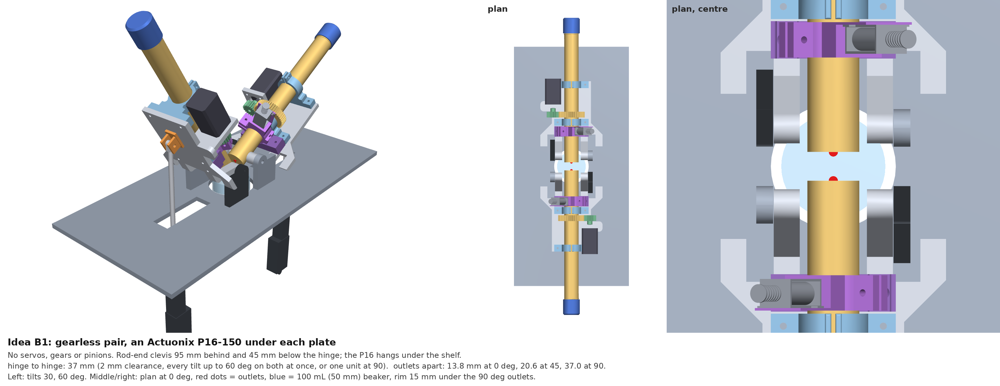

### B2. Gearless tri-star: three modules at 120°

- **Hinges 32 mm from the beaker axis.** Neighbouring towers set this. Without
  towers (a shared hinge frame) it would be 25 mm, where the plates' knuckles
  meet.
- **Outlets** lie on a Ø40.8 mm circle at 0°, Ø47.6 at 45° and Ø64 at 90°: a
  150 mL beaker (about 57 mm inside) up to 60°, 250 mL for 90°.
- **All three can be at 90° at once** if the tap collar is rolled 90° onto the
  module's flank. With the collar on top, as now, 90° on all three needs 56.5 mm.
- **Actuators** hang 127 mm out, again outside the balance's breeze break.

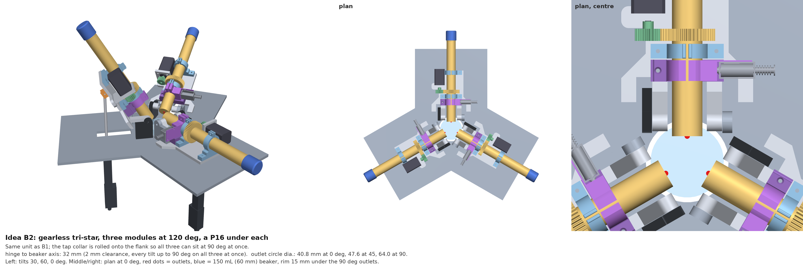

#### B2 with #203's tap bracket (added 10 Nov)

[#203](https://github.com/vertical-cloud-lab/powder-doser/issues/203)'s first
tap bracket ([Ethan's Onshape document](https://cad.onshape.com/documents/3db901b123bbee05f5c196f3/w/71800ea0548acad53e21d816/e/68af1a083e7d90e44c40f87c),
part studio "Solenoid bracket", exported at workspace microversion `103ac09`)
is the front C-clip and a solenoid tower as one part. Here it **replaces each
module's front Flexible Bracket**. The tap collar, its base and the old
solenoid are gone. The Adafruit 412 lies on the module's +X flank, and its
plunger strikes the side of the tube at hinge height, 46 mm behind the hinge.

- **Placement comes from Ethan's assembly, not by eye.**
  [`tap_bracket.py`](tap_bracket.py) exports his "Assembly new solenoid
  setup" (the whole doser with the bracket in place of the front Flexible
  Bracket). It fits his mounting plate onto PR #170's (median gap 0.38 mm,
  95th percentile 0.79 mm). The parts both assemblies share then line up too:
  auger 0.51 mm, rear bracket 0.19, cap 0.51, stepper 0.23 (medians). The
  bracket and its solenoid go into every module at the same place relative to
  the plate ([`tap-bracket/`](tap-bracket/), [`registration.json`](tap-bracket/registration.json)).
- **Hinges are still 32 mm from the beaker axis, as in B2.** The neighbouring
  hinge towers set it at all ten tilt mixes swept: all three at 0, 30, 45, 60
  or 90°, one at 60 or 90°, two at 60 or 90°, and 30/60/0.
- **The brackets have room.** All three solenoids point the same way round,
  so each faces the plain flank of the next module. A bracket or solenoid
  comes no closer than 5.8 mm to another module. That happens when two
  neighbours are both at 90°, bracket to bracket. In every other mix the gap
  is 30 mm or more.
- **All three can be at 90° at once,** as in B2 with the collar on the flank.
- **Self-check:** each bracket stays at least 9.0 mm from its own module's
  towers and actuator over 0–90°.
- **Outlets** are where they were in B2: a Ø40.8 mm circle at 0° and Ø64 at
  90°. The figure uses a 250 mL beaker (Ø70 mm), which holds the 90° circle.
- **Strike gap:** in Ethan's assembly the plunger is drawn touching the tube
  (its tip 0.8 mm inside the tube's surface), so the rest gap can't be read
  from the model. #203 suggests about 3–4 mm.

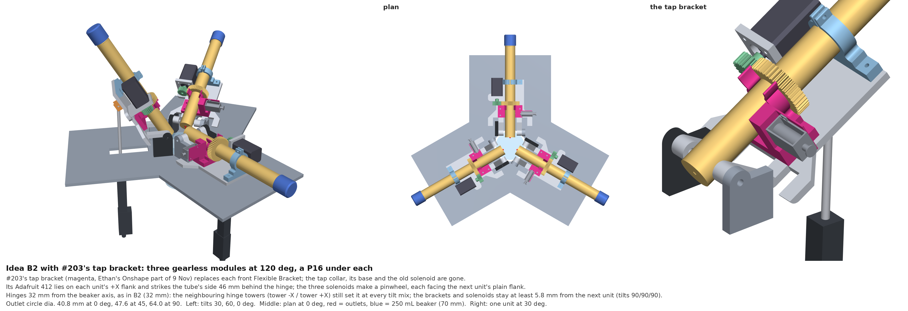

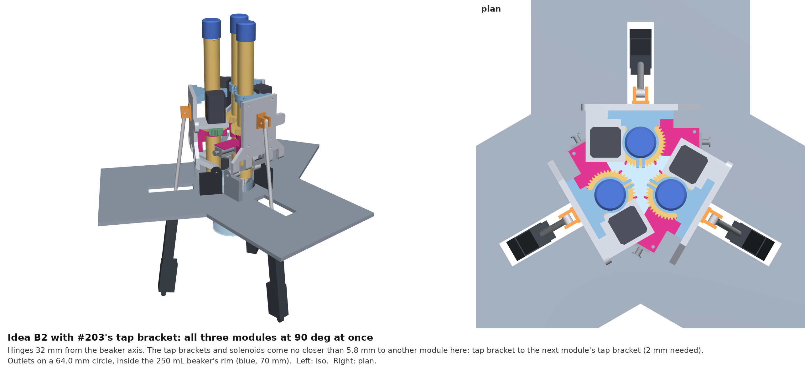

#### Room under the tri-star (added 10 Nov)

[Philip asked](https://github.com/vertical-cloud-lab/powder-doser/issues/204)
how much clearance there is under the doser, whether the hinge towers set it,
and whether a stand could change it. [`clearance.py`](clearance.py) measures it
on the B2 + tap bracket model above ([`clearance.json`](clearance.json) has
the numbers).

- **The towers don't set it; a stand does.** The towers put the hinge
  37.25 mm above the shelf top, so the outlets sit 25.7 mm (90°) to 37.25 mm
  (0°) above it. The shelf has a window under the outlets, so the vessel
  comes up through it from below.
- **The tri-star needs a stand anyway.** Each P16 hangs 208 mm below the
  shelf (its lower eye; the base pin is 204 mm down). With an 8 mm base
  clevis under it, the shelf's underside has to be at least **217 mm** above
  the bench. The outlets are then 249 mm (90°) to 260 mm (0°) up. A taller
  stand adds room 1:1.
- **Hang each actuator from the shelf** (the orange hangers in the figure),
  not from the bench. Then the legs can be any length, and a lab jack under
  the vessel does the fine adjustment.
- **How wide a vessel can be:**
  - **Up to 71 mm** (a 250 mL beaker is 70 mm): rises up between the hinge
    towers, to 2 mm under the lowest the tubes ever get. That is 24 mm above
    the shelf's underside, set by the tube's end lip at 45°.
  - **71–188 mm:** stops under the shelf, 32 mm below the 90° outlets.
    Below the shelf the actuators leave a 188 mm column (214 mm if no module
    goes past 60°, because a P16 leans inward near 90°).
  - **Wider:** has to stay below the actuators' lower ends, or fit between
    two of them.
- **Erlenmeyer necks can't catch three outlets.** The outlets lie on a
  Ø40.8 (0°) to Ø64 mm (90°) circle. DURAN's necks are 34 mm (250 and
  500 mL), 42 mm (1 L) and 50 mm (wide neck). Only the wide neck (about
  46 mm inside) is wider than the circle, and only up to about 39° of tilt,
  before allowing for each stream's own width. So plan on a funnel in the
  neck. An 80 mm, 60° powder funnel stands 29–43 mm above the neck. Its
  mouth is too wide for the window, so it sits under the shelf.

Stand height (bench to the shelf's underside) for some vessels on a 100 mm
stir plate (a placeholder; add or subtract the difference for yours, and
take 100 mm off for a vessel on the bench):

| Vessel | Where its top goes | Stand |
|---|---|---|
| 100 / 150 / 250 mL beaker (Ø50–70) | between the towers, rim 15 mm under the 90° outlets | 217 mm (the shortest), on a 64 / 54 / 39 mm riser |
| 400 mL beaker (Ø80 × 110) | rim 2 mm under the shelf | 217 mm, on a 5 mm riser |
| 600 mL beaker (Ø90 × 125) | rim 2 mm under the shelf | 227 mm |
| 250 mL Erlenmeyer (Ø85 × 145, 34 mm neck) + funnel | funnel mouth 2 mm under the shelf | 290 mm |
| 500 mL Erlenmeyer (Ø105 × 180, 34 mm neck) + funnel | as above | 325 mm |
| 500 mL wide-neck Erlenmeyer (Ø105 × 175, 50 mm neck) + funnel | as above | 306 mm |
| 1 L Erlenmeyer (Ø131 × 220, 42 mm neck) + funnel | as above | 358 mm |

Erlenmeyer sizes are DURAN's catalogue dimensions (ISO 1773 narrow neck, ISO
24450 wide neck); beakers are ISO 3819 low form. The stand legs, hangers,
stir plate (150 × 150 × 100 mm), riser and funnel are placeholders.

**The stir plate on the shortest stand** stands among the actuators' lower
ends, which come within 99.6 mm of the axis there. So it has to fit in a
199 mm circle, or between two actuators. The 150 × 150 mm placeholder clears
them by 6.2 mm (a P16 at 90°). From a 319 mm stand up, the actuators end
above a 100 mm stir plate, so its footprint no longer matters.

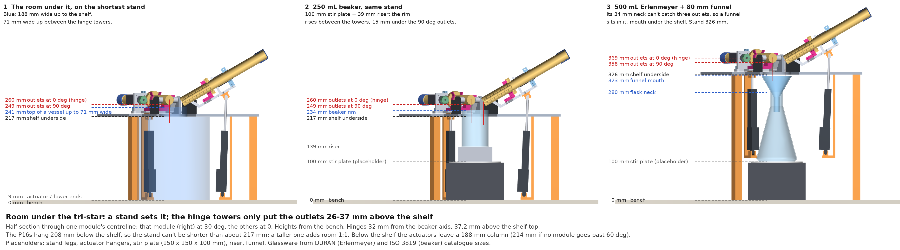

To put the doser lower than 217 mm, the actuators would have to fold away:
lie at an angle, or a shorter actuator on a shorter lever, which trades tilt
range or resolution. That isn't modelled here. To weigh while dosing, the
shelf has to clear the HR-100A's 315 mm top instead (see below).

#### Parts breakdown and the actuator mount (added 12 Nov)

[Ethan asked](https://github.com/vertical-cloud-lab/powder-doser/issues/204)
for three things: the tri-star broken into its parts with a render of each,
how the actuator connects to the mounting plate, and which parts are new and
which come from the current doser unchanged.
[`components.py`](components.py) uses the same model as above: B2 with #203's
tap bracket, hinges 32 mm from the beaker axis. It renders every part on its
own into [`renders/components/`](renders/components/) and writes
[`parts.json`](parts.json). Nothing was modelled in Onshape.

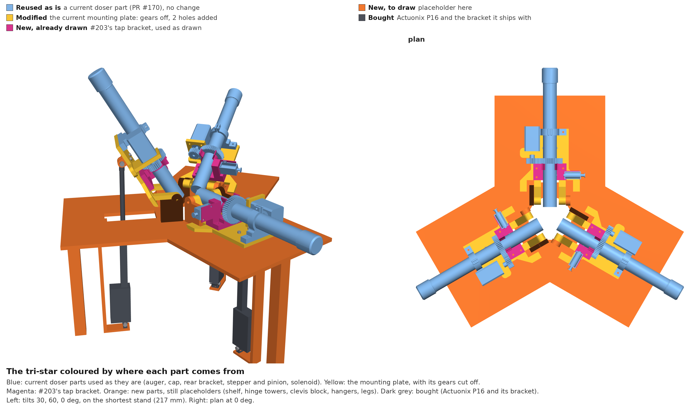

| # | Part | In the station | Status | What it is, what changes |
|---|---|---|---|---|
| 1 | Auger (tube, flights, 44T gear) | 3 | reused as is | PR #170 `auger.step` |
| 2 | Auger cap | 3 | reused as is | |
| 3 | Rear Flexible Bracket | 3 | reused as is | |
| 4 | NEMA 11 stepper (11HS18-0674S) | 3 | reused as is | bought |
| 5 | 20T stepper pinion | 3 | reused as is | |
| 6 | Adafruit 412 solenoid | 3 | reused as is | bought; held by #203's bracket instead of the tap collar |
| 7 | Mounting plate, gearless | 3 | **modified** | PR #170's plate without its two 28T gears and their webs, plus two Ø3.4 holes for the clevis block. In PR #170's STEP file the gears and webs are already separate bodies |
| 8 | Tap bracket (#203) | 3 | new, already drawn | Ethan's part (9 Nov), as drawn. It replaces the front Flexible Bracket, the tap collar and the collar's base |
| 9 | Rod-end clevis block | 3 | **new** | printed; see below |
| 10 | Hinge tower | 6 | **new** | like the baseplate's towers, but 8 mm wide (no gear outboard), with the M5 hinge screw on the hinge axis. Could be printed as part of the shelf |
| 11 | Shelf | 1 | **new** | 6 mm, one piece under all three modules; Ø78 window for a 250 mL beaker; a 34 × 87 mm slot per module |
| 12 | Actuator hanger | 3 | **new** | a strap from the shelf's underside down behind the P16, with a foot under its rear lug |
| 13 | Stand leg | 3 | **new** | 217 mm, the shortest stand |
| 14 | Actuonix P16-150-22-12-P | 3 | bought | plus an LAC board each |
| 15 | P16 mounting bracket | 3 | bought | ships with the P16 (two per actuator; one is used) |
| 16 | Screws and pins | a set per module | hardware | M4 × 20 + nyloc (not × 25: it clips the base's slot at 0°; see the clevis block section), 2 × M3 × 10 + nuts, the P16's #8-32 screw |

Per module, six parts come over unchanged (counting the solenoid) and one is
modified (the plate). One more is #203's bracket. The rest are the new base
and the actuator with its two mounts.

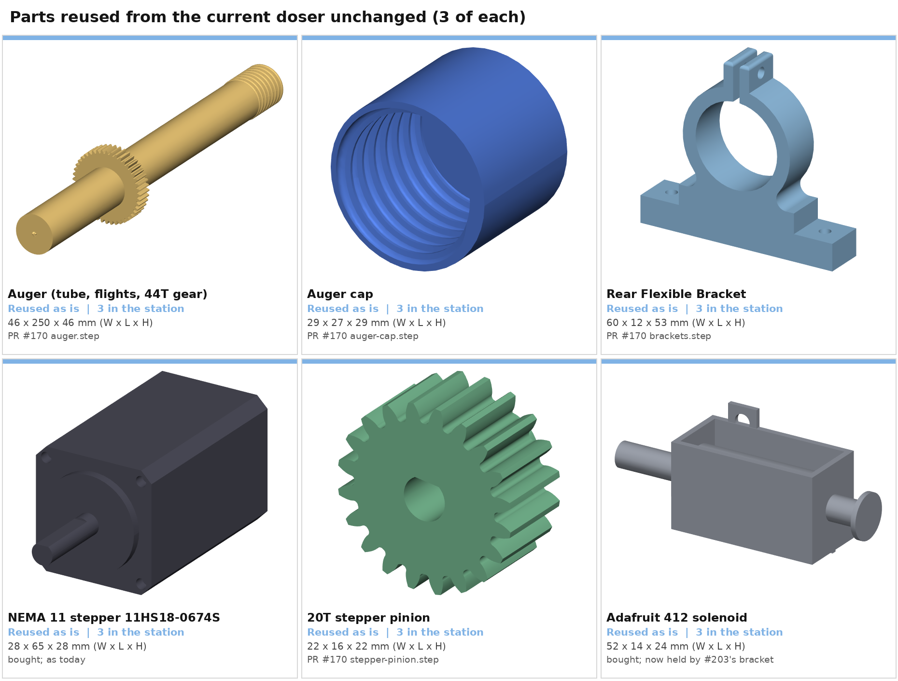

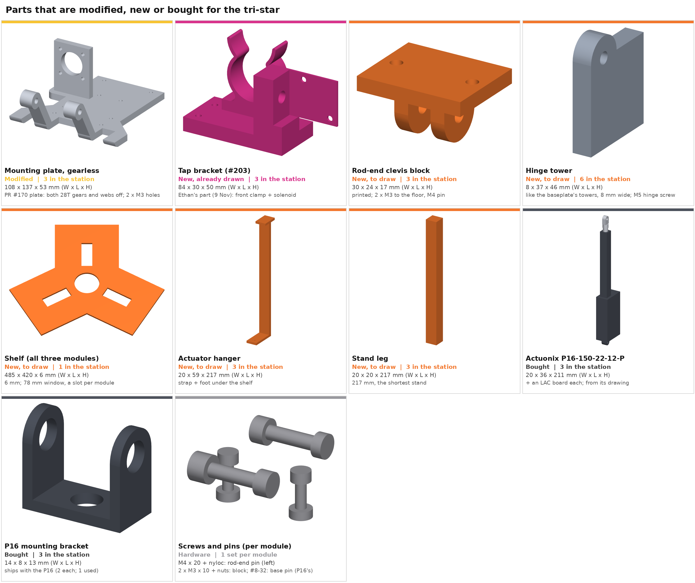

No longer used: the baseplate, both MG996R servos and 14T servo pinions, the
two 28T gears (cut off the plate), the front Flexible Bracket, the tap collar
and the collar's base.

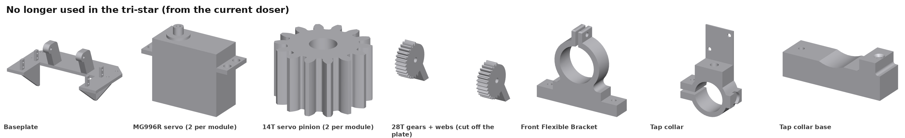

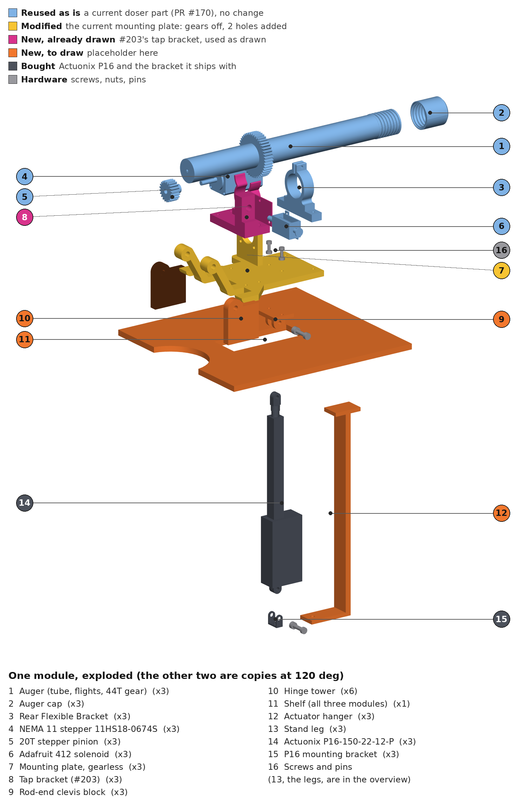

##### How the actuator connects to the mounting plate

The P16's dimension drawing (Actuonix, Rev B) gives both ends. The rod end is
a 6 mm tab and the rear end an 8 mm lug, each with a Ø4.25 hole (M4 or #8),
197 mm apart when closed. Each P16 ships with two U-brackets (11.5 mm inside,
holes 9.1 mm above the base) and #8-32 screws.

- **Rod end to the mounting plate: a printed clevis block under the floor.**
  - The block is a 30 × 24 × 4 mm pad with two 4 mm lugs, 6.5 mm apart. It
    sits under the plate's floor on the centreline, between the tap bracket
    and the rear bracket.
  - Two M3 × 10 screws go down through two new Ø3.4 holes in the floor, 11 mm
    either side of the centreline and 95 mm behind the hinge. Their nuts sit
    in pockets in the pad. The floor is clear there on both sides: the screw
    heads are at least 12.5 mm from the auger, stepper and brackets.
  - An M4 × 20 screw and a nyloc nut pin the rod-end tab between the lugs.
    The pin is 95 mm behind and 45 mm below the hinge (9.75 mm under the
    floor), where it was before, so the stroke table above still holds.
  - From 0 to 90° the rod end turns 82° relative to the plate: from straight
    down to nearly along the floor, pointing forward. The lugs are rounded
    (R7) round the pin. So the rod end's 9 mm hub, which starts 8.5 mm from
    the pin, swings past them with at least 1.5 mm to spare.
  - The plate itself only gains two holes. The block prints pad-down.
  - At 0° the block reaches down through the shelf, so the shelf's slot grows
    from 24 × 75 mm to 34 × 87 mm (33–120 mm behind the hinge). That leaves
    2 mm either side of the pad.
- **Rear lug to the shelf: the P16's own U-bracket, on a hanger.** One of the
  two brackets that ship with each P16 is screwed to the hanger's foot. The
  rear lug is pinned in it with the #8-32 screw that ships with the P16. The
  hanger hangs from the shelf's underside, so the stand can be any height.
- **The P16's housing faces outward.** It is 36 mm across in the plane of the
  swing, with the axis 10.5 mm from one side. That narrow side faces the
  beaker. Under the shelf the actuators then come no closer than 95 mm to the
  beaker axis: a Ø190 mm column, about what the clearance section found with
  the old outline (188 mm).
- **Why not the P16's U-bracket on the plate too?** Its base would sit under
  the floor, between its cheeks, 9.1 mm from the pin, with its screw's head or
  nut inside the U. The rod-end tab would then clear that head by under a
  millimetre (a button head) or hit it (a socket head). The printed block has
  nothing between its lugs.

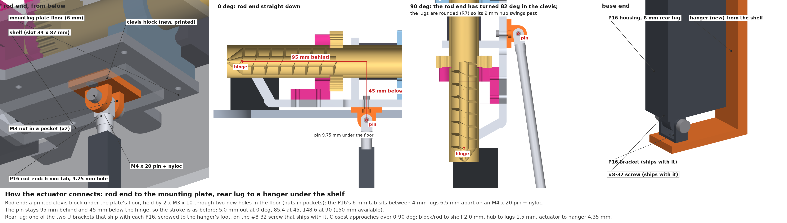

**Checks** over 0–90° in 2.5° steps ([`parts.json`](parts.json)):
- the block, its screws, the pin and the rod stay at least 2.0 mm from the
  shelf (the pad in its slot at 0°);
- the rod end's hub and shaft stay at least 1.5 mm from the lugs (at 67.5°);
- the actuator stays at least 4.35 mm from its hanger (the rear lug above the
  foot).

**Limits.**
- The block, hanger, towers, shelf and legs are placeholders sized for these
  renders, not drawn parts.
- The P16 is drawn from its dimension drawing (housing, tube, rod-end tab and
  rear lug), not from Actuonix's STEP file.
- Everything else is as in the sections above.

#### The gearless mounting plate against today's (added 13 Nov)

Ethan asked whether the tri-star's mounting plate has the same dimensions as
the current one, just without the gears. **Yes.** It is PR #170's plate body
exactly as it is, the same part as #193's Onshape document (Ethan's #203
assembly matched it to a median of 0.38 mm). In PR #170's STEP file the plate
is five bodies: the plate, two 28T gears and two webs. The tri-star drops the
gears and the webs and adds the clevis block's two holes. Nothing else on the
plate changes. [`plate.py`](plate.py) measures it into [`plate.json`](plate.json).

| | Today, with gears | Tri-star, gearless |
|---|---|---|
| Width, along the hinge | 108.2 mm | 108.2 mm |
| Length, front to back | 149.5 mm | 137.5 mm |
| Height | 54.7 mm | 53.35 mm |
| Plastic | 93.7 cm³ | 64.8 cm³ (31% less) |

- **The width stays** because the floor's front wings, which carried the
  webs, are as wide as the gears (|x| up to 54.1 mm).
- **The length and height drop only because the gear teeth stuck out:** 19.5
  mm in front of the hinge, where the knuckles reach 7.5 mm, and 19.5 mm above
  it, where the stepper wall reaches 18.1 mm.
- **Unchanged:** the 6 mm floor; the knuckles (Ø15, 12.5 mm long, Ø5.7 bore);
  the notches for the towers; the stepper wall with its Ø22 bore and four M3
  holes; the six Ø3.4 floor holes.
- **Floor holes in the tri-star** (x from the centreline, y behind the hinge):
  - the rear bracket uses (±24, 124), as today;
  - #203's tap bracket screws into the front bracket's two holes (±24, 58.33)
    and one of the collar base's (−24, 42.33). Its holes line up with the
    plate's;
  - the collar base's other hole (+24, 42.33) is unused, under the bracket;
  - the clevis block adds two at (±11, 95), 29 mm in front of the rear
    bracket's holes.

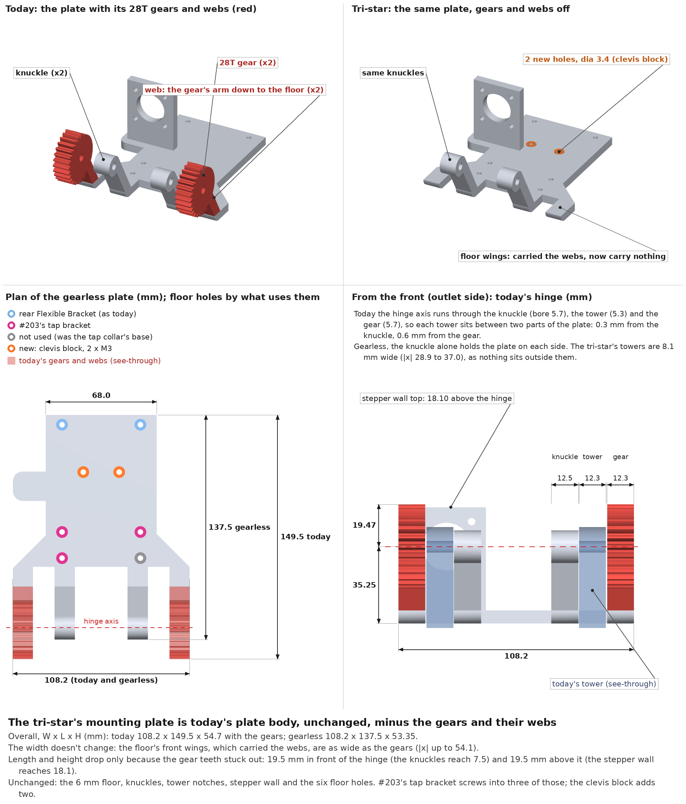

**Two things to decide before drawing it in Onshape:**
1. **The floor wings now carry nothing.** They can stay, as drawn, or be
   trimmed to the 68 mm floor. Trimmed, the plate is 88.1 mm wide overall (the
   stepper tab sets that). Either way the tri-star spacing stays 32 mm,
   because the towers set it.
2. **Today each gear is also an outer cheek of the hinge.** The knuckle, the
   tower and the gear all have a bore on the hinge axis (Ø5.7, Ø5.3, Ø5.7), so
   each tower sits between two parts of the plate: 0.3 mm from the knuckle and
   0.6 mm from the gear. Gearless, the knuckle alone holds the plate on each
   side. The renders and clearance checks assume that, with 8.1 mm towers. To
   keep the plate on both sides of each tower, a plain cheek could replace
   each gear. That widens the module at the hinge, so the tri-star spacing
   would need checking again.

#### The base, with the hinge towers merged in (added 13 Nov)

[Ethan asked](https://github.com/vertical-cloud-lab/powder-doser/issues/204)
for detailed dimensions of the base, with the hinge towers made part of it.
He has also cut the gears and their arms off the mounting plate, so the
plate is now widest at the stepper mount. [`base.py`](base.py) models both.
It writes the drawing below, [`base/base.step`](base/base.step) and
[`base/base.stl`](base/base.stl), and [`base.json`](base.json). In the STEP
and STL files the origin is on the beaker axis, with z = 0 on the base's
underside. Nothing was modelled in Onshape.

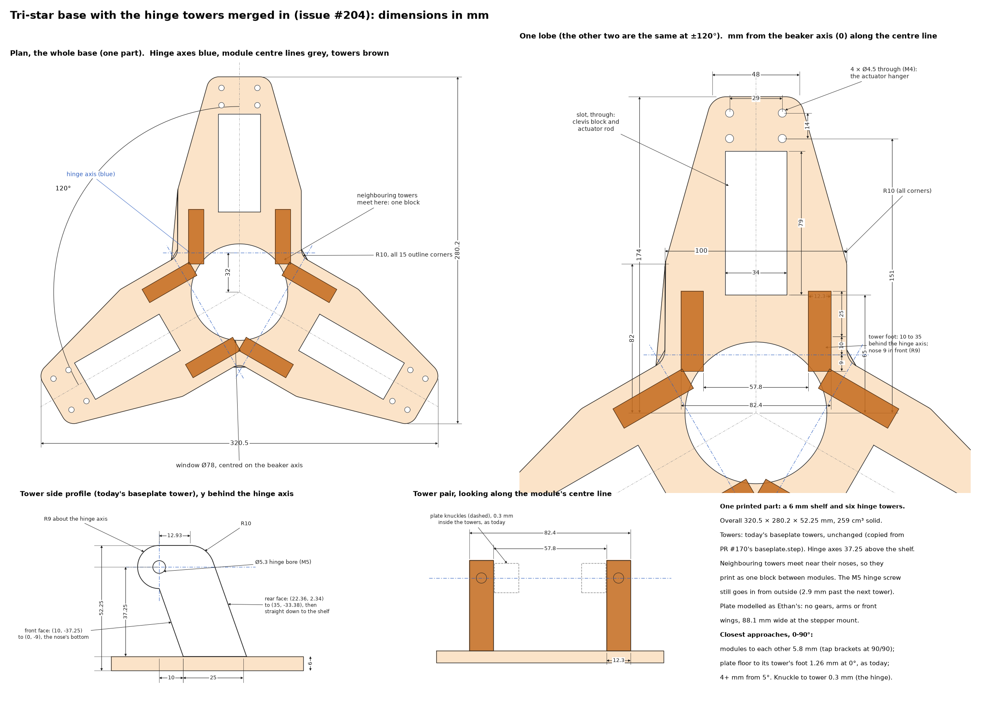

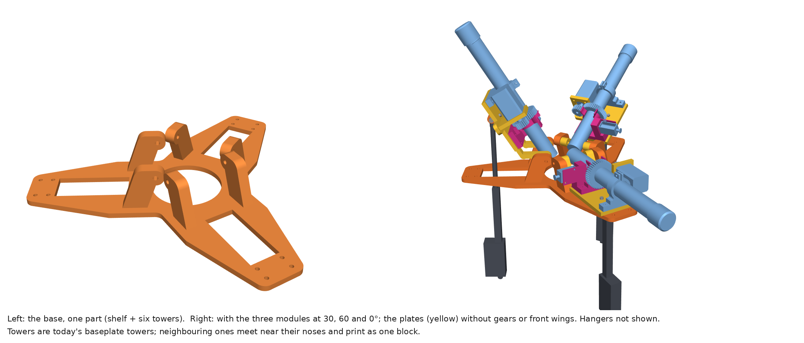

**The plate as Ethan has it now.** This is PR #170's plate body without the
gears and webs. Its floor is trimmed to |x| ≤ 34 mm as far as 70 mm behind
the hinge, which removes the front wings. The plate is then 88.1 mm wide:
54.1 mm out on the stepper side and 34 mm on the other. It is still 137.5 mm
long and 59.6 cm³. I modelled it from PR #170's STEP; it is not an export of
Ethan's Onshape plate.

**The base is one printed part** (mm; along a module's centre line the
distances are measured from the beaker axis):

| Feature | Dimensions |
|---|---|
| Overall | 320.5 × 280.2 × 52.25, inside the 325 × 320 a single H2D nozzle reaches |
| Shelf | 6 thick, like today's baseplate. Top 37.25 below the hinge axes |
| Lobes | 3, at 120°. Each is 100 wide (±50 about its centre line) out to 82 from the beaker axis, then tapers straight to 48 wide (±24) at 174 |
| Outline corners | all 15 R10: 3 between lobes, 6 where the taper starts, 6 at the lobe ends |
| Window | Ø78 on the beaker axis |
| Hinge axes | 32 from the beaker axis; 37.25 above the shelf top (43.25 above the underside) |
| Towers | 6, today's baseplate towers (cut from PR #170's `baseplate.step`): 12.3 wide. In each pair the inner faces are 57.8 apart (28.9 either side of the centre line) and the outer faces 82.4 apart |
| Tower profile | in (y behind the hinge axis, z above it). Foot from y = 10 to 35. Front face straight from (10, −37.25) up to (0, −9), the bottom of an R9 nose round the hinge axis. Flat top at z = 9, 12.93 long, then R10. Rear face straight from (22.36, 2.34) down to (35, −33.38), then vertical to the shelf |
| Hinge bore | Ø5.3 through each tower, on the hinge axis, as today (M5) |
| Slot, each lobe | 34 wide, through, from 65 to 144 from the beaker axis (33 to 112 behind the hinge), for the clevis block and the actuator rod |
| Hanger holes, each lobe | 4 × Ø4.5 through (M4), ±14.5 either side of the centre line, at 151 and 165 from the beaker axis |

**What changed from the earlier placeholder base:**
- **Towers:** the earlier ones were 8.1 mm blocks. These are today's real towers, 12.3 mm wide.
- **Lobes:** they were 200 mm wide and reached 222 mm from the beaker axis.
  Now they are 100 mm tapering to 48, and reach 174. That is what lets the
  base fit one H2D nozzle.
- **Slot:** it ends 112 mm behind the hinge instead of 120. The rod still
  clears its end by 4.4 mm (at 25°).
- **Legs:** the old placeholder legs stood 165–185 mm behind the hinge, which
  is past the new lobes' ends. They can bolt to the hanger holes instead. Or
  each hanger can carry on down to the bench: on the shortest stand (217 mm)
  its foot is already at bench level.

**Checks.** These are mesh clearances (fcl). One module was swept over 0–90°
in 5° steps; all three were checked at the ten B2T tilt cases.
- **Modules to each other:** 5.8 mm at the closest, tap bracket to tap
  bracket with both at 90°, as before.
- **Moving parts to the base:** 1.26 mm at 0°. That is the end of the plate
  floor's notch, 37 mm behind the hinge, against the tower's foot. Today's
  doser has the same gap, because it is the same plate and the same tower. It
  is 4.1 mm by 5°.
- **Everything else** clears the base by 4.4 mm or more. The closest is the
  P16 rod at the slot's end, at 25°.
- **Hinge:** the knuckles run 0.3 mm inside the towers, as today.
- **Neighbouring towers meet** near their noses, so in one part they merge
  into a block between modules.
- **The M5 hinge screw still goes in from outside.** A Ø10 rod along each
  hinge axis, standing in for the screw head and the hex key, clears the
  next tower by 2.9 mm.

**Choices before drawing it in Onshape:**
1. **Tower width:** today's 12.3 mm, as drawn, or 8.1 mm. With 8.1 mm the
   neighbouring towers stay apart, with a gap of about 3 mm between them.
2. **The 1.26 mm at 0°:** for 2 mm, take about 0.8 mm off the back of the
   tower's foot, or lengthen the plate's notch by as much.
3. **Stiffness:** the shelf is 6 mm, like today's baseplate, but it is 320 mm
   across. Ribs underneath, clear of the slots, would stiffen it.

**Printing.**
- **Orientation:** print it shelf-down.
- **Overhangs:** the towers' faces lean 19.5° from vertical. The only real
  overhang is the underside of each R9 nose, which today's baseplate has too.
- **Bed:** at 320.5 mm, it leaves 4.5 mm of the H2D's 325 mm single-nozzle
  width for a brim or skirt.

#### Where the clevis block's holes go in the plate (added 17 Nov)

[Ethan asked](https://github.com/vertical-cloud-lab/powder-doser/issues/204)
where the two new holes for the clevis block go in the mounting plate.
[`holes.py`](holes.py) measures them on the plate as he has it now (no
gears, arms or front wings, as `base.py` models it), from features that can
be picked in an Onshape sketch. It draws the figure below and writes
[`holes.json`](holes.json). Nothing was modelled in Onshape.

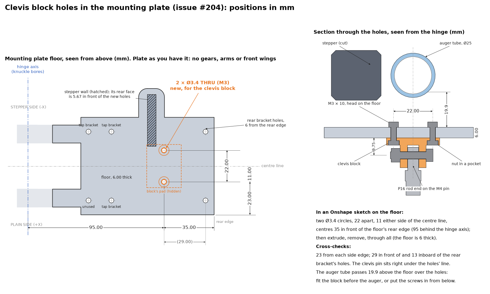

**The two holes** (mm):

| | |
|---|---|
| Size | Ø3.4 through the 6 mm floor, for M3 |
| Across | 22 apart, 11 either side of the plate's centre line |
| Along | 35 in front of the floor's rear edge, which puts them 95 behind the hinge axis |

**Cross-checks:**
- 23 from each side edge of the floor. On the stepper side that is the edge
  behind the stepper tab.
- 29 in front of the rear Flexible Bracket's holes and 13 inboard of them.
- 36.67 behind the tap bracket's rear holes, and 13 inboard of them.
- 5.67 behind the stepper wall's rear face. On the stepper side the hole's
  edge is 3.97 from the wall, and the screw head 3.6.
- The clevis pin sits right under the line of the holes, 9.75 below the
  floor's underside. Keep the holes 95 behind the hinge; moving them moves
  the pin and changes the stroke table.

**Every floor hole** (x from the centre line, + away from the stepper; y
behind the hinge axis):

| Hole (x, y) | From the rear edge | Used by |
|---|---|---|
| ±24, 124 | 6 | rear Flexible Bracket |
| **±11, 95 (new)** | **35** | **clevis block** |
| ±24, 58.33 | 71.67 | #203's tap bracket |
| −24, 42.33 | 87.67 | #203's tap bracket |
| +24, 42.33 | 87.67 | not used |

**Fitting the block.** The auger tube passes 19.9 mm above the floor's top
over the screw heads (23.3 mm on the hole axes), so a hex key can't go
straight down onto them once the auger is in. Screw the block on before the
auger goes in, or turn the screws over, with the heads in the block and the
nuts on top of the floor. The screws are at least 14 mm from the stepper and
15 mm from the tube. The block's own holes match: 22 apart on its centre
line, 4 from its ends.

**Limits.** Measured on PR #170's plate (`mounting-plate.step` at `7f5b3b7`),
trimmed as `base.py` does; Ethan's Onshape plate matched it to a median of
0.38 mm. In that STEP file's own frame the hole centres on the floor's top
face are (−95, −29.25, −30.8) and (−95, −29.25, −52.8). I haven't checked
that frame against the Onshape part studio's.

#### The clevis block's dimensions (added 17 Nov)

[Ethan asked](https://github.com/vertical-cloud-lab/powder-doser/issues/204)
for the clevis block's dimensions. [`clevis.py`](clevis.py) builds the block
as a part on its own, from the same numbers `components.py` uses. It checks
the fit again, exports the block, and draws the sheet below. It writes
[`clevis.json`](clevis.json). Nothing was modelled in Onshape.

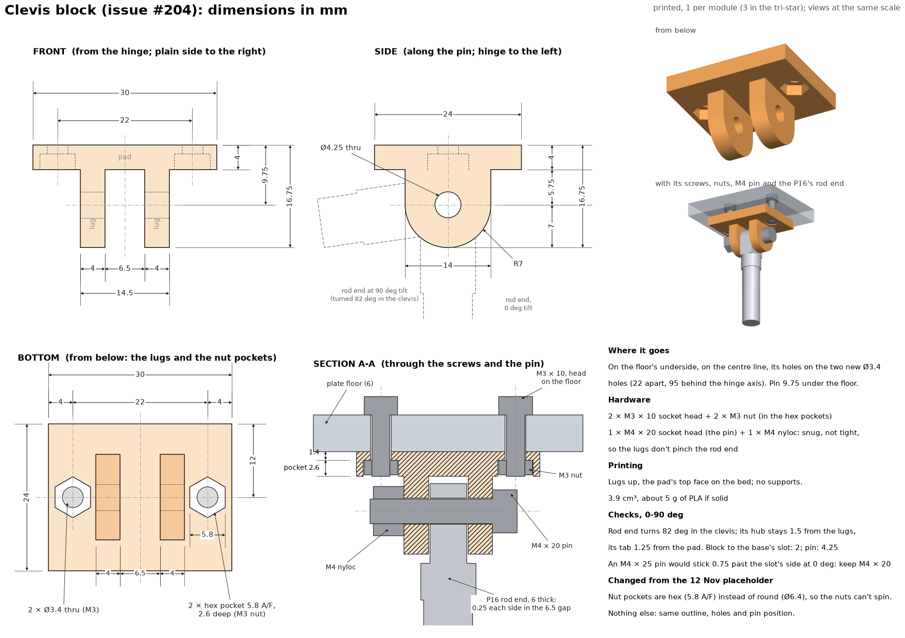

**The block** (mm). Origin: the centre of the pad's top face, which sits
against the floor's underside. x runs along the pin, y along the plate and z
up:

| Feature | Dimensions |
|---|---|
| Overall | 30 (x) × 24 (y) × 16.75 (z) |
| Pad | 30 × 24 × 4. Its top face screws flat to the floor's underside |
| Lugs | 2, each 4 thick (x) and 14 wide (y), centred on the pad. 6.5 apart (inner faces at ±3.25), 14.5 over both (outer faces at ±7.25). They hang 12.75 below the pad |
| Lug ends | R7 about the pin axis, so the rod end's 9 mm hub can swing past |
| Pin hole | Ø4.25 through both lugs (M4), on the centre line, 9.75 below the pad's top face (5.75 below its underside) |
| Screw holes | 2 × Ø3.4 through the pad (M3), 22 apart (±11), on the pin's line (y = 0). They sit 4 from the pad's ends and 12 from its sides |
| Nut pockets | 2 × hexagon, 5.8 across flats (6.70 across corners), 2.6 deep from the pad's underside, on the screw holes. The flats face the pad's ends. That leaves a 1.1 mm wall to the ends and 1.4 mm of pad between each nut and the floor |
| Volume | 3.85 cm³, about 5 g of PLA if printed solid |

**One change from the 12 Nov placeholder:** the nut pockets are hexagonal
instead of round (Ø6.4). That stops a nut from turning while its screw is
tightened from above. A socket head (Ø5.5) also fits the pocket, if you'd
rather put the screws in from below. Otherwise the block is unchanged. With
round pockets, `clevis.py`'s block is the same solid as `components.py`'s
(the volume difference is 0).

**Hardware, per block:**
- 2 × M3 × 10 socket head cap screws, heads on the floor's top, and 2 × M3
  hex nuts in the pockets. Each screw's end comes flush with the pad's
  underside. An M3 × 12 also fits: it sticks 2 mm out beside the lugs.
- 1 × M4 × 20 socket head cap screw as the pin (head on the plain-side lug),
  and 1 × M4 nyloc nut. Tighten it snug, not tight, so the lugs don't pinch
  the rod end. The screw ends 0.5 mm past the nyloc.
- **Not M4 × 25.** The parts table above suggested it for more thread past
  the nyloc. But at 0° the pin sits in the base's slot, and an M4 × 25 sticks
  0.75 mm past the slot's 34 mm width. It would clip the slot's side (the
  pin's top is 0.25 mm above the shelf's underside there). To use one, widen
  the slot to 36 mm.

**Checks over 0–90°** (module A, components.py's actuator geometry, every 2.5°):
- **Rod end in the clevis.** It turns 81.7° in the clevis by 90°, toward the
  hinge. Its hub and rod stay at least 1.5 mm from the lugs, closest at
  67.5°. Its tab is 1.25 mm below the pad at 0°, and has 0.25 mm each side in
  the 6.5 mm gap.
- **Against the base** (`base.py`'s one-piece base, every 1° to 20°, then
  every 5°). All of these are closest at 0°:
  - the block: 2.0 mm, from the pad's ends to the slot's sides;
  - the M3 screws: 4.5 mm; the nuts: 3.25 mm;
  - the M4 × 20 pin: 4.25 mm; the nyloc: 4.75 mm.

**Printing.** Print it lugs up, with the pad's top face on the bed. It needs
no supports: the pockets open upward, and the only overhang is the top of the
Ø4.25 hole.

**Files** in [`clevis/`](clevis/):
- `clevis_block.step`: the block in the frame above.
- `clevis_block_print.stl`: the block flipped for printing.
- `clevis_block_with_hardware.step`: the block with its screws, nuts, pin,
  nyloc and the P16's rod end at 0°.

You can import the STEP files into Onshape for reference without using API
calls.

**Limits.**
- The rod end (6 mm tab, Ø9 hub 8.5–14.5 mm from the pin) is drawn from
  Actuonix's P16 drawing, as in `components.py`, not from a real actuator.
  Check that the tab slides into the 6.5 mm gap before printing three.
- Printed holes often come out small. If the pin or screws bind, drill the
  holes out to 4.3 and 3.4.

#### The clevis block in Onshape (added 20 Nov)

Ethan asked for the clevis block in Onshape, built through the REST API with
his own API key.

- **Document:** [Clevis block - tri-star actuator mount (powder-doser #204)](https://cad.onshape.com/documents/a38fe824c59c30b2f2c7acad/w/c7bd1cb3ff8f94c39a996741/e/7ee76209682949b2733e966c),
  tab *Clevis block*. It belongs to the account the key belongs to (Ethan's)
  and stays private until he shares it.
- **Built from features, so every size can be edited.**
  [`onshape_clevis.py`](onshape_clevis.py) reads `clevis.json` and adds
  twelve features:

| # | Feature | What it does |
|---|---|---|
| 1 | Sketch *Pad sketch* (Top plane) | 30 × 24 rectangle, both sides dimensioned |
| 2 | Extrude *Pad* | 4 mm down, new part |
| 3 | Sketch *Lug profile* (Right plane) | 14 wide, from the pad's underside down 5.75 to the pin axis, then R7 round it |
| 4 | Extrude *Lugs* | that profile, symmetric, 14.5 (both lugs and the gap) |
| 5 | Extrude *Lug gap* | the same profile, symmetric, 6.5, remove |
| 6 | Sketch *Pin hole sketch* (Right plane) | Ø4.25, 9.75 below the top face |
| 7 | Extrude *Pin hole* | symmetric, 40, remove |
| 8 | Sketch *Screw holes sketch* (Top plane) | 2 × Ø3.4, 22 apart |
| 9 | Extrude *Screw holes* | 10 mm down, remove |
| 10 | Plane *Pad underside* | the Top plane, 4 mm down |
| 11 | Sketch *Nut pockets sketch* (Pad underside) | 2 hexagons, 5.8 across flats, flats facing the pad's ends |
| 12 | Extrude *Nut pockets* | 2.6 mm up into the pad, remove |

- **Frame:** the same as `clevis.json` and `clevis/clevis_block.step`. The
  origin is at the centre of the pad's top face, the face that sits against
  the floor. x runs along the pin, y along the plate, z up, so the block hangs
  below the Top plane. Flip it pad-down to print it.
- **Checked against `clevis.py`:**
  - Onshape reports a volume of 3.8493 cm³ and a 30 × 24 × 16.75 mm box,
    the same as `clevis.py`.
  - Onshape's STL export ([`clevis/clevis_block_onshape.stl`](clevis/clevis_block_onshape.stl))
    differs from `clevis.py`'s block by 0.235 mm³ in all, which is
    triangulation.
- **Not done in Onshape:**
  - The sketches are dimensioned but not tied to the origin, so they can be
    dragged. A midpoint or coincident constraint to the origin locks each one.
  - The hexagons have no dimensions.
  - No material is set.
  - The new document still has an empty *Part Studio 1* tab. The key can
    create but not delete tabs (HTTP 403), so delete it by hand.
- **API calls:** 39 in all on 20 Nov. That includes two key checks, three
  failed calls while getting the feature format right, and the two shaded
  views below. `python onshape_clevis.py --check-only --did ... --wid ... --eid ...`
  re-runs only the checks (about 5 calls).

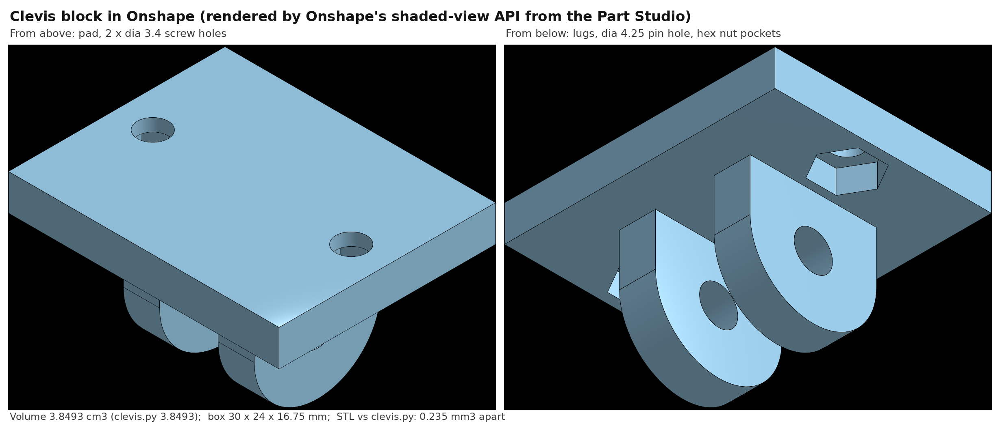

#### Other ways to mount the actuators (added 20 Nov)

Ethan asked for more options for the actuator mount, for example a second
deck that all three actuators mount to.
[`mounts.py`](mounts.py) compares four, each to scale in side view:

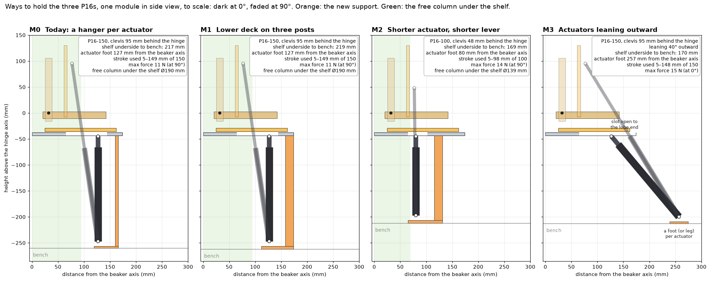

| | M0: today's hangers | **M1: lower deck** | M2: P16-100, short lever | M3: leaning 40° out |
|---|---|---|---|---|
| What holds each actuator's foot | its own strap from the shelf | one printed ring on three posts | the same deck, smaller | its own foot or leg |
| Actuator | P16-150 | P16-150 | P16-100 | P16-150 |
| Clevis pin behind the hinge | 95 mm | 95 mm | 48 mm | 95 mm |
| Shelf underside to bench | 217 mm | 219 mm | **169 mm** | 170 mm |
| Actuator foot from the beaker axis | 127 mm | 127 mm | 80 mm | 257 mm |
| Free column under the shelf | Ø190 | Ø190 | Ø139 | wider (the actuators lean away) |
| Stroke used (of the actuator's) | 5–149 of 150 | 5–149 of 150 | 5–98 of 100 | 5–148 of 150 |
| Most force, at 0.65 N·m | 11 N | 11 N | 14 N | 15 N |
| 150 × 150 mm stir plate on the bench | fits | fits, inside the deck | doesn't fit | fits |

The force row is conservative: it applies the README's upper estimate of
the torque (0.65 N·m) at every tilt, and the actuator's leverage is lowest at
90° (M0–M2) or 0° (M3).

**M1. A lower deck that carries all three actuators**
- **Deck:** one printed ring, 6 mm thick.
  - It is Ø280 outside with a Ø224 opening, plus a lobe at each module out to
    174 mm from the beaker axis (48 wide, R10 corners).
  - At 318 × 314 mm it fits on one H2D nozzle, like the base.
- **Actuators:** each P16's own U-bracket screws to the deck's top.
  - An M4 (or #8) screw goes through the bracket's base hole and a Ø4.5 hole
    in the deck, 127 mm from the beaker axis, straight under the clevis pin.
    A heat-set insert or a nut in a pocket underneath keeps the deck's
    underside flat. (The #8-32 screws that ship with the P16 are its pins.)
  - A 1 mm pocket keys the bracket square, so it can't turn on its one screw.
- **Posts:** three, 20 × 16 mm, at the lobe ends, where the hangers hang
  today (158–174 mm from the beaker axis, 5.5 mm behind the P16's housing).
  - **Length:** 212.85 mm, from the deck's top to the shelf's underside.
  - **Printing:** printed on the deck as one 219 mm tall print, or printed
    separately and screwed on with an M5 through the deck into a heat-set
    insert in each post's foot.
  - **Top:** an M5 countersunk screw down through a Ø5.5 hole in the shelf
    into a heat-set insert in the post. Countersink it: a cap head on top of
    the shelf would hit the plate's rear end at 0°.
- **Standing it up:** the deck is the foot.
  - On the bench, the shelf's underside is 218.85 mm up, 2 mm more than with
    the hangers.
  - For taller vessels, put legs or a lab jack under the deck. For example, a
    1 L Erlenmeyer with a funnel (`clearance.py`'s 358 mm) needs 139 mm of
    legs.
- **Why it's better than the hangers:**
  - **Stiffer:** each hanger carries its U-bracket 33 mm in front of its
    strap, so every push bends the strap. With the deck, the push goes
    straight down into the bench, or up the posts.
  - **Aligned:** all three U-brackets sit in one plane, located by holes in
    one part.
  - **It replaces the legs as well.**
- **Assembly:** brackets onto the deck, then the P16s onto the brackets. Then
  lower the base onto the posts with the rods up through the slots, screw it
  down, and pin each rod end in its clevis block.
- **Checks over 0–90°:**
  - **Deck and posts:** the closest a moving part comes is 2.44 mm, a P16's
    housing to its post at 25°, when the actuator leans 2.4° outward.
  - **Shelf:** the clevis block clears it by 2.0 mm, as before.
  - **Room under the shelf:** the free column stays Ø190 mm, and a 150 × 150
    mm stir plate stands on the bench inside the deck with 5.7 mm to spare.
- **File:** [`mount-deck/deck_M1.step`](mount-deck/deck_M1.step), the deck
  with its posts. The origin is on the beaker axis, with the hinge axes at
  z = 0.

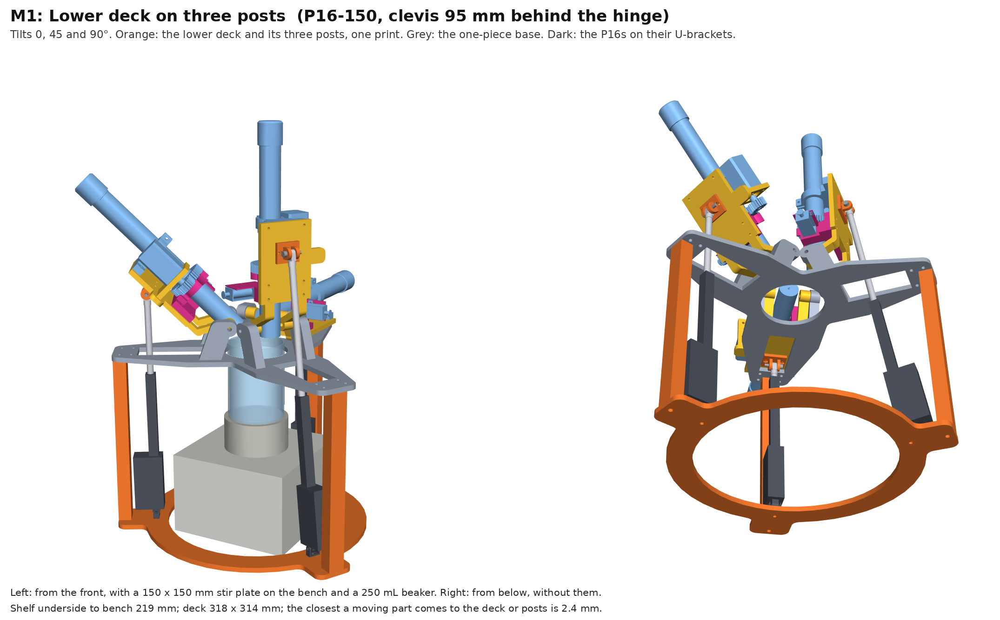

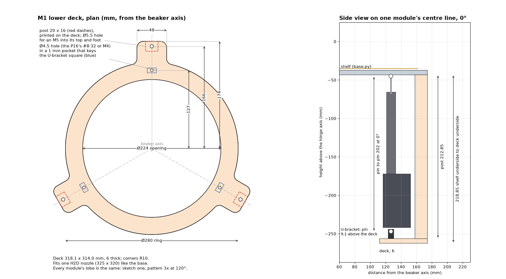

**M2. A shorter actuator on a shorter lever.** The P16-100 is 147 mm between
holes when closed and has 100 mm of stroke.
- **Geometry:** the clevis pin moves to 48 mm behind the hinge (from 95),
  still 45 mm below it. Then 0–90° uses 5–98 mm of stroke, with 2 mm to spare.
- **Gain:** the station is 50 mm lower; the shelf's underside is 169 mm above
  the bench.
- **Costs:**
  - **Room:** the actuators move 47 mm closer to the beaker. The free column
    shrinks from Ø190 to Ø139 mm, and a 150 × 150 mm stir plate no longer
    fits between them, so the station would have to stand over it on legs.
  - **Force and resolution:** 1.3× the force (14 N at 90°), and 0.8–1.15 mm
    of stroke per degree instead of 1.0–1.8.
  - **The block's screws:** the clevis block moves under #203's tap bracket,
    whose base covers the floor's top from 37 to 67 mm behind the hinge. Its
    two M3 screws would have to go through the tap bracket's base as well
    (longer screws, plus two new holes in the bracket), or into heat-set
    inserts from below.
  - **The base:** its slots end 70 mm behind the hinge (instead of 112), so
    the posts land on solid shelf.
- **Checks over 0–90°:** 3.3 mm to the deck and posts, 2.0 mm to the shelf.

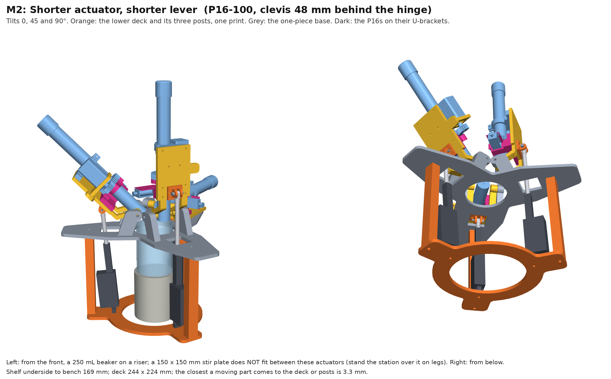

**M3. The P16-150 leaning outward** (side view and numbers only)
- **Gain:** leaning each actuator 40° outward puts its foot 257 mm from the
  beaker axis. The shelf's underside drops to 170 mm above the bench, 47 mm
  lower than now, with the same actuator and clevis.
- **Costs:**
  - **Footprint:** about Ø550 mm. That's too big for one printed deck, so
    each actuator needs its own foot or leg.
  - **Slots:** each lobe's slot has to run out to the lobe end, because at
    90° the actuator crosses the shelf 127 mm behind the hinge.
  - **Force:** 15 N at 0°.
- **Smaller leans save less:**
  - **30°:** saves 27 mm, with the clevis at 92.5 mm.
  - **20°:** saves 12 mm, with the clevis at 91 mm.
  - At 95 mm both would run out of stroke.

**Also considered**
- **Posts between the modules:** between lobes the shelf only reaches 59 mm
  from the beaker axis, inside the vessel's column. The posts would also
  stand in the gaps you reach the beaker through.
- **Aluminium extrusion posts (2020):** they would work and are stiffer. But
  at 20 mm deep they need the shelf's and deck's lobes 4 mm longer, which
  makes both parts 327 mm wide: too wide for one H2D nozzle (325 mm).
- **A bell crank,** with the actuator lying flat under the shelf: this would
  lower the station the most. But the actuator would lie radially (a P16-50
  sticks out about 150 mm past the lobe end), and the crank adds a push rod
  and four more pins, each with some play. Not modelled.
- **One moving deck that tilts all three** (the cheaper variant below): the
  deck would rise 146 mm from 0° to 90° on three guides, with fixed 202 mm
  links in place of the actuators. One actuator can't lift it from the
  middle, where the beaker is. One pushing at a post would jam it on its
  guides, so it would need three synchronised lead screws. Not modelled.

**Limits**
- The deck, posts, feet, stir plate, riser and beaker are placeholders.
- The P16-100 is drawn as the P16-150 with a 50 mm shorter tube. Closed
  length = stroke + 47 mm, as for the P16-150; check it against Actuonix's
  drawing.
- M3 is worked out in the module's plane only. Its clevis needs no change,
  but its U-bracket would sit tilted 40°.
- Nothing was modelled in Onshape except the clevis block, and nothing was
  printed.

### A cheaper variant: one actuator for all modules

The #116 battery runs found **no flow at any tilt with the auger stopped**
(block B, 0.0000 g after 15 s at 0°, 45° and 90°, every powder; see
[#128](https://github.com/vertical-cloud-lab/powder-doser/issues/128)).
Flow is gated by the auger, not by the tilt. So the modules could share one
tilt: one actuator lifts a yoke (pair) or spider (tri-star) that carries
every plate's rear on a roller, and each auger doses in turn. The cost is
per-powder tilt schedules. The 0° tap-trim phase, which #116 found to be the
only sub-milligram actuator, would have to run for every module at once,
between bulk doses. This was not modelled.

### Stand options for the tri-star (added 21 Nov)

[Ethan asked](https://github.com/vertical-cloud-lab/powder-doser/issues/204)
for options for a stand. [`stands.py`](stands.py) models four on the same
model as the sections above: B2 with #203's tap bracket, the one-piece base
and the trimmed plate. It checks each one and writes [`stands.json`](stands.json)
and the figures below. Every stand part is a placeholder, and so are the stir
plate, lab jack and retort stand. Nothing was modelled in Onshape.

**What every stand has to do**
- **Height.** The actuators hang 208 mm below the shelf, so its underside has
  to be at least 217 mm above the bench. Vessels on a 100 mm stir plate need
  217–358 mm (the table in "Room under the tri-star"). Weighing on the
  HR-100A needs 317 mm or more.
- **Stay under the shelf where the modules sweep.** Above the shelf the
  modules reach 273 mm from the beaker axis at 0°, and 240 mm above the hinge
  at 90°. Every concept meets the base from below, through the four hanger
  holes at each lobe end. S4's rod is the one exception: it stands in the gap
  between two modules, where nothing sweeps.
- **Hold the actuators.** They still hang from the shelf, as in
  `components.py`, so the stand only holds the shelf. The P16's geometry and
  stroke table don't change with the stand's height. In S1–S3, the stand part
  behind each P16 also carries its U-bracket, so it replaces the hanger. It
  sits where the hanger did, 7.5 mm behind the P16's housing.
- **Leave the front gap open.** With modules at 90° (back), 210° and 330°, the
  gap between the two front modules faces the user. No stand member crosses it.

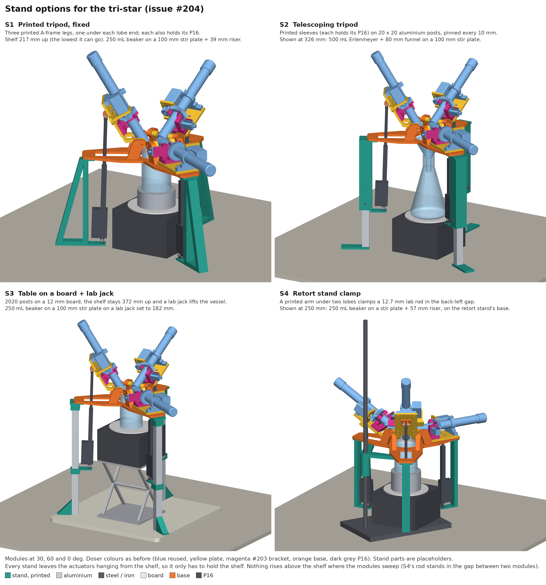

| | S1 Printed tripod | S2 Telescoping tripod | S3 Table on a board + lab jack | S4 Retort stand clamp |
|---|---|---|---|---|
| Shelf underside above the bench | 217 mm, fixed | 217–359 mm, in 10 mm steps | 372 mm, fixed (cut the posts for your tallest vessel) | 250 mm as drawn; anywhere on the rod |
| What moves to suit a vessel | a riser or lab jack | the doser | the vessel, on a lab jack | the doser |
| Printed | 3 A-frame legs, 217 × 118 × 40 mm, about 110 g each | 3 sleeves (about 130 g each), 3 feet | 3 post caps, 3 collars, 3 gussets (about 35 g per post) | 1 arm (about 60 g), 3 hangers (about 55 g each) |
| Bought | M4 screws | 3 × 204 mm of 20 × 20 × 1.5 aluminium tube, 3 M5 pins | 3 × 342 mm of 2020 extrusion, a 12 mm board (390 × 370), a lab jack | a retort stand (Ø12.7 rod), or use the hood's lattice |
| Feet on the bench | 422 × 365 mm | 443 × 383 mm | 390 × 370 mm (the board) | 280 × 180 mm (the stand's base) |
| Height at 90° (bench to the auger caps) | 501 mm | 501–643 mm | 656 mm | 534 mm + the rod |
| Sideways push at the shelf that tips it ¹ | **8.8 N** (1.8 kg in all) | **7.5 N** at 326 mm (2.1 kg) | 30 N (7.2 kg, with the stir plate and jack on the board) | 24 N (7.3 kg, with a 3 kg base and the stir plate on it) |
| Over the HR-100A | no (too low) | **yes, at 320 mm** | not as drawn; cut the posts to 320 mm | yes, with the rod beside the balance |
| Best for | the first build: print it now | one stand for every vessel and the balance | dosing height that never changes | fume hoods; uses what the lab has |

¹ Estimated: the centre of mass at the worst tilt mix (one module at 90°)
against the edge of the feet, with printed parts at 60% of solid PLA. A P16
is taken as 95 g, a NEMA 11 as 110 g, a solenoid as 40 g, each auger holds
50 g of powder, and the stir plate weighs 2 kg and the lab jack 1.5 kg.

**Checks, all four** (each module swept over 0–90° in 5° steps; the stands are fixed):
- **Moving parts:** every stand part stays at least 4.35 mm from everything
  that moves. That is the P16's housing to the upright behind it at 75°, the
  same gap today's hanger has.
- **Glassware:** the vessels drawn stay at least 9.7 mm from the doser. The
  closest is the 250 mL beaker to an auger at 50°.
- **Front gap:** park the modules at 0°, and a 192 mm square (a 150 mm stir
  plate, say) slides in from the front at any height under the shelf in
  S1–S3. The two front P16s set that, not the stands. At high tilt the P16s
  lean in, and near the shelf the gap is 158 mm. Near the bench S2 and S3
  leave 267–276 mm, once the actuators are higher up. S4's arm leaves
  148 mm near the shelf for a square object, but round vessels have the
  same Ø186 mm column as the others.

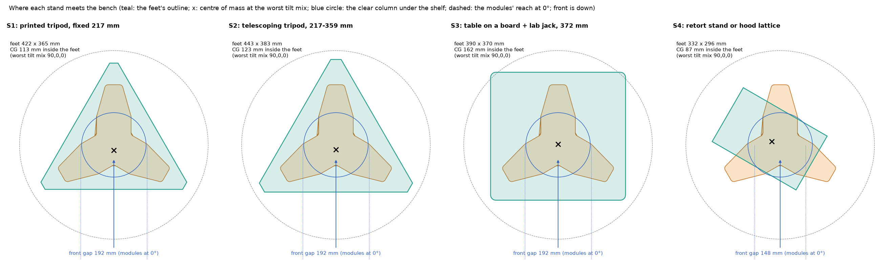

**S1. Printed tripod, fixed at 217 mm** ([render](renders/stand_s1.png)).
- **The leg:** each one is a printed triangle in its module's plane. It has a
  flange through the lobe end's four M4 holes and an upright behind the P16.
  A strut splays 15° outward, and a tie runs along the bench. The tie's front
  end is the tab under the P16's U-bracket. Each leg prints flat
  (217 × 118 × 40 mm).
- **For:** the fewest parts, and it can be printed now. The splayed struts
  make each leg stiff in its own plane.
- **Against:** the height is fixed at the minimum. Beakers rise on a riser
  or lab jack (the 250 mL beaker needs 39 mm on a 100 mm stir plate), and
  Erlenmeyers with a funnel don't fit.

**S2. Telescoping tripod, 217–359 mm** ([render](renders/stand_s2.png)).
- **The leg:** a printed sleeve under each lobe end, with the same flange and
  U-bracket tab as S1. Inside it slides a 20 × 20 mm aluminium tube on a
  printed long-toed foot. An M5 pin through the sleeve and a hole in the
  tube every 10 mm sets the height. At 359 mm, 60 mm of tube is still in the
  sleeve. Count holes to set all three legs the same.
- **For:** one stand covers every vessel in the clearance table, and the
  HR-100A. The P16s ride up with the shelf, so nothing else changes.
- **Against:** it's the tippiest. It is light (2.1 kg) and its centre of mass
  is high, so a push of about 7.5 N at the shelf tips it.

**S3. Table on a board, with a lab jack** ([render](renders/stand_s3.png)).
- **The frame:** three 2020 posts, each with a printed cap on the lobe end's
  four holes and a gusset at its foot, on a 12 mm board (HDPE or plywood). A
  printed collar on each post (T-nuts) holds the U-bracket. The doser stays
  372 mm up. A lab jack on the board brings each vessel to the outlets.
- **For:** the outlets never move, which keeps calibration simple. The board
  carries the stir plate and jack, so the whole station moves as one piece
  and is the hardest to tip.
- **Jack heights** with the doser at 372 mm (each vessel on a 100 mm stir plate):

  | Vessel | Jack |
  |---|---|
  | 100 / 150 / 250 mL beaker | 207 / 197 / 182 mm |
  | 400 / 600 mL beaker | 148 / 133 mm |
  | 250 mL / 500 mL wide-neck / 500 mL Erlenmeyer + funnel | 70 / 54 / 35 mm |
  | 1 L Erlenmeyer + funnel | none: the stir plate goes straight on the board |

  Check that your jack covers 35–207 mm, or cut the posts shorter if you
  never use the 1 L flask.

**S4. Retort stand or hood lattice clamp** ([render](renders/stand_s4.png)).
- **The clamp:** a printed V-shaped arm under the two lobes either side of
  the back-left gap. As drawn, each of those lobes needs one new M4 hole,
  30 mm from its centre line and 70 mm behind the hinge; two per lobe would
  stop the struts pivoting. The arm ends in a 70 mm sleeve
  that clamps a standard Ø12.7 mm rod, 140 mm from the beaker axis. The P16s
  hang from S1-style hangers.
- **For:** it uses the lab's support stands, or the fume hood's lattice
  (then nothing stands on the bench). The height is continuous.
- **Against:** the whole doser hangs on one clamp, about 140 mm out. It is
  the least stiff under tapping, and it relies on the clamp's grip. The
  stand's base has to reach under the doser's centre of mass: a 280 mm base
  with the rod 35 mm from its end does, with 87 mm to spare.

**Dosing onto the HR-100A: S2 set to 320 mm** ([render](renders/stand_s2bal.png)).
- **Clear of the balance:** the shelf is 5 mm above the balance's 315 mm top.
  The closest the stand comes to the balance is 10 mm, the back post and foot
  to its back edge. Nothing on the stand or doser touches it.
- **Moving parts:** they stay at least 8.1 mm from the balance (a P16 rod
  beside its lid, at 90°). The actuators are 27 mm away at 0°. 99 mm of each
  post stays in its sleeve.
- **Beaker:** the 100 mL beaker sits on a 180 mm, Ø60 riser on the pan. That
  is narrow enough to go in through the Ø76 top door. The balance's 102 g
  capacity still limits the beaker, the riser and the powder together (see
  "Things every concept has to handle").
- **Vibration:** the tapper shakes the stand, and the stand sits on the same
  bench as the balance. Feet on rubber or Sorbothane pads, or a separate
  bench for the balance, keep that out of the reading.

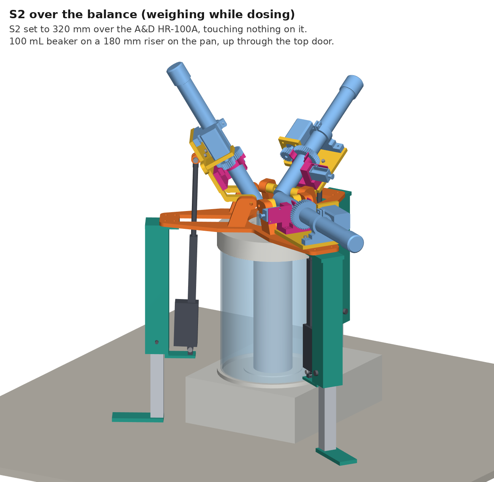

**Choices before drawing one in Onshape**
1. **Which one.**
   - S2, if one stand should cover every vessel and the balance.
   - S1, for a quick first build that only needs M4 screws, if 217 mm is enough for now.
   - S3, if the outlets should never move and the lab has a jack.
   - S4, for a fume hood with a lattice.
2. **Tipping.** S1 and S2 weigh about 2 kg and tip with a push of about 8 N
   at the shelf. A snagged cable could do that. Screw their feet to the bench
   or a board, or weigh them down: 1 kg on each foot nearly triples the push
   it takes.
3. **With the M1 deck** from the parallel run (branch
   `claude/issue-204-20261120-2331`: one printed ring on three posts carries
   all three P16s), the deck is already a 219 mm stand on the bench. Its
   posts sit at the lobe ends, where S1–S3 put their legs. For more height,
   S2's telescoping legs, or S3's board and jack, would go under the deck
   instead of under the shelf. S4's rod would have to move outside the
   ring, which reaches 140 mm from the axis. None of this is checked
   together yet.

**Limits.**
- Every stand part is a placeholder: sized for these checks, not drawn.
- The masses and tip-over pushes are estimates. Stiffness and ringing under
  the tapper weren't analysed.
- The lab jack, stir plate (150 × 150 × 100 mm) and retort stand are generic.
  The HR-100A is PR #185's model.

## Things every concept has to handle

- **Tapper at high tilt.** With the solenoid on top of the tube, two facing
  modules both at 90° need 73 mm between hinges. Rolled onto the flank, they
  need 54 mm, because the tap collars themselves meet. For the pairs, a
  firmware interlock (one module above 60° at a time) keeps them at 37–41
  mm. The tap-collar base's hard-stop bump sets today's 30° roll, so rolling
  further needs a new base. A tapper fixed to the plate's flank, as #203 is
  exploring, would do the same job.
- **Beaker and balance.** The outlets have to sit about 15 mm over the rim. On
  the HR-100A (198 × 253 mm, 315 mm tall, Ø76 top-door opening, numbers from
  PR #185's model), that means:
  - the shelf on a stand above the balance, not touching it;
  - the beaker on a riser on the pan, up through the top door, as in PR #185's v5.
  
  The HR-100A's 102 g capacity covers a 100 mL beaker (about 50 g) plus a
  printed riser and a few grams of powder. Check the tare before using a
  150 mL beaker or a tall riser.
- **The atomizer cup is too small for simultaneous dosing.** Its bore is about
  12–16 mm (19.05 mm OD, byu-vcl PR 232). Every concept here puts the outlets
  14–41 mm apart, so a cup needs:
  - a funnel that stays with that cup, or
  - one powder at a time, with the cup moved under each outlet.
- **Facing outlets.** At 0° the two outlets point at each other 14–18 mm
  apart, so a puff from one can reach the other's end face. Park idle modules
  at 0°, and reverse a turn after each dose, as the carousel designs do.

## Suggested next steps

1. **A1 on the bench:** print the shared base with the towers and
   rear-facing servo posts, move two existing modules onto it, and check the
   41 mm spacing and the interlock.
2. **In parallel, one B module:** a gearless mounting plate, a clevis bracket
   and one P16-150 or L16-140-R. The test is whether the actuator's tilt is as
   repeatable as the servo's, and whether it holds through tapping.
3. Decide the beaker (and the riser) before committing the base. The outlet
   circle above sets it.

## Files

| File | What it is |
|---|---|
| [`doserlib.py`](doserlib.py) | Loads PR #170's STEP files and `layout.py` at commit `7f5b3b7` (downloaded once to `~/.cache`). Builds a module with any drive variant, plus the placeholder base, towers, actuator and beaker. Mesh clearance (fcl), VTK renders |
| [`concepts.py`](concepts.py) | The concepts, the spacing sweeps, the self-checks and the figures |
| [`tap_bracket.py`](tap_bracket.py) | Exports #203's tap bracket and Ethan's assembly from Onshape (needs `ONSHAPE_ACCESS_KEY`/`ONSHAPE_SECRET_KEY`), fits it onto PR #170's frame, and writes `tap-bracket/` |
| [`tap-bracket/`](tap-bracket/) | `tap-bracket-pr170.step`: the bracket and its solenoid (coil, yoke, plunger) in PR #170's frame at 0°, which `doserlib.py` reads. `solenoid-bracket-onshape.step`: the bracket alone, as Onshape exports it. `registration.json`: the fit and its checks |
| [`results.json`](results.json) | Every swept spacing with the two parts that limit it, the self-checks, the actuator stroke table and the outlet spacings |
| [`clearance.py`](clearance.py), [`clearance.json`](clearance.json) | The room under the tri-star: the lowest the doser gets over the beaker axis at every radius (0–90°), how far the actuators hang, and the stand each vessel needs; renders `b2_clearance.png` |
| [`stands.py`](stands.py), [`stands.json`](stands.json) | Four stand options (printed tripod, telescoping tripod, table on a board + lab jack, retort stand): clearance to the moving parts and the glassware over 0–90°, the front gap, the feet and the centre of mass, S2 over the HR-100A; renders `stand_*.png`, `stands_overview.png`, `stands_plan.png` |
| [`components.py`](components.py), [`parts.json`](parts.json) | The tri-star's parts: each one rendered alone ([`renders/components/`](renders/components/)), the reused/new/removed sheets, the exploded module, the status-coloured station, the actuator connection and its checks |
| [`plate.py`](plate.py), [`plate.json`](plate.json) | The gearless mounting plate against today's: sizes, volumes, floor holes and what uses each, the hinge stack; renders `plate_compare.png` |
| [`base.py`](base.py), [`base.json`](base.json) | The one-piece base with today's hinge towers, and the plate trimmed as Ethan has it: dimensions, clearance checks, `base_drawing.png` and `base_iso.png` |
| [`base/`](base/) | `base.step` and `base.stl`: the base, origin on the beaker axis, z = 0 on its underside |
| [`holes.py`](holes.py), [`holes.json`](holes.json) | Where the clevis block's two M3 holes go in the plate's floor, measured from its edges, holes, stepper wall and hinge axis; what sits over and under them; renders `clevis_holes.png` |
| [`clevis.py`](clevis.py), [`clevis.json`](clevis.json) | The clevis block on its own: every dimension, hex nut pockets, the rod end's swing and the block, pin and screws against the base; renders `clevis_block.png` |
| [`clevis/`](clevis/) | `clevis_block.step` (origin at the pad's top face), `clevis_block_print.stl` (flipped for printing), `clevis_block_with_hardware.step`; `onshape.json` (the Onshape document, its features and the checks) and `clevis_block_onshape.stl` (the part as Onshape exports it) |
| [`onshape_clevis.py`](onshape_clevis.py) | Builds the clevis block in Onshape through the REST API (needs `ONSHAPE_ACCESS_KEY`/`ONSHAPE_SECRET_KEY`) and checks it against `clevis.py` |
| [`mounts.py`](mounts.py), [`mounts.json`](mounts.json) | Ways to mount the actuators: today's hangers, a lower deck on three posts, a P16-100 on a shorter lever, leaning the actuators outward. Stroke, force, height, footprint; clearance checks for the decks; renders `mount_*.png` |
| [`leg_room.py`](leg_room.py), [`leg_room.json`](leg_room.json) | Six layouts that make more room for the scale: legs splayed, P16s leaning out, a longer lever (P16-200), both, and a gearmotor on each hinge axis. Free diameter and front opening by depth, clearance checks over 0–90°, the HR-100A at every orientation; renders `legroom_*.png` |
| [`actuator_size.py`](actuator_size.py), [`actuator_size.json`](actuator_size.json) | Do the actuators need to be that big? The module's load from its mass model; Actuonix's smaller actuators (P16, L16, L12, P8, PQ12) on a shorter lever under the floor or on a crank at the hinge; force margins, resolution, move times; clearance checks for the crank; renders `actuator_*.png` |
| [`mount-deck/`](mount-deck/) | `deck_M1.step` and `deck_M2.step`: the lower decks with their posts, origin on the beaker axis, hinge axes at z = 0 |
| [`new_scale.py`](new_scale.py), [`new_scale.json`](new_scale.json) | The new balance (Ethan's rough numbers, as two boxes) under every layout: the closest approach at every orientation and pan position, the room beside each side door and behind it, and behind the top door; renders `newscale_*.png` with [`new_scale_figs.py`](new_scale_figs.py) |
| [`crank_drive.py`](crank_drive.py), [`crank_drive.json`](crank_drive.json) | L6: a P16-50 on a crank at each hinge, above the shelf. Kinematics, clearance checks over 0–90° against its own module, both neighbours and the base, and the base with its ears against the H2D's bed; renders `crank_drive.png` |
| [`renders/`](renders/) | The figures above |

```bash
pip install cadquery trimesh python-fcl rtree vtk pillow numpy matplotlib scipy
xvfb-run -a python concepts.py              # sweeps + figures, about 4 min on 4 cores
xvfb-run -a python concepts.py --no-sweep   # figures only, from results.json
xvfb-run -a python concepts.py --tap-bracket  # only B2 + #203's tap bracket (about 1 min)
python tap_bracket.py                       # re-export the bracket from Onshape (needs the keys)
xvfb-run -a python clearance.py             # room under the tri-star (about 20 s)
xvfb-run -a python stands.py                # four stand options: checks, stands.json, figures (about 3 min)
xvfb-run -a python components.py            # parts breakdown and the actuator mount (about 20 s)
xvfb-run -a python plate.py                 # the gearless plate against today's (about 10 s)
xvfb-run -a python base.py                  # the one-piece base: STEP/STL, checks, drawing (about 20 s)
xvfb-run -a python holes.py                 # where the clevis block's holes go in the plate (about 10 s)
xvfb-run -a python clevis.py                # the clevis block: dimensions, checks, STEP/STL, drawing (about 1 min)
python onshape_clevis.py                    # build the clevis block in a new Onshape document (needs the keys; about 25 calls)
xvfb-run -a python mounts.py                # actuator mount options: decks, checks, figures (about 1 min)
xvfb-run -a python leg_room.py             # more room for the scale: six layouts, checks, figures (about 11 min)
python crank_drive.py                      # L6, the crank drive: kinematics and checks (about 1 min)
xvfb-run -a python new_scale.py            # the new balance under every layout, figures (about 17 min)
python actuator_size.py                     # smaller actuators: load, sizing, crank checks, figures (about 4 min)
```

**Limits.**
- The new parts are placeholders. Spacings that involve them (towers, servo
  posts) are as good as those placeholders.
- The brackets are the old split clamp from PR #170's CAD, not the rig's
  C-clip, which isn't in any shared file.
- Meshes are triangulated to 0.15 mm.
- The gear mesh itself isn't re-checked here. PR #170 did that.
- No powder was simulated.

## Room for the scale under the telescoping tripod (added 21 Nov)

Ethan asked how much room S2 leaves underneath for the scale, and how that compares with the scale
under the current doser: the lab's A&D HR-100A. [`scale_room.py`](scale_room.py) answers it, and
[`scale_room.json`](scale_room.json) holds the numbers.

**The HR-100A, from A&D's own drawing** (HR-A/HR-AZ manual, sections 21-22, drawn at 1:5):

- 198 wide × 294 deep × 315 tall.
- The pan centre is 167 mm behind the display's front edge.
- The round breeze break is Ø156 inside and about Ø186 across its door frames.
- A full-height rear column reaches 127 mm behind the pan centre.
- The lid has a front handle 113 mm in front of the pan centre. When it opens, it swings out to the
  user's left, to 270 mm from the pan centre.

`doserlib.hr100a()`, which `stands.py` used on 20 Nov, has no rear column. It also puts the base 95 mm in
front of the pan instead of 167, and its breeze break is 7 mm smaller in radius.

**What S2 leaves under the shelf, for any balance:**

| | |
|---|---|
| Shelf underside above the bench | 217-359 mm |
| Lowest point of the hanging actuators | 213 mm below the shelf's underside (107 mm above the bench at 320) |
| Below that | the whole space inside the legs. Each post's inner face is 168 mm from the beaker axis |
| Above that | a column between the actuators: Ø233 mm with the modules parked at 0°, Ø187 mm at any tilt to 90° (narrowest just under the shelf) |

**The HR-100A under S2,** pan on the beaker axis. Checked at every orientation in 5° steps, at
320-359 mm, with the lid on and off, against the stand and all three modules over 0-90°:

- **It fits only turned so its rear column points into a gap between modules** (bearing 30°, 150° or
  270°). With the display facing the user, the rear column hits the back module's P16, even with every
  module parked. So the 20 Nov check, which found 8.1 mm, is wrong for the real balance.
- **With the lid off, every tilt mix clears:** the closest is 2.5 mm at 320 mm (a P16 body at 90°),
  and that grows to 8.2 mm at 359 mm.
- **With the lid on, only tilts up to 60° clear.** Past that, the lid's front handle hits the P16 of the
  module opposite the rear column.
- **The display then faces a leg.** Its front edge comes 1.0 mm from that leg's post, at any height.
  That is under the 2 mm target and within the drawing's tolerance, so measure the real balance before
  relying on it. Turning the balance 5° either way makes them touch.

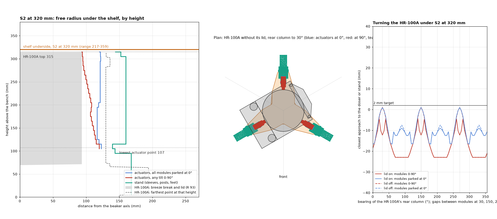

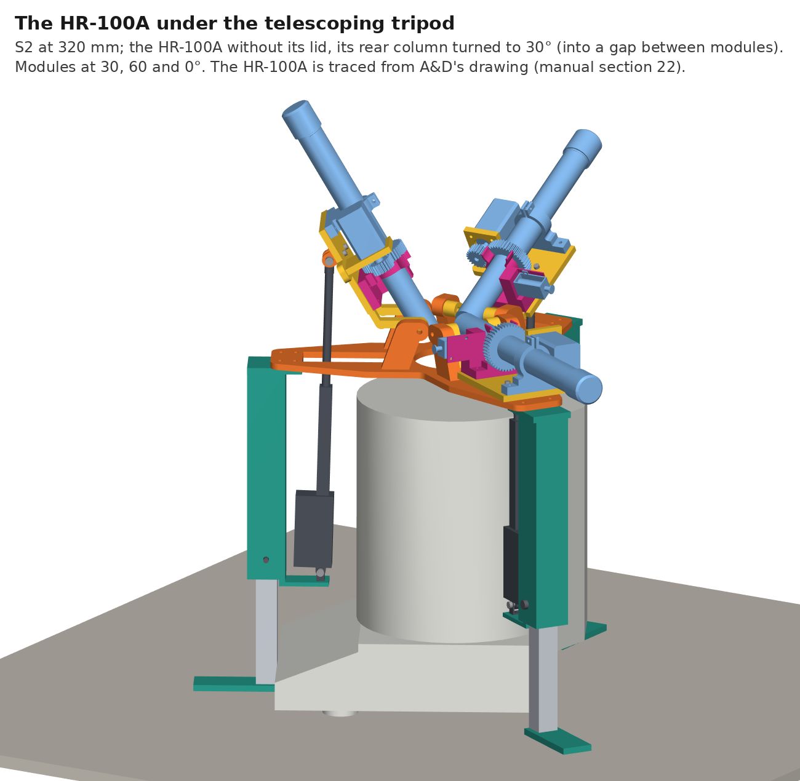

**Today's doser, for comparison:** its platform bridges over the HR-100A on four legs, roughly 265 mm
apart (a photo estimate in #146), with its underside just above the 315 mm top. Nothing hangs beside
the balance, so any orientation works and the lid can open. Under S2, the three actuators hang down
around the balance. That, more than the height, is what limits it.

**Limits**

- The balance is traced from A&D's drawing (±3 mm), not measured.
- With the lid off, the top is taken as 290 mm.
- The lid's swing and the side doors (which open to 105 mm from the pan centre) were not checked against
  the actuators.
- The fast sweep uses surface samples 1.5 mm apart. The reported configurations were re-checked with
  mesh distances.
- `xvfb-run -a python scale_room.py` takes about 9 minutes.

## More room for the scale: options that spread the legs and actuators apart (added 21 Nov)

Ethan asked for options that make the space between the legs bigger, so that whatever legs we choose
fit easily round the new scale. Its dimensions are still to come. [`leg_room.py`](leg_room.py) models
six layouts, and [`leg_room.json`](leg_room.json) holds the numbers. Every layout is shown with the
shelf 340 mm above the bench.

**What sets the room today.**
- Two things hang round the scale: the legs and the three P16s.
- The P16s are the tighter of the two. Each hangs 213 mm below the shelf, 127 mm from the beaker axis.
- As its module tilts, a P16's top swings inward. That leaves Ø190 mm between the three P16s just
  under the shelf (Ø212 mm 100 mm lower), counting every tilt.
- S2's posts are Ø336 mm apart.
- **So moving only the legs gains nothing above the P16s' lower ends.**

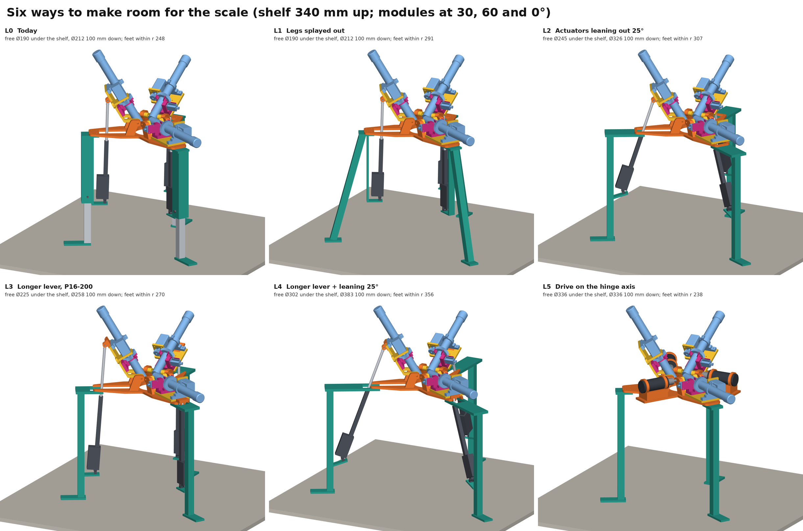

| | What changes | Free Ø ¹ (mm), 15 / 105 / 205 mm under the shelf | Front opening ² (mm), same depths | Hangs below the shelf | Feet within | HR-100A ³, lid off / on |
|---|---|---|---|---|---|---|
| **L0** Today (S2) | — | 190 / 212 / 232 | 163 / 178 / 191 | 213 mm | r 248 | +1.0 (0) / −4.2 (0) |
| L0, tilts kept to 60° | firmware only | 235 / 236 / 244 | | 213 mm | r 248 | |
| **L1** Legs splayed 15° | 3 splayed legs; the P16s on their own hangers | 190 / 212 / 232 | 163 / 178 / 191 | 213 mm | r 291 | +5.4 (9) / −4.2 (0) |
| **L2** P16s leaning 25° out | clevis pin 91.5 mm behind the hinge (was 95); slots to 134.5 mm; posts on outrigger arms, r 247 | 245 / 326 / 421 | 210 / 276 / 354 | 195 mm | r 307 | +30.0 (72) / +13.9 (48) |
| **L3** Longer lever | P16-200; pin 135 mm behind the hinge on a tail under the plate; slots to 151 mm (past the lobe end); posts at r 209 | 225 / 258 / 290 (up to 60°: 291 / 300 / 305) | 193 / 218 / 242 | 263 mm | r 270 | +19.2 (9) / +0.9 (0) |
| **L4** Lever + lean | P16-200 leaning 25°, pin 120 mm behind the hinge; slots to 164.5 mm; posts at r 296 | 302 / 383 / 466 | 259 / 326 / 394 | 240 mm | r 356 | +50.3 (72) / +36.2 (72) |
| **L5** Drive on the hinge axis | a gearmotor on each hinge axis; no P16s, clevis blocks or slots | 336 / 336 / 336 (the posts) | 281 / 281 / 281 | nothing | r 239 | +35.5 (21) / +32.2 (21) |
| L5, posts moved out to r 247 | as L5, with L2's outrigger arms | 474 / 474 / 474 | 400 / 400 / 400 | nothing | r 307 | +51.6 (72) / +35.5 (72) |

¹ The diameter of the largest circle about the beaker axis that clears the actuators at every tilt from
0 to 90° and the legs, in 10 mm bands below the shelf's underside. Just under the shelf, the legs'
8 mm arms set it: Ø288 in L3–L5.
² The widest object, centred on the beaker axis, that clears everything in front of the axis at every
tilt. This is what slides in from the front.
³ `scale_room.py`'s HR-100A (A&D's drawing), as an example. It stands on the bench with its pan centre
on the beaker axis, checked at every orientation in 5° steps. The first number is its closest approach
at its best orientation. The bracket is how many of the 72 orientations clear by 2 mm.

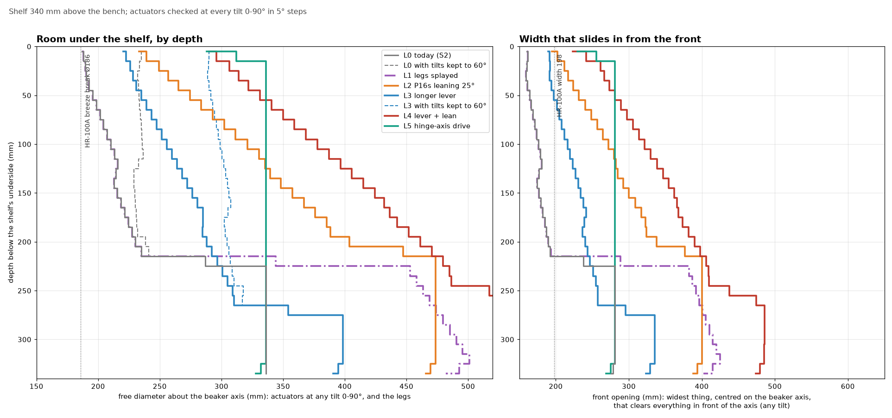

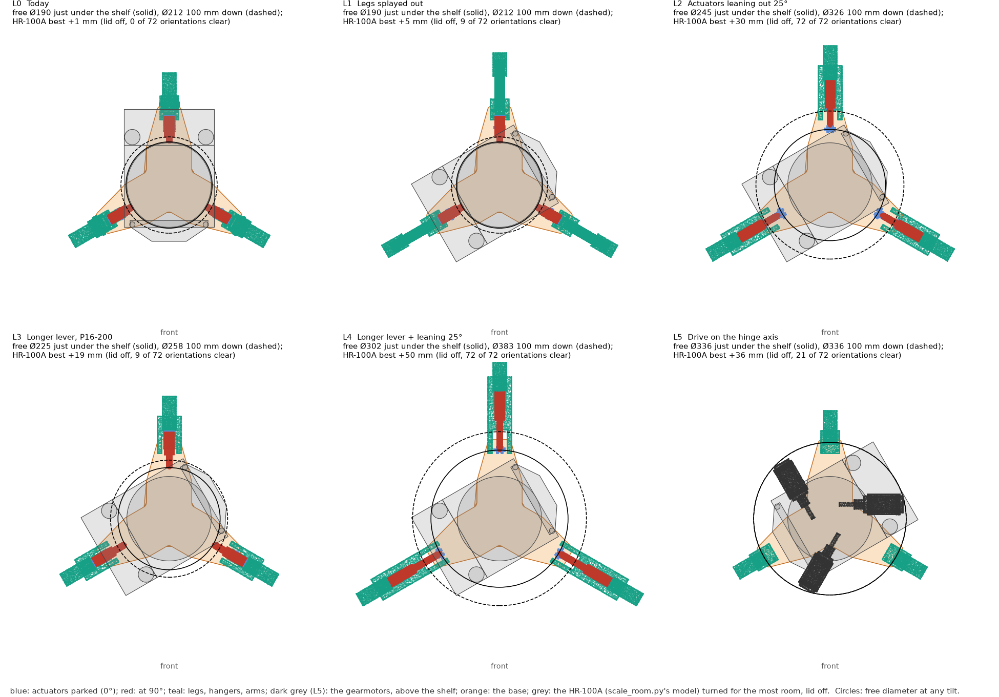

**L0 with tilts kept to 60°.**
- The P16s lean inward most near 90°.
- **Limited to 60° in firmware, the gap is Ø235 at every depth,** with no hardware change. Dosing so
  far has used 20–40°.

**L1, legs splayed.**
- **Only the room below the P16s' feet grows,** because the P16s still set the room above them.
- For the HR-100A that is enough to stop the display touching a leg (+1.0 → +5.4 mm), but the P16s
  still hem in the breeze break.

**L2, P16s leaning 25° outward.**
- **Same parts:** the same P16-150 and clevis block. The pin moves 3.5 mm nearer the hinge, so
  0–90° still fits the stroke (5–149 of 150 mm). The force is about 10 N, as now.
- **The top of the room barely changes.** It is still set by the clevis block, which sits just under
  the shelf at 0°.
- **Lower down it opens up,** because the P16 bodies run outward: Ø326 at 100 mm and Ø421 at 200 mm.
- **The feet move out to r 209, so the posts move out too:**
  - The posts go out to r 247 on printed arms under the lobe ends.
  - Each arm is a fork either side of the lengthened slot.
  - Each P16's U-bracket sits on a tab from its post, square to the actuator at 45°. The actuator
    leans 17–25° as the module tilts.
- **Footprint:** 546 × 473 mm.

**L3, longer lever.**
- **The P16s move 40 mm further out:** the pin sits 135 mm behind the hinge, on a tail past the
  floor's rear edge (130 mm). This needs P16-200s, which use 5–199 of their 200 mm.
- **Parked, the gap is Ø325; up to 60°, Ø291.**
- **At 90° it is only Ø225,** because at 90° the pin comes in to 77 mm from the beaker axis,
  whatever the lever.
- **Height:** the P16s hang 263 mm below the shelf, 50 mm more than now, so the stand can't go below
  about 270 mm.

**L4, lever and lean.**
- **The most room of the P16 layouts:** Ø302, 383 and 466 at the three depths, at any tilt.
- **The cost:** P16-200s, and feet out to r 356 (632 × 547 mm).

**L5, a gearmotor on each hinge axis.**
- **The idea:** take the P16s out from under the shelf altogether. Each module is driven from its
  hinge axis by:
  - an 8 mm shaft keyed into the +X knuckle, in place of the M5 hinge screw;
  - a coupler 53 mm out from the module's centre line;
  - a gearmotor with an encoder, drawn as a Ø37 × 85 mm placeholder, on a cradle.
- **Where the motor sits:** above the shelf, in the gap to the next module, 82–163 mm from the
  beaker axis. One of the three is in the front gap.
- **The legs alone set the room:** Ø336 between S2's posts at every depth and tilt.
  - On L2's outrigger arms (r 247), that grows to Ø474.
  - The HR-100A then clears at every orientation: by at least 39 mm with the lid off, 22 mm with it on.
- **Footprint:** with S2's posts, 427 × 370 mm, the smallest of the six.
- **Checks, over 0–90°:**
  - The drive stays 15.5 mm from the neighbouring module.
  - It stays 7.5 mm from its own auger tube.
  - The coupler stays 4.4 mm from the towers.
  - Closer than 53 mm, the coupler would pass within 2 mm of the next module's tower nose.
- **What the drive has to do:**
  - Hold 0.65 N·m at the hinge, the upper torque estimate. So pick a gearmotor rated about 2 N·m or
    more.
  - Hold its tilt with the power off: use a worm gear, or a brake.
  - Report its tilt, as the P16's potentiometer does today, for example with a magnet on the shaft
    end and an absolute encoder.
- **Printing:** with the motor pads printed in, the base grows to 344 × 324 mm, which is past one
  H2D nozzle (325 × 320). So print the pads with the cradles and bolt them on.

**Checks (all layouts).** The legs, arms, tabs, hangers and motors stay at least 4.25 mm from every
moving part, with each module swept over 0–90° in 5° steps. The base stays at least 2.0 mm away. That
2.0 mm is the clevis block in its slot at 0°, as before.

**What to send for the new scale** (so the next step can fit it the way `scale_room.py` fitted the
HR-100A):
- width, depth and height;
- where the pan's centre is, measured from the front edge and from one side;
- the draft shield's footprint and height, and how its doors open;
- where the display is;
- whether its top or doors must open while the doser is in place.

**Limits**
- **Placeholders:** the legs, arms, tabs, tails, motors, cradles and pads.
- **The P16-200's closed length** (247 mm) assumes stroke + 47 mm, like the P16-100 and P16-150.
  Check it against Actuonix's drawing.
- **L5's drive** is an envelope only. No motor was chosen, and the keyed knuckle wasn't drawn.
- **Not analysed:** stiffness, and ringing under the tapper. The longer slots in L2–L4 leave thinner
  strips at the lobe ends.
- **The HR-100A is only an example;** the new scale will differ.
- **Run time:** `xvfb-run -a python leg_room.py` takes about 11 minutes. `--figures-only` redraws the
  charts from `leg_room.json`.

## The new balance: fitting the tri-star over it with a side door free (added 23 Nov)

Ethan gave rough dimensions for the balance the doser will be built around, and asked three things:
which balance the earlier checks were planned for, what has to change for the tri-star to fit easily over
the new one with room to open at least one side door while keeping the linear actuators, and whether the
earlier answers still hold. [`new_scale.py`](new_scale.py) fits the new balance under every layout so far
and two new ones, [`crank_drive.py`](crank_drive.py) designs and checks the new drive (L6), and
[`new_scale.json`](new_scale.json) and [`crank_drive.json`](crank_drive.json) hold the numbers.

**The balance the earlier checks used** is the lab's A&D HR-100A, traced from A&D's drawing
(`scale_room.py`, 21 Nov):

| | A&D HR-100A (10–21 Nov) | New balance (Ethan, 23 Nov, rough) |
|---|---|---|
| Overall | 198 wide × 294 deep × 315 tall (290 with the lid off) | base 190 wide × 260 long; 320 tall |
| Around the pan | a round breeze break, Ø186 across its door frames (Ø156 inside), from 72 to 290 mm up | an enclosure 183 wide × 240 long |
| Pan | Ø90, 86.5 mm up; its centre 167 mm behind the display's front edge | not known; assumed centred in the enclosure |
| Other | a full-height rear column reaching 127 mm behind the pan centre; a lid with a front handle | not known; the enclosure is assumed to start 90 mm up |
| Doors | curved side doors (open to 105 mm from the pan centre); the lid swings out 270 mm to the left | sliding side doors on both long sides, assumed; a top door |

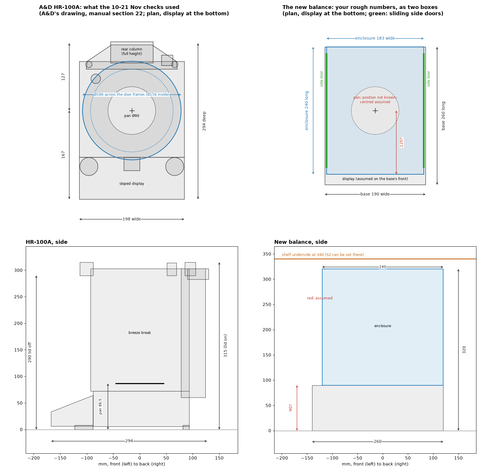

The new balance is a little smaller than the HR-100A on the bench, but above its base it takes far more
room: the HR-100A's breeze break fits in a Ø186 circle, while a 183 × 240 box is 302 mm corner to corner.

**How it was checked.**
- The balance is two boxes: the base (190 × 260, its back flush with the enclosure's, from the bench to
  90 mm) and the enclosure (183 × 240, from 90 to 320 mm). The real one has rounder corners, so this is
  conservative.
- The pan centre sits on the beaker axis. The baseline has it centred in the enclosure (120 mm behind
  its front); 80–160 mm is swept as well.
- The balance is turned in 5° steps, and every actuator swept over 0–90° in 5° steps.
- **Fits easily** means 10 mm between the balance and everything under the shelf (2 mm is the
  mechanism's own target).
- **Side door, reach-in:** a clear space beside the door, as long as the enclosure and from 90 to 320 mm
  up, at least 100 mm deep (a hand with a beaker).
- **Side door, slide-back:** if the door slides back past the enclosure's back, a strip 20 mm wide beside
  that side, 200 mm long behind the enclosure.
- **Top door:** the clear length behind the enclosure's top for it to slide back into. It has to be open
  while dosing.

| Layout | Shelf | Clears the balance by ¹ | Best side door ²: reach-in / slide-back | Top door ³ | Pan 20–40 mm off centre ⁴ |
|---|---|---|---|---|---|
| **L0** Today: S2, P16-150s straight down | 340 | collides: 23 mm into the actuators | — | — | collides (11 mm) |
| L0 with tilts kept to 60° | 340 | collides (6 mm) | — | — | 3 mm, no door |
| L1 Legs splayed | 340 | collides (23 mm) | — | — | collides |
| **L2** P16-150s leaning 25° out | 340 | 6 mm | none: 21 mm beside it at most | — | 15 mm, no door |
| L2 with the shelf at 380 | 380 | 22 mm | none: 37 mm at most | — | 28 mm, no door |
| L3 Longer lever, P16-200 | 340 | collides (6 mm) | — | — | 4 mm, no door |
| L3 with tilts kept to 60° | 340 | 24 mm | none: 30 mm at most | — | 24 mm, no door |
| **L4** Lever + lean, P16-200 | 340 | 24 mm (11 turned for the door) | right: clear / **18** | 10 | 24 mm, no door |
| L4 with the shelf at 380 | 380 | 48 mm (20 turned for the door) | left: clear / **88** | 36 | a full door in 6–12 of 72 orientations |
| L5 Gearmotor on each hinge, S2's posts | 340 | 26 mm | none: 49 mm at most | — | a full door only with the pan 20 mm forward of centre |
| L5 with its posts at r 247 | 340 | 26 mm | both: 113 / clear | 117 | a full door at every orientation |
| **T0** Today's P16-150s above the balance (tall stand) | 550 | 13 mm | left: clear / clear | 115 | a full door at every orientation |
| **L6** P16-50 on a crank, above the shelf | 340 | 26 mm | both: 113 / clear | 117 | a full door at every orientation |

¹ The closest the balance comes to anything under the shelf (actuators at any tilt, hangers, legs), at
its best orientation, with the pan centred in the enclosure. 10 mm counts as fitting easily.
² With the balance turned for the best door: the clear depth beside the door (100 mm wanted) / the clear
length behind the enclosure's back for a door that slides back (200 mm wanted). "clear": nothing there.
³ The clear length behind the enclosure's top for the top door to slide back into.
⁴ The pan centre 80, 100, 140 or 160 mm behind the enclosure's front instead of 120.

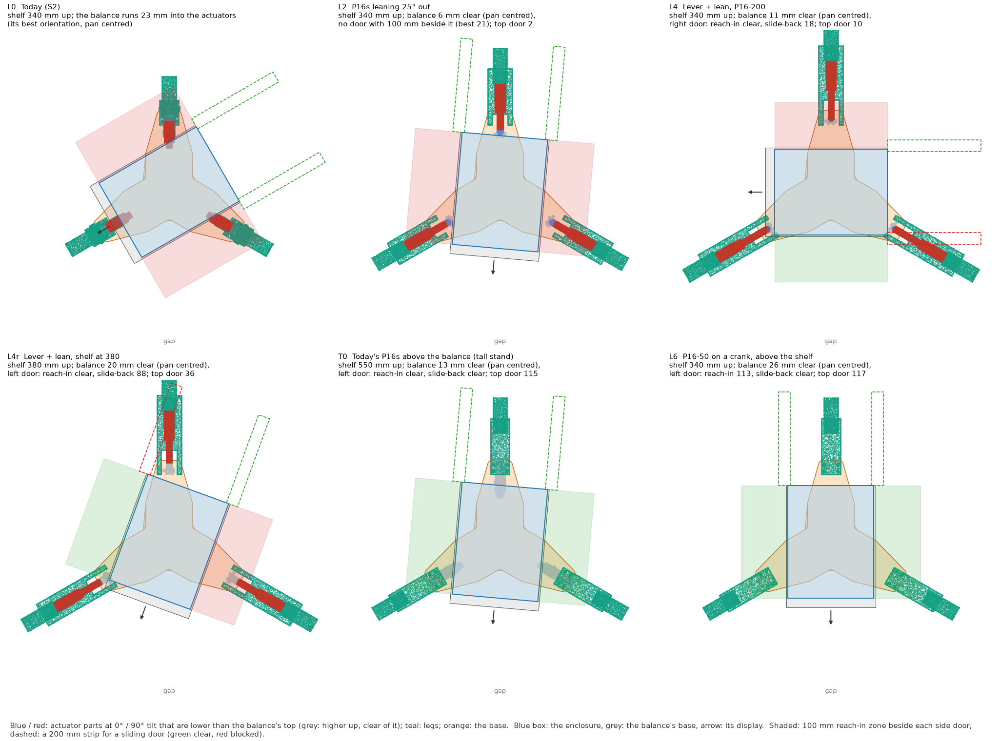

**What it takes.**
- **Height: the shelf's underside at 340 mm.** S2 can be set there, and it leaves 20 mm over the
  balance's 320 mm top.
- **The actuators can't hang beside the balance.** With P16s under the shelf, one is always beside or
  behind it:
  - **Straight down (L0, L1),** the balance collides at every orientation, even with tilts kept to 60°.
  - **Leaning out or on a longer lever (L2–L4),** it fits. The best door comes with the balance turned
    so that one side faces a gap between modules. You can reach through that door, but the next
    module's P16 sits 18 mm behind the balance's back corner. A door that slides back past the
    enclosure's back can't open, and the top door has only 10 mm to slide into.
  - **Raising the shelf to 380 mm** helps the leaning layouts fit but doesn't free a door. L2 at 380 mm
    clears by 22 mm but still has at most 37 mm beside a door. L4 at 380 mm keeps its reach-in door,
    with 88 mm of slide-back and 36 mm for the top door; it gets a full door only if the pan sits
    20–40 mm off centre.
- **Two ways keep a linear actuator and free the doors.** Both take the actuators out of the space
  beside the balance:
  - **L6:** a P16-50 on a crank at each hinge, above the shelf (next section). At 340 mm, nothing but
    the legs is under the shelf.
  - **T0:** today's P16-150s, clevis blocks and hangers, unchanged, on a stand tall enough that they end
    above the balance. The shelf goes to 550 mm, because the P16s and their hangers reach 217 mm
    below it. The outlets are then about 265 mm above the balance, so the powder needs a funnel down
    to the vessel, and the stand is tall and top-heavy.
- **Either way, the legs go out to r 247 mm** (L2's outrigger arms; feet within 546 × 473 mm).
  - The balance then clears everything by 26 mm (13 mm on T0, where the hangers end just above it).
  - Both side doors are free, with 109–113 mm beside each and nothing behind.
  - The balance can face the user, within 5°, wherever its pan is (80–160 mm from the front). The top
    door then has 75–157 mm to slide into: the further back the pan, the more.
  - Posts closer in block a door. With S2's posts (L5), a door never has more than 49 mm beside it with
    the pan centred.
- **My pick is L6.** T0 needs no new drive, but a 550 mm stand and a 265 mm drop are worse to live
  with than a crank and a post per module. L4 is enough only if the side doors don't slide back past
  the balance's back and the top glass can come off.

### L6: a P16-50 on a crank at each hinge, above the shelf

The idea is L5's (a drive on each hinge axis, so nothing hangs under the shelf), but with a linear
actuator instead of a gearmotor. Beside each module's +X side, past 64 mm from its centre line and behind
its hinge line, nothing passes at any tilt: not the module itself (its parts reach 63.6 mm), not its
neighbour, not the base. Everything goes there.

Dimensions in the module's frame: x along the hinge axis from the module's centre line (toward its +X
side, the tap bracket's side), y behind the hinge axis, z above it.

| Part | What and where |
|---|---|
| Shaft | Ø8, keyed into the plate's +X knuckle in place of the M5 hinge screw, through the +X tower, out to x = 75 (as L5's) |
| Crank | 6 thick at x = 67.5–73.5, Ø16 hub on the shaft, 14 wide arm, pin 33 from the hinge axis. It turns with the plate: at 0° it points 45° down and back, at 90° 45° up and back |
| Crank pin | M4 shoulder screw from the crank out to x = 86, through the P16's rod end |
| Actuator | Actuonix P16-50 (50 mm stroke, 105 mm closed hole to hole), hanging in the plane x = 79. Its rear lug is pinned in its own U-bracket at y = 28, z = 130 (167 above the shelf's top) |
| Post and arm | Post 20 × 16 at x = 69–89, y = 62–78, from the shelf up to z = 147; an 8 mm arm from it forward over the pivot, with the U-bracket screwed underneath |
| Ear | The shelf grows a 6 mm ear under each post (x = 40–95, y = 46–94) |

In the station, the pivot is 99 mm from the beaker axis and the post 129 mm, both in the gap next to the
module's +X side. Each gap holds one actuator.

**Kinematics.**
- **Stroke:** the module tilts as the rod retracts. It is out 48.4 mm at 0°, 33.6 at 30°, 25.1 at 45°,
  16.5 at 60° and 1.8 at 90°. That uses 46.6 of the 50 mm, with 1.6–1.8 mm to spare at each end.
- **Swing:** the actuator stays within 3° of vertical.
- **Force:** at most 29 N, at 90°, with the upper torque estimate (0.65 N·m). Actuonix rates the 22:1
  gearbox at 40 N at peak power (50 N maximum, 75 N back-drive); the 64:1 at 80 N (90 N, 200 N), so
  64:1 gives the margin.
- **Resolution:** 0.39–0.58 mm of stroke per degree, against 1.0–1.8 for the P16-150 under the plate.
  The P16-50's potentiometer spans its 50 mm stroke, so the counts per degree come out about the same.
  The gearbox's backlash (0.3 mm on Actuonix's T16 datasheet) is worth 0.5–0.8° of tilt instead of
  0.2–0.3°.
- **Holding:** like the P16-150, it holds its position with the power off: the 29 N is well under the
  75 N back-drive force.

**Checks** over 0–90° in 5° steps (2 mm target):
- **Its own module:** 6.3 mm, the ear to the plate's floor at 0°. Everything else is further away.
- **The neighbour its +X side faces:** 15.5 mm (the shaft end to that module's plate), at every pair of
  tilts. The other neighbour is 47.9 mm away.
- **The base:** 13.3 mm (the crank).
- **The base with its three ears** is 320.5 × 319.3 mm, so it still fits one H2D nozzle (325 × 320), but
  with only 0.7 mm to spare. The ears could also be printed separately and screwed on.

**What it changes:**
- Each module loses its P16-150, clevis block and M4 pin. The plate doesn't need the clevis block's two
  holes, and the shelf doesn't need its slots.
- Each module gains a shaft, a crank and a P16-50, plus a post, an arm and an ear (placeholders).
- The legs only have to clear the balance. With L2's outrigger posts (r 247), both side doors and the top
  door are free at every orientation. With posts where S2's are (r 178), a door never has more than
  49 mm beside it with the pan centred.

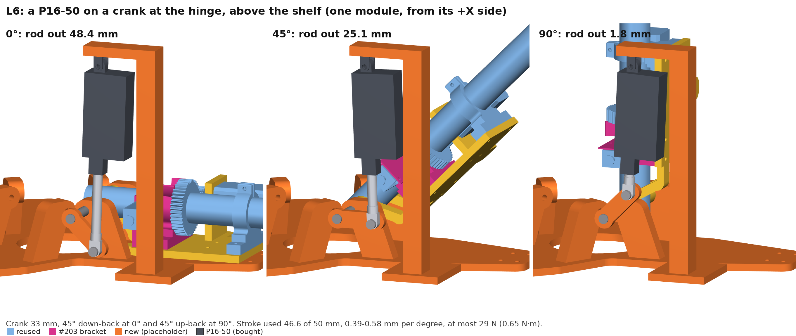

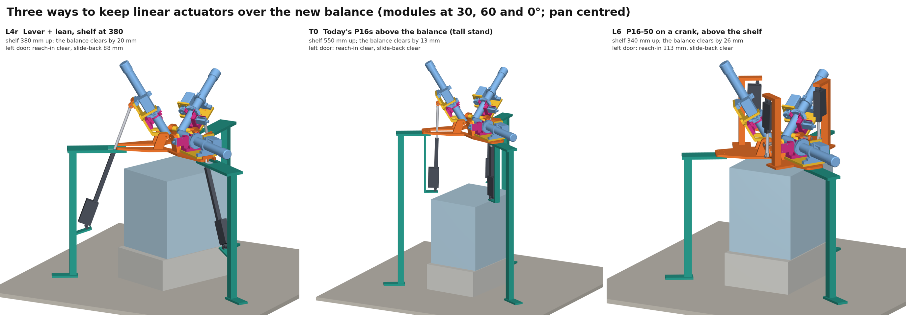

**Do the earlier answers still hold for the new balance?**

| Earlier answer | With the new balance |
|---|---|
| The tri-star itself: spacing, outlets, #203's tap bracket, the plate without gears (7–13 Nov) | Unchanged |
| The one-piece base, 320.5 × 280.2 mm (13 Nov) | Unchanged for every layout except L6, which adds an ear per module (320.5 × 319.3, still one H2D nozzle) |
| Clevis block, its holes in the plate and the P16-150's stroke table (12–20 Nov) | Hold for today's geometry and T0. L2 moves the pin 3.5 mm nearer the hinge and L4 to 120 mm on a tail, so the holes move. L6 doesn't use them |
| S2's height, 217–359 mm (20 Nov) | Fine: set it to 340 mm, 20 mm over the balance |
| The room under S2: Ø190 between the P16s at any tilt, Ø233 parked (21 Nov) | Still true, but this balance needs more: it collides with today's P16s at every orientation |
| The HR-100A under S2: rear column into a gap, lid off (21 Nov) | Only for the HR-100A |
| `leg_room.py`'s six layouts (21 Nov) | L0, L1 and L3 collide (L3 fits only with tilts kept to 60°). L2 and L4 fit, but no side door has both reach-in and slide-back room. L5 (gearmotor) frees the doors with its posts out at r 247 |
| The M1 deck (20 Nov) | Doesn't work here: with the shelf at 340 mm the deck sits about 120 mm up, level with the enclosure, and the balance (302 mm corner to corner) can't pass through its Ø224 opening |
| Stands S1, S3, S4 (20 Nov) | S1 is too low (217 mm). S3 (372 mm) and S4 are tall enough, but with today's P16s the balance still collides, and S4's rod stands in a gap a door would face |
| Weighing while dosing: a beaker on a 180 mm riser up through the HR-100A's top (20 Nov) | Needs redoing. With the shelf at 340 mm, the outlets are 372–383 mm up, 50–65 mm above the enclosure's top. A riser on the pan that brings the vessel up to the open top door, or a funnel hung from the shelf, closes that gap. On T0 the outlets are about 265 mm above the top |

**What I need to firm this up**
- the make and model, so the next run can use the maker's drawing;
- where the pan's centre is, from the enclosure's front and from one side, and how high the base is;
- how the side doors open: do they slide back past the enclosure's back, and how far;
- whether the top door slides back or lifts off.

**Limits**
- The balance is two boxes from rough numbers. The pan position, the base height and the doors are
  assumptions.
- The fast pass compares surface samples (1.5–2 mm apart) with the balance's exact boxes.
- L6's crank, shaft, post, arm and ear, T0's tall posts, and every leg are placeholders.
- The P16-50's closed length is taken as 105 mm hole to hole, as RobotShop lists the P16-50-22-12-P
  (the stroke + 47 mm rule of the P16-100 and P16-150 would give 97 mm). Check it against Actuonix's
  drawing: at 97 mm, the pivot comes down 8 mm.
- Not analysed: stiffness and ringing under the tapper, especially on T0's tall stand.
- Nothing was modelled in Onshape, printed or ordered.
- Run time: `xvfb-run -a python new_scale.py` takes about 17 minutes; `--figures-only` redraws the figures.
  `python crank_drive.py` takes about 1 minute.

## Do the actuators need to be that big? (added 24 Nov)

Ethan asked whether the actuators need to be as big as the P16-150s in the renders.
[`actuator_size.py`](actuator_size.py) sizes Actuonix's smaller actuators for one tri-star module, and
[`actuator_size.json`](actuator_size.json) holds every number.

**Short answer: no.** The P16-150 is far stronger than a module needs. Its length comes from its 150 mm
stroke, and the stroke comes from where the rod pins to the plate.

- **The load is small.** The module's own mass model (the one `stands.py` uses: printed parts at 60% of
  solid PLA, the NEMA 11 at 110 g, the solenoid at 40 g, powder at the auger's middle) gives:
  - 0.24 N·m about the hinge with an empty auger, 0.46 N·m with 250 g of powder;
  - largest at 0°, falling to almost nothing at 90°, where the centre of mass ends up over the hinge.
  - On today's lever that is at most 4.8 N. The P16-150-22 gives 40 N at its peak-power point and holds
    75 N with the power off.
  - The earlier runs used a flat 0.65 N·m, the upper estimate for the geared module. Against that figure
    the actuators below have less margin; `actuator_size.json` lists both.
- **The stroke sets the length.** Every Actuonix model is its stroke plus a fixed length: P8 + 35 mm,
  P16 + 47, L12 + 52, L16 + 68. To tilt 0–90°, the rod pin travels about 1.41 × its distance from the
  hinge. Today's pin is 105 mm from the hinge (95 behind it, 45 below), so 0–90° takes 144 mm of rod:
  a 150 mm stroke and 197 mm between the holes.
- **A shorter lever needs a shorter actuator, but more force.** With this little load there is room to
  trade one for the other.

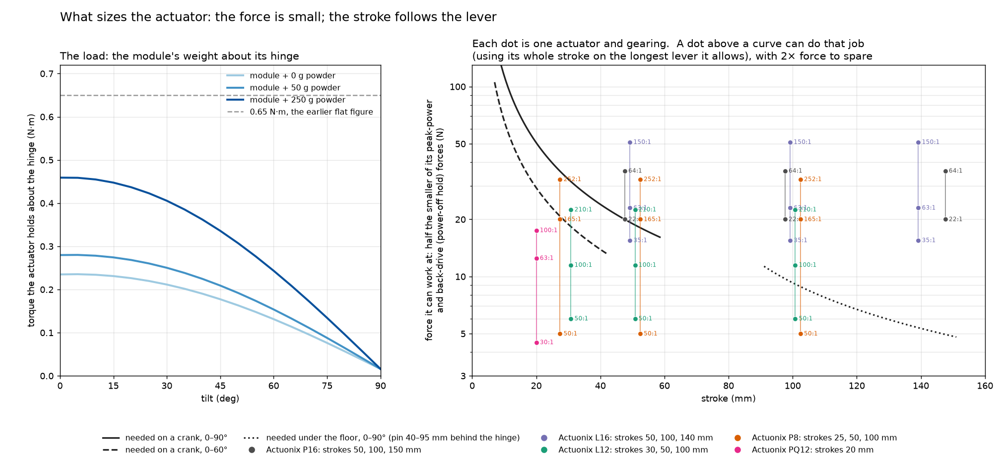

### Where a shorter lever can go

- **Under the floor, as today.** The pin sits 45 mm below the hinge (under the clevis block), so moving it
  forward shortens the lever only so far. Nearer than 40 mm behind the hinge, the actuator would stand in
  the vessel's way. With the pin 48.5 mm behind the hinge (66 mm from it), 0–90° still needs 94 mm of rod,
  so a 100 mm stroke. That far forward, the clevis block sits under #203's tap bracket (37–67 mm behind
  the hinge), so its screws go through the bracket's base too, as for M2 (20 Nov).
- **On a crank on the hinge axis, beside the module.** This is L6 from the section above
  ([`crank_drive.py`](crank_drive.py)), which uses a P16-50 on a 33 mm crank. The crank can be any
  length:
  - At 0° it points 45° below horizontal, and at 90° 45° above, so the pin's path has a vertical chord.
  - The actuator hangs from a pivot straight above the pin, on a post standing on the shelf, and pulls
    the pin up as the module tilts.
  - Nothing hangs under the shelf.

### The smallest that works

Rule: the largest force over the tilt range is at most half the actuator's peak-power force and at most
half its back-drive force (so it holds the tilt with the power off, through taps). Load: 250 g of powder.
Each actuator is put on the longest lever whose stroke covers the range, keeping 1 mm spare at each end.

| Mounting | 0–90° | 0–60° only | 0–45° only |
|---|---|---|---|
| Under the floor | P8-100-165 (135 mm), P16-100-22 (147 mm), L12-100-100-6-R (152 mm); pin 48.5 mm behind the hinge; hangs 145–163 mm under the shelf | the same 100 mm strokes, pin 82.5 mm behind the hinge | P8-50-165 (85 mm), P16-50-22 (97 mm), L12-50-100-6-R (102 mm); pin 41.5 mm behind the hinge; hangs 95–113 mm under the shelf |
| On a crank | P8-50-165 (85 mm), P16-50-22 (97 mm), L12-50-210-6-R (102 mm), L16-50-63-6-R (118 mm); crank 33.5 mm; stands 150–185 mm above the shelf | P8-25-252 (60 mm, crank 23 mm), L12-30-210-6-R (82 mm, crank 28 mm); stands 113–139 mm above the shelf | P8-25-165 (60 mm, crank 30 mm), L12-30-210-6-R (82 mm) |

Lengths are between the holes, closed. For comparison, today's P16-150-22 is 197 mm and hangs 208 mm under
the shelf. Each part number gives the stroke and then the gearing (P8-50-165 is a 50 mm stroke with 165:1
gearing).

**The main candidates in detail.** The force is the largest over the range, with 250 g of powder; in
brackets, with the earlier flat 0.65 N·m. The margins are the actuator's peak-power force and back-drive
force over that force. Moves to 30° take the lower time at no load and the higher at the peak-power load.

| Actuator | Closed | Where, range | Lever | Most force | × peak power / × held | Rod per degree | 0–30° takes | Reaches |
|---|---|---|---|---|---|---|---|---|
| P16-150-22-12-P (today) | 197 mm | floor, 0–90° | pin 95 mm behind | 5 N (11) | 8.3 / 15.6 | 1.03–1.83 mm | 1.2–2.1 s | 208 mm under the shelf |
| P16-100-22-12-P | 147 mm | floor, 0–90° | pin 48.5 mm behind | 9 N (14) | 4.3 / 8.0 | 0.80–1.15 mm | 0.7–1.2 s | 158 mm under |
| P8-100-165-12-P | 135 mm | floor, 0–90° | pin 48.5 mm behind | 9 N (14) | 8.5 / 4.3 | 0.80–1.15 mm | 3.4–6.5 s | 145 mm under |
| P8-50-165-12-P | 85 mm | floor, 0–45° | pin 41.5 mm behind | 11 N (15) | 7.3 / 3.7 | 0.73–1.07 mm | 3.0–5.8 s | 95 mm under |
| P16-50-22-12-P (L6's pick) | 97 mm | crank, 0–90° | crank 33.5 mm | 19 N (27) | 2.1 / 3.9 | 0.42–0.58 mm | 0.3–0.6 s | 164 mm above the shelf |
| P8-50-165-12-P | 85 mm | crank, 0–90° | crank 33.5 mm | 19 N (27) | 4.2 / 2.1 | 0.42–0.58 mm | 1.6–3.1 s | 150 mm above |
| L12-50-210-6-R | 102 mm | crank, 0–90° | crank 33.5 mm | 19 N (27) | 2.3 / 4.2 | 0.42–0.58 mm | 2.9–5.9 s | 168 mm above |
| L16-50-63-6-R | 118 mm | crank, 0–90° | crank 33.5 mm | 19 N (27) | 3.9 / 2.4 | 0.42–0.58 mm | 0.7–1.5 s | 185 mm above |
| L12-30-210-6-R | 82 mm | crank, 0–60° | crank 28 mm | 19 N (27) | 2.4 / 4.2 | 0.43–0.49 mm | 2.8–5.6 s | 139 mm above |
| P8-25-252-12-P | 60 mm | crank, 0–60° | crank 23 mm | 23 N (32) | 5.3 / 2.8 | 0.35–0.40 mm | 1.8–3.8 s | 113 mm above |
| L12-30-210-6-R | 82 mm | crank, 0–90° | crank 19.5 mm | 33 N (47) | **1.4** / 2.4 | 0.24–0.34 mm | 1.7–3.4 s | fails: too weak |
| PQ12-100-6-R | 42 mm | crank, 0–45° | crank 23.5 mm | 21 N (30) | **1.9 / 1.7** | 0.38–0.41 mm | 1.2–2.0 s | fails: too weak |

- **"Reaches"** is the actuator itself: its lowest point under the shelf, or its top above the shelf's top
  face. Its bracket, and the hanger or arm it screws to, add 9–14 mm.
- **With the flat 0.65 N·m,** every 50 mm stroke on a 0–90° crank falls short of 2× on one count. The
  P16-50 has 1.5× of its peak-power force. The P8-50-252, P16-50-64 and L16-50-150 keep 2×, but they're
  slower.

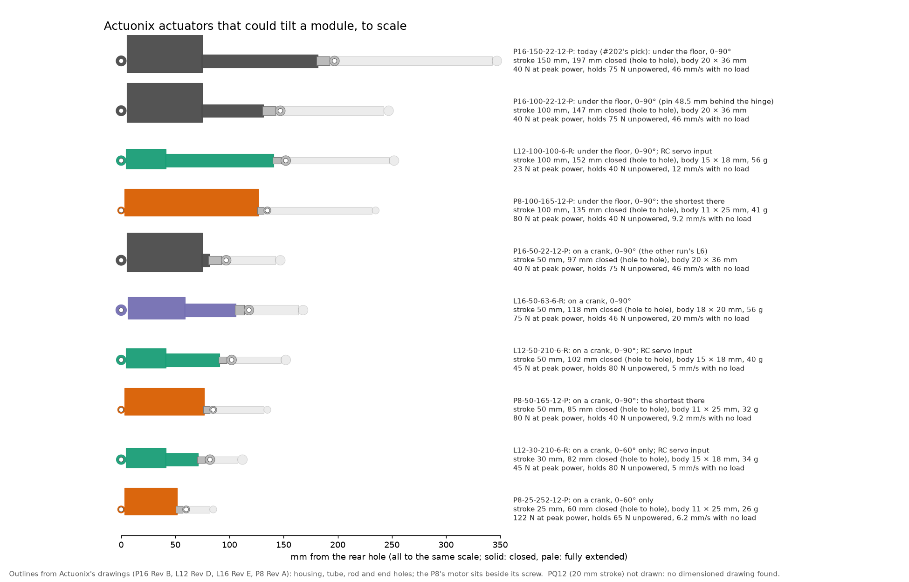

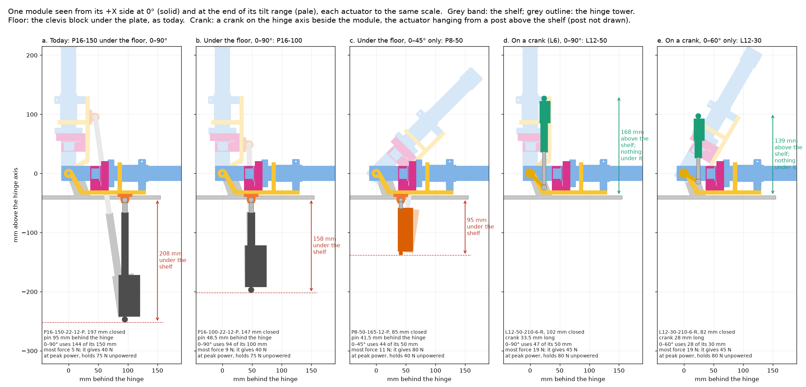

### Clearance on the crank

I checked four of the crank-mounted ones in 3D, laid out as in L6:
- **Layout:** the actuator 79 mm out from the module's centre line, and the crank at 67.5–73.5 mm.
- **Sweep:** module A over its range in 5° steps, against itself, both neighbours at every tilt from 0 to
  90°, and the base.
- **Not checked:** the post, arm and shaft, which are L6's and not part of this check.

| Actuator, range | Own module | Neighbour it faces | Other neighbour | Base |
|---|---|---|---|---|
| P8-50-165, 0–90° | 9.9 mm | 25.9 mm | 86.2 mm | 13.3 mm |
| L12-50-210, 0–90° | 9.4 mm | 25.9 mm | 86.2 mm | 13.3 mm |
| P16-50-22, 0–90° | 5.4 mm | 23.5 mm | 86.2 mm | 13.3 mm |
| L12-30-210, 0–60° | 9.4 mm | 25.9 mm | 86.2 mm | 13.3 mm |

- **Own module:** the closest is always the actuator body to the module's own solenoid plunger, at 50–70°
  of tilt.
- **Neighbour:** the closest is the crank to the neighbour's mounting plate.
- **Target:** every gap is above the 2 mm target.

### What a shorter lever costs

- **Resolution.** On a 33.5 mm crank the rod moves 0.42–0.58 mm per degree of tilt; today it moves
  1.03–1.83. So an actuator's repeatability and backlash count 2–3 times as many degrees. For the L12-50,
  ±0.3 mm of repeatability is about ±0.7°, and its 0.2 mm of backlash about 0.5°.
- **Speed.** The slow gearings that give the force margin take longer. On a crank, 0–30° takes
  0.3–0.6 s with the P16-50-22, 1.6–3.1 s with the P8-50-165 and 2.9–5.9 s with the
  L12-50-210.
- **Pins.** Play in the rod-end and crank pins also counts more on a short lever.

### What it means for the new scale

- **Under the floor, a smaller actuator still sits over the scale.** For 0–90° or 0–45° it stands 73–81 mm
  from the beaker axis. That is inside the new scale's enclosure footprint (183 mm wide, so its sides are
  about 90 mm from a centred pan). So the shelf would have to clear the scale's 320 mm top by the
  actuator's hang plus its bracket: about 427 mm for a P8-50 under the floor (0–45°)
  and 477–494 mm for a 100 mm stroke (0–90°). The section above's T0 does the same for today's P16-150s,
  with the shelf at 550 mm. With nothing under the shelf, 340 mm is enough.
- **On a crank, nothing hangs under the shelf.** The section above found that, with the shelf at 340 mm and
  only L6's legs under it, the new balance clears by 26 mm and both side doors and the top door are free.
  That holds whichever crank-mounted actuator is used, since none of them reaches under the shelf.

### Controls

- **L12, L16 and PQ12 come as `-R` linear servos.** They take an RC pulse (1.0 ms in, 2.0 ms out) and 6 V,
  like the MG996R the Pico drives today, so they need no LAC board. Their datasheets give a 5 V pulse;
  check them on the Pico's 3.3 V, or add a level shifter.
  - The `-R` reports no position. The L12's `-I` version takes the same RC pulse and gives a 0–3.3 V
    position signal the Pico's ADC can read.
- **P16 and P8 come as `-P`** (potentiometer feedback) and need an LAC board each, as #202 planned. The
  P8 can also use Actuonix's smaller Ext-R board, which takes an RC pulse.

### Limits

- **Datasheet numbers.** Forces and speeds are Actuonix's (L12 Rev B, L16 2019, PQ12 Rev D, P8 2022; the
  P16 from #202). The P16's 64:1 peak-power point isn't published, so it's estimated as 0.8 × its 90 N
  maximum. The PQ12's closed length (42 mm) is from a retailer listing.
- **Outlines.** The actuators are drawn from their dimension drawings: housing, tube, rod and end holes,
  not their STEP files.
- **The load is modelled, not measured.** Weigh a loaded module and find its balance point to confirm it.
- **The crank layout** follows L6 (`crank_drive.py`): the same crank and actuator plane, with the pivot
  straight above the pin (L6 puts it 4.3 mm further back). The post, arm and shaft aren't in this check;
  `crank_drive.py` checks them for the P16-50.
- **The P16-50's length.** L6 takes it as 105 mm closed, as one RobotShop listing gives. This section uses
  97 mm: stroke + 47 mm, as for the P16-100 and P16-150 in #202, and as another RobotShop listing gives.
  If it is 105 mm, the P16-50 stands 8 mm taller on the crank and hangs 8 mm lower under the floor, and
  the L12-50 (102 mm) is the shorter of the two.
- Nothing was bought, printed or modelled in Onshape.
