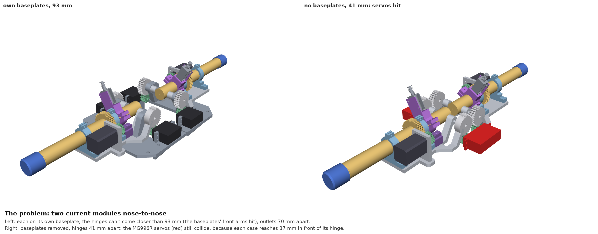
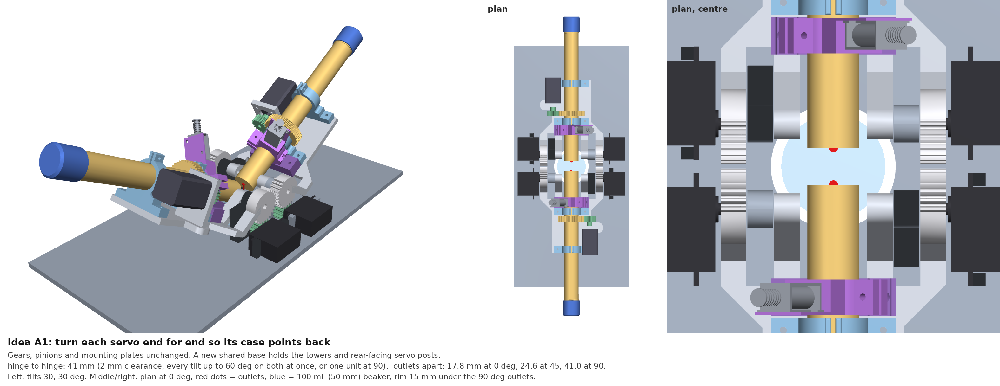
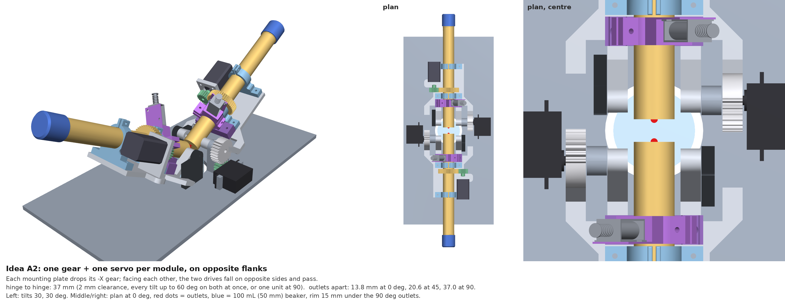
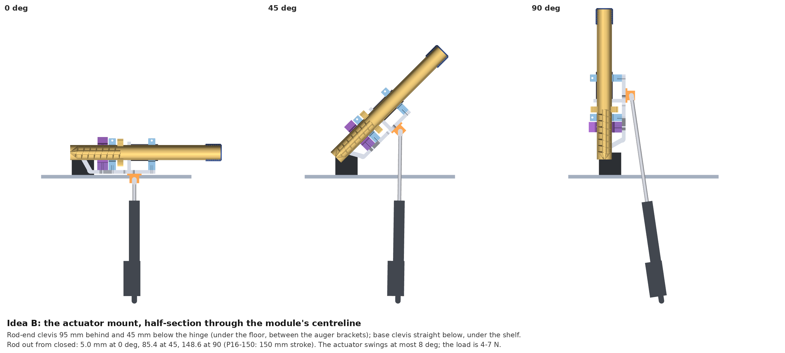
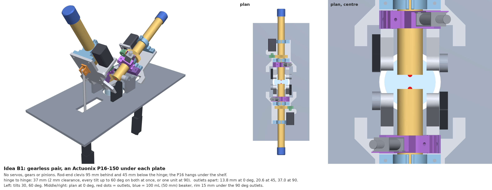
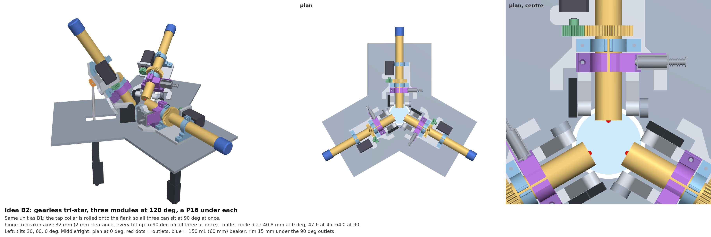
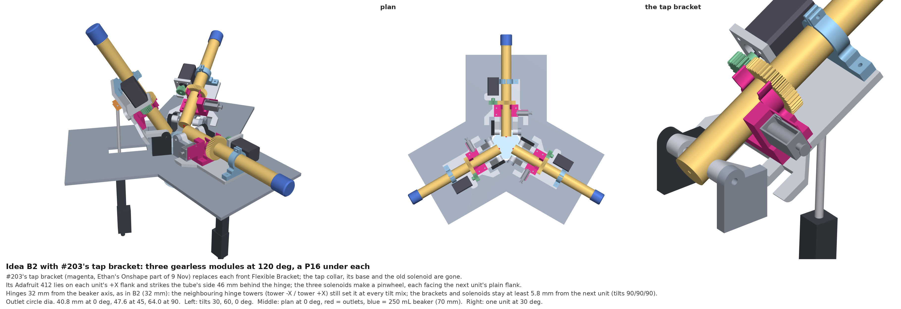
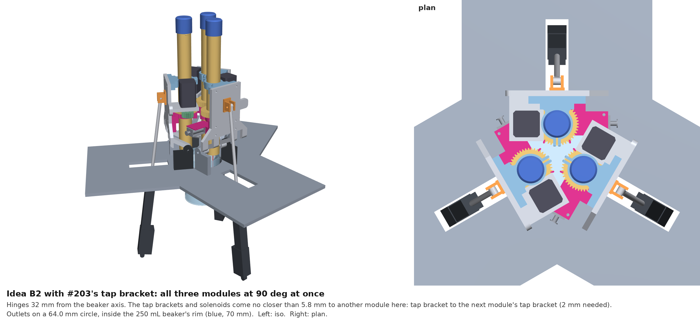
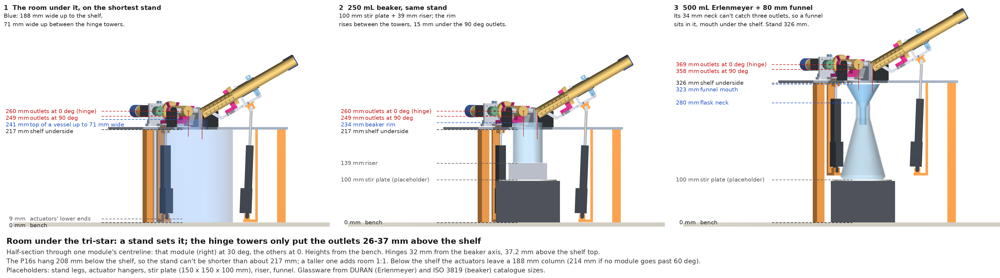

# Fixed-base multi-auger doser: concepts (issue #204)

Issue [#204](https://github.com/vertical-cloud-lab/powder-doser/issues/204)
asks for 2–3 of the current dosing modules on one fixed base, so that 2–3
powders can go into one beaker (or crucible) without anyone swapping
augers. Two directions were proposed:

- **Idea A:** put two of the existing modules nose-to-nose over the beaker,
  and find a way round the big tilt gears at the front of the mounting plate.
- **Idea B:** drop the servos and gears, and tilt each mounting plate with a
  linear actuator pushing from underneath. It must fit 2 augers; 3 would be better.

Every number below comes from the module's real CAD: the STEP files and
placements of [PR #170](https://github.com/vertical-cloud-lab/powder-doser/pull/170)
(the same parts as the Onshape documents listed in
[#193](https://github.com/vertical-cloud-lab/powder-doser/issues/193)).
[`concepts.py`](concepts.py) places 2–3 copies of the module, tilts them, and
finds the closest spacing that keeps **2 mm between any two parts of
different modules**. It checks triangulated meshes with
[python-fcl](https://github.com/BerkeleyAutomation/python-fcl). The new parts
(shared base, towers, servo posts, clevis bracket, actuator, beaker) are
placeholders sized from the real parts. They are not ready to print.

## Summary

| | Augers | Spacing ¹ | Outlets apart at 0° / 45° / 90° ² | Beaker | What changes | Tilt drive |
|---|---|---|---|---|---|---|
| Current modules, each on its own baseplate | 2 | 93 mm | 70 / 77 / 93 mm | a 1 L beaker (Ø105 mm) to catch both at 90° | — | 2 servos each |
| **A1** Servos turned end for end | 2 | **41 mm** | 17.8 / 24.6 / 41.0 mm | 100 mL (50 mL up to about 60°) | new shared base only | 2 servos each (as now) |
| **A2** One gear and servo per module, on opposite flanks | 2 | **37 mm** | 13.8 / 20.6 / 37.0 mm | 100 mL (50 mL up to about 70°) | new base; each plate loses one gear | 1 servo each |
| **B1** Gearless pair, actuator underneath | 2 | **37 mm** | 13.8 / 20.6 / 37.0 mm | 100 mL | new base; plate without gears; clevis bracket | 1 linear actuator each |
| **B2** Gearless tri-star (3 at 120°) | **3** | **32 mm** ³ | Ø40.8 / Ø47.6 / Ø64.0 mm circle | 150 mL up to 60°, 250 mL for 90° | as B1, tapper rolled onto the flank | 1 linear actuator each |
| **B2 + #203's tap bracket** (10 Nov) | **3** | **32 mm** ³ | Ø40.8 / Ø47.6 / Ø64.0 mm circle | as B2 | as B2; the tap bracket replaces the front bracket and the collar | 1 linear actuator each |
| Three A1 modules at 120° | 3 | 66 mm ³ | Ø108 mm circle at 0° | none | | |

¹ Hinge to hinge for the pairs; hinge to beaker axis for three modules.
Clears every tilt up to 60° with all modules tilting together, and any one
module at 90° with the others at 0°. B2 also clears all three at 90° together.
² Pairs: outlet to outlet. Three modules: diameter of the circle through the outlets.
³ Hinge to the beaker axis.

**Short version**
- **Two augers, soonest:** A1. Every printed part of the module stays as it
  is. Only the base is new: it carries both modules' hinge towers, with the
  servo posts behind the hinge instead of in front.
- **Three augers:** only idea B fits a beaker. Three modules with servos and
  gears need the hinges 66 mm from the beaker axis.
- **For two modules, idea B brings the outlets only 4 mm closer than A1.**
  Its real gains are elsewhere: no printed gears to strip and no servo horn
  to loosen, a position readback from the actuator's potentiometer, and a
  tilt that holds when the power is off.
- **Whatever the layout, two facing modules can't both be at 90° at once.**
  At 90° the solenoid on top of the tube swings about 65 mm forward into the
  other module. A firmware interlock fixes this: only one module above 60°
  at a time. For three modules, rolling the tap collar onto the flank fixes
  it (B2). [#203](https://github.com/vertical-cloud-lab/powder-doser/issues/203)
  (tapper off the auger) bears on this; see below.

## Why two current modules don't fit nose-to-nose

The hinge sits 11.6 mm behind the outlet, on the auger's axis. How far each
part reaches **in front of the hinge**, measured on the CAD:

| Part | 0° | 45° | 90° |
|---|---|---|---|
| Baseplate (front arms, legs) | 45.4 mm | 45.4 | 45.4 |
| MG996R servos (under the hinge, case pointing forward) | 37.1 | 37.1 | 37.1 |
| 28T tilt gears | 19.5 | 19.5 | 19.5 |
| Auger tube end | 11.6 | 17.0 | 11.6 (peaks at 47°) |
| Tap collar / solenoid (on top of the tube) | behind | 2.1 / 17.5 | **52.6 / 64.6** |
| 44T auger gear | behind | behind | 23 (72 mm above the hinge) |

So the gears aren't what collides first. With their own baseplates, two
modules can't get their hinges closer than 93 mm, because the baseplates'
front arms (under the servos) hit. With the baseplates gone, the **servos**
hit next: each case reaches 37 mm in front of its hinge, on the same side
as the facing module's servo. The 28T gears only come into play at 41 mm.



## Idea A: two current modules nose-to-nose

Both concepts share one new base: a flat plate (printed, HDPE or plywood)
carrying the two pairs of hinge towers face to face. A Ø60 window between
them lets the beaker rise to about 15 mm under the outlets. The baseplate's
front arms and legs are gone.

### A1. Turn each servo end for end so its case points back

The MG996R's spline sits 17.4 mm from one end of the case (with its flange)
and 37.1 mm from the other. On the current baseplate the long end points
forward. Turn the servo round so the long end points back, and its forward
reach drops from 37 to 17 mm. **The spline, pinion, gears and mounting plate
don't move,** so the gear mesh and the tilt firmware stay as they are. Only
the servo posts move, to behind the hinge on the new base.

- **Spacing 41 mm,** set by the two modules' 28T gears, which sit in the same
  planes (|x| = 41.8–54.1 mm). Outlets 17.8 mm apart at 0°, 24.6 at 45°, 41 at 90°.
- **Self-check:** over 0–90° the turned servos come no closer than 1.6 mm to
  anything that tilts. That gap is the spline boss to the 28T gear at 40°, the
  same as today. The case itself sits behind the hinge at |x| ≥ 56.6 mm,
  outside the plate (|x| ≤ 54.1 mm). The tightest pair on the whole module is
  still tower to gear, 0.6 mm, as on today's baseplate.
- **Cost:** one printed base. Every other part is a copy of today's module.



### A2. One gear and one servo per module, on opposite flanks

Delete the −X gear (and its web) from each mounting plate, and the −X servo
with it. Face to face, the two modules' remaining drives land on opposite
sides of the base, so each gear and servo passes beside the other module's
plain knuckle.

- **Spacing 37 mm,** set by the tubes themselves: at about 47° each tube's
  end reaches 17 mm in front of its hinge. Outlets 13.8 mm apart at 0°,
  20.6 at 45°, 37 at 90°.
- **Torque:** the repo's sizing
  ([`hardware/vibration-motor-and-solenoid.md`](../../hardware/vibration-motor-and-solenoid.md#servo-driven-baseplate-tilt--alternative-to-the-linear-actuator))
  puts one module at about 0.39 N·m about the hinge. Through the 14T:28T pair
  that is 0.2 N·m (2 kg·cm) at one servo, against the MG996R's roughly 9–11
  kg·cm stall. Adding 100–250 g of powder brings it to 2.5–3.3 kg·cm, so about
  3× margin. The weak spot is the printed 14T pinion, which has stripped
  before ([#65](https://github.com/vertical-cloud-lab/powder-doser/issues/65)):
  one pinion now carries twice the tooth load. Print it in a tougher material,
  or use a metal pinion.
- **It only gains 4 mm over A1,** for a new mounting plate and a one-sided
  drive. A1 is the better trade unless those 4 mm decide the beaker size.



### Considered and dropped

- **Pinion behind the hinge, gear cut to a sector:** over 0–90° only a quarter
  of each 28T gear ever meshes. With the pinion behind the hinge, that quarter
  never comes in front of it. But the plate's gear web and floor wings (|x| up
  to 54 mm, 16–49 mm behind the hinge) sweep through that pinion position by
  45°. It needs a new mounting plate and gains nothing over A2.
- **Servos above the hinge** (the PR #176 variant): it clears the space under
  the outlet, but two modules facing each other still need the cases pointing
  back. That makes it A1 with the servos higher up.
- **Three servo modules at 120°:** with A1's turned servos, neighbouring
  modules' servo cases meet unless the hinges sit 66 mm from the beaker axis
  (outlet circle Ø108 mm at 0°). Idea A stops at two modules.

## Idea B: no servos or gears, a linear actuator underneath

Each mounting plate keeps its knuckles and pivots on the same hinge. The 28T
gears, servo pinions and servos are gone. An actuator underneath pushes the
plate's rear up. Without the gears and servos, a module is about 75 mm wide
at the front (towers at |x| ≤ 37 mm) instead of 190 mm (the servo cases).
That is what lets three modules close in on one beaker.

### Mounting the actuator

- **Rod-end clevis** on a small bracket under the plate floor, **95 mm behind
  and 45 mm below the hinge**, on the centreline (between the front and rear
  auger brackets).
- **Base clevis** straight below it, under the shelf. The rod passes through a
  slot in the shelf (y = 35–110 mm behind the hinge). With pins at both ends
  the actuator swings at most about 8° over 0–90°.
- **Stroke needed** (from closed, with 5 mm in hand at 0°):

| Tilt | 0° | 30° | 45° | 60° | 90° |
|---|---|---|---|---|---|
| Rod out | 5.0 mm | 58.7 | 85.4 | 109.9 | 148.6 |

- **Force:** about 0.4–0.65 N·m about the hinge (module plus powder) over
  95 mm is 4–7 N. Every candidate below is far stronger.



| Actuator | Stroke / closed | Range here | Control | Notes |
|---|---|---|---|---|
| Actuonix **P16-150-22-12-P** + LAC ([#202](https://github.com/vertical-cloud-lab/powder-doser/issues/202)'s pick) | 150 / 197 mm | 0–90° | LAC board (RC pulse, USB or analogue in), potentiometer feedback | $90 + $30 per module; holds 75 N with the power off |
| Actuonix **L16-140-35-6-R** | 140 / 208 mm | 0–90° with the clevis at about 85 mm | RC servo: 1.0 ms = fully in, 2.0 ms = fully out, from the same PWM pin the MG996R uses | 6 V, no LAC needed; holds 31 N with the power off; the datasheet's pulse is 5 V, so check it on the Pico's 3.3 V or add a level shifter |
| Actuonix L16-100-x-12-P / P16-100 | 100 / 147–168 mm | 0–about 54° | as above | if dosing stays at 20–40° (PR #185 v5 caps at 40°) |

L16 numbers are from Actuonix's
[L16 datasheet](https://cdn.robotshop.com/media/F/Fir/RB-Fir-111/pdf/ActuonixL16Datasheet.pdf):
35:1 gearing, 32 mm/s, 50 N lifted, 31 N back-drive, 20% duty, IP-54. P16
numbers are from #202's write-up.

- **A hobby servo also works here.** An MG996R with a horn and a pushrod to
  the same clevis is a 4-bar that can sweep the plate 0–90°. It costs $10
  instead of $90–120 and keeps today's firmware. It loses the position
  readback and the unpowered hold.

### B1. Gearless pair

- **Spacing 37 mm,** the same as A2 (the tubes are the limit). Outlets 13.8 /
  20.6 / 37 mm apart at 0° / 45° / 90°.
- **Actuators:** each hangs 113 mm from the beaker axis, outside the HR-100A's
  Ø172 mm breeze-break housing. Each needs about 210 mm under the shelf. With
  the shelf above the balance's 315 mm top, that leaves the actuator's lower
  end above the balance's 80 mm-tall base.
- **Self-check:** nothing on the module comes within 5 mm of the towers,
  clevis bracket or actuator over 0–90°.



### B2. Gearless tri-star: three modules at 120°

- **Hinges 32 mm from the beaker axis.** Neighbouring towers set this. Without
  towers (a shared hinge frame) it would be 25 mm, where the plates' knuckles
  meet.
- **Outlets** lie on a Ø40.8 mm circle at 0°, Ø47.6 at 45° and Ø64 at 90°: a
  150 mL beaker (about 57 mm inside) up to 60°, 250 mL for 90°.
- **All three can be at 90° at once** if the tap collar is rolled 90° onto the
  module's flank. With the collar on top, as now, 90° on all three needs 56.5 mm.
- **Actuators** hang 127 mm out, again outside the balance's breeze break.



#### B2 with #203's tap bracket (added 10 Nov)

[#203](https://github.com/vertical-cloud-lab/powder-doser/issues/203)'s first
tap bracket ([Ethan's Onshape document](https://cad.onshape.com/documents/3db901b123bbee05f5c196f3/w/71800ea0548acad53e21d816/e/68af1a083e7d90e44c40f87c),
part studio "Solenoid bracket", exported at workspace microversion `103ac09`)
is the front C-clip and a solenoid tower as one part. Here it **replaces each
module's front Flexible Bracket**. The tap collar, its base and the old
solenoid are gone. The Adafruit 412 lies on the module's +X flank, and its
plunger strikes the side of the tube at hinge height, 46 mm behind the hinge.

- **Placement comes from Ethan's assembly, not by eye.**
  [`tap_bracket.py`](tap_bracket.py) exports his "Assembly new solenoid
  setup" (the whole doser with the bracket in place of the front Flexible
  Bracket). It fits his mounting plate onto PR #170's (median gap 0.38 mm,
  95th percentile 0.79 mm). The parts both assemblies share then line up too:
  auger 0.51 mm, rear bracket 0.19, cap 0.51, stepper 0.23 (medians). The
  bracket and its solenoid go into every module at the same place relative to
  the plate ([`tap-bracket/`](tap-bracket/), [`registration.json`](tap-bracket/registration.json)).
- **Hinges are still 32 mm from the beaker axis, as in B2.** The neighbouring
  hinge towers set it at all ten tilt mixes swept: all three at 0, 30, 45, 60
  or 90°, one at 60 or 90°, two at 60 or 90°, and 30/60/0.
- **The brackets have room.** All three solenoids point the same way round,
  so each faces the plain flank of the next module. A bracket or solenoid
  comes no closer than 5.8 mm to another module. That happens when two
  neighbours are both at 90°, bracket to bracket. In every other mix the gap
  is 30 mm or more.
- **All three can be at 90° at once,** as in B2 with the collar on the flank.
- **Self-check:** each bracket stays at least 9.0 mm from its own module's
  towers and actuator over 0–90°.
- **Outlets** are where they were in B2: a Ø40.8 mm circle at 0° and Ø64 at
  90°. The figure uses a 250 mL beaker (Ø70 mm), which holds the 90° circle.
- **Strike gap:** in Ethan's assembly the plunger is drawn touching the tube
  (its tip 0.8 mm inside the tube's surface), so the rest gap can't be read
  from the model. #203 suggests about 3–4 mm.





#### Room under the tri-star (added 10 Nov)

[Philip asked](https://github.com/vertical-cloud-lab/powder-doser/issues/204)
how much clearance there is under the doser, whether the hinge towers set it,
and whether a stand could change it. [`clearance.py`](clearance.py) measures it
on the B2 + tap bracket model above ([`clearance.json`](clearance.json) has
the numbers).

- **The towers don't set it; a stand does.** The towers put the hinge
  37.25 mm above the shelf top, so the outlets sit 25.7 mm (90°) to 37.25 mm
  (0°) above it. The shelf has a window under the outlets, so the vessel
  comes up through it from below.
- **The tri-star needs a stand anyway.** Each P16 hangs 208 mm below the
  shelf (its lower eye; the base pin is 204 mm down). With an 8 mm base
  clevis under it, the shelf's underside has to be at least **217 mm** above
  the bench. The outlets are then 249 mm (90°) to 260 mm (0°) up. A taller
  stand adds room 1:1.
- **Hang each actuator from the shelf** (the orange hangers in the figure),
  not from the bench. Then the legs can be any length, and a lab jack under
  the vessel does the fine adjustment.
- **How wide a vessel can be:**
  - **Up to 71 mm** (a 250 mL beaker is 70 mm): rises up between the hinge
    towers, to 2 mm under the lowest the tubes ever get. That is 24 mm above
    the shelf's underside, set by the tube's end lip at 45°.
  - **71–188 mm:** stops under the shelf, 32 mm below the 90° outlets.
    Below the shelf the actuators leave a 188 mm column (214 mm if no module
    goes past 60°, because a P16 leans inward near 90°).
  - **Wider:** has to stay below the actuators' lower ends, or fit between
    two of them.
- **Erlenmeyer necks can't catch three outlets.** The outlets lie on a
  Ø40.8 (0°) to Ø64 mm (90°) circle. DURAN's necks are 34 mm (250 and
  500 mL), 42 mm (1 L) and 50 mm (wide neck). Only the wide neck (about
  46 mm inside) is wider than the circle, and only up to about 39° of tilt,
  before allowing for each stream's own width. So plan on a funnel in the
  neck. An 80 mm, 60° powder funnel stands 29–43 mm above the neck. Its
  mouth is too wide for the window, so it sits under the shelf.

Stand height (bench to the shelf's underside) for some vessels on a 100 mm
stir plate (a placeholder; add or subtract the difference for yours, and
take 100 mm off for a vessel on the bench):

| Vessel | Where its top goes | Stand |
|---|---|---|
| 100 / 150 / 250 mL beaker (Ø50–70) | between the towers, rim 15 mm under the 90° outlets | 217 mm (the shortest), on a 64 / 54 / 39 mm riser |
| 400 mL beaker (Ø80 × 110) | rim 2 mm under the shelf | 217 mm, on a 5 mm riser |
| 600 mL beaker (Ø90 × 125) | rim 2 mm under the shelf | 227 mm |
| 250 mL Erlenmeyer (Ø85 × 145, 34 mm neck) + funnel | funnel mouth 2 mm under the shelf | 290 mm |
| 500 mL Erlenmeyer (Ø105 × 180, 34 mm neck) + funnel | as above | 325 mm |
| 500 mL wide-neck Erlenmeyer (Ø105 × 175, 50 mm neck) + funnel | as above | 306 mm |
| 1 L Erlenmeyer (Ø131 × 220, 42 mm neck) + funnel | as above | 358 mm |

Erlenmeyer sizes are DURAN's catalogue dimensions (ISO 1773 narrow neck, ISO
24450 wide neck); beakers are ISO 3819 low form. The stand legs, hangers,
stir plate (150 × 150 × 100 mm), riser and funnel are placeholders.

**The stir plate on the shortest stand** stands among the actuators' lower
ends, which come within 99.6 mm of the axis there. So it has to fit in a
199 mm circle, or between two actuators. The 150 × 150 mm placeholder clears
them by 6.2 mm (a P16 at 90°). From a 319 mm stand up, the actuators end
above a 100 mm stir plate, so its footprint no longer matters.



To put the doser lower than 217 mm, the actuators would have to fold away:
lie at an angle, or a shorter actuator on a shorter lever, which trades tilt
range or resolution. That isn't modelled here. To weigh while dosing, the
shelf has to clear the HR-100A's 315 mm top instead (see below).

### A cheaper variant: one actuator for all modules

The #116 battery runs found **no flow at any tilt with the auger stopped**
(block B, 0.0000 g after 15 s at 0°, 45° and 90°, every powder; see
[#128](https://github.com/vertical-cloud-lab/powder-doser/issues/128)).
Flow is gated by the auger, not by the tilt. So the modules could share one
tilt: one actuator lifts a yoke (pair) or spider (tri-star) that carries
every plate's rear on a roller, and each auger doses in turn. The cost is
per-powder tilt schedules. The 0° tap-trim phase, which #116 found to be the
only sub-milligram actuator, would have to run for every module at once,
between bulk doses. This was not modelled.

## Things every concept has to handle

- **Tapper at high tilt.** With the solenoid on top of the tube, two facing
  modules both at 90° need 73 mm between hinges. Rolled onto the flank, they
  need 54 mm, because the tap collars themselves meet. For the pairs, a
  firmware interlock (one module above 60° at a time) keeps them at 37–41
  mm. The tap-collar base's hard-stop bump sets today's 30° roll, so rolling
  further needs a new base. A tapper fixed to the plate's flank, as #203 is
  exploring, would do the same job.
- **Beaker and balance.** The outlets have to sit about 15 mm over the rim. On
  the HR-100A (198 × 253 mm, 315 mm tall, Ø76 top-door opening, numbers from
  PR #185's model), that means:
  - the shelf on a stand above the balance, not touching it;
  - the beaker on a riser on the pan, up through the top door, as in PR #185's v5.
  
  The HR-100A's 102 g capacity covers a 100 mL beaker (about 50 g) plus a
  printed riser and a few grams of powder. Check the tare before using a
  150 mL beaker or a tall riser.
- **The atomizer cup is too small for simultaneous dosing.** Its bore is about
  12–16 mm (19.05 mm OD, byu-vcl PR 232). Every concept here puts the outlets
  14–41 mm apart, so a cup needs:
  - a funnel that stays with that cup, or
  - one powder at a time, with the cup moved under each outlet.
- **Facing outlets.** At 0° the two outlets point at each other 14–18 mm
  apart, so a puff from one can reach the other's end face. Park idle modules
  at 0°, and reverse a turn after each dose, as the carousel designs do.

## Suggested next steps

1. **A1 on the bench:** print the shared base with the towers and
   rear-facing servo posts, move two existing modules onto it, and check the
   41 mm spacing and the interlock.
2. **In parallel, one B module:** a gearless mounting plate, a clevis bracket
   and one P16-150 or L16-140-R. The test is whether the actuator's tilt is as
   repeatable as the servo's, and whether it holds through tapping.
3. Decide the beaker (and the riser) before committing the base. The outlet
   circle above sets it.

## Files

| File | What it is |
|---|---|
| [`doserlib.py`](doserlib.py) | Loads PR #170's STEP files and `layout.py` at commit `7f5b3b7` (downloaded once to `~/.cache`). Builds a module with any drive variant, plus the placeholder base, towers, actuator and beaker. Mesh clearance (fcl), VTK renders |
| [`concepts.py`](concepts.py) | The concepts, the spacing sweeps, the self-checks and the figures |
| [`tap_bracket.py`](tap_bracket.py) | Exports #203's tap bracket and Ethan's assembly from Onshape (needs `ONSHAPE_ACCESS_KEY`/`ONSHAPE_SECRET_KEY`), fits it onto PR #170's frame, and writes `tap-bracket/` |
| [`tap-bracket/`](tap-bracket/) | `tap-bracket-pr170.step`: the bracket and its solenoid (coil, yoke, plunger) in PR #170's frame at 0°, which `doserlib.py` reads. `solenoid-bracket-onshape.step`: the bracket alone, as Onshape exports it. `registration.json`: the fit and its checks |
| [`results.json`](results.json) | Every swept spacing with the two parts that limit it, the self-checks, the actuator stroke table and the outlet spacings |
| [`clearance.py`](clearance.py), [`clearance.json`](clearance.json) | The room under the tri-star: the lowest the doser gets over the beaker axis at every radius (0–90°), how far the actuators hang, and the stand each vessel needs; renders `b2_clearance.png` |
| [`renders/`](renders/) | The figures above |

```bash
pip install cadquery trimesh python-fcl rtree vtk pillow numpy
xvfb-run -a python concepts.py              # sweeps + figures, about 4 min on 4 cores
xvfb-run -a python concepts.py --no-sweep   # figures only, from results.json
xvfb-run -a python concepts.py --tap-bracket  # only B2 + #203's tap bracket (about 1 min)
python tap_bracket.py                       # re-export the bracket from Onshape (needs the keys)
xvfb-run -a python clearance.py             # room under the tri-star (about 20 s)
```

**Limits.**
- The new parts are placeholders. Spacings that involve them (towers, servo
  posts) are as good as those placeholders.
- The brackets are the old split clamp from PR #170's CAD, not the rig's
  C-clip, which isn't in any shared file.
- Meshes are triangulated to 0.15 mm.
- The gear mesh itself isn't re-checked here. PR #170 did that.
- No powder was simulated.
