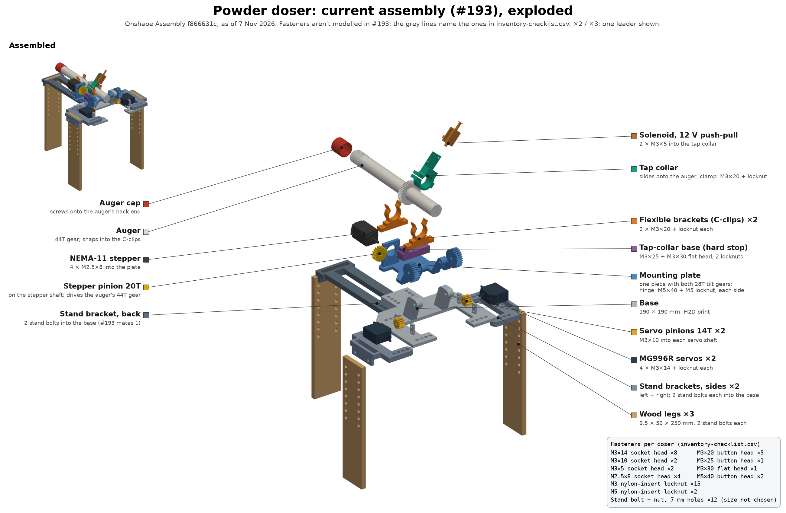
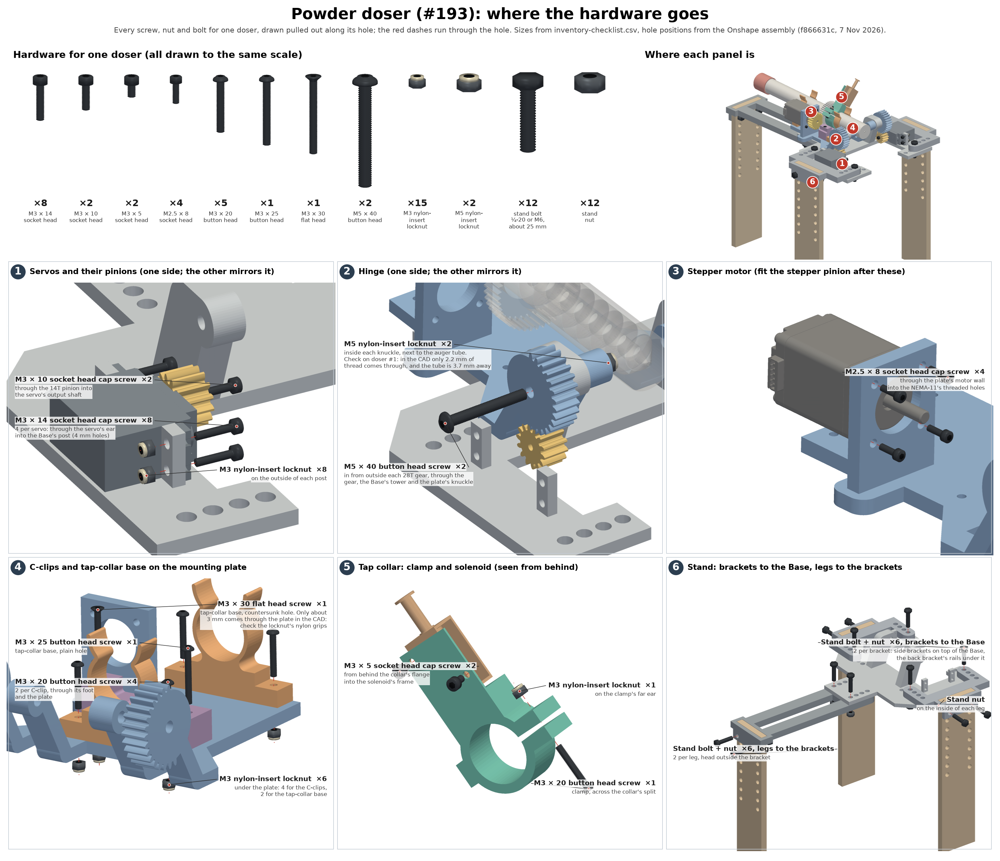

# Current doser assembly (#193): exploded diagram



For where each screw, nut and bolt goes, see the
[hardware diagram](#where-the-hardware-goes) below.

Drawn from Ethan's Onshape
[Assembly](https://cad.onshape.com/documents/f866631c78fbefd61e6856e4/w/043fe020d0194e41cea13bc2/e/3156bac055c13d8160e229b4)
linked in #193, which Brandon named as the newest version (10 Nov 2026). The
document was last changed on 7 Nov. Every part was exported at the exact
version the assembly uses, and placed with the assembly's own transforms.
[`assembly_193_parts.json`](assembly_193_parts.json) lists the 25 parts,
their source documents and versions, and the 52 mates.

To redraw it after the assembly changes:

```bash
cd docs/new-dosers/onshape
python assembly_193.py fetch                  # read-only, about 45 Onshape API calls, logged in api_calls.jsonl
xvfb-run -a python assembly_193.py render     # writes ../assembly/doser_193_exploded.png
```

## What's in it

The doser stands on its own legs now, so there's no board to screw it to:

- **Stand:** the Base (190 × 190 mm, H2D only), a back stand bracket, left
  and right side stand brackets, and 3 wood legs. The rails and legs have rows
  of 7 mm holes, so the height can be set.
- **Tilt:** 2 MG996R servos on the Base's posts, each with a 14T pinion,
  driving the 28T gears that are part of the one-piece mounting plate.
- **Auger drive:** a NEMA-11 stepper under the mounting plate's block, with
  a 20T pinion on the auger's 44T gear.
- **Auger:** held in 2 flexible brackets (C-clips), with the cap on its back
  end, and the tap collar on its tube with the solenoid on the collar.
  The tap-collar base on the plate is the collar's hard stop.

The colour key and part names match
[`inventory-checklist.csv`](../inventory-checklist.csv).

## Fasteners, joint by joint

#193 doesn't model any screws or nuts. These come from reading every mated
hole in the assembly: which parts the axis passes through, the hole size and
the stack length. The sizes are the ones in the checklist.

| Joint | Holes in the CAD | Fastener | Per doser |
|---|---|---|---:|
| Servo to the Base's posts | 4.0 mm, 5 mm posts | M3 × 14 socket head + locknut | 8 |
| Servo pinion to the servo | 3.4 mm through the 11.5 mm pinion | M3 × 10 socket head, into the shaft | 2 |
| Hinge (28T gear, Base tower, plate knuckle) | 5.7 / 5.3 / 5.7 mm, 37.8 mm in all | M5 × 40 button head from outside the gear + M5 locknut inside the knuckle | 2 |
| Stepper to the plate | 3.4 mm through 6 mm; M2.5 tapped in the motor | M2.5 × 8 socket head | 4 |
| C-clip to the plate | 3.4 mm through 6 + 8 mm | M3 × 20 button head + locknut | 4 |
| Tap-collar base, plain hole | 3.4 mm through 6 + 14 mm | M3 × 25 button head + locknut | 1 |
| Tap-collar base, countersunk hole | 3.4 mm through 6 + 20 mm | M3 × 30 flat head + locknut | 1 |
| Tap-collar clamp | 3.4 mm | M3 × 20 button head + locknut | 1 |
| Solenoid to the tap collar | 3.2 mm | M3 × 5 socket head, into the solenoid's ears | 2 |
| Side and back stand brackets to the Base | 7 mm, 10 + 6 mm | stand bolt + nut | 6 |
| Wood legs to the stand brackets | 7 mm, 6 + 9.5 mm | stand bolt + nut | 6 |

## Worth checking

- **The hinge screws.** Each hinge stack is 37.8 mm in the CAD, on both
  sides, with no counterbores. The screw can only go in from outside the
  28T gear: the two knuckles are 32.5 mm apart, less than the screw, and the
  auger tube runs between them. An M5 × 40 then leaves 2.2 mm of thread past
  the knuckle, and an M5 nylon-insert locknut is 5 mm tall, so it can't reach
  its nylon ring. A longer screw doesn't help: the auger tube is only 3.7 mm
  from each knuckle's inner face, so a 5 mm locknut doesn't fit there either.
  See what doser #1 actually needs (for example a thin nut, or a threaded
  insert in the knuckle) before buying 50.
- **The tap-collar base's flat head screw.** It sits flush in the
  countersink, so an M3 × 30 comes about 3 mm through the plate, less than
  the 4 mm locknut. An M3 × 35 would let the nylon grip.
- **The stepper pinion doesn't fit the auger.** The #193 Stepper Pinion is
  module 1.3 (tip 28.7 mm). The auger's 44T gear is module 1.0, and the
  assembly sets their centres 32 mm apart, which is right for module 1.0. In
  the assembly the pinion runs 265 mm³ into the auger's gear. PR #170's
  module 1.0 pinion (tip 22 mm) is the one that meshes.
- **The back leg reaches 16 mm lower than the side legs.** Its bracket sits
  16 mm lower than the side brackets. Bolting the back leg through its second
  row of holes (15 mm up) brings the three feet level to within 1 mm.
- **The back stand bracket is mated with one bolt.** On one bolt it would
  pivot, so the checklist counts 2, as on the side brackets.
- **Not in #193 yet:** Ethan's new solenoid bracket (#203). When the assembly
  changes, run `fetch` and `render` again.

The overlap check also found only gear-tooth contact between the servo
pinions and the plate's 28T gears (77 mm³ at most), the cap's thread on the
auger, and 42 mm³ between the tap collar and its base. Nothing else touches.

## Where the hardware goes



Every fastener for one doser, drawn to the ISO head sizes, pulled out along
its hole axis, with a red dashed line through the hole. The top row is all the
hardware for one doser at one scale, so you can tell the screws apart on the
bench. The six panels are the joints, and the small view at the top right
shows where each panel is on the doser.

The holes come from the same assembly: the mates give most of them, and the
ones #193 doesn't mate were found by cutting sections through the parts. Those
are the servo posts (4.0 mm, 47.9 × 10.2 mm apart), the tap-collar clamp
(across the split, its axis tilted 50° from horizontal) and the back stand bracket's second
bolt (the other rail's hole in the same row). The direction each screw goes in
follows the room around it:

- **Servos:** head on the servo's ear, locknut on the outside of the post.
- **Hinge:** from outside the 28T gear (see above).
- **Stepper:** from the pinion side of the plate's 6 mm wall, into the
  motor's threaded holes, so fit the stepper pinion afterwards.
- **C-clips and tap-collar base:** heads on top, locknuts under the plate.
- **Solenoid:** from behind the collar's 1 mm flange into the solenoid's frame.
- **Stand:** side brackets bolt down through the Base, and the back
  bracket's rails hang under it. The plate's back end is only about 5 mm
  above the Base where the back bracket's two bolt heads sit, so check the
  plate clears them when it tilts. Leg bolts go in from outside the brackets.

To redraw it after the assembly changes:

```bash
cd docs/new-dosers/onshape
python assembly_193.py fetch                  # if not fetched yet
xvfb-run -a python hardware_193.py render     # writes ../assembly/doser_193_hardware.png
```
