# Sliced A1 mini files for doser #1

> **Don't reprint these as they are (23 Oct 2026).** The mounting plate, its
> two 28T tilt gears and its two links are one part: one 70 g item on Sam's
> slicer sheet, and one solid in the team's Onshape plate. In the STEP, each
> link's end sits inside its gear's hub. These files print them as five
> separate parts, which is a likely cause of Brandon's report that "the
> baseplate and gears were not printed correctly". Merge the five bodies and
> print them as one piece; see the
> [guide's §2.2](../README.md#22-print-order-non-auger-parts-first).

Ready-to-print `.gcode.3mf` files for the A1 mini ("Thumbelina"), made from
the PR #170 STEP export
[`mounting-plate.step`](https://github.com/vertical-cloud-lab/powder-doser/blob/ce256c3/cad/full-assembly/components/fusion-step/mounting-plate.step).
That STEP holds 5 bodies (the plate, both 28T tilt gears, 2 links). They were
split apart and each one laid on its largest flat face. The gears end up with
their axis vertical.

| File | Contents | PLA | Time |
|---|---|---:|---:|
| [`doser1_mounting_plate.gcode.3mf`](doser1_mounting_plate.gcode.3mf) | Mounting plate, with tree supports | 46.8 g | 1 h 38 min |
| [`doser1_tilt_gears_links.gcode.3mf`](doser1_tilt_gears_links.gcode.3mf) | Both 28T tilt gears and both links, no supports | 19.2 g | 50 min |

Together that's 66 g, against 70 g on Sam's slicer sheet.

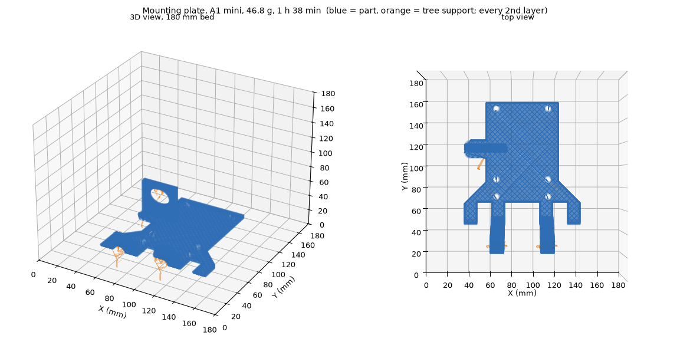

**Settings.** BambuStudio 02.06.00.51 CLI with the stock `Bambu Lab A1 mini
0.4 nozzle`, `0.20mm Standard @BBL A1M` and `Bambu PLA Basic @BBL A1M`
profiles, flattened with `flatten_bambu_profiles.py` (branch
`copilot/programmatic-access-bambu-h2d`). Changes from stock: textured PEI
plate (65 °C bed), 3 walls, 25 % infill. The mounting plate also uses
`tree(auto)` supports on the build plate only. Its two hinge knuckles start in
mid-air 27.9 mm up, and without supports the slicer warns about floating
regions. The supports are the orange trees in the preview. Printing the
gears and links on the same plate needs supports off, so they're in a
separate file.

**Starting a print.** In Bambu Studio, open the file, *Slice plate*, then
*Print plate*, pick Thumbelina, and map the filament to an AMS lite slot.
Studio slices the file again rather than sending the committed G-code, so
first check that the process preset shows as modified
(`* 0.20mm Standard @BBL A1M`) with the settings above (see
[below](#opening-the-files-in-studios-gui-22-oct-2026)). The mounting plate
is also on Thumbelina's storage as `doser1_mounting_plate.gcode.3mf`, so it
can be started from the touchscreen's file list, which runs the committed
G-code.

**Why an agent can't start it on its own (15 Oct 2026).** Thumbelina is on
firmware 01.08.00.00, which has Bambu's printer-control authorization. Over
LAN from the tailnet Pi, status reads, the camera, FTPS upload and the
chamber-light command all work. `print.project_file` comes back with
`err_code 84033543`, the unsigned-command rejection. A Bambu Cloud login
doesn't help, because starting a print from non-Bambu software is restricted
in cloud mode too. Two ways to unblock it: turn on **Developer Mode** on the
printer (Settings, LAN Only Mode / Developer Mode), or start jobs from Bambu
Studio, Handy or Bambu Connect.

## Opening the files in Studio's GUI (22 Oct 2026)

Bambu Studio 02.08.02.61 opens these files as projects and slices them
again. As first committed (`8254040`), they lost their changed settings
there. The GUI loaded the stock `0.20mm Standard @BBL A1M` with no
*modified* mark, so the plate had 2 walls, 15 % infill and no supports. Its
slice came to 36.1 g and 1 h 18 min, with a floating-regions warning for the
hinge knuckles. byu-vcl found the same cause
([runbook](https://github.com/vertical-cloud-lab/byu-vcl/blob/591fd92/bambu/studio/README.md#the-gui-resets-a-cli-projects-changed-settings)).
The flattened presets keep the stock preset's name, and
`different_settings_to_system` in `Metadata/project_settings.config` was
empty, so the GUI takes the stock preset of that name.

Both files now list their changes there, in the form Studio itself writes
when it saves a project:
- the plate: `enable_support;sparse_infill_density;support_on_build_plate_only;wall_loops`;
- the gears and links: `sparse_infill_density;wall_loops`.

Nothing else in the files changed, and the plate G-code is byte-identical.
With the patch, the GUI keeps the settings and its slices match the
committed ones:
- the plate: 46.78 g and 267 layers, against 46.77 g and 267;
- the gears and links: 19.20 g, against 19.20 g.

Studio estimates the plate at 1 h 36 min instead of 1 h 38 min because it
uses Bambu's stock acceleration limits, which byu-vcl also saw. The unpatched
file still opened as stock in the same session, so the patch is what keeps
the settings.

## Sending from an agent (22 Oct 2026)

An approved `@claude-print` run can send these. In a test run on PR #181,
Studio logged in on the runner with the password and an authenticator code
from `bambu-totp`, and no e-mailed code was needed. Both printers were on the
account, and Thumbelina was already selected. *Print plate* opened *Send
print job* with these defaults:
- "Thumbelina, the A1 Mini" and the PEI plate;
- PLA mapped to slot A3;
- timelapse off;
- bed levelling and flow calibration on.

The test closed the dialog without sending
([thread](https://github.com/vertical-cloud-lab/powder-doser/pull/181#issuecomment-6352282576)).

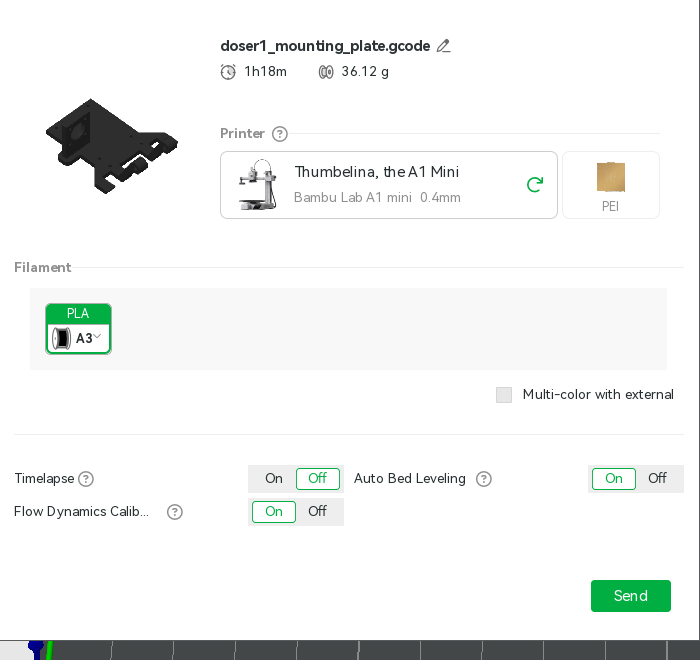

That screenshot is the unpatched file's slice, so it shows 36.12 g. Two notes
for the real send:
- The runner's default Azure apt mirror stalled for 25 min. Pointing
  `/etc/apt/apt-mirrors.txt` at `mirrors.edge.kernel.org` got Studio's
  packages in 4 s.
- The job name defaults to `doser1_mounting_plate.gcode`. It has no spaces,
  so it doesn't need renaming.

## First print: the mounting plate on Thumbelina (22 Oct 2026)

Requested on PR #181 with `@claude-print` ("Print a plate on the A1 mini")
and approved in `bambu-print`. "A plate" was taken to mean this mounting
plate, the file prepared for that request.

- **Setup.** Studio 02.08.02.61 from the AppImage. With the apt mirror
  switched as above, its packages installed in 51 s. byu-vcl's first-run
  steps and click positions held, including the login and authenticator
  boxes.
- **Login.** Studio asked for the authenticator code, not an e-mailed one,
  and the first code from `bambu-totp` worked (22:57 UTC). Thumbelina was
  already the selected printer.
- **Pre-flight, from Studio's Device page.** This run had no Pi or tailnet
  access, so the Device page was the only check.
  - Thumbelina was idle, with nozzle and bed at 23 °C, no HMS alerts and
    black PLA in slot A3.
  - The last job, `deck_key_fit_test`, showed *Finished*.
  - The live view at 23:03:27 UTC showed the plate clear. The gantry was
    parked high, so the camera looked down on the whole plate (frame
    below, with the room blurred).
  - A small red box sits on the bench behind the plate's corner. Something
    red is in the same place in byu-vcl's 2 Oct frames, from a 2.5 h print
    that finished normally.
- **Settings.** The GUI kept the patched settings
  (`* 0.20mm Standard @BBL A1M`, 3 walls, 25 % infill, `tree(auto)`
  supports on the build plate only). Its slice matched the committed one:
  46.78 g, 267 layers, 1 h 36 min.
- **Send print job.** Thumbelina, PEI plate, PLA → A3, timelapse off, bed
  levelling and flow calibration on.

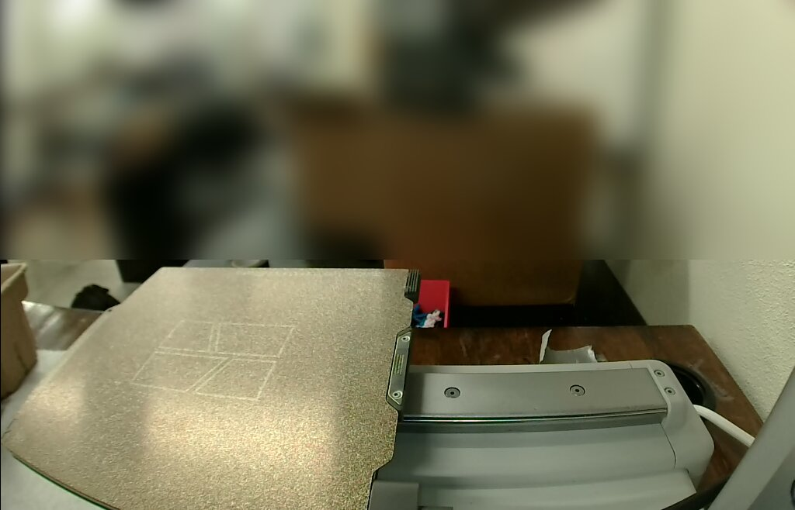

| UTC | Step |
|---|---|
| 23:04:25 | *Send* |
| 23:05:20 | Job downloaded; heating and loading PLA from A3 |
| 23:08:59 | Auto bed levelling |
| 23:10:05 | Flow dynamics calibration |
| 23:11:11 | Layer 1 of 267 |
| 23:16:52 | Layer 2. The first layer took 5.7 min |
| 23:38–23:52 | Layers 26–30, the slowest of the print at about 3 min each. They're the solid top of the 6 mm plate |
| 00:16:38 | Layer 142. The hinge knuckles start on their tree supports at layer 140 (28.0 mm) |
| 00:39:28 | *Finished*, 95 min after Send (Studio's estimate was 1 h 36 min). The last *Printing* read was at 00:38:44 |

While printing, the nozzle and bed stayed within 1 °C of their 220 and
65 °C targets. There was no HMS alert and no dialog. After the print, the gantry parked high and the camera showed the
finished plate from above.

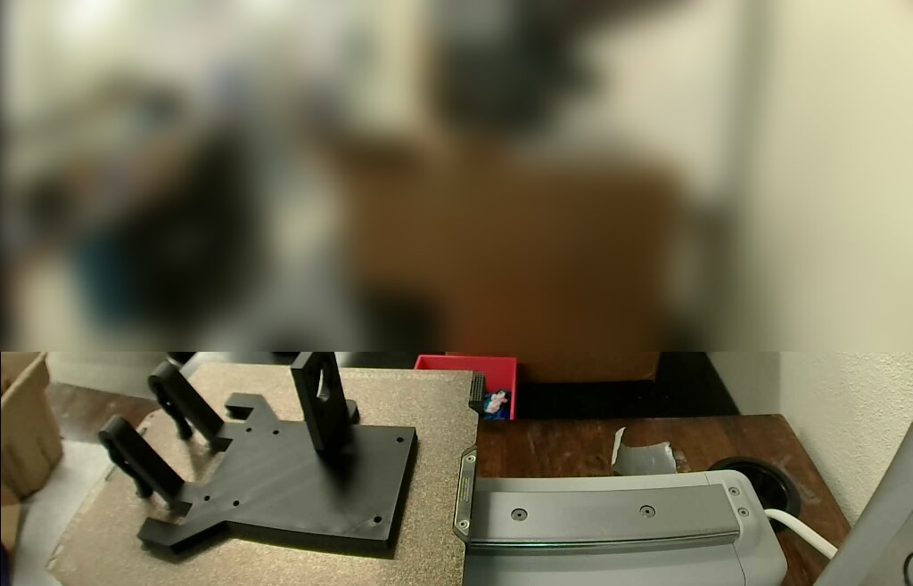

**What was sent.** At Send, Studio writes the 3MF it uploads to
`/tmp/bamboo_model/.../Metadata/.<pid>.0.3mf`. Its plate G-code was
byte-identical to Studio's slice, and its config block matched the
committed file's:
- 3 walls, 25 % infill;
- `tree(auto)` supports, on the build plate only;
- textured PEI at 65 °C, nozzle at 220 °C;
- 46.78 g, against 46.77 g committed.

The print was watched from the Device page. A copy of byu-vcl's
`watch_studio.py` with the A1 mini's screen regions read the screen every
10 s, saved a camera frame every 1–3 min and never clicked. On this layout:
- the nozzle temperature is at (1348, 160)–(1425, 192);
- the bed's is at (1348, 215)–(1425, 247).

Its finish check missed the end, because OCR read "100%" as "100«". Look for
*Finished* with both heater targets at 0 instead.

The run outlived the session's one-hour GitHub token.
`scripts/refresh_github_app_token.py` re-minted it from `/proc`, because
`claude-print.yml` has no stash step.

## Second batch: 25 augers on the H2D, doser #1's parts and caps on Thumbelina (23 Oct 2026)

Requested on PR #181 with `@claude-print`: "if the H2D is available, fill
the plate with whatever you can and print it. The A1 mini is free". Both
printers were idle with clear plates, so both got a full plate.

| File | Printer | Contents | PLA | Studio's estimate |
|---|---|---|---:|---:|
| [`doser_augers_x25_H2D.3mf`](doser_augers_x25_H2D.3mf) | H2D (Théoden) | 25 augers, 5 × 5 | 1,680 g | 1 d 15 h 35 min |
| [`doser1_parts_and_caps_A1mini.gcode.3mf`](doser1_parts_and_caps_A1mini.gcode.3mf) | Thumbelina | The rest of doser #1's A1 mini parts, plus 12 auger caps | 110.7 g | 5 h 32 min |

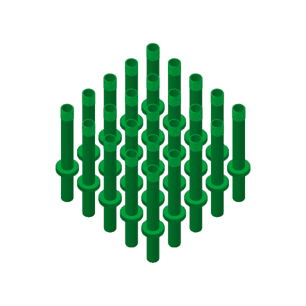 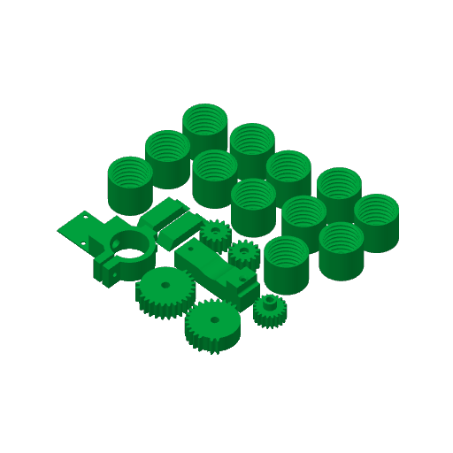

**What went on which plate.** All parts come from the PR #170 STEP
exports.
- **H2D: augers only.** The auger is the only current part too big for the
  A1 mini.
  - The baseplate is left out because the choice between the Fusion v2
    plate and William's Onshape stand is still open.
  - The brackets are left out because the rig's rear bracket is Sam's C-clip,
    which has no CAD file yet.
  - Twenty-five augers is one per doser for the 25 in PR #115.
- **Thumbelina: everything else doser #1 needs from the A1 mini:**
  - both 28T tilt gears and both links;
  - the tap collar and the tap-collar base;
  - both 14T servo pinions and the 20T stepper pinion;
  - 12 auger caps, one for doser #1 and 11 toward the 25.

  The mounting plate printed on 22 Oct. The brackets are still waiting on
  Sam's C-clip.

**H2D settings.**
- **Printer and profile.** Both nozzles were 0.6 mm hardened steel: the left
  is standard flow, the right TPU high flow (Studio's *Printer Parts*).
  Sliced on `0.24mm Balanced Strength @BBL H2D 0.6 nozzle` with
  `Bambu PLA Basic @BBL H2D 0.6 nozzle` (220 °C, textured PEI at 55 °C).
- **Changed from stock:** 3 walls, 25 % infill, `tree(auto)` supports on the
  build plate only, and a 5 mm outer brim. These five keys are listed in
  `different_settings_to_system`, so the GUI kept them.
- **Orientation.** Each auger stands on its outlet end, where the STEP has
  z = 0. That end is a near-solid 25 mm disc, against a 2 mm ring at the
  threaded end.
  - The 44T gear's underside is a flat ring 10.5 mm wide, 80 mm up, so it
    needs supports either way up. The tree supports come up from the bed
    around each tube.
  - The internal flight prints without supports, inside the tube.
- **Layout.** A 5 × 5 grid on a 60 mm pitch (14 mm between gears), centred
  at (162.5, 160) inside the left nozzle's 325 × 320 mm area. The arrange
  tool put only 15 per plate at its default spacing.
- **Layer height.** 0.24 mm, for the 3.5 mm-pitch cap thread and the flight
  overhangs. On its own, an auger slices to 2 h 00 min at 0.24 mm and
  1 h 39 min at 0.30 mm.
- **Labels.** Label each auger with its 6-character ID (#134) when it comes
  off the plate.

**Filament on the H2D.** The plate needs 1.68 kg, more than one spool, and
the black PLA in A2 isn't an RFID spool, so how much is left is unknown. A2
will run out partway through, and the H2D will pause until someone loads
more. To avoid the stop, load a second spool of the same black PLA into
empty slot A1 or A3, set to the same type and colour, so AMS auto-refill
takes over. The other PLA on that side (light blue in A4, pink on the
external spool) doesn't count as a backup, since auto-refill needs a match.

**Thumbelina settings.** The same as the mounting plate: stock A1 mini
`0.20mm Standard`, 3 walls, 25 % infill, and `tree(auto)` supports on the
build plate only, which only add support where a part needs it (31 s of
support in the CLI slice). Each part lies on the flat face with the least
overhang. The caps sit closed end down, with the thread going up.

**Pre-flight, from Studio's Device page.** There was no Pi, so these checks
used the Device page only.
- **H2D, 05:31 UTC:** idle, heaters off, plate clear. The only HMS entry was
  a maintenance reminder: "Please clean and lubricate the X-axis linear
  rail, YZ-axis linear rods, and the extruder lift linear rail." It doesn't
  block a print, but it is due.
- **Thumbelina, 05:37 UTC:** idle, no HMS alerts, and the 22 Oct mounting
  plate was off the bed.
- **Logins.** Studio logged in at 04:59 on the first authenticator code, with
  no e-mailed code.

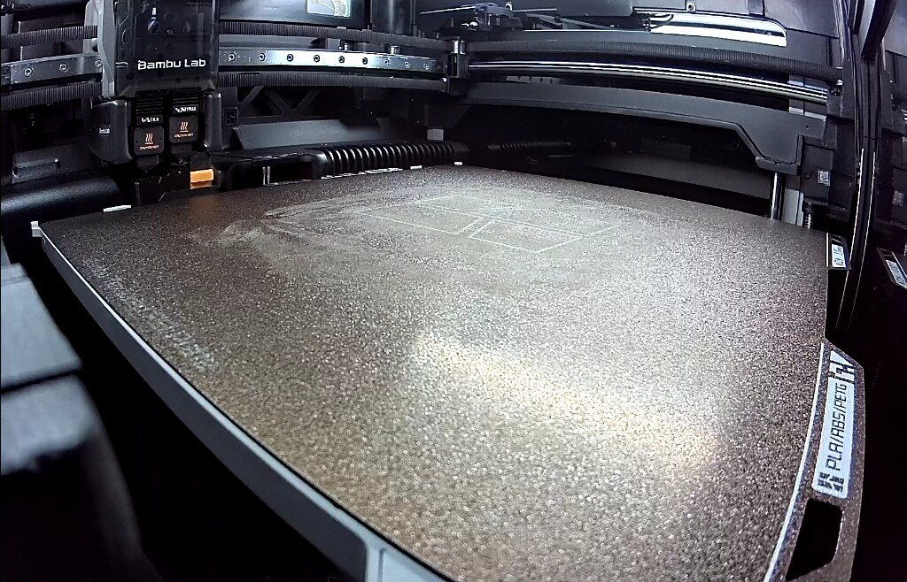

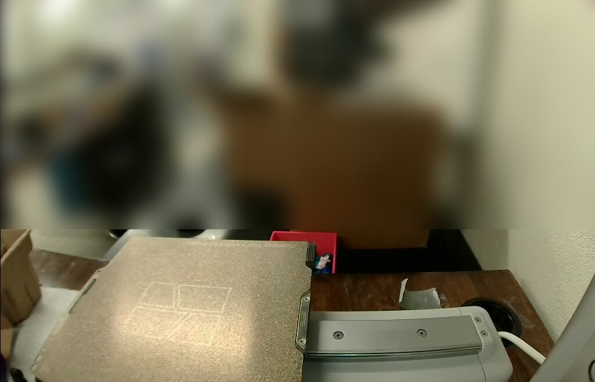

**Send.**
- **H2D:** PLA → A2 on the left nozzle; textured PEI; timelapse off; bed
  levelling and flow calibration on; nozzle offset calibration off. The H2D
  dialog defaults to timelapse on and to *Auto* for the two calibrations.
  Filament grouping was set to *Convenience mode*.
- **Thumbelina:** PLA → A3; PEI; timelapse off; bed levelling and flow
  calibration on. These were the dialog's defaults.
- **Driving the dialog.** With the 25-auger preview loaded, Studio used
  9 GB of RAM and redrew slowly under software GL. The dialog's toggles
  ignored `ui.py`'s smooth pointer moves, and plain
  `xdotool mousemove X Y click 1` worked.

| UTC | Step |
|---|---|
| 04:59 | Logged in |
| 05:18–05:27 | GUI slice of the 25 augers (9 min) |
| 05:33:25 | H2D *Send*; uploaded through the cloud by 05:34 |
| 05:38:35 | Thumbelina *Send* |
| 05:39:51 | H2D: nozzle at 221 °C, bed at 55 °C, calibrating dynamic flow |
| 05:41:52 | H2D: auto bed levelling |
| 05:46 | Both printers on layer 1. Thumbelina: nozzle 220 °C, bed 65 °C |
| 06:10 | Thumbelina: layer 4 of 135, every part's first layer flat |
| 06:13 | H2D: layer 2 of 1041. The first layer took about 27 min for 25 bases, their brims and the support pads |
| 06:58 | H2D: layer 14, all 25 tubes and their support rings standing |
| 07:04 | Thumbelina: layer 18 of 135, 24 % |
| 07:05 | Studio logged out, quit, and its config and cache deleted. Both prints left running |

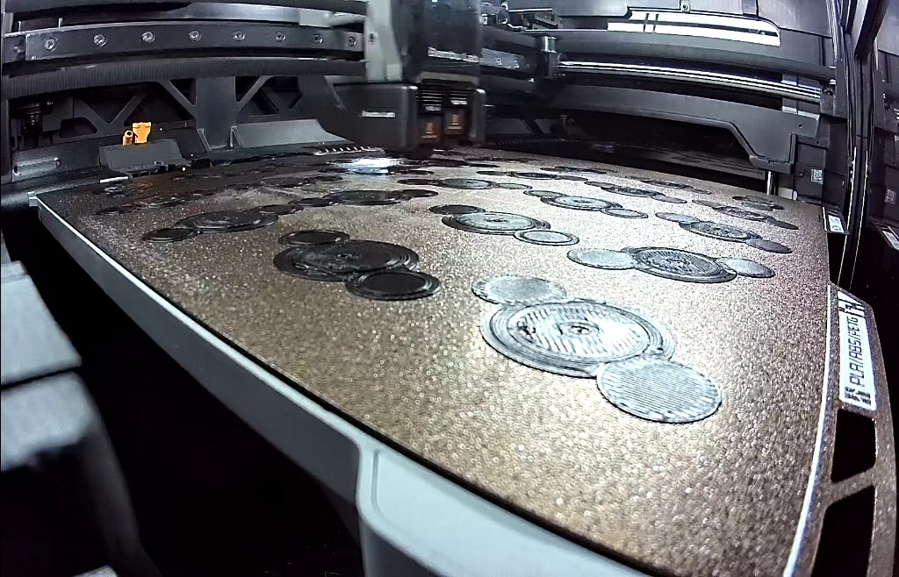

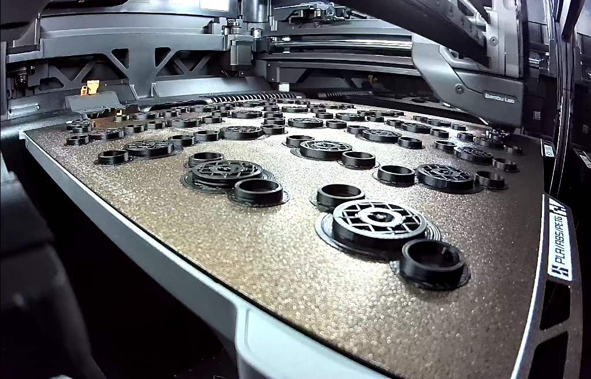

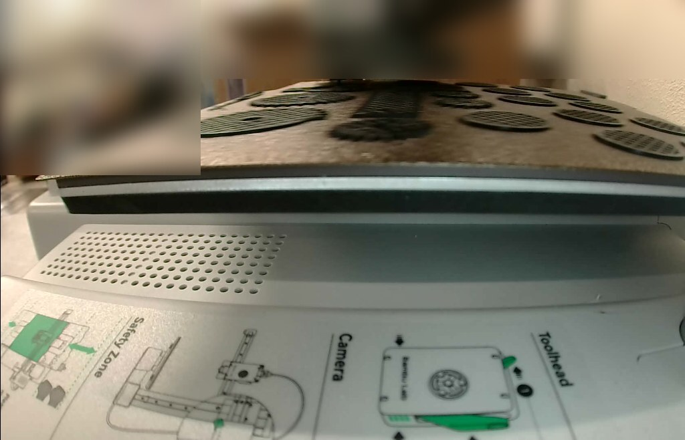

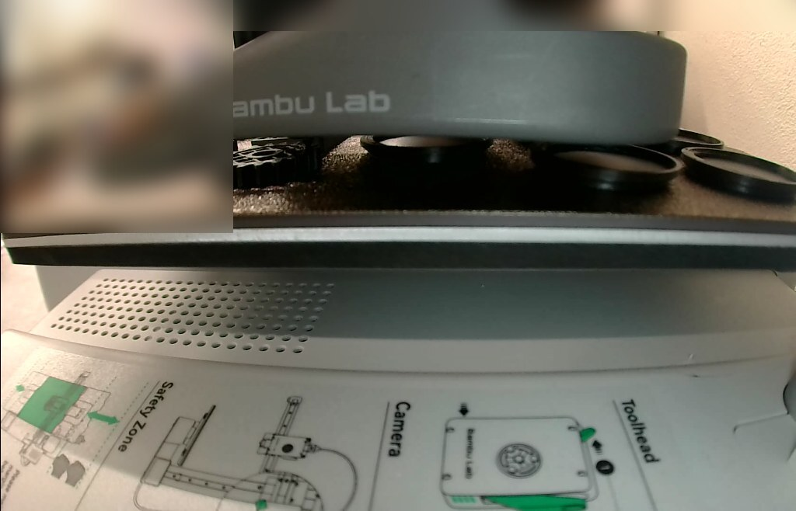

The H2D's camera sits low at the front left, so the near bases look large
and the far ones are foreshortened. Thumbelina's camera was level with the
bed during these layers.

While the session watched, there were no HMS alerts or dialogs, and both
nozzles and beds held their targets. The session's 180 min limit ends long
before either print does, so neither finish was watched. byu-vcl's
`watch_studio.py` read the Device page every 10 s, switching between the
two printers, and never clicked.

**Times to check on the H2D.** These come from the M73 progress marks in the
sent G-code, counted from the job's start at 05:35 UTC.
- **About 04:00 UTC Saturday** (22.5 h in), the 44T gears start at 80 mm,
  over their tree supports. If anything goes wrong there, it's most likely
  to show up then.
- **The filament runs out before the end** wherever it happens. By the gears
  the plate has used a little over 800 g.
- **About 21:15 UTC Saturday**, Studio's finish time if nothing stops it.

**What was sent.** In both sent files, the plate G-code is byte-identical
to Studio's slice:
- H2D: MD5 `8516b26f…`;
- Thumbelina: MD5 `5d9a502a…`.

The committed Thumbelina file is the one Studio uploaded, with the account's
`DesignerUserId` blanked. The H2D's uploaded file is 50 MB, so the project it
was sliced from is committed instead. Opening it in Studio and slicing gives
the same 1,680 g plate.

### The H2D paused at layer 75 (checked 23 Oct 2026, 23:15 UTC)

Read over LAN from the tailnet Pi in a plain `@claude` run: one MQTT status
read and one camera frame. Nothing was sent to the printer.

- `doser_augers_x25_H2D` is **paused at layer 75 of 1041** (11 %, 18 mm up).
  - Print error `0300-801E`: "The extrusion motor is overloaded, please
    check the Assistant for details."
  - HMS `0300_0900_0002_0001`: "The extrusion motor is overloaded. The
    extruder may be clogged or the filament may be stuck in the tool head."
  - The only other HMS entry is the rail-lubrication reminder from before
    the send.
- The nozzle had cooled to 40 °C and the bed was holding 55 °C, so the parts
  are still stuck down. The printer reported 2,096 min left of Studio's
  2,375, so the pause came about 4.7 h into the job, probably around
  10:15 UTC.
- The camera shows all 25 augers and their support trunks standing, with no
  spaghetti and nothing knocked loose.
- A likely cause is slot A2's black PLA, the spool without an RFID tag,
  reaching the end of its spool or tangling. A clog in the 0.6 mm nozzle is
  the other possibility.

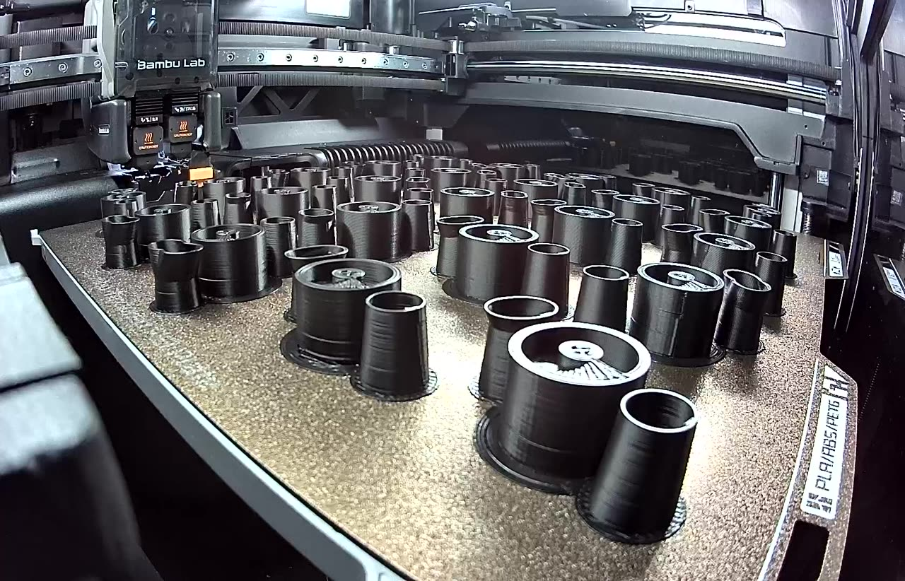

**Resumed about 23:35 UTC.** Someone at the printer heated the nozzle
(210 °C at 23:28) and resumed the job. At 23:37 it was *Printing* at
layer 75 with no error, the nozzle at 220 °C, and 2,093 min left. At that
rate it finishes around **10:30 UTC on Sun 25 Oct**, if nothing else stops
it. The AMS read afterwards:
- A2: black PLA, the active slot;
- A3: newly loaded blue PLA;
- A4: light blue PLA.

About 1.5 kg remains. If A2 can't supply that, the job will stop again,
because auto-refill only switches to a matching spool, and neither A3 nor
A4 is black.
