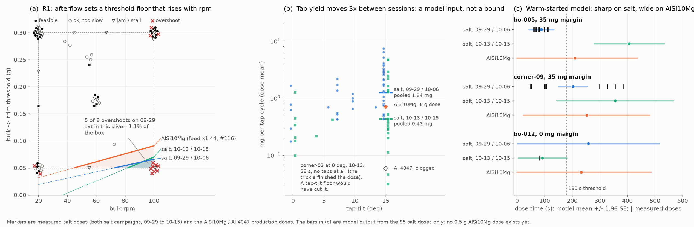

# Powder properties in the BO loop: an example for related powders

Asked in [PR #166](https://github.com/vertical-cloud-lab/powder-doser/pull/166): *how can
powder properties be integrated into the BO loop to reduce the search space for related
powders?* This folder works one example on the doses we already have (two salt campaigns,
the AlSi10Mg and Al 4047 production doses) and the pinned `ax-platform==0.4.3` template of
[`scripts/opt_campaign.py`](../../../scripts/opt_campaign.py). **It is an example only:**
the campaign loop is unchanged, and nothing was dosed.



*(a) The afterflow rule's floor on the bulk→trim threshold against bulk rpm, over every
salt campaign dose. (b) Mass per tap cycle against tap tilt, per dose. (c) What the
warm-started Ax model predicts for three salt points in each context (bars: mean ± 1.96 SE),
against the doses measured there (ticks). Every marker is a measured dose; the bars are
model output from salt data only.*

## The idea in three parts

1. **Measure a fingerprint.** These are a few numbers the doser itself measures, before a
   campaign and at the start of each session.
2. **Turn it into hard limits, but only where physics is unambiguous.** A limit removes
   points for good, so a wrong one can remove the optimum.
3. **Give everything else to the model as context inputs.** Earlier powders' and sessions'
   doses are attached with their own fingerprints, so the GP learns how outcomes move with
   the properties instead of us guessing.

## 1. The fingerprint

| | q20 (g/s) | q100 (g/s) | τ (s) | mg per tap cycle, 15° | lowest tilt that feeds | source |
|---|---|---|---|---|---|---|
| salt, 09-29 / 10-06 | 0.057 | 0.114 | 0.83 | 1.24 | every tilt in the box | 60 salt doses |
| salt, 10-13 / 10-15 | 0.012 | 0.119 | 0.83 | 0.43 | every tilt in the box | 35 salt doses |
| AlSi10Mg | 0.082* | 0.163* | 0.73 | 0.71 | ≤ 10° | its 8 g dose (09-29); *salt × the #116 feed ratio 1.44 |
| Al 4047 9fxeqt, clogged | 0.008* | 0.015 | 0.83* | 0.06 | 35° | its 09-30 doses; *estimated |

q20 and q100 are the bulk feed at 40° tilt and 20 or 100 rpm. Each is the trailing-2 s slope at
the bulk halt, which every RESULT stop event already records. τ is the existing
τ_afterflow fit. Mass per tap cycle is pooled over the `[phase 3 tap] cycle N` log lines.

**AlSi10Mg's feed comes from a powder property, not from AlSi10Mg doses.** It is salt's
times the ratio of the two powders' feed factors in the #116 battery (231 vs 161 mg/rev at
45°). Its own 8 g dose halted at 0.265 g/s, but only after 57 s of bulk at steady flow. A
0.5 g dose halts before the flow reaches that.

On a new powder the fingerprint is a short block before screening: about 10 minutes of
bulk at 40° (20 and 100 rpm) with three halts each, then 15 tap cycles at 15°.

## 2. Hard limits: the AlSi10Mg box

[`powder_box.py`](powder_box.py) applies two rules.

- **R1, afterflow.** The bulk halts `threshold + 38.5 mg` short of the goal. 38.5 mg is the
  median over the salt halts. After the halt about τ·Q(rpm) more arrives, with Q
  interpolated between q20 and q100. Keep `threshold + 38.5 mg − τ·Q(rpm) ≥ 10 mg`. That is
  one linear constraint, which Ax accepts as a parameter constraint. For AlSi10Mg:
  ```
  0.000737953*bulk_rpm - trickle_start_remaining_g <= -0.0171609
  ```
  So the threshold must be at least 32 mg at 20 rpm and 91 mg at 100 rpm, instead of the
  box's 50 mg everywhere. That removes 6% of the box. For salt it removes 1.1%: the floor is
  66 mg at 100 rpm.
- **R4, no feed.** Tilts below the lowest tilt that feeds come out of the box. For Al 4047
  with its clog, that leaves no trickle tilt at all (10–30° box, feeds only at 35° and
  above). The rule then says to search a bulk-only or bulk-tap dose instead, which is what
  landed it +0.95 mg on 09-30.

**Checked against every salt dose**, using salt's own fingerprint for each session group:

| | doses | overshoots | R1 would have skipped | of which overshoots | of which feasible |
|---|---|---|---|---|---|
| 09-29 campaign | 42 | 8 | 5 (`corner-04`, `-08`, `-11`, `-13`, `bo-004`) | 5 | 0 |
| 10-13 / 10-15 margin campaign | 35 | 5 | 4 (`corner-04`, `-08`, `-11`, `-13`) | 3 | 0 (the 4th was a tap-budget jam) |

- Across all 95 bulk halts, the bulk alone overshot the band 9 times, and R1 catches 8.
- The one it misses is `corner-00` on 09-29: a 144 mg slug at 20 rpm with bulk taps at 40°.
  The same settings ran clean on 10-13.
- The other overshoots are trickle slugs (30° trim tilt), which R1 does not target.

**R1 cuts few points but many doses.** It removes about 1% of salt's box, yet that sliver
held 5 of the 09-29 campaign's 8 overshoots. The 2⁸⁻⁴ screen puts 4 of its 16 corners
exactly at 100 rpm and a 50 mg threshold.

## 3. Context inputs: the warm start

[`ax_warm_start.py`](ax_warm_start.py) does it in Ax 0.4.3:

```python
from ax.service.utils.instantiation import FixedFeatures

ctx_params = [{"name": "ctx_log10_feed", "type": "range", "bounds": [-2.028, -0.984]},
              {"name": "ctx_log10_tap",  "type": "range", "bounds": [-0.467, 0.194]}]
# GenerationStep(model=Models.MOO or SAASBO, model_kwargs={"fit_out_of_design": True})
ax.create_experiment(parameters=full_box + ctx_params, objectives=...,  # same 180 s / 20 mg
                     immutable_search_space_and_opt_config=False)
for dose in salt_doses:                    # all 95, each with its session's fingerprint
    _, i = ax.attach_trial({**dose.params, **context(fingerprint[dose.session])})
    ax.complete_trial(i, raw_data=oc.ax_raw_data(dose.outcomes, jam=..., overshoot=...))
ax.experiment.search_space = ax.make_search_space(          # now narrow to AlSi10Mg's box
    parameters=alsi_box + ctx_params, parameter_constraints=[r1_constraint])
params, i = ax.get_next_trial(fixed_features=FixedFeatures(parameters=context(alsi)))
```

Two Ax 0.4.3 details matter here:

- **It refuses to attach a trial outside the search space.** So the experiment is created
  on the full box and narrowed after the data are in.
- **`fit_out_of_design=True`** keeps the 10 salt doses outside the AlSi10Mg box in the
  model. Ax just stops proposing points there.

**What the model learned (figure, panel c):**

- **It holds salt's two states apart.** `bo-005` at 35 mg is predicted at 88 ± 23 s on the
  well-fed sessions (measured median 78 s) and at 407 ± 65 s on the slow ones, where both
  real tries ran out of taps. `bo-012` at 0 mg is predicted at 92 ± 45 s on the slow
  sessions (measured 80 s). The 10-13 comparison was confounded because the model had no
  such input.
- **It does not know AlSi10Mg yet.** At AlSi10Mg's fingerprint every point is 210–260 s ±
  115–130 s. One powder seen in two states can't tell the model how outcomes change between
  powders. That takes a few AlSi10Mg doses, or campaigns on more powders (the multi-task
  plan in [`../tms-2027`](../tms-2027/README.md)).
- **Its first three asks** (qNEHVI, 45 s on the CI runner) all sit inside the AlSi10Mg box.
  They are exploration, not predictions of a good point:
  - 35° bulk tilt, 42 rpm, 0.3 g threshold, 35 mg margin
  - 35° bulk tilt, 20 rpm, 0 mg margin, tap tilt 0°
  - 20° bulk tilt, 79 rpm, 0 mg margin
- **Context can't undo a confounded design.** Every 0 mg dose ran on a slow day, so the
  model cannot say what 0 mg does on a well-fed day (259 ± 131 s). A same-day crossing can.

## 4. What should not become a bound

- **Tap tilt.** At 0.2–0.6 mg per cycle, tap tilt 0° looks hopeless. Yet the margin
  campaign's fastest dose, `corner-03` (28 s), ran there: its trickle finished the dose
  without a single tap. A tap-tilt floor would have cut it, so tap yield is a context input
  instead.
- **A box drawn around the related powder's good points.** This is the usual
  transfer-learning way to shrink a search space. The 44 feasible salt doses touch both
  ends of every knob's range, so for salt it would return the whole box.

## 5. What it would take in `opt_campaign.py` (not done)

1. A fingerprint block before screening, stored in the powder file next to τ.
2. `parameter_constraints` from R1 in `create_experiment`, with the screening corners that
   violate R1 moved onto the constraint line. The 2⁸⁻⁴ corners assume a rectangular box.
3. The two `ctx_` parameters and `fixed_features` in `_open_ax_trial`, plus
   `fit_out_of_design=True`.
4. Attaching related powders' doses with their fingerprints. This is the same mechanism as
   the margin campaign's `--warm-start`, extended across powders.

## Run it

```bash
python docs/optimization/powder-transfer/powder_box.py --json docs/optimization/powder-transfer/boxes.json   # stdlib only
python docs/optimization/powder-transfer/ax_warm_start.py --powder AlSi10Mg    # ax-platform==0.4.3; --model saasbo for the campaign default
python docs/optimization/powder-transfer/make_powder_transfer_figure.py         # matplotlib
```

[`boxes.json`](boxes.json) holds the fingerprints, boxes, the retrospective and every bulk
halt's predicted vs measured afterflow. [`ax_warm_start.json`](ax_warm_start.json) holds
the asks and predictions.
