# Citation network of El Kassem et al. (2021), the closest auger-dosing precedent

Asked on PR #196 (23 Nov 2026): a web search for the TMS 2027 abstract's title turned up

> B. El Kassem, N. Salloum, T. Brinz, Y. Heider, B. Markert, "A Semi-Automated DEM Parameter Calibration
> Technique of Powders Based on Different Bulk Responses Extracted from Auger Dosing Experiments",
> *KONA Powder and Particle Journal* 38 (2021) 235–250, [doi:10.14356/kona.2021010](https://doi.org/10.14356/kona.2021010)
> (RWTH Aachen and Robert Bosch Packaging Technology; CC BY 4.0).

This folder maps who it builds on and who cites it, reads it and its open-access neighbours in a headed Chrome
whose traffic leaves through the doser Pi, keeps crops of the key figures, and asks Edison (q12, q13) what is
left new for our paper.

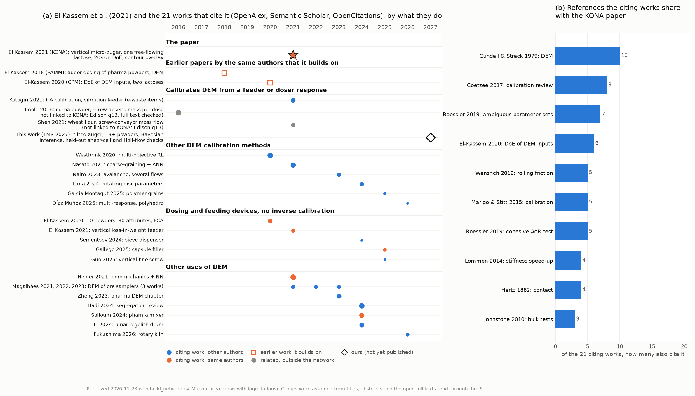

## In short

- **It is the closest precedent found so far, and it is close.** The authors use a vertical micro-auger dosing
  rig as a "standard calibration device" for DEM. Three bulk responses come out of one dosing run: the mass flow
  rate at 400, 600 and 800 rpm, the angle of repose of the heap the doser builds in its catch cup, and the bulk
  density. They fit three DEM friction coefficients from these.
- **What it does not do** is most of what our abstract adds:
  - one free-flowing lactose only; cohesive powders are named as future work;
  - no cohesion in the contact model, no tilt, no tapping;
  - a 20-run design of experiments and regression, read off overlaid contour plots, with no uncertainty;
  - "validation" re-checks the same responses it was fit to, not held-out tests;
  - no optimization of the doser itself, and no AM or metal powders.
- **The network is small and mostly about calibration method.** 21 works cite it (OpenAlex; J-STAGE lists
  13 unique). Five are by the same authors. None of the other 16 calibrates several powders from a doser's
  response with uncertainty and checks the result on tests held out of the fit. The nearest is Katagiri et al.
  (2021), who calibrate DEM from a vibration feeder's response by a genetic algorithm, for e-waste items rather
  than powders.
- **The same group's 2020 paper is a second precedent**, for run 33 rather than for the DEM: ten pharmaceutical
  powders, 30 measured material attributes (shear cell and empirical tests), three augers at three speeds, reduced
  by PCA to six components. It measured the properties on its own lots, which is what
  [`SAME_JAR.md`](../runs/heldout-powders/SAME_JAR.md) asks for.
- **It is not the only one.** Edison q13 found two more papers that fit DEM to a screw's own output, and the
  full text confirms the first: Imole et al. (2016) chose friction and cohesion for cocoa powder to match their
  screw doser's mass per dose, and Shen et al. (2021) fit wheat flour's surface energy and friction to
  screw-conveyor mass flow. All three are single-powder, deterministic, and checked only on the same device.
- **For the abstract and the paper:** cite El Kassem 2021 and Imole 2016 at least, and drop any claim that using
  a doser or feeder to calibrate DEM is new. Both Edison answers land on the same defensible claim: the
  combination of
  - many powders, cohesive and metallic ones included;
  - inference from a richer fingerprint (tilt, taps, afterflow, no-flow events), with posterior uncertainty and
    identifiability checks;
  - validation on tests held out of the fit;
  - the same doser's settings optimized by multi-task BO.

## What the KONA paper did

| | El Kassem et al. 2021 |
|---|---|
| Rig | Vertical micro-auger (outer diameter 5.8 mm, inner 3 mm, pitch 4.5 mm, 67 mm³ per revolution) in a 45° stainless-steel funnel with a 6 mm outlet; 6 g of powder; Mettler XPE 204 balance logging every 0.2 s; an ioniser against static |
| Powder | SpheroLac 100 lactose: free-flowing, D[4,3] 115 µm, aspect ratio 0.75 |
| Measured | Mass flow rate at 400, 600 and 800 rpm (0.257, 0.374 and 0.507 g/s); angle of repose of the dosed heap (33.2–33.4°); bulk density in a separate glass tube (0.758 g/cm³) |
| Simulator | LIGGGHTS-Premium 4.x; Hertz–Mindlin with EPSD2 rolling resistance; no cohesion; grains coarse-grained 6× to 690 µm (22,705 particles); particle modulus lowered to 26 MPa; a 64-CPU cluster |
| Varied | Auger speed, particle–particle sliding friction (0.3–0.8), particle–wall sliding friction (0.1–0.4), particle–particle rolling friction (0.1–0.7), each at 3 levels |
| Design and fit | Quadratic D-optimal design, **20 DEM runs**; multivariate regression in Cornerstone (adjusted R² 0.975–0.998) |
| Calibration | Contour plots of the three predicted responses over sliding × rolling friction, superimposed; the admissible region is μ<sub>r,pp</sub> 0.1–0.2 with μ<sub>s,pp</sub> 0.34–0.5; Cornerstone's optimizer then picks one set per speed |
| Validation | 3 confirmation runs (one per speed) reproduce the 4 calibration responses within 2.86 % (mean 0.87 %); no test outside the fit |
| Main sensitivity finding | Rolling friction dominates the AoR in the auger setting; wall friction dominates the mass flow rate |
| Stated future work | "More material properties and bulk behaviors", and "extended to cover cohesive powders" |

A detail worth knowing: the three confirmation runs use three different parameter sets (Table 7). At 400 and
800 rpm the sets are close (μ<sub>s,pp</sub> 0.52 and 0.51, μ<sub>r,pp</sub> 0.1, μ<sub>s,pw</sub> 0.375 and
0.347), but at 600 rpm the optimizer picked μ<sub>s,pp</sub> 0.313 and μ<sub>r,pp</sub> 0.32. One powder got
speed-dependent "calibrated" parameters, which is the non-identifiability that run 29 found for the tilt sweep
and an argument for one joint, uncertainty-aware fit across all conditions.

### Key figures (cropped from the CC BY 4.0 PDF; © the authors, published by the Hosokawa Powder Technology Foundation)

| | |
|---|---|
| 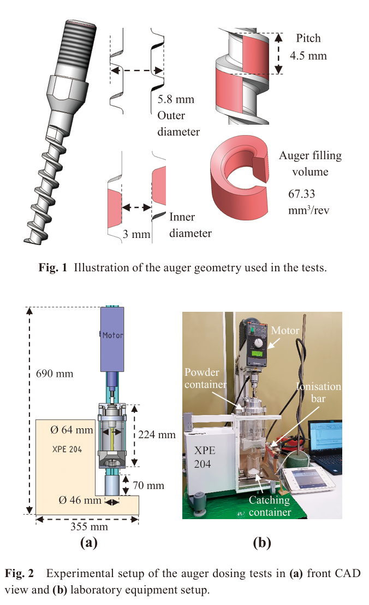 | 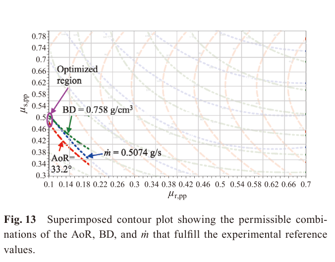 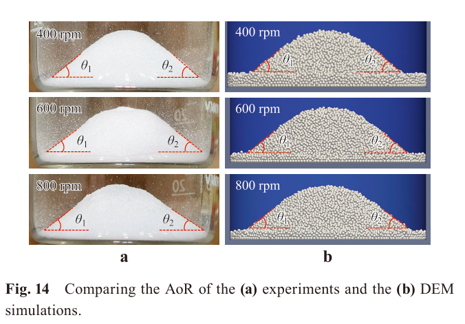 |
| Figs. 1–2: the auger and the dosing rig | Fig. 13: the superimposed contours that leave a small admissible region. Fig. 14: the dosed heap, experiment and DEM, at the three speeds |

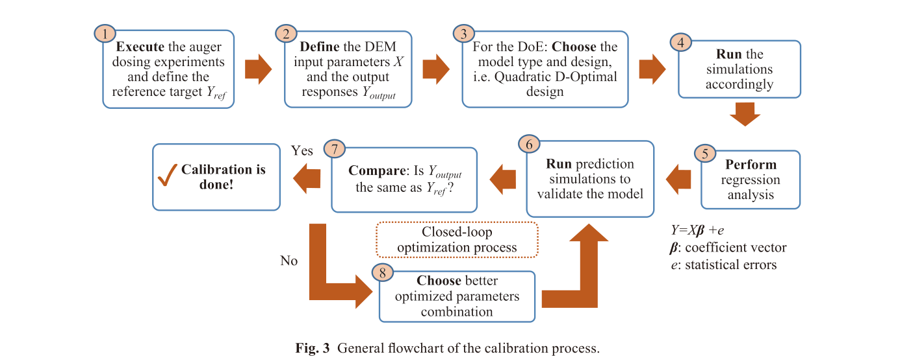

*Fig. 3: their calibration loop.*

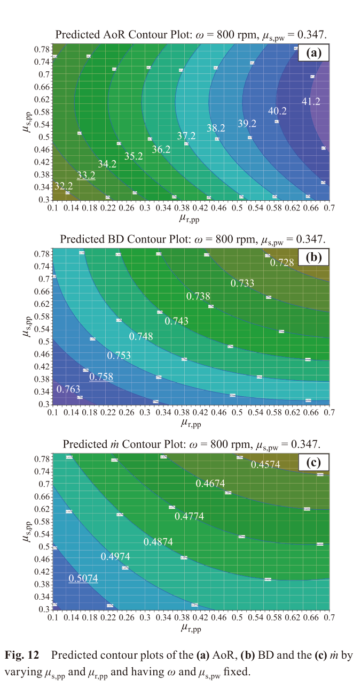 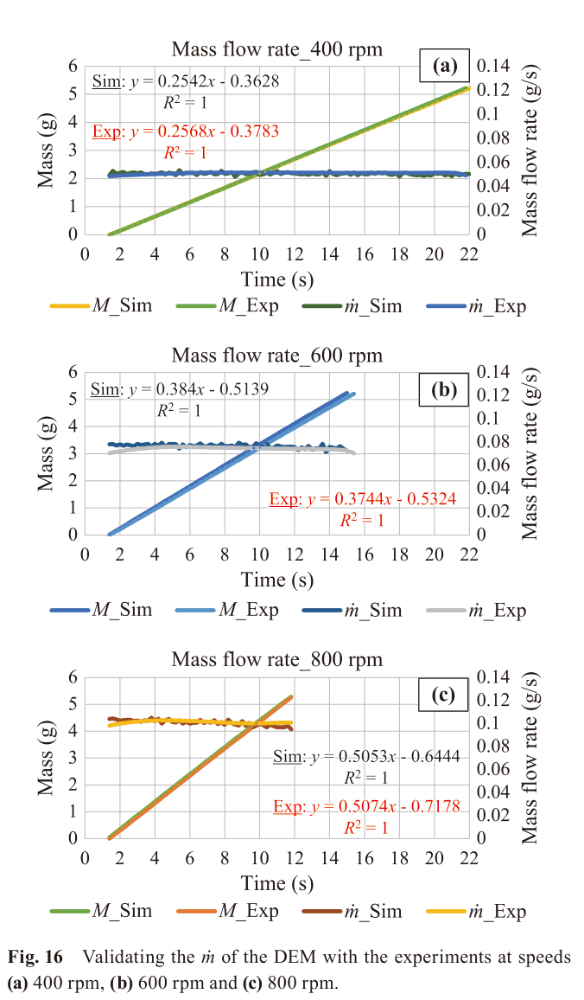

*Fig. 12: predicted AoR, bulk density and mass flow over sliding × rolling friction, at 800 rpm. Fig. 16: mass
over time, DEM against experiment.*

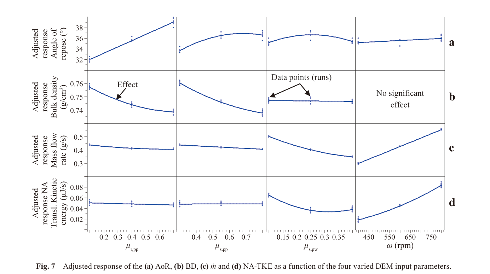

*Fig. 7: how each response moves with each input (adjusted response graphs).*

The predecessor the KONA paper relies on most (cited again by 6 of its 21 citing works) is the group's
*Computational Particle Mechanics* paper (El-Kassem et al. 2021, 8:87–111, CC BY 4.0). It runs the same
design-of-experiments approach on a funnel angle-of-repose test for a free-flowing and a cohesive lactose, with
SJKR cohesion energy density as a sixth input:

| | |
|---|---|
| 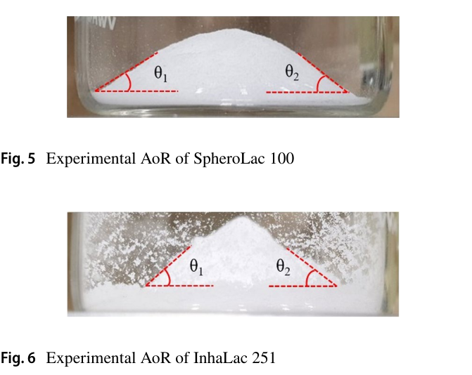 | 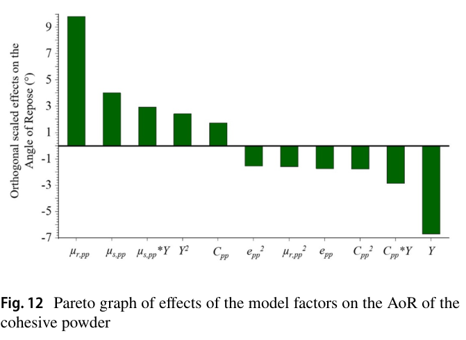 |
| Figs. 5–6: measured heaps, free-flowing SpheroLac 100 and cohesive InhaLac 251 | Fig. 12: for the cohesive powder, rolling friction moves the AoR most |

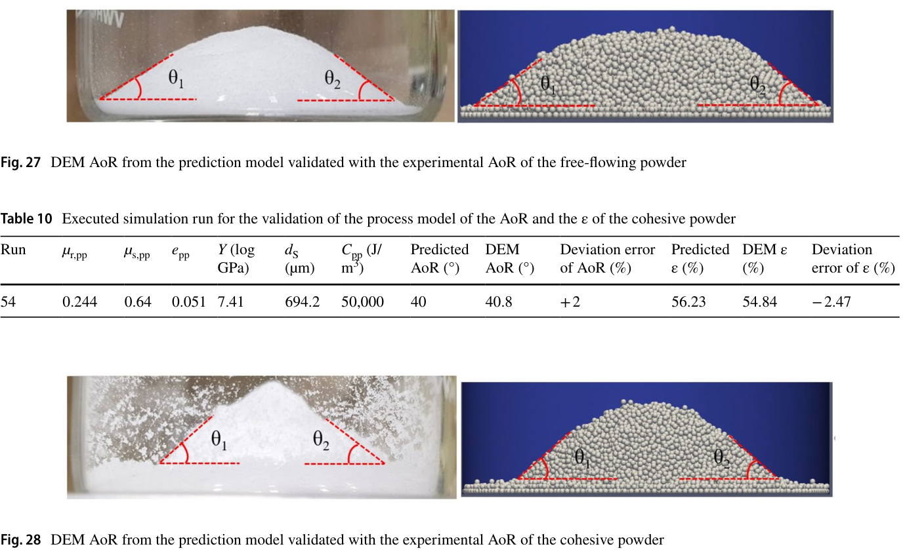

*Figs. 27–28: AoR from the calibrated DEM against experiment, free-flowing and cohesive (C<sub>pp</sub> = 50 kJ/m³).*

## How it compares with our plan

| | El Kassem et al. 2021 (KONA) | This project (TMS 2027 abstract, PR #184, this PR) |
|---|---|---|
| Device | Vertical micro-auger in a steel funnel, 400–800 rpm | 3D-printed auger in a tube tilted 0–45°, 15–100 rpm, solenoid tapping, closed-loop trickle and taps |
| Powders | 1, free-flowing lactose | 13 in Sam's battery (salt, AlSi10Mg, Si, salts, biopolymers, fumed silica), then alloy precursors and AM feedstocks |
| Data from the doser | Mass flow at 3 speeds, plus the heap's AoR and a separate bulk density | Fingerprint: mg/rev against tilt and speed, release per tap, afterflow, no-flow fraction; closed-loop dose time and error |
| Contact model | Hertz–Mindlin, EPSD2 rolling, no cohesion, 6× coarse-grained | Hertz–Mindlin, SJKR cohesion, constant-directional-torque rolling, real-size salt grains (#180) |
| Inference | DoE + regression + contour overlay; one point estimate per speed | Emulator + MCMC posterior with a discrepancy term; identifiability checks (runs 28–29, Edison q10) |
| Validation | The same responses it was fit to | Tests held out of the fit: shear cell, Hall/Carney, tapped density, spreading (runs 2–7; #205) |
| Optimizing the device | None | Multi-objective, multi-task BO of 8 controller settings (salt: 42 doses, #166) |
| Property ↔ dosing statistics | In the 2020 JDDST paper: 10 powders, 30 measured attributes, PCA | Runs 32–33 on 12 powders with handbook labels; same-jar measurements planned |

Two things in their rig line up with our plans: the angle of repose read off the heap the doser itself builds
(their Fig. 14; test 1 in #205 and the stand William is building), and bulk density from a filled glass tube
(test 2 in #205).

## The citation network

[`network.json`](network.json) has every node and edge; [`citing_works.md`](citing_works.md) lists the citing
works with DOIs, open-access status and citation counts.

- **Backward (54 references).** Screw-conveyor DEM (Owen & Cleary 2009; Moysey & Thompson 2005; Fernandez
  2011; Roberts 1999), DEM calibration (Coetzee 2017 review; Roessler et al. 2019 on ambiguous parameter sets
  and the drawdown test; Marigo & Stitt 2015; Johnstone 2010; Zhou 2002; Yan 2015), rolling resistance (Ai 2011;
  Iwashita & Oda 2000; Wensrich & Katterfeld 2012), speed-ups (Lommen 2014 on stiffness; Bierwisch 2009 on
  coarse-graining), and the group's own PAMM 2018 and CPM papers. It compares itself with Roessler et al.: 20 DEM
  runs against their 384.
- **Forward (21 citing works, 2020–2026)**, grouped in panel (a) of the figure:
  - *Calibrates DEM from a feeder's response:* Katagiri et al. 2021 (*Materials Transactions*), a multi-objective
    genetic algorithm on a vibration feeder for e-waste items, with simulation cost as the second objective.
  - *Other calibration methods (6):* multi-objective reinforcement learning (Westbrink 2020), coarse-graining with
    a neural network (Nasato 2021), avalanches (Naito 2023), a rotating disc (Lima 2024), LDPE grains with four
    tests and a genetic algorithm (García Montagut 2025), polyhedral pharmaceutical granules with multi-response
    optimization (Díaz Muñoz 2026). All deterministic, one material each.
  - *Dosing and feeding devices (5):* the group's 10-powder auger study (2020) and vertical loss-in-weight feeder
    (2021), a capsule filler (Gallego 2025, with Salloum and Brinz), a sieve dispenser (Sementsov 2024) and a vertical
    fine screw (Guo 2025). None calibrates DEM from the device.
  - *Other DEM uses (9):* ore samplers (three works by Magalhães et al.), reviews, a pharmaceutical mixer, a
    lunar-regolith drum, a rotary kiln, and a poromechanics paper by one of the authors.
- **Same authors: 5 of 21.** El Kassem 2020 (JDDST) and 2021 (vertical LiW feeder), Heider 2021, and Salloum
  and Brinz 2024 and 2025 (mixers and capsule filling, with TU Hamburg and Magdeburg). No later paper by the
  group extends the auger calibration to cohesive powders, as far as the indexes show.
- **What the citing works share (panel b).** The KONA reference most often cited again is Cundall & Strack
  (10 of 21), then Coetzee's calibration review (8) and Roessler et al. on ambiguous parameter sets (7). The
  network is a calibration-methods network, not a feeder or dosing one.
- **One step further out.** Works that cite the group's other papers add a few that matter here: Cao et al.
  2024 (*Pharmaceutics*), the material-library sample-size study behind Edison q11's "about 20 materials";
  Kruppa et al. 2022, closed-loop screw dosing with an inline density sensor; and several surrogate- or
  ML-based calibration papers (CPM 2023, *Powder Technology* 2025), listed under `group_papers` in
  [`network.json`](network.json).

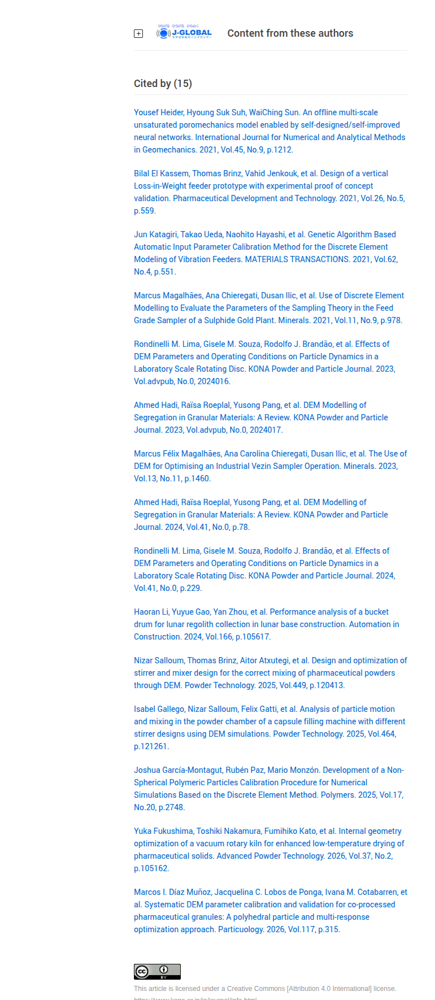

*J-STAGE's own "Cited by (15)" list, read through the Pi on 23 Nov 2026. Two KONA papers appear twice
(advance and issue versions), so it lists 13 distinct works, all among the 21 above.*

## What Edison adds

Both tasks succeeded (sent 23:25 UTC, done by 23:46): [q12 answer](../edison/q12_kona_citation_network.answer.md)
(LITERATURE_HIGH, citation network) and [q13 answer](../edison/q13_precedent_after_kona.answer.md) (PRECEDENT),
with full task records beside them.

- **q13, precedent after KONA: "No", qualified.** Edison found no study that infers DEM or continuum contact
  parameters mainly from screw or auger dosing for several powders, with Bayesian uncertainty, then tests them on
  shear, Hall/Carney, density or spreading measurements left out of the fit. It is firm that **calibrating DEM to
  doser output is not new**: besides El Kassem, it names
  - Imole et al. 2016 (*Powder Technol.*, doi:10.1016/j.powtec.2015.07.052): cocoa powder, mass per dose of a
    screw doser. We re-read §5.2 of the arXiv version through the Pi: friction and cohesive stiffness were swept,
    several pairs matched 3.70 g/dose, and the lowest cohesion was chosen, then checked against dose time, speed
    and pitch on the same rig. This corrects an earlier line in [`../LITERATURE.md`](../LITERATURE.md).
  - Shen, Li & Xu 2021 (*J. Eng.*, doi:10.1155/2021/6671511): wheat flour, JKR surface energy and two friction
    coefficients fit to screw-conveyor mass flow by response surfaces, within 3 % at 60–140 rpm. Not read here:
    the Wiley PDF link could not be clicked through the Pi.

  The reverse direction also exists: Tekeste et al. 2018 calibrated corn on angle-of-repose tests and validated
  on a commercial auger; Gómez et al. 2024 calibrated on FT4 and a drum and validated on a feeder. Bayesian DEM
  calibration exists too (Cheng et al. 2019, GrainLearning), and so does a failed transfer of
  consolidation-calibrated metal-powder parameters to spreading (Katagiri et al. 2025).
- **q12, the network.** Its summary of the KONA paper agrees with ours in every number checked. It adds the
  first author's RWTH Aachen dissertation, *Machine design for auger dosing of powders by utilizing DEM
  simulations and analysis* (2021; no DOI, not in OpenAlex), which Kruppa et al. 2022 cite. It found no later
  paper by the group extending the auger calibration to cohesive powders, inverse identification or AM. Its
  forward-citation table mixes verified citers with "network-adjacent" papers it could not confirm, so use the
  open-index list above for who actually cites the paper.
- **q12, claims to keep.** It marks these as not found in the network:
  - the tilt sweep, tap release, afterflow and no-flow fraction, alone or as one fingerprint;
  - a fingerprint over 13 or more powders on one device;
  - Bayesian inference from an auger's response;
  - held-out shear-cell and Hall/Carney checks;
  - doser-inferred properties linked to spreading;
  - multi-task BO of the controller across powders, in an open-source, self-driving setup.
- **q12, claims to drop or soften.**
  - First use of an auger as a DEM calibration device (El Kassem 2021).
  - First multi-response calibration (Roessler et al. 2018; El Kassem 2021).
  - First Bayesian DEM calibration (Cheng et al.).
  - First closed-loop powder dosing (Kruppa et al. 2022, inline density sensing on a screw doser).
  - First DEM calibration of AM powders (Meier 2019, Girnth 2024, Sani 2026).
  - A blanket "parameter-free" for the salt twin's 105 mg/rev: list which inputs came from where instead.
- **q12's three closest papers:** El Kassem 2021 (KONA), El-Kassem 2020 (CPM, SJKR cohesion on AoR tests), and
  Sani et al. 2026 (*Prog. Addit. Manuf.*), who calibrate Inconel 718 and Ti-6Al-4V on a rotating drum with
  surrogate models.
- **Advice both answers give:** call the inferred values *effective*, device- and wall-material-dependent
  parameters, not intrinsic properties. Model the no-flow fraction as a count or censored response. Say
  "evaluate the association with spreadability" unless a real spreading test is held out. And show by ablation
  that the extra fingerprint components (tilt, taps, afterflow) add information beyond mass flow.

## Files

| File | What |
|---|---|
| [`build_network.py`](build_network.py) | Pulls the focal paper, its references and its citing works from Crossref, OpenAlex, Semantic Scholar (with citation contexts) and OpenCitations; merges by DOI; adds the group's other papers and co-citation counts. Writes `network.json` and `citing_works.md` |
| [`plot_network.py`](plot_network.py) | The figure above |
| [`pi_snapshots.py`](pi_snapshots.py) | Opens each paper's landing page in headed Chrome through the doser Pi (reusing [`../fulltext/fetch_fulltexts.py`](../fulltext/fetch_fulltexts.py)), screenshots it, and takes the PDF from the click |
| [`manifest.json`](manifest.json) | URL, bytes, sha256 and time of every PDF read. The PDFs are not committed |
| [`extract_figures.py`](extract_figures.py) | Crops the figures above from the two CC BY PDFs |
| [`figures/`](figures/), [`snapshots/`](snapshots/) | The crops, and screenshots of the J-STAGE page |

## How it was read

- **Open indexes, from the runner:** Crossref, OpenAlex, Semantic Scholar and OpenCitations, with a generic
  User-Agent and no credentials. They disagree on the count (Crossref 15, Semantic Scholar 14, OpenAlex 21);
  the union is 21.
- **Through the doser Pi:** `../fulltext/pi_socks.sh` opens a SOCKS5 tunnel; the tunnel's exit network is BYU.
  The Pi was idle (no rig session since 20 Nov; load 0.00), and nothing was installed or written on it. Chrome
  ran headed under Xvfb on the runner, throttled to 400 kB/s; the pointer moved to each PDF link and clicked it.
- **Read:** the KONA paper (9.6 MB), the group's CPM paper (5.6 MB, Springer's attachment download after
  declining optional cookies), Katagiri et al. 2021, García Montagut et al. 2025, and Imole et al.'s arXiv
  version (to check Edison q13). Two failed: Guo et al. 2025 (no PDF link found on the landing page) and Shen et
  al. 2021 (Wiley's PDF link was not clickable). Only open-access papers were opened; for the others we rely on
  abstracts and Edison.
- **Committed:** crops of figures from the two CC BY 4.0 papers, with the attribution above. Nothing from
  Katagiri et al. (free to read, but no open licence).

## Rerunning

```bash
cd docs/physics-simulations/citation-network
python build_network.py /tmp/kona/api && python plot_network.py
../fulltext/pi_socks.sh && xvfb-run -a python pi_snapshots.py        # needs the tailnet and the Pi
python extract_figures.py /tmp/kona/pdf
cd .. && python edison/run_queries.py fetch q12_kona_citation_network q13_precedent_after_kona
```
