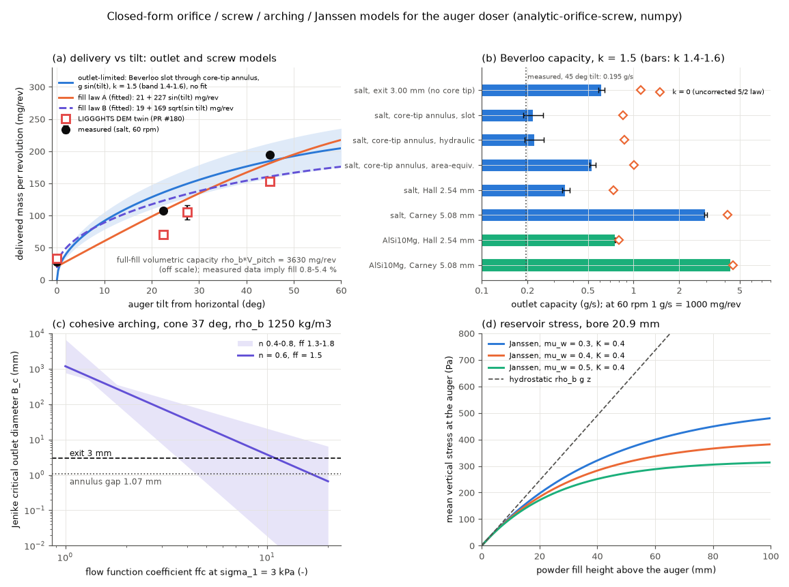

# analytic-orifice-screw: closed-form orifice, arching, Janssen and screw models

## What it models and why it matters here

Four textbook reduced-order models applied to the doser's actual geometry and the salt, as a zero-cost baseline for the DEM twin and for the paper's "dosing response as a probe of powder flow" argument:

1. **Orifice discharge** (Beverloo et al. 1961, with the empty-annulus correction `k d`; and the uncorrected 5/2-power law, `k = 0`, the scaling Hagen first reported in 1852, English translation Tighe & Sperl 2007) for the Ø3 mm exit, the annulus left by the core's conical tip, and the Hall (2.54 mm, ASTM B213) and Carney (5.08 mm, ASTM B964) funnels.
2. **Jenike critical outlet for cohesive arching** in the 37° half-angle cone, for flow functions with ffc = 1-20.
3. **Janssen stress saturation** in the 20.9 mm bore (what consolidation stress the powder at the auger sees).
4. **Screw-conveyor volumetric model**, mass/rev = ρ_bulk × fill fraction × swept volume per pitch, with an explicit tilt-dependent fill law, against the measured mg/rev vs tilt and the LIGGGHTS DEM twin (PR #180).

## Code and version

Custom Python script [`run.py`](run.py): Python 3.12.3, numpy 2.5.4, scipy 1.18.1, matplotlib 3.11.2. No external solver.

## Setup

- **Salt**: ρ_p = 2165 kg/m3, d50 = 0.425 mm (sensitivity 0.36-0.49 mm), **assumed flowing bulk density ρ_b = 1250 kg/m3** (sensitivity 1200-1300), internal friction 34°.
- **AlSi10Mg** (Hall/Carney rows only): d50 = 35 µm, **assumed** apparent density 1350 kg/m3 (about half of 2670).
- **Beverloo**: W = C ρ_b √g (D − k d)^2.5 with C = 0.58, k = 1.5 (band 1.4-1.6). Common literature values (Beverloo et al. 1961; Nedderman 1992).
- **Core-tip annulus**: inner radius 0.43 mm, outer 1.5 mm at the exit plane, so the gap is b = 1.07 mm = 2.52 d50. Three treatments:
  - *slot* (main): the annulus unrolled into an endless slot, W = C_s ρ_b √g L (b − k d)^1.5, C_s = 1.03 (slot coefficient, Nedderman 1992 / Myers & Sellers 1971), L = π(r_i + r_o) = mean circumference, no end correction;
  - *hydraulic*: Beverloo written as W = (4C/π) ρ_b A_eff √(g D_h,eff), exact for a circle, applied to the annulus shrunk by k d/2 at both walls;
  - *area-equivalent*: a circle of the same open area (ignores the narrow gap; kept as a counter-example).
- **Tilt dependence of the outlet**: gravity projected on the outlet axis, g_eff = g sin(tilt) (assumption; at 0° the outlet faces sideways and the screw push dominates).
- **Screw**: bore 20.9 mm, core 7.96 mm, pitch 10.4 mm, flight 0.5 mm (treated as axial thickness). Swept volume per pitch V_p = π(D² − d_c²)/4 × p − flight volume = 2904 mm3, so full fill gives ρ_b V_p = 3630 mg/rev.
- **Fill laws (fitted, stated)**: we did not implement Roberts' (1999) vortex-motion model. Instead two explicit 2-parameter fill laws were least-squares fitted to the 4 measured points: law A, φ = φ0 + φ1 sin(tilt) (linear in the axial gravity component, the empirical linear inclination dependence seen in Owen & Cleary 2009-style DEM studies); law B, φ = φ0 + φ1 √(sin tilt) (screw push plus a Beverloo outlet term).
- **Jenike**: B_c = H(θ) σ_c,crit / (ρ_b g), H(θ) = 2 + θ/60 = 2.617 for θ = 37°. Flow function assumed as a power law σ_c = (σ_ref/ffc)(σ_1/σ_ref)^n with ffc quoted at σ_ref = 3 kPa, n = 0.6 (band 0.4-0.8); critical point where σ_c = σ_1/ff, flow factor ff = 1.5 (band 1.3-1.8). These are assumptions, not measurements. The cone's mass-flow limit was checked with the usual closed-form fit to Jenike's conical boundary using δ = 40° and wall friction φ_w = 15/20/25° (assumed for salt on a printed polymer).
- **Janssen**: σ_v(z) = ρ_b g λ (1 − e^(−z/λ)), λ = D/(4 μ_w K), K = 0.4, μ_w = 0.3/0.4/0.5, treating the bore as the reservoir.

## How to rerun

```bash
python3 -m venv /tmp/venv-continuum && /tmp/venv-continuum/bin/pip install numpy scipy matplotlib
OMP_NUM_THREADS=1 /tmp/venv-continuum/bin/python run.py   # writes result.json and analytic_orifice_screw.png
```

## Runtime

4-8 s wall clock on 1 core (most of it importing matplotlib and saving the PNG).

## Result



**Outlet capacity (k = 1.5; brackets k = 1.6 to 1.4; at 60 rpm, 1 g/s = 1000 mg/rev):**

| orifice | W (g/s) | k = 0 (g/s) | time per 50 g |
|---|---|---|---|
| salt, Ø3 mm exit without core tip | 0.616 [0.589-0.644] | 1.12 | 81 s |
| salt, core-tip annulus, slot | **0.220** [0.188-0.253] | 0.856 | 227 s |
| salt, core-tip annulus, hydraulic | 0.223 [0.191-0.257] | 0.868 | 224 s |
| salt, core-tip annulus, area-equivalent | 0.537 | 1.01 | 93 s |
| salt, Hall 2.54 mm | 0.359 | 0.738 | 139 s |
| salt, Carney 5.08 mm | 2.99 | 4.18 | 16.7 s |
| AlSi10Mg, Hall 2.54 mm (upper bound, no cohesion) | 0.757 | 0.797 | 66 s |
| AlSi10Mg, Carney 5.08 mm (upper bound) | 4.40 | 4.51 | 11.4 s |

- The annulus, not the Ø3 mm hole, is the bottleneck: its capacity (220 mg/rev at full gravity) is about 1/3 of the bare exit's (616 mg/rev), and with g sin(tilt) and **no fitted parameter** it predicts 0 / 136 / 149 / 185 mg/rev at 0 / 22.5 / 27.5 / 45°, against measured 28 / 106-110 / 105 ± 11 / 195 and DEM 33 / 71 / 105 / 153. It is 5 % low at 45° (185 vs 195), over-predicts 22.5-27.5° by 25-42 %, and cannot produce the screw-pushed flow at 0°. This agrees with the DEM finding that the core-tip annulus sets the flow.
- The annulus capacity is very sensitive to grain size because b − k d is small (0.43 mm): 298 / 220 / 150 mg/rev for d = 0.36 / 0.425 / 0.49 mm (ρ_b 1250), versus ±4 % for ρ_b 1200-1300. The gap is only 2.5 grain diameters, so intermittent geometric clogging (not represented in Beverloo) is expected.
- **Screw volumetric model**: full fill would deliver 3630 mg/rev, so the measured data imply an effective fill fraction of only 0.77 / 2.98 / 2.89 / 5.37 % (DEM: 0.91 / 1.96 / 2.89 / 4.22 %). The volumetric model only works with a fill fraction set by something else, which here is the outlet.
- **Fill law A (2 fitted parameters, 4 points)**: m = 20.9 + 227.2 sin(tilt) mg/rev, i.e. φ = 0.58 % + 6.26 % sin(tilt). Residuals (measured − fit) +7.1 / +0.2 / −20.8 / +13.5 mg/rev, RMSE 12.9 mg/rev. Against the DEM numbers the same curve is off by +12.1 / −36.8 / −20.8 / −28.5. **Law B**: m = 18.5 + 169.2 √(sin tilt), RMSE 24.0 mg/rev; its fitted outlet term is 0.77 of the no-fit Beverloo annulus capacity.
- **Jenike arching** (n = 0.6, ff = 1.5): B_c = 1176 / 208 / 36.8 / 3.7 mm for ffc = 1 / 2 / 4 / 10, with assumption bands 763-6720 / 57-298 / 1.8-94 / 0.02-20 mm. The stress acting in an arch over the 3 mm exit is only 14 Pa (11 Pa over the annulus gap), so any powder with an unconfined yield strength above roughly 15 Pa at these tiny consolidation stresses will arch unless the auger or tapping breaks it. With ffc measured at kPa stresses, whether a powder arches at the doser depends almost entirely on the extrapolation of the flow function to tens of Pa, which standard shear cells do not reach. This is one argument for using the dosing response itself as a low-stress flow probe.
- The mass-flow limit for the cone is 33.7 / 27.0 / 20.0° for φ_w = 15 / 20 / 25°, so the 37° funnel is probably in funnel (core) flow, and ratholing, not only arching, is possible for cohesive powders.
- **Janssen**: the vertical stress saturates at 534 / 400 / 320 Pa (μ_w 0.3 / 0.4 / 0.5) with length scale 44 / 33 / 26 mm; at 50 mm fill it is 365 / 314 / 273 Pa against 613 Pa hydrostatic. Prediction: beyond a few cm of fill, mg/rev should not depend on reservoir fill level.

## Status

**ran.** All numbers above are from `run.py` (output in [`result.json`](result.json)).

## Limitations

- Beverloo is for steady, gravity-driven discharge of cohesionless grains with D/d well above about 5-6. The annulus gap is 2.5 d50, outside its calibrated range, and clogging is ignored. The slot coefficient 1.03 and the k range are literature values, not fitted to this salt.
- g sin(tilt) projection on the outlet axis is an assumption; the funnel walls, the rotating core tip and the screw's push are not modelled.
- Fill laws A and B are empirical 2-parameter fits to 4 points (2 residual degrees of freedom); they describe, not predict. Roberts' (1999) vortex-motion efficiency model was not implemented.
- Jenike's B_c depends strongly on the assumed flow-function shape (n), flow factor and H(θ); results for ffc ≥ 4 span more than an order of magnitude. The Jenike radial stress field and its flow-factor charts were not computed, only a typical ff band.
- Janssen assumes a vertical cylinder with constant K and fully mobilised wall friction; the real reservoir shape and the tilt were not modelled.
- AlSi10Mg rows are cohesionless upper bounds; fine AM powders often do not flow through a Hall funnel at all.

References: Beverloo, Leniger & van de Velde (1961) Chem. Eng. Sci. 15:260; Hagen (1852), transl. Tighe & Sperl (2007) Granular Matter 9:141; Nedderman (1992) *Statics and Kinematics of Granular Materials*, CUP; Myers & Sellers (1971); Jenike (1964) Univ. Utah Eng. Exp. Stn. Bull. 123; Janssen (1895) Z. Ver. Dtsch. Ing. 39:1045; Roberts (1999) Powder Technol. 104:56; Owen & Cleary (2009) Powder Technol. 193:274.
