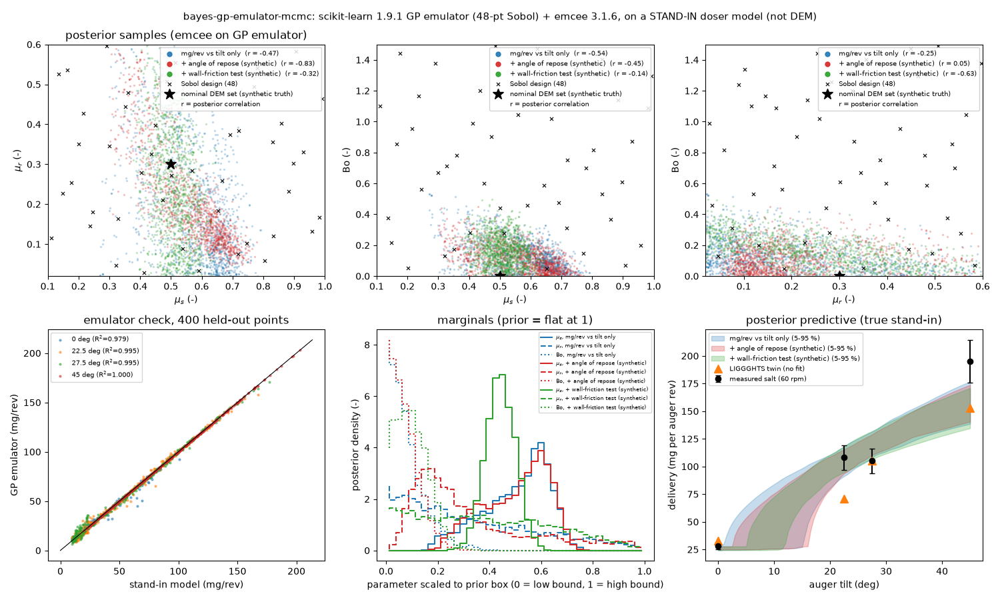

# bayes-gp-emulator-mcmc: GP emulator + MCMC posterior and identifiability on a stand-in doser model

## What it models and why it matters here

The inference the paper proposes is: fit DEM contact parameters so that simulated dosing matches measured dosing. The twin costs about 30 CPU-min per revolution, so the standard route is an emulator. Run a space-filling design, fit a Gaussian process (GP) to the outputs, then sample the posterior with MCMC on the GP. This run does exactly that, but on a **cheap stand-in forward model, not DEM**. Its purpose is to test **identifiability**: which of sliding friction μ_s, rolling friction μ_r and cohesion Bo the dosing fingerprint (mg/rev vs tilt) can actually pin down, and whether a second observable helps.

## Code and version

scikit-learn 1.9.1 (`GaussianProcessRegressor`), emcee 3.1.6, scipy 1.17.1 (`qmc.Sobol`), numpy 1.26.4, Python 3.12.3. Files: [`run.py`](run.py) and [`doser_standin.py`](doser_standin.py), the same stand-in as `bayes-grainlearning`.

## Setup

- **Forward model**: the stand-in in [`doser_standin.py`](doser_standin.py) (screw push + Beverloo annulus discharge + tilt threshold; equations in the `bayes-grainlearning` README and the module docstring). Inputs are μ_s, μ_r and Bo. Outputs are mg/rev at 0, 22.5, 27.5 and 45°, plus a static angle of repose (AoR) from the power-law form of Zhou et al. (2002, *Powder Technol.* 125:45), raised by cohesion.
- **Design**: 48-point scrambled Sobol design over μ_s ∈ [0.1, 1.0], μ_r ∈ [0.02, 0.6], Bo ∈ [0, 1.5].
- **Emulator**: one GP per output, with ARD Matérn-5/2 kernel × constant + white noise, normalised targets, 4 optimiser restarts.
- **Likelihood**: Gaussian, with variance = measurement variance + GP predictive variance.
  - Data: 28 / 108 / 105 / 195 mg/rev.
  - σ = 3 / 11 / 11 / 19.5 mg/rev. The 11 at 27.5° is measured; the others are assumed to be 10 % with a 3 mg floor.
- **Prior**: flat over the box.
- **MCMC**: emcee with 24 walkers × 1500 steps, 500 burn-in, thinned 5, giving 4800 samples per case. Integrated autocorrelation time is 27–48 steps, so each chain is about 20–35 τ long. emcee warns below 50 τ, so treat the tails as approximate.
- **Three cases**:
  1. mg/rev vs tilt only.
  2. Plus a **synthetic** AoR of 29.7 ± 1.5°, the stand-in's value at the twin's nominal set (μ_s 0.5, μ_r 0.3, Bo 0).
  3. Plus a **synthetic** wall-friction test (Jenike/ASTM D6128-type on PLA) giving μ_w = 0.4 ± 0.04, where the model has μ_w = 0.8 μ_s.

## How to rerun

```bash
python3 -m venv /tmp/venv-bayes && /tmp/venv-bayes/bin/pip install numpy scipy scikit-learn emcee matplotlib
OMP_NUM_THREADS=1 GP_SCRATCH=/tmp /tmp/venv-bayes/bin/python run.py      # writes gp_emcee_posterior.png, result.json
```

## Runtime

202 s wall clock on 1 thread of an oversubscribed shared runner. That covers 48 + 400 (validation) stand-in evaluations, 5 GP fits and 3 × 36,000 emulator calls. Running the **same 48-point design with the LIGGGHTS twin** would take 48 parameter sets × 4 tilts = **192 runs of 30 CPU-min: 96 CPU-h, or 24 h wall clock on 4 cores** (one revolution per run; more if steady state needs several).

## Result



**Emulator accuracy** on 400 random held-out points:

| output | R² | RMSE |
|---|---|---|
| mg/rev at 0° | 0.979 | 2.1 mg/rev |
| mg/rev at 22.5° | 0.995 | 2.5 mg/rev |
| mg/rev at 27.5° | 0.995 | 2.6 mg/rev |
| mg/rev at 45° | 1.000 | 0.08 mg/rev |
| AoR | 0.9995 | 0.24° |

The 0° output fits worst because the threshold [·]₊ puts a kink in it.

**Posteriors** (mean ± sd, with the 5–95 % interval in brackets):

| case | μ_s | μ_r | Bo | corr(μ_s, μ_r) | corr(μ_s, Bo) | corr(μ_r, Bo) |
|---|---|---|---|---|---|---|
| mg/rev vs tilt only | 0.57 ± 0.11 [0.34, 0.71] | 0.21 ± 0.14 [0.03, 0.49] | 0.13 ± 0.10 [0.01, 0.34] | −0.47 | −0.54 | −0.25 |
| + angle of repose | 0.57 ± 0.11 [0.37, 0.72] | 0.21 ± 0.13 [0.07, 0.50] | 0.11 ± 0.08 [0.01, 0.27] | **−0.83** | −0.45 | +0.05 |
| + wall-friction test | **0.51 ± 0.05** [0.42, 0.59] | 0.25 ± 0.15 [0.04, 0.51] | 0.16 ± 0.10 [0.02, 0.33] | −0.33 | −0.14 | **−0.63** |

1. **The dosing fingerprint alone constrains μ_s and Bo but not μ_r.** The μ_r 5–95 % interval, 0.03–0.49, covers most of the prior box (0.02–0.6). μ_s is anti-correlated with both μ_r (−0.47) and Bo (−0.54): more friction, less rolling resistance and less cohesion all trade off along a ridge of equal delivery. At the dosing-only posterior mean the stand-in gives 26.3 / 104.3 / 119.0 / 155.7 mg/rev (measured: 28 / 108 / 105 / 195).
2. **The angle of repose does not break the μ_s–μ_r degeneracy here. It sharpens the ridge instead** (correlation −0.47 → −0.83). In the stand-in, the AoR also trades μ_s against μ_r: AoR ∝ μ_s^0.49 μ_r^0.18. So it mostly constrains the same combination. It does tighten cohesion (Bo sd 0.10 → 0.08).
3. **An observable that sees only sliding friction does break it.** A wall-friction test halves the μ_s uncertainty (sd 0.11 → 0.05) and removes most of the μ_s–μ_r correlation (−0.33). The remaining degeneracy moves to μ_r–Bo (−0.63), so rolling friction is still unidentified. For the paper: pick the second measurement by its *parameter sensitivity direction*, not by how standard it is. To identify rolling friction, the extra test must respond to μ_r differently from both dosing and AoR, for example a rotating-drum dynamic angle or flow through an orifice.

## Status

**ran.** Full intended scope on the stand-in. No DEM outputs were used.

## Limitations

- **Stand-in, not DEM.** The degeneracy structure found here is a property of the stand-in's closures, which are assumed (see the `bayes-grainlearning` README). The real twin may have different, and more, parameter sensitivities. Rerun the same pipeline on a DEM design once it exists (96 CPU-h for 48 points).
- Both second observables are synthetic, generated at the twin's nominal parameters, not measured. Their error bars (1.5°, ±0.04) are assumptions.
- Only 4 measured points with assumed error bars on three of them. The stand-in cannot reach 195 mg/rev at 45° while also giving 28 mg/rev at 0°, so the posterior predictive underpredicts 45° by about 20 %.
- The MCMC chains are short (20–35 autocorrelation times). Treat the means and sds as good to about 10 %.
