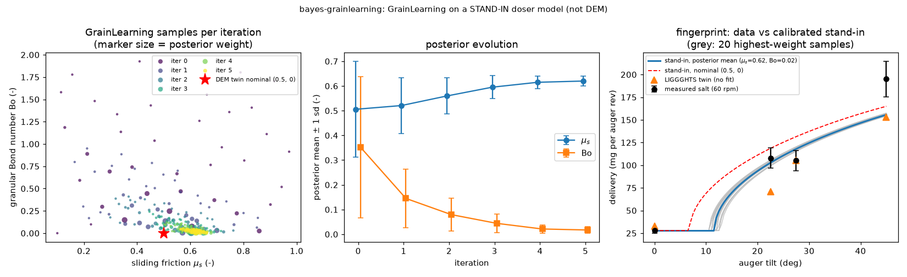

# bayes-grainlearning: GrainLearning iterative Bayesian filter on a stand-in doser model

## What it models and why it matters here

The paper wants to infer powder contact parameters (friction, cohesion) by making simulated dosing match measured dosing. GrainLearning (Cheng et al., 2019, *Comput. Methods Appl. Mech. Eng.* 350:268; Cheng et al., 2024, *J. Open Source Softw.*) is a DEM calibration tool built for exactly this. It runs sequential Monte Carlo over the control variable, then refits a Gaussian mixture to the weighted ensemble and resamples, and it repeats this until the ensemble stops shrinking. Every LIGGGHTS revolution costs about 30 CPU-min, so this run tests the workflow on a **cheap stand-in forward model, not DEM**. It calibrates sliding friction μ_s and cohesion (granular Bond number Bo) against the measured salt fingerprint, mg/rev vs tilt.

## Code and version

GrainLearning 2.0.5 (PyPI `grainlearning`), Python 3.12.3, numpy 1.26.4, scipy 1.17.1, scikit-learn 1.9.1. Files: [`run.py`](run.py) (calibration, figure, result.json) and [`doser_standin.py`](doser_standin.py) (the stand-in).

## Setup

**Stand-in forward model** ([`doser_standin.py`](doser_standin.py)). The tilt is θ, 60 rpm, one auger revolution per second:

| quantity | relation | source |
|---|---|---|
| wall friction | μ_w = 0.8 μ_s | ratio 0.4/0.5 of the LIGGGHTS twin |
| effective exit gap | w_eff = w − k d (1 + γ Bo) | Beverloo empty annulus, k = 1.5 (Nedderman 1992); γ = 0.3 assumed |
| screw push | m_push = η_p ρ_b π(r_o + r_i) w_eff p | η_p = 0.8, set by hand |
| exit discharge | W_B = C ρ_b √g π(r_o + r_i) w_eff^1.5, C = 1.03/(1 + μ_r) | Beverloo slot form, C_slot = 1.03 (Nedderman 1992); μ_r term assumed |
| tilt threshold | θ_s = atan(μ_w (1 + β Bo)) − atan(w / L_x) | β = 0.5 assumed; L_x = 4 mm set by hand |
| delivery | m(θ) = m_push + W_B · 1 s · [sin(θ − θ_s)]₊^0.5 | Beverloo √g_eff with g_eff = g sin(θ − θ_s) |

Geometry and material: exit r_o = 1.5 mm, core-tip radius r_i = 0.43 mm (gap 1.07 mm, 6.5 mm² open), pitch p = 10.4 mm, d = 0.42 mm, ρ_p = 2165 kg/m³, packing 0.58 (ρ_b = 1256 kg/m³). Rolling friction is fixed at μ_r = 0.3 (the twin's value). Before any fitting, the stand-in gives 27.9 / 118.5 / 131.5 / 165.0 mg/rev at 0 / 22.5 / 27.5 / 45° for the twin's nominal set (μ_s = 0.5, Bo = 0). This is not a coincidence: η_p and L_x were tuned by hand to put that set near the data, and they then stay fixed.

**Data**: measured salt at 60 rpm, 28 / 108 / 105 / 195 mg/rev at 0 / 22.5 / 27.5 / 45°. The 22.5° value is the midpoint of the measured 106–110.

**GrainLearning settings**:
- Prior box μ_s ∈ [0.1, 1.0], Bo ∈ [0, 2], with a Halton initial design.
- 40 samples per iteration.
- Effective sample size (ESS) target 0.3.
- Resampling with a 2-component full-covariance Gaussian mixture and slice sampling.
- Stop when the normalised σ falls below 10⁻³ (GrainLearning's default).
- Tilt is the filter's "time" axis.

## How to rerun

```bash
python3 -m venv /tmp/venv-bayes && /tmp/venv-bayes/bin/pip install grainlearning==2.0.5 matplotlib
OMP_NUM_THREADS=1 /tmp/venv-bayes/bin/python run.py          # writes grainlearning_posterior.png, result.json
```

## Runtime

1.0 s wall clock on 1 core: 6 iterations × 40 samples = 240 stand-in evaluations. The same 240 evaluations with LIGGGHTS would be 240 × 4 tilts × 30 CPU-min = **480 CPU-h**.

## Result



| iteration | μ_s mean ± sd | Bo mean ± sd | normalised σ |
|---|---|---|---|
| 0 | 0.506 ± 0.194 | 0.352 ± 0.286 | 0.185 |
| 1 | 0.521 ± 0.112 | 0.145 ± 0.118 | 0.030 |
| 2 | 0.560 ± 0.073 | 0.079 ± 0.067 | 0.0072 |
| 3 | 0.595 ± 0.047 | 0.044 ± 0.038 | 0.0027 |
| 4 | 0.615 ± 0.026 | 0.021 ± 0.017 | 0.0010 |
| 5 | **0.620 ± 0.021** | **0.017 ± 0.013** | 0.0004 (stop) |

- The run converges to μ_s ≈ 0.62 with almost no cohesion; the most probable sample is μ_s = 0.622, Bo = 0.002. That is close to the twin's μ_s = 0.5 and agrees with dry salt being free-flowing.
- At the posterior mean the stand-in gives **27.7 / 102.6 / 117.9 / 155.6 mg/rev**. The measured values are 28 / 108 / 105 / 195 and the LIGGGHTS twin gives 33 / 71 / 105 / 153.
- The stand-in underpredicts the 45° point by 20 %. With μ_r fixed, no (μ_s, Bo) in the box can give both 28 mg/rev at 0° and 195 mg/rev at 45°. This misfit comes from the model's structure, not from the sampler.

## Status

**ran**. The full method ran at its intended (cheap) scale. The forward model is a stand-in, not DEM.

## Limitations

- **Stand-in, not DEM.** η_p and L_x were tuned by hand so that the twin's nominal parameters land near the data, which pulls the posterior toward that region. The β, γ and a_r closures are assumed, not fitted to DEM.
- **GrainLearning's posterior width is not a measurement-error posterior.** Its likelihood is a Gaussian with obs-scaled variance σ·y², and σ is annealed each iteration to hit ESS = 0.3. The final ±0.02 on μ_s reflects that annealing, not the ±10 % data error. The GP + emcee run (`bayes-gp-emulator-mcmc`) uses the stated error bars and gets μ_s ± 0.11.
- Only four data points are used, and μ_r is held at 0.3. In the GP run, μ_r trades off against μ_s.
- To use this with the real twin, swap `run_sim` for a callback that launches LIGGGHTS (GrainLearning's `IODynamicSystem`). That would cost 480 CPU-h for this schedule.
