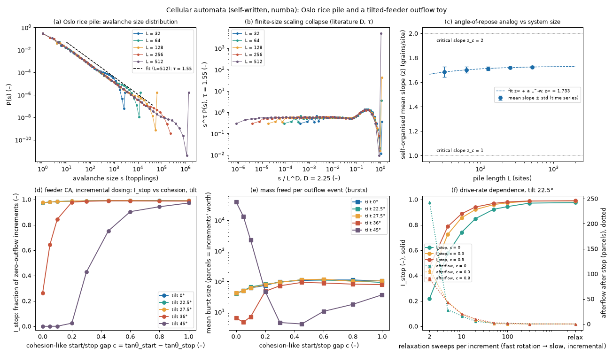

# ca-avalanche: sandpile avalanches and a tilted-feeder outflow cellular automaton

## What it models and why it matters here

Two lattice (cellular automaton) models of granular avalanches. Both are stochastic toys, not calibrated simulations.

- **(a) Oslo rice pile** (Christensen et al. 1996; the model behind the rice-pile experiment of Frette et al. 1996).
  This is a 1D sandpile in which each site topples when its local slope exceeds a critical slope, drawn at random
  from {1, 2} after every toppling. It self-organises to a mean slope between the two thresholds (an
  angle-of-repose analogue) and has power-law avalanche sizes. It is a reference point for why angle-of-repose
  readings fluctuate and depend on the size of the heap.
- **(b) Tilted-feeder CA** (written here). This is a 1D column-height lattice for the powder between the end of
  the auger flight and the outlet lip. It is tilted by the doser angle and fed one parcel per rotation increment.
  A resting column topples only when its surface slope exceeds s_f + c. A column that has just moved needs only
  s_f. The gap c = tanθ_start − tanθ_stop is the cohesion-like threshold (cohesive powders have a larger gap
  between their starting and stopping angles). The outputs map onto the doser fingerprint: the fraction of
  increments with zero outflow (**I_stop**), the mass freed per outflow event, and the **afterflow** after the
  drive stops. Each is computed as a function of c, tilt and drive rate.

## Code and version

Self-written Python 3.12.3 with numba 0.68.1 (numpy 2.5.4, scipy 1.18.1, matplotlib 3.11.2, imageio 2.38.1 with
imageio-ffmpeg's ffmpeg 7.0.2 for the MP4). One script, [`run.py`](run.py).

## Setup

- **Oslo model:** L = 32, 64, 128, 256 and 512 sites. Grains are added at site 1 and leave at site L. Thresholds
  are 1 or 2 with p = 1/2, redrawn after each toppling. Warm-up is 3L² grains, then 10⁶ grains are measured per L.
  Avalanche size is the number of topplings. τ is fitted to the log-binned P(s) for L = 512 over
  10 ≤ s ≤ L^2.25/30. The collapse in panel (b) uses the literature values τ = 1.55 and D = 2.25.
- **Feeder CA:**
  - Lattice: L = 40 columns, with 5 parcel layers per column width, so slopes are in physical tan units. The base
    slope is tan(tilt), for tilts of 0°, 22.5°, 27.5°, 36° and 45°.
  - Thresholds: s_f = tan 34° = 0.675 (the middle of the 32 to 36° friction angle of the rig salt), plus Gaussian
    noise σ = 0.10 that is redrawn after each toppling. A resting column needs s_f + c. A column that toppled in
    the last 3 sweeps needs only s_f.
  - Updates: synchronous sweeps, with one parcel moved per toppling, downhill (or uphill if steeper). The flight
    backs column 0, and the outlet lip is at base level after column 39.
  - Drive: 1 parcel per increment enters column 0. **Incremental dosing** means the lattice relaxes to rest after
    every increment. **Continuous rotation** means only K sweeps per increment (K = 2 to 300).
  - Run length: 20 000 warm-up and 40 000 measured increments (20 000 in the K scan). Afterflow is the number of
    parcels that leave after the drive stops, averaged over 100 stops per point.
  - Scan: c = 0 to 1.0 (9 values) by 5 tilts, plus 3 c values by 8 drive rates at 22.5°, plus 5 seeds at one point.

## How to rerun

```bash
python3 -m venv /tmp/venv-continuum && /tmp/venv-continuum/bin/pip install numpy scipy numba matplotlib imageio imageio-ffmpeg
OMP_NUM_THREADS=1 NUMBA_NUM_THREADS=1 /tmp/venv-continuum/bin/python run.py   # add --reuse-oslo to skip part (a) once cached
```

It writes `result.json`, `ca_avalanche.png`, `ca_feeder.gif` and `ca_feeder.mp4`. The Oslo cache goes to
`/tmp/sims-scratch/ca-avalanche`.

## Runtime

193 s wall clock on 1 core (130 s CPU; the runner was shared). Oslo 73 s, feeder scans 77 s, animation 32 s.

## Result



Animation (incremental dosing at 22.5°, c = 0 vs c = 0.6): [GIF](ca_feeder.gif), [MP4](ca_feeder.mp4).

- **Oslo verification:** the fitted τ is 1.550 for L = 512 (literature 1.55). The mean avalanche size equals L
  (32.0, 64.0, 128.0, 256.0, 512.0), which is an exact property of the model. The curves collapse with D = 2.25.
- **Angle-of-repose analogue:** the mean slope is 1.684, 1.702, 1.714, 1.721 and 1.725 for L = 32 to 512. A fit
  extrapolates to z∞ = 1.733 (literature 1.7326). The standard deviation of the slope falls from 0.042 to 0.005,
  scaling as L^−0.77. So the self-organised "angle" sits between the stop and start thresholds (1 and 2), and
  small heaps show both a lower angle and much larger scatter.
- **Feeder CA, incremental dosing, tilts below the friction angle (0°, 22.5°, 27.5°):**
  - Output comes in bursts. The mean burst rises from 40 parcels (increments' worth) at c = 0 to 106 to 117 at
    c = 0.45 to 0.6, then levels off.
  - I_stop rises with it, from 0.975 to 0.99. Here I_stop ≈ 1 − (inflow per increment)/(mean burst), so its
    absolute value is set by the parcel size. The robust output is the burst size, which grows about 2.7 times.
  - Tilt has no effect within seed scatter (I_stop std 0.0005 over 5 seeds at c = 0.3). A slope-threshold
    lattice only cares about the surface angle, so tilting the base changes only how much powder is stored
    (2602 parcels at 0° vs 905 at 22.5° for c = 0).
- **Feeder CA, tilts above the friction angle:**
  - At 36°, I_stop is 0.26 at c = 0, then 0.64, 0.84 and 0.98 at c = 0.05, 0.1 and 0.2.
  - At 45°, I_stop is 0 for c ≤ 0.1, then 0.025, 0.43, 0.75, 0.90 and 0.97 at c = 0.2, 0.3, 0.45, 0.6 and 1.0.
  - So the toy predicts that delivery becomes continuous once tilt exceeds atan(s_f + c), and that cohesion
    raises the tilt needed for steady output.
- **Drive rate (22.5°):** faster rotation (fewer relaxation sweeps per increment) keeps the powder moving.
  - At c = 0, I_stop is 0.22 at K = 2, 0.74 at K = 10 and 0.975 when relaxing to rest.
  - At c = 0.8 the same values are 0.47, 0.89 and 0.99.
  - Mean afterflow grows at the fast end: 244, 109 and 90 parcels at K = 2 (c = 0, 0.3, 0.8), about 20 at K = 10,
    and 0 when every increment relaxes to rest.
  - This is the avalanching-to-continuous transition seen in rotating drums.

## Status

**Ran.** The Oslo part reproduces the published exponents and slope. The feeder CA ran as designed. The first
version made every column "moving" whenever a neighbour toppled, so c had no effect. That version was discarded
and the rule changed so that only a column that itself moved loses its cohesion. This rule choice changes the
results.

## Limitations

- These are lattice toys in lattice units (sites, cells, parcels, sweeps). There is no mapping to mg, seconds or
  measured ffc. The cohesion-like gap c is not calibrated to any powder test.
- The feeder CA contains no auger mechanics: no fill fraction, no backflow over the flight, no arching across the
  annulus. Its tilt dependence below the friction angle is zero by construction, so it **cannot** explain the
  measured rise from 28 to 195 mg/rev between 0° and 45°. Use the screw-conveyor and DEM results for that.
- The absolute I_stop values depend on the parcel size relative to the inflow per increment (1 parcel here). In
  a shorter test with 5 parcels per increment (not in the final run), I_stop was 0.88 at c = 0 and 0.96 at
  c = 0.45, with similar burst sizes (44 and 133 parcels). Only the trends with c, tilt and drive rate should be read.
- At 45° and c = 0.8 the stored mass was still drifting (+26 % between the halves of the run; it is small,
  20 parcels), so that point is not fully stationary.
- Panel (e) counts uninterrupted outflow as one burst, which is why the values reach 40 000 at 45° for small c.
