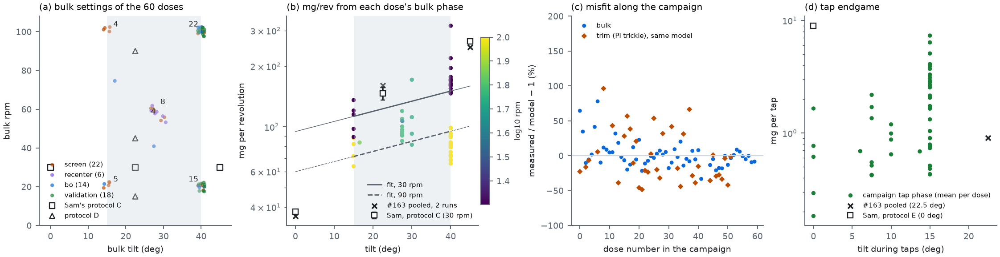

# Run 34: do a BO campaign's own doses carry fingerprint data? (salt, #166)

William asked on #196 (10 Nov 2026) whether the dosing data collected while running BO campaigns on every powder
could also train the simulation and the ML models. This run checks that on the one campaign that exists: salt,
`salt-20260929T014732Z` (60 doses, 29 Sep and 6 Oct). [`PLAN.md`](PLAN.md) drafts what a campaign would look
like if it were also meant to collect training data.

[`extract.py`](extract.py) reads the 60 spooled trial documents, each with its balance telemetry (about 3 readings
per second), and writes [`campaign_phases.csv`](campaign_phases.csv) (one row per dose, every phase), the figure
and [`result.json`](result.json). It runs in about 2 s. Nothing new was dosed.

## In short
* **Yes, every dose already carries fingerprint-like numbers, and nothing extra has to be dosed for them.** The
  60 salt doses give 58 bulk-phase mg/rev values at 15–40° and 20–100 rpm, 37 trim-phase values at 4–12 rpm, 2,467
  single taps and 58 afterflow events. The fingerprint has 18 revolutions at three tilts plus 9 at three speeds.
* **Within the campaign they are precise.** A four-term rate model fits the bulk values to ±19 % per dose, and puts
  the mean at 22.5° and 30 rpm to ±7 %. Eight repeats at one setting on 6 Oct scattered 6.5–8.7 % (CV).
* **They don't reproduce Sam's August fingerprint**, so they can't simply replace it:
  * 123 mg/rev at 22.5° and 30 rpm, against 146 (−16 %);
  * the speed exponent is 0.58, against 0.78;
  * extrapolated to 45° and 0°, the campaign's model is 40 % low and 2.5× high.
* **Several things changed between and within sessions.** All of them would also move a fingerprint, so a fixed
  block has to run in the same session as the campaign:
  * the same settings delivered 14–17 % less a week later;
  * the misfit falls about 8 % per 10 g dosed out of the hopper during the session;
  * a bulk phase is the first 1–7 revolutions after the plate tilts up from the previous dose's tap tilt, not
    revolutions 2–6 of six at one tilt.
* **The BO's doses are powder-specific.** 11 of the 14 BO doses sat at 40° and 8 at 100 rpm, the corner of the box.
  The 22 screening doses are the same settings for every powder, so they are the part of a campaign that compares
  directly across powders.
* **One logging bug.** The firmware counts bulk revolutions with a one-second clock. That puts single-dose
  mg/rev off by a median 8 % and up to 25 %. Here the revolutions come from the telemetry timestamps instead.

*(a) Bulk tilt and rpm of the 60 doses, by part of the campaign (points jittered; numbers count doses at a
setting), with Sam's protocol C and D settings. (b) mg per revolution from each dose's bulk phase, coloured by rpm;
lines: the fitted model at 30 and 90 rpm, thin outside the campaign's 15–40° box. Squares: Sam's protocol C (21 Aug
run, ± standard error at 22.5°); crosses: #163's two-run pooled values. (c) Measured / model − 1 along the
campaign, for the bulk phases and for the PI trim phases run through the same model. (d) Mean release per tap in
each dose's tap endgame, against the tap tilt, with Sam's protocol E value.*

## What each dose contains
From [`opt_common.py`](https://github.com/vertical-cloud-lab/powder-doser/blob/d14a50d/scripts/opt_common.py#L434-L486)
and the trickle-tap firmware on the #164 branch: the eight settings and the executed parameters; outcomes (time,
error, taps, nudges, auger revolutions); a stop event per phase (mass at the halt, settled mass, afterflow, rate at
the stop, stalled flag); covariates (doses since the cup was emptied, cup load); and the telemetry: time, phase,
raw balance reading, the Kalman mass and rate, the PI's rpm command and the predicted final mass, about every 0.29 s.

| Phase | Number extracted | How |
|---|---|---|
| Bulk | mg/rev at the dose's bulk tilt and rpm, with or without cadence taps | settled bulk mass ÷ revolutions; revolutions = rpm × spin time from the telemetry clock (first poll − one poll interval to the halt poll) |
| PI trim | mg/rev at the trim tilt and the PI's mean rpm | trim mass ÷ Σ rpm_cmd·Δt over the telemetry rows |
| Tap endgame | mg per tap, fraction of taps that release under 0.2 mg | consecutive settled readings, one per tap |
| Stops | afterflow mass, τ = afterflow ÷ rate at the stop | the stop events |

## Results

### Bulk rate model, 58 doses
log10(mg/rev) = a + b (tilt − 27.5°) + c log10(rpm / 30) + d [cadence taps on]

| term | value | SE |
|---|---|---|
| a (27.5°, 30 rpm) | 2.115 (130 mg/rev) | 0.017 |
| b, per degree | 0.0050 | 0.0012 |
| c (speed exponent − 1) | −0.417 | 0.033 |
| d, bulk taps | −0.039 | 0.022 |
| residual SD | 0.076 log10 (±19 %) | leave one dose out: 0.081 |

Two doses had no telemetry and are left out; three whose tap endgame ran out of cycles are kept, since their bulk
phase is clean.

### Against Sam's salt fingerprint (#116, 21 Aug, `20260821T192031Z_salt`)

| | campaign model (90 % CI of the mean) | Sam | #163 pooled, two runs |
|---|---|---|---|
| mg/rev, 22.5°, 30 rpm | **123** (115–132) | 146 | 161 |
| mg/rev, 45°, 30 rpm (outside the box) | 159 (145–176) | 265 | 248 |
| mg/rev, 0°, 30 rpm (outside the box) | 95 (82–109) | 38 | 36 |
| speed exponent α (mg/s ∝ rpmα) | **0.58** (0.53–0.64) | 0.78 (at 22.5°) | – |

* **The tilt effect shrinks at high rpm.** Adding a tilt × log rpm term (−0.0097 ± 0.0030) gives a speed exponent
  of 0.77 at 15° and 0.53 at 40°. So the low exponent comes mostly from the 40° doses, where the BO spent its time.
* **The trim phase doesn't follow the bulk model.** At 10–30° and 4–12 rpm, the 37 trim values are 15 % below
  the model on median (RMSE 0.16 log10). They need their own term.

### Drift within and between sessions

| check | result |
|---|---|
| `corner-09` settings (40°, 20 rpm, bulk taps) | 195 mg/rev on 29 Sep (3 doses) → 161 on 6 Oct (8 doses, CV 6.5 %): −17 % |
| `bo-005` settings (40°, 100 rpm, bulk taps) | 85 mg/rev on 29 Sep (9 doses, CV 10.5 %) → 74 on 6 Oct (8 doses, CV 8.7 %): −14 % |
| powder dosed out of the hopper in the session (cup load, up to 29.6 g) | misfit −0.035 log10 per 10 g (about −8 %), r = −0.42; confounded with dose order, since the BO doses came last |
| firmware revolution count against the telemetry clock | median error 8 %, largest 25 % |

### Afterflow and taps
* **Afterflow.** Over the 58 bulk stops, τ = afterflow ÷ rate at the stop has a median of 0.87 s (IQR 0.77–1.15).
  The campaign's own refit gave 0.834 s. It includes the balance's lag, which the firmware takes as 0.7 s but drop
  tests put at 0.16 s (`OUTLINE.md` §4.A9). So it is a powder number only once the lag is pinned down.
* **Taps.**
  * 48 doses reached the tap endgame, with 2,467 taps in all.
  * The mean release per dose ranges from 0.18 to 7.3 mg (median 1.1 mg). A median 1 % of taps released under 0.2 mg.
  * Release rises only weakly with tap tilt (Spearman 0.25 over 0–15°). It depends more on how much powder the
    trim phase left at the lip, which the validation note on #166 already traced.
  * Sam's protocol E gets 9.0 mg per tap at 0°, because it taps right after a full refeed revolution.
  * So campaign taps describe the endgame. They aren't a powder constant until the lip state is logged or
    modelled.

## What this means
* **Campaign doses are worth extracting for every powder.** They are free, they span tilt and rpm far more
  widely than the fingerprint, and they measure things the fingerprint barely touches: repeatability at fixed
  settings, the tilt × rpm interaction, afterflow and tap release in the endgame.
* **They extend the fingerprint; they don't replace it.** Each campaign session needs a fixed fingerprint block
  (at least at the start and the end), so that its numbers are tied to the same powder state. Its screening doses
  should also stay identical across powders. [`PLAN.md`](PLAN.md) lays this out.
* **A salt pilot would settle the −16 % offset.** Running the fingerprint in the same session as a campaign would
  show whether it is a session effect (fill, day, auger) or a method effect (first revolutions after a tilt change).

## Limitations
* One powder and one campaign. The model is empirical: log-linear in tilt, inside a 15–40° box.
* Sam's fingerprint is from August, and #180 left open which auger produced which dataset (§4.A1). The −16 % mixes
  a session offset with a method offset.
* Spin time is taken from the poll clock, so it is good to about one poll (0.29 s, i.e. 0.1–0.5 rev). That is
  small against the 1 s quantization it replaces, but not zero.
* Cup load stands in for the hopper's fill. The fill at the start of the session wasn't logged.

## Files
* [`extract.py`](extract.py): the extraction, the models and the figure.
* [`campaign_phases.csv`](campaign_phases.csv): one row per dose, with every number above.
* [`result.json`](result.json): all results.
* [`data/salt_trials/`](data/salt_trials/): the 60 trial documents, byte-identical copies
  ([`data/SOURCES.md`](data/SOURCES.md)).
* [`PLAN.md`](PLAN.md): the draft of campaigns as data collection.
