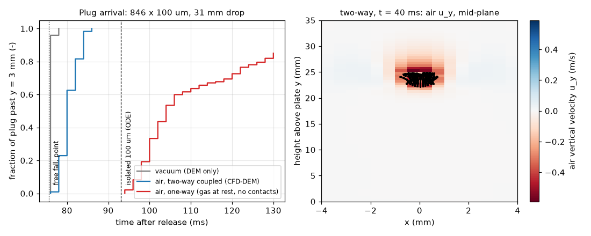

# cfd-dem: coupled CFD–DEM of a falling powder plug (OpenFOAM DPMFoam)

## What it models and why it matters here
A dose leaves the Ø3 mm exit and falls a few cm onto the balance. For fine AlSi10Mg
(d50 ≈ 35 µm) air drag is large for an isolated grain (terminal speed about 0.09 m/s), but a
dense plug drags air along with it and falls faster than its grains would one at a time. That
collective effect sets when the mass reaches the pan (arrival time and how spread out it is),
so it may shape the balance trace, for example as an afterflow-like tail. A two-way-coupled
CFD–DEM captures it, and DEM in vacuum or one-way drag does not.

## Code and version
- OpenFOAM v1912 (`Build: OPENFOAM=1912 patch=200626`), Ubuntu 24.04 package `openfoam 1912.200626-2build3`, solver `DPMFoam`
  (volume-averaged incompressible gas + Lagrangian soft-sphere parcels, `nParticle 1`, `pairCollision`).
- MFiX, the method the brief suggested first, **failed to install**: `conda create -c conda-forge -c mfix mfix` returned
  `PackagesNotFoundInChannelsError: The following packages are not available from current channels: - mfix`
  (MFiX is now only distributed through a registration-gated channel URL). DPMFoam was used instead. It is a
  genuine unresolved CFD–DEM: particle–particle and particle–wall contacts use a Hertzian spring–slider–dashpot,
  and the gas momentum equation carries the volume fraction and the particle momentum source.

## Setup
- Box 8 × 35 × 8 mm (x, y vertical, z), 16 × 70 × 16 = 17,920 hexahedral cells (0.5 mm). The top is open
  (p = 0, `pressureInletOutletVelocity`), and the plate and side walls are no-slip walls. Laminar air: ρ = 1.2 kg/m³, ν = 1.5e-5 m²/s.
- Plug: 846 spheres, d = 100 µm, ρ = 2670 kg/m³ (AlSi10Mg), on a jittered cubic lattice (solid fraction 0.30)
  filling a cylinder Ø1.4 mm × 1.0 mm. Released from rest with its centre 31 mm above the plate.
- **Coarse-grained** from d50 = 35 µm to 100 µm (2.9×) so the DEM sub-step and particle count fit the CPU budget.
  Isolated-grain drag is therefore weaker than for real AlSi10Mg (see reference ODE below).
- Drag: `ErgunWenYuDrag` (Ergun for gas fraction < 0.8, Wen–Yu = Schiller–Naumann × α^-1.65 above), gravity. Contacts: Young's modulus 1e4 Pa
  (soft, chosen for speed), ν = 0.35, friction 0.5 particle–particle and 0.4 particle–wall, 5 collision-resolution steps.
  DPMFoam sub-cycled 4–12 DEM steps per fluid step. Δt_fluid = 2e-4 s, end time 0.13 s.
- Three runs from one generator (`make_case.py`):
  `twoway`: drag + two-way momentum coupling (CFD–DEM).
  `oneway`: drag on grains, gas held at rest, **contacts off** (DPM, an isolated/hindered-grain reference).
  `vacuum`: no drag, no coupling (DEM only).
- Arrival is defined as a grain's first crossing of the plane 3 mm above the plate, which sits above the pile that forms. Output every 2 ms, so times resolve to 2 ms.
- Reference ODE (`post_cfd.py`): a single grain with Schiller–Naumann drag in still air, from the same start height.

## How to rerun
`bash run.sh`, which writes the cases to `$SCRATCH` (default `/tmp/sims-scratch/cfd-dem`), runs blockMesh + DPMFoam for each mode, then `post_cfd.py`.

## Runtime
1 core per run, run one after another on a shared runner (load average about 8 on 4 cores). Wall clock: twoway 162 s, oneway 57 s, vacuum 198 s.

## Result

Animation: [cfd_dem_plug.gif](cfd_dem_plug.gif) / [cfd_dem_plug.mp4](cfd_dem_plug.mp4) (left: vacuum, middle: two-way with air u_y, right: one-way).

| run | first crossing | t10 | t50 | t90 | crossed by 130 ms |
|---|---|---|---|---|---|
| vacuum (DEM) | 76 ms | 76 ms | 76 ms | 76 ms | 846/846 |
| air, two-way CFD–DEM | 76 ms | 78 ms | 80 ms | 84 ms | 846/846 |
| air, one-way, no contacts | 94 ms | 98 ms | 104 ms | > 130 ms | 719/846 |
| isolated 100 µm grain (ODE) | 93 ms | | | | |
| isolated 35 µm grain (ODE) | 307 ms | | | | |

Free fall of a point mass over the same 28 mm takes 75.6 ms. In the two-way run the plug dragged the air down
at up to 0.59 m/s (mid-plane, t = 40 ms). Its median arrives only 4 ms after the vacuum plug and 13 ms before an
isolated grain of the same size. Shedding of grains from the plug edge spread arrivals over 6 ms (t10–t90), against
under 2 ms in vacuum. The one-way model, with Wen–Yu hindrance and no gas back-flow, made the plug *slower* than an
isolated grain and left 15 % of grains still airborne at 130 ms. So the one-way/vacuum shortcuts misjudge the dose
arrival in opposite directions.

## Status
**Ran at reduced scale** (coarse-grained 100 µm particles, 846 particles, 0.13 s, soft contacts). MFiX: failed (see above).

## Limitations
- Coarse-graining to 100 µm cuts isolated-grain drag about 8× compared with 35 µm. The real powder is far more drag-dominated, so the
  isolated-grain contrast (93 ms vs 307 ms in the ODE) means the collective effect matters more for real AlSi10Mg, not less.
- The plug (Ø1.4 mm) spans only about 3 cells, so the entrained-air jet is under-resolved and the two-way effect is approximate.
- E = 1e4 Pa is very soft. That is harmless for the in-flight phase measured here, but overlaps at the plate impact are unphysical, so
  impact forces and pile shape are not reported.
- The one-way case has contacts switched off, so it differs from the two-way case in two ways.
- No cohesion, electrostatics or humidity. Laminar gas, single plug, no auger, no continuous stream.
