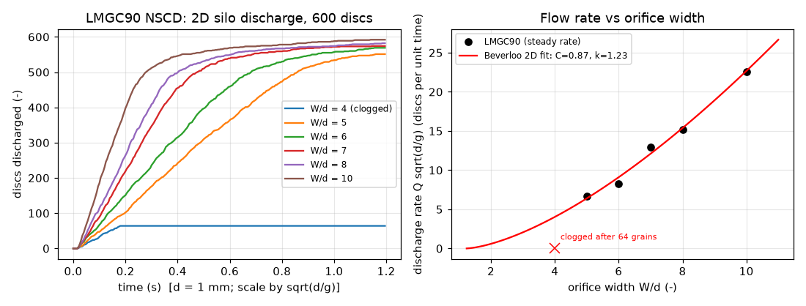

# contact-dynamics: non-smooth contact dynamics silo discharge (LMGC90)

## What it models and why it matters here
Non-smooth contact dynamics (NSCD, Moreau–Jean) treats grains as perfectly rigid. Contacts obey Signorini (no interpenetration)
and Coulomb laws, solved implicitly each step, so there is no contact stiffness or stiffness-limited time step.
Staron et al. used NSCD to study silo discharge and Beverloo scaling. For the doser, the Ø3 mm exit annulus (0.43–1.5 mm radial gap)
is only a few salt-grain diameters wide, which is exactly where Beverloo's "empty annulus" constant k and **clogging (arching)**
govern whether and how steadily grains leave. This run measures discharge rate and arching against outlet width with the rigid-grain method.

## Code and version
LMGC90 user version 2025 (`pyproject` version 2025.rc3), built from source (`cmake`, gfortran 13, SWIG 4.2, Python 3.12 venv,
NumPy 2.5, HDF5/MUMPS/MatLib off). There is no `pip`/conda package (`pip install pylmgc90` gave "No matching distribution found"),
and the 2025 zip came from the project wiki. One patch was needed: NumPy ≥ 2.5 removed `np.cross` for 2-vectors, which the 2025
pre-processor still calls, so `silo_lmgc90.py` installs a small 2-vector shim before importing `pylmgc90`.

## Setup
- 2D flat-bottomed silo, width 30 d, rigid walls (JONCx), central outlet of width W. Rigid discs (DISKx), N = 600,
  radii uniform in [0.4, 0.6] mm (mean d = 1 mm), placed by LMGC90's geometric `depositInBox2D`, density 2165 kg/m³.
- Contact law IQS_CLB (inelastic quasi-shock + Coulomb). Friction 0.5 disc–disc and 0.4 disc–wall (values from the repo's salt twin).
- Moreau–Jean θ = 0.5, dt = 2e-4 s, 6000 steps (1.2 s). NLGS (`Stored_Delassus_Loops`), quadratic norm, tol 1e-3, at most 200 iterations.
  Contact alert distance 0.2 r_min. Discs more than 20 d below the outlet are switched off.
- Rigid NSCD has no material length or time scale, so the results depend only on W/d and scale with sqrt(d/g). The 1 mm discs therefore
  map onto NaCl (d50 = 0.425 mm) by rescaling time with sqrt(0.425) = 0.65.
- Discharge rate: linear fit of the cumulative count while 10–60 % of the grains have left. A run counts as clogged if no grain leaves during the last 0.3 s
  while less than 90 % has drained.

## How to rerun
`bash run.sh` (downloads and builds LMGC90 2025, then runs the widths one after another, then `post_lmgc90.py`).

## Runtime
Build: about 11 min on the shared runner (first minute with `make -j2`, the rest with `-j1`). Simulations: 1 core each, 279 s in total for 6 widths (per-run wall times in the table).

## Result

Animation (W/d = 6): [contact_dynamics_silo.gif](contact_dynamics_silo.gif) / [contact_dynamics_silo.mp4](contact_dynamics_silo.mp4).

| W/d | discharge rate (d = 1 mm) | Q·sqrt(d/g) | mass rate per metre depth (kg/s/m) | wall |
|---|---|---|---|---|
| 4 | clogged at t = 0.18 s after 64 of 600 discs | - | - | 94 s |
| 5 | 657 discs/s | 6.64 | 1.136 | 40 s |
| 6 | 822 discs/s | 8.30 | 1.420 | 59 s |
| 7 | 1277 discs/s | 12.90 | 2.207 | 29 s |
| 8 | 1508 discs/s | 15.23 | 2.605 | 38 s |
| 10 | 2240 discs/s | 22.61 | 3.869 | 19 s |

Fitting the 2D Beverloo law Q·sqrt(d/g) = C (W/d − k)^(3/2) to the 5 flowing widths gives **C = 0.87, k = 1.23**. The narrowest opening (W/d = 4) jammed with a stable arch. For the doser this means the narrow
side of the exit annulus (0.43 mm, about 1 salt diameter) cannot pass salt on its own; flow has to come through the wider side (1.5 mm, about 3.5 d).
In these 2D runs, openings of about 4 d or less were prone to arching, so the exit probably operates near the intermittent-flow range.
That is a hypothesis to test against measured dose-to-dose noise, not a result.

## Status
**Ran at reduced scale** (2D, 600 discs, one realisation per width).

## Limitations
- 2D discs are not 3D cubes. 2D Beverloo constants (C, k) do not transfer quantitatively, and discs arch more easily than spheres.
- One random packing per width, so the clogging threshold is statistical and needs many realisations to pin down. The silo is small (about 20 d fill),
  so the rate drops as it empties, and the fit window covers only part of the discharge.
- The NLGS tolerance (1e-3, at most 200 iterations) was loosened for speed. Rigid grains with no cohesion, humidity or air.
