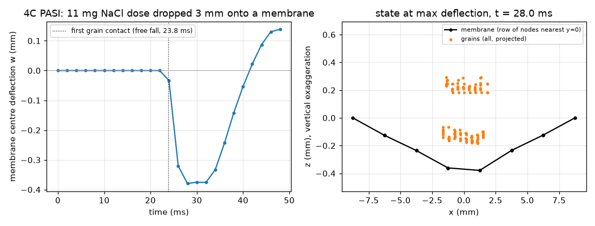

# dem-fem-coupling: DEM grains on a deformable FE membrane (4C particle–structure interaction)

## What it models and why it matters here
Coupled DEM–FEM resolves grains interacting with a structure that deforms under them. Weissbach, Meier et al. used it (in BACI,
now open-sourced as 4C) for blade and roller spreading of cohesive AM powders. In the doser the compliant structure that matters most
is the **balance pan or weighing boat**. A falling dose loads it dynamically, so the reading overshoots and rings before it settles to the
static weight, and that sets how long the BO loop must wait for a stable mass. This run drops a salt dose onto a compliant membrane with
full two-way coupling.

## Code and version
- 4C `2026.4.0-dev`, git `1f2ed686d9` (29 Oct 2026), Docker image `ghcr.io/4c-multiphysics/4c:main`
  (`sha256:5543f36ca2ec…`, 3.43 GB compressed / 9.7 GB unpacked; Docker works on the runner). Problem type
  `Particle_Structure_Interaction` (PASI): 4C's DEM particle engine coupled to its nonlinear structural FE.
- Check 1: 4C's own regression test `pasi_twoway_disprelax_particle_dem_1d_normalcontact_linspring_walldiscretcond` ran in 8.7 s and
  passed all 9 reference-value checks (`OK (9)`).
- Project Chrono (pychrono FEA + SMC) was not needed, because the BACI/4C route worked.

## Setup
- Structure: the clamped 7 × 7 MEMBRANE4 mesh from that regression test, scaled to 17.5 × 17.5 mm, thickness 0.1 mm, nonlinear
  kinematics, neo-Hookean μ = 0.33 MPa (rubber-like sheet, E ≈ 1 MPa), density 1100 kg/m³, Rayleigh damping (M 50 1/s, K 1e-4 s).
  The membrane carries no gravity load (tared), only the grains' contact forces.
- Grains: 128 DEM spheres, d = 0.425 mm (NaCl d50), ρ = 2165 kg/m³, an 11.1 mg dose arranged as an 8 × 8 × 2 lattice 3 mm above the membrane,
  falling under gravity. Linear spring–dashpot normal contact (stiffness from 5 % relative penetration at 0.35 m/s), restitution 0.5,
  linear tangential spring–dashpot with friction 0.5 grain–grain and 0.4 grain–wall (from the repo's twin).
- Coupling: partitioned two-way (structure displacements move the particle walls, particle contact forces load the structure),
  dt = 5 µs for both fields, fixed under-relaxation 0.5, convergence on interface-displacement increments
  (scaled 1e-5 m, relative 1e-4), at most 50 iterations.
- Getting there took five attempts:
  1–4. Aitken relaxation with the test file's tolerances (forces 1e-6), then forces off with displacement tolerances of 1e-8, 1e-6 and 1e-6/1e-4.
  Every one aborted at the moment of impact (t = 23.8–24.8 ms) with
  `PROC 0 ERROR … 4C_pasi_partitioned_twowaycoup.cpp:422: The partitioned PASI solver did not converge in ITEMAX steps!`.
  The interface increment stalled at 1e-8 to 1e-6 m instead of shrinking, and Aitken stayed at ω = 1 ("norm of displacement increment too small").
  5. Fixed ω = 0.5, displacement tolerance 1e-5 m, and `IGNORE_CONV_CHECK: true` so that non-converged steps are logged rather than aborting.
  In this run 1 of 9627 steps hit the 50-iteration cap. Steps with grain contact took 11.9 coupling iterations on average.

## How to rerun
`bash run.sh` (pulls the image, runs the regression test, builds the input with `make_input.py`, runs it, then `post_4c.py`).

## Runtime
1 core (`--cpus=1`). Regression test 8.7 s. Dose run: 690 s wall clock for 9627 steps (about 8 ms per step in free fall, about 140 ms per step during contact, with fixed under-relaxation).

## Result

Animation: [dem_fem_membrane.gif](dem_fem_membrane.gif) / [dem_fem_membrane.mp4](dem_fem_membrane.mp4) (side view: membrane centre row and all grains, projected).

- First contact at about 24 ms (the lowest layer needs 23.8 ms of free fall to touch the membrane).
- Peak downward centre deflection 0.379 mm at t = 28 ms, about 4 ms after first contact. The membrane stays near
  that sag until about 34 ms, then springs back while the grains rebound (restitution 0.5). It passes its flat position at about 42 ms and is
  0.138 mm *above* flat at 48 ms while the grains rebound.
- The run stopped while still in this first rebound, so no settled (static) deflection was reached and no overshoot ratio is reported.
  For a balance, the point is qualitative: an 11 mg dose dropped 3 mm onto a compliant pan gives a load transient that
  includes a phase where the pan carries less than the dose weight. A reading taken within the first tens of ms is not the dose mass.
- Centre deflection every 2 ms after impact (mm): 0.000, -0.034, -0.321, -0.379, -0.375, -0.376, -0.333, -0.243, -0.142, -0.054, 0.022, 0.087, 0.130, 0.138.

## Status
**Partial**: stopped at t = 48.0 ms of the planned 70 ms (step 9627 of 14000) to stay within the CPU budget; the impact and the first 24 ms of membrane response were captured. The 4C regression test ran and passed.

## Limitations
- The partitioned coupling did not converge in every step at the tightest tolerances (see the attempts above). Results are converged only to 1e-5 m
  (about 3 % of the deflection), and 1 step(s) were accepted unconverged.
- A pure membrane (no bending stiffness), soft and rubber-like, with only 49 elements. A real weighing boat is about 1000× stiffer, so
  its deflection would be micrometres and its ringing faster. This run shows the coupled workflow and the transient's shape, not balance numbers.
- 128 monodisperse spheres with the contact stiffness softened through the 5 % penetration setting. The run is short (stopped at 48 ms, during the first rebound).
- No air, cohesion or blade. The roller and blade spreading cases from the literature would reuse the same PASI machinery with a moving structure.
