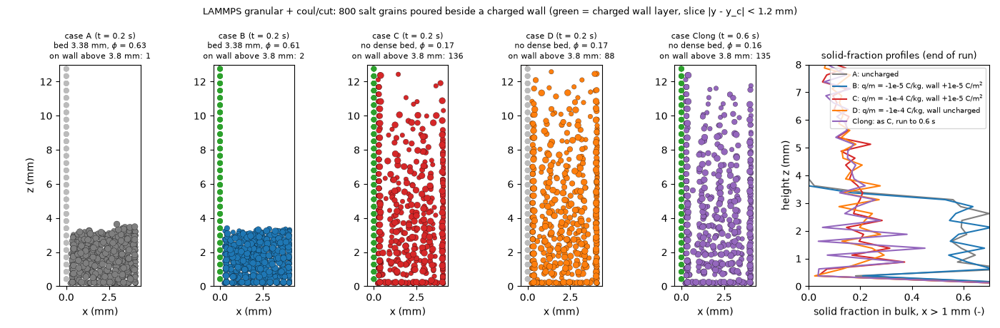

# dem-lammps-charge: tribocharged salt grains poured beside a charged wall (LAMMPS granular + coul/cut)

## What it models and why it matters here

Salt grains carrying a unipolar tribocharge settle beside a wall that carries the opposite charge,
standing in for a PLA/PETG surface the powder has rubbed against. The run compares how the grains
settle, how densely they pack and how many stick to the wall, at zero, realistic and near-maximum
charge. This bears on the doser's electrostatic questions: powder clinging to 3D-printed walls,
dosing drift in dry air or an argon glove box, and whether charging is strong enough to change the
dosing fingerprint for grains this size.

## Code and version

* LAMMPS 7 Feb 2024, Update 1: the Ubuntu 24.04 package `lammps` 20240207+dfsg-1.1build3, binary
  `lmp`, serial.
* `atom_style hybrid sphere charge`, `pair_style hybrid/overlay granular coul/cut`.
* Post-processing: Python 3.12 with numpy, matplotlib and imageio (venv).

## Setup

| Item | Value |
|---|---|
| Domain | x ∈ [−0.3, 4.25] mm (walls), y periodic over 4.25 mm, z from the floor to a lid at 19.5 mm |
| Grains | 800 spheres: 240 × 0.361 mm, 320 × 0.425 mm, 240 × 0.489 mm, ρp = 2165 kg/m³. They start at random non-overlapping positions at z = 4–18.5 mm and fall under gravity. |
| Charged wall | one square layer of 300 frozen 0.425 mm spheres at x = 0 (spacing 0.425 mm, up to z = 12.8 mm). Each carries q_w = σ_w a² = 1.8 pC for σ_w = 1×10⁻⁵ C/m². The floor, far wall and lid are smooth uncharged `wall/gran` planes. |
| Contact | Hertz (`hertz/material`, E = 2×10⁵ Pa, ν = 0.3, e = 0.5 via Tsuji damping); Mindlin friction 0.5 between grains and 0.4 against walls; SDS rolling μr = 0.3; no cohesion |
| Electrostatics | `coul/cut` with a 1.2 mm cutoff (2.8 d), dielectric constant 1 (air), q_i = (q/m)·m_i (unipolar, negative). At the centre of a grain touching the wall layer (0.425 mm from its plane), the cutoff keeps 67 % of the field of an infinite charged sheet, 1 − z/√(z² + r_c²). |
| Time | dt = 1×10⁻⁵ s, 20,000 steps (0.2 s); case Clong runs 60,000 steps (0.6 s) |

Cases:

| Case | q/m of the grains | σ of the wall | Notes |
|---|---|---|---|
| A | 0 | 0 | reference |
| B | −1×10⁻⁵ C/kg | +1×10⁻⁵ C/m² | upper end of the 10⁻⁶–10⁻⁵ C/kg range given in the task brief for tribocharged powders; q = 0.87 pC on a 0.425 mm grain |
| C | −1×10⁻⁴ C/kg | +1×10⁻⁵ C/m² | near the air-breakdown (Gauss) limit of a single 0.425 mm grain: σ_max = ε0 E_b = 2.7×10⁻⁵ C/m² with E_b = 3 MV/m, which caps q/m at 1.7×10⁻⁴ C/kg |
| D | −1×10⁻⁴ C/kg | 0 | separates grain–grain repulsion from wall attraction |

Assumptions, not measurements: the wall charge density 1×10⁻⁵ C/m² is set below the 2.7×10⁻⁵ C/m²
breakdown limit, and the sign convention (negative salt, positive wall) is arbitrary. For scale:
the infinite-sheet field σ_w/2ε0 = 5.6×10⁵ V/m pulls a case-B grain with 0.58 of its weight and
a case-C grain with 5.8 times its weight. With the cutoff, these become about 0.39 and 3.9 times
the weight at contact. Two touching case-B grains repel with 0.04 of a grain's
weight; two case-C grains repel with 4.4 times it.

## How to rerun

```bash
OUT=/tmp/x; mkdir -p $OUT
lmp -in in.charge -var qm 0.0   -var sigw 0.0  -var tag A -var out $OUT -log $OUT/log.A
lmp -in in.charge -var qm -1e-5 -var sigw 1e-5 -var tag B -var out $OUT -log $OUT/log.B
lmp -in in.charge -var qm -1e-4 -var sigw 1e-5 -var tag C -var out $OUT -log $OUT/log.C
lmp -in in.charge -var qm -1e-4 -var sigw 0.0  -var tag D -var out $OUT -log $OUT/log.D
lmp -in in.charge -var qm -1e-4 -var sigw 1e-5 -var tag Clong -var nrun 60000 -var out $OUT -log $OUT/log.Clong
python analyze.py $OUT .     # charge_settling.png, analysis_summary.json, charge_animation.gif/.mp4
```

## Runtime

Each case ran on 1 core: A 41 s, B 44 s, C 26 s, D 36 s, Clong 68 s (0.6 s simulated). These are
wall-clock times on an oversubscribed runner.

## Result



Animation of case Clong (side view of a 2.4 mm slice, 0–0.6 s):
[GIF](charge_animation.gif), [MP4](charge_animation.mp4).

| Case | t (s) | Bed height (mm) | φ (bulk, x > 1 mm) | Grains touching the wall layer | Of these, above z = 3.8 mm | Kinetic energy at the end (J) |
|---|---|---|---|---|---|---|
| A, uncharged | 0.2 | 3.38 | 0.627 | 60 | 1 | 3.6×10⁻¹⁴ |
| B, −1×10⁻⁵ C/kg, wall +1×10⁻⁵ C/m² | 0.2 | 3.38 | 0.612 | 69 | 2 | 1.2×10⁻¹² |
| C, −1×10⁻⁴ C/kg, wall +1×10⁻⁵ C/m² | 0.2 | no dense bed | 0.167 (column mean) | 210 | 136 | 7.2×10⁻⁸ |
| D, −1×10⁻⁴ C/kg, wall uncharged | 0.2 | no dense bed | 0.168 (column mean) | 156 | 88 | 6.3×10⁻⁸ |
| Clong, as C | 0.6 | no dense bed | 0.163 (column mean) | 210 | 135 | 2.8×10⁻⁸ |

* Bed height is where the bulk solid fraction falls below half its value near the floor.
* "No dense bed" means the solid fraction near the floor stayed below 0.4. For those cases the
  table gives the mean solid fraction from 0.5 to 8 mm.
* "Touching the wall layer" means the grain centre lies within r + a/2 + 5 µm of the wall plane.
  "Above z = 3.8 mm" means higher than the uncharged bed (3.38 mm) plus one grain diameter.

* **At the realistic charge (B), the effect on 0.4 mm salt is small.** The bed settles like the
  uncharged one, packing is 2.4 % looser (0.612 against 0.627), and 9 more grains touch the
  charged wall. This is consistent with electrostatic forces below the grain weight. B is a single
  realization, so differences this small are within run-to-run noise.
* **Near the breakdown limit (C, D and Clong), electrostatics wins over gravity.** No dense bed
  forms. Grain–grain repulsion holds the grains up as an expanded column with φ ≈ 0.17, with or
  without the charged wall, and it is still there at 0.6 s (Clong, kinetic energy falling slowly).
  The charged wall pulls 210 grains into contact, against 156 for the uncharged wall layer, and 136
  of them sit higher than the uncharged bed, against 88.
* **The expanded column is partly a cutoff artifact.** By 0.6 s the grains sit in a loose lattice
  with spacing close to the 1.2 mm cutoff. The sign of the effect (repulsion opposing settling,
  attraction to the wall) is physical. The structure and the exact solid fraction are not, because
  long-range fields and image charges in the floor are absent.

## Status

**Ran.** All five cases completed (A–D for 0.2 s, Clong for 0.6 s).

## Limitations

* `coul/cut` truncates the Coulomb interaction at 1.2 mm. Long-range space-charge fields of the
  whole cloud, and image charges in the floor and walls, are missing; a grounded floor would pull
  the charged grains down. KSPACE solvers (`pppm` with `kspace_modify slab`) exist in this build but
  were not used, to keep each run under a minute.
* Charges are fixed. There is no charge transfer on contact, no charge leakage (humidity), and no
  dielectric polarization of the grains or the PLA.
* Wall charge and sign are assumptions. Grains are spheres with a reduced modulus. The domain is
  small (800 grains, 10 grain diameters across), and each case is a single realization.
