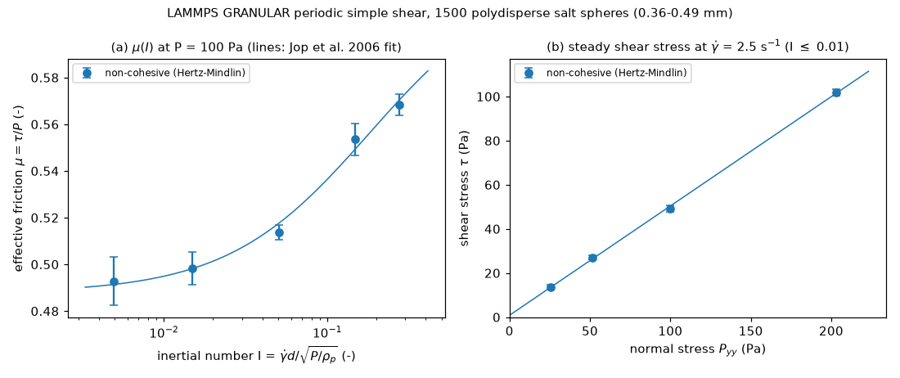

# dem-lammps-shear-mui: μ(I) and the cohesive yield line from periodic simple shear (LAMMPS GRANULAR)

## What it models and why it matters here

Homogeneous simple shear of a fully periodic 3D packing of salt-like spheres at a controlled normal
stress, with no walls. Each stage gives one point of the local rheology μ(I), the effective friction
τ/P against the inertial number I = γ̇ d / √(P/ρp). This is the constitutive input of continuum
(μ(I), Jop, Forterre & Pouliquen 2006) models of hopper and auger flow. It is also a numerical
analogue of the steady-shear part of a shear-cell test (FT4, ASTM D7891; Schulze ring shear,
D6773). The low-I plateau μs is the steady-state internal friction, and with cohesion the
intercept of the τ–P line is the cohesion c that sets the unconfined yield strength and ffc.

## Code and version

* LAMMPS 7 Feb 2024, Update 1: the Ubuntu 24.04 package `lammps` 20240207+dfsg-1.1build3,
  binary `lmp`, GRANULAR package, serial (1 MPI rank, `OMP_NUM_THREADS=1`).
* Post-processing: Python 3.12 with numpy, scipy, matplotlib, imageio and imageio-ffmpeg (venv).

## Setup

| Item | Value |
|---|---|
| Particles | 1500 spheres: 450 × 0.361 mm, 600 × 0.425 mm, 450 × 0.489 mm (number fractions 0.3/0.4/0.3), ρp = 2165 kg/m³ |
| Box | fully periodic triclinic cell, about 4.6–4.8 mm on a side (about 11 grain diameters) |
| Normal contact | `hertz/material`: E = 2×10⁵ Pa (the reduced modulus of the PR #180 LIGGGHTS twin), ν = 0.3, restitution 0.5 through Tsuji damping |
| Tangential, rolling, twisting | Mindlin, μs = 0.5; SDS rolling resistance μr = 0.3 (k_roll = 1 N/m, no rolling damping); Marshall twisting. There are no walls, so the particle–wall friction (0.4) does not enter. |
| Cohesive variant | `jkr` with γ = 8.5 mJ/m². The nominal pull-off force 3πγR* is 8.5 µN for two 0.425 mm grains, 10 times the grain weight, so the **granular Bond number Bo_g ≈ 10**. The cohesion number F/(P d²) is 0.24 at 200 Pa, 0.47 at 100 Pa and 1.9 at 25 Pa. LAMMPS refuses Tsuji damping with JKR (`ERROR: Cannot use tsuji model with a cohesive normal model, jkr`, the first JKR attempt), so this case uses `damping mass_velocity` with η_n0 = 3500 s⁻¹, which gives e ≈ 0.5 for a 4×10⁻⁴ s contact. |
| Time step | 1×10⁻⁵ s, about 22 steps per contact at 100 Pa |
| Protocol | Random insertion at solid fraction φ = 0.15, then affine isotropic compression to φ = 0.55 (10,000 steps). Shear stages then use Lees–Edwards boundaries (`fix deform xy erate … remap v`). |
| Pressure control | `fix press/berendsen` refuses triclinic boxes in this build (`ERROR: Cannot use fix press/berendsen with triclinic box`). Pyy is therefore held by feedback: every 100 steps the box height is rescaled affinely (`change_box all y scale s remap`) with s = 1 + g(⟨Pyy⟩ − P)/P, where g = 0.2 P/K, K ≈ 1.07×10⁴ (P/100 Pa)^(1/3) Pa, and s is clamped to ±0.5 %. |
| Stages, non-cohesive | γ̇ = 2.5, 7.5, 25, 75, 150 s⁻¹ at P = 100 Pa (strain 2.5, 2, 3, 4, 5), then P = 200, 50, 25 Pa at γ̇ = 2.5 s⁻¹ (strain 1.5 each) |
| Stages, JKR | reduced to fit the time budget: γ̇ = 2.5, 25, 150 s⁻¹ at 100 Pa (strain 2, 2, 4), then P = 200 and 25 Pa at 2.5 s⁻¹ (strain 1 each) |
| Measurement | `compute pressure` with `temp/deform` (contact virial plus kinetic stress relative to the streaming profile); μ = −Pxy/Pyy; I uses d = 0.425 mm. Averages are over the second half of each stage (the last 1.0 strain for the first stage). Error bars are the standard error from 4 consecutive blocks. |

## How to rerun

```bash
bash run.sh            # both cases, then analyze.py; OUT=/some/dir to move the scratch output
# or one case:
lmp -in in.shear -var gamma 0.0 -var tag noncoh -var nsc 1.0 -var out /tmp/x -log /tmp/x/log.noncoh
python analyze.py /tmp/x .     # writes analysis_summary.json, shear_mu_I.png, shear_animation.gif/.mp4
```

`-var nsc 0.02` runs a 2 % length smoke test in a few seconds.

## Runtime

Non-cohesive: 654 s wall clock, 1 core, 337,500 steps. The 4-core runner was heavily
oversubscribed by other jobs (load average 9–14) during the run. JKR: see Status.

## Result



Animation of the first two non-cohesive stages (slice through the cell, with one band of grains
coloured red to show the shear): [GIF](shear_animation.gif), [MP4](shear_animation.mp4).

**Non-cohesive, P = 100 Pa:**

| γ̇ (1/s) | I | μ = τ/P | φ |
|---|---|---|---|
| 2.5 | 0.0050 | 0.493 ± 0.010 | 0.561 |
| 7.5 | 0.015 | 0.498 ± 0.007 | 0.561 |
| 25 | 0.050 | 0.514 ± 0.003 | 0.556 |
| 75 | 0.148 | 0.554 ± 0.007 | 0.551 |
| 150 | 0.275 | 0.568 ± 0.005 | 0.543 |

* Jop et al. fit, μ(I) = μs + (μ2 − μs)/(1 + I0/I): **μs = 0.488**, μ2 = 0.625, I0 = 0.18. μ2 and
  I0 are weakly constrained because I ≤ 0.28.
* Yield line at γ̇ = 2.5 s⁻¹ (I = 0.0035–0.0098) over P = 25–200 Pa: **τ = 0.495 P + 0.85 Pa**. The
  intercept is zero within the noise, as expected without cohesion. The steady-state internal
  friction angle is atan 0.495 = 26.3°.

JKR results: see Status.

## Status

Non-cohesive: **ran**, at the scale above. JKR: first attempt **failed** (Tsuji damping refused
with JKR, see Setup); rerun queued with mass_velocity damping (this section is updated below if it
completed).

## Limitations

* Small cell (about 11 d) and short averaging windows (0.5–1 strain units, 7–200 samples), so μ
  carries a few percent of statistical error (larger at 25 Pa). There is one realization per case.
* Spheres with rolling resistance stand in for cubic salt grains. The modulus is reduced to
  2×10⁵ Pa, so overlaps are about 1 % of d at 100 Pa. This is still close to the rigid limit, but
  not the real salt stiffness.
* The box height is changed between 100-step blocks, not continuously. The ±0.5 % clamp slows the
  pressure response in the short high-rate stages: the γ̇ = 150 s⁻¹ stage averaged Pyy = 116 Pa
  instead of 100 Pa.
* The JKR case uses a different damping law (mass_velocity, not Tsuji) because LAMMPS forbids Tsuji
  with JKR. μ in the dense regime depends only weakly on restitution, but the non-cohesive and
  cohesive runs differ in more than cohesion alone.
* Steady flow only. Shear-cell yield loci also need pre-shear and incipient-failure points, which
  this protocol does not reproduce.
