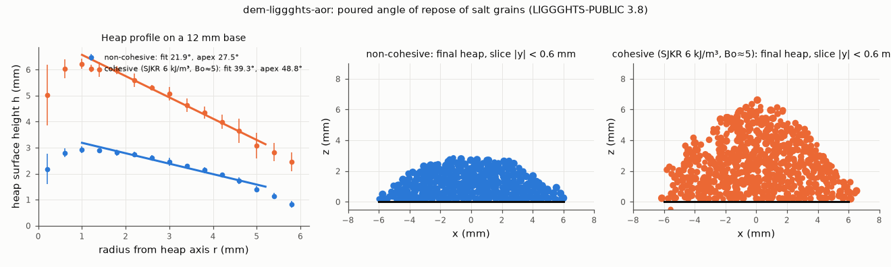

# dem-liggghts-aor: poured angle of repose (ISO 4324 style, reduced scale)

## What it models and why it matters here
A heap is poured onto a fixed-diameter base and its slope is read off, as in ISO 4324. The static angle of
repose is one of the standard flowability numbers the paper compares the dosing fingerprint against. It is
also the simplest test of whether a DEM parameter set (friction, rolling friction, cohesion) gives a
plausible bulk response before it is used in the auger twin.

## Code and version
LIGGGHTS-PUBLIC 3.8.0, Debian/Ubuntu package `liggghts` (compiled 2024-03-31), run serially (1 MPI rank, OMP_NUM_THREADS=1).

## Setup
* Base: a 12 mm diameter disk (STL mesh, about 28 mean grain diameters). ISO 4324 uses 100 mm, so this is
  a reduced-scale test. Grains that roll off the rim leave the box and are deleted.
* Pour: 4000 grains inserted at 8000 grains/s (0.72 g/s) in a 3 mm wide cylinder 10–14 mm above the base,
  with 0.1 m/s downward velocity. This stands in for the funnel outlet. Settling time after the pour is 0.35 s.
* Grains: real-size salt (no coarse-graining). Diameters 0.361/0.425/0.489 mm in number fractions 0.3/0.4/0.3,
  density 2165 kg/m³. Hertz–Mindlin with tangential history, EPSD2 rolling friction. E = 2×10⁵ Pa (reduced as in
  the PR #180 twin), ν = 0.3, e = 0.5, μ(grain–grain) = 0.5, μ(grain–wall) = 0.4, μ_roll = 0.3. Time step
  2.06×10⁻⁵ s (20 % of the Rayleigh time of the smallest grain).
* Cohesive variant: SJKR cohesion between grains, cohesion energy density k = 6000 J/m³ (no grain–wall cohesion).
  How k was chosen: with Hertz plus SJKR, the net normal force between two equal spheres is
  F(δ) = (4/3)E*√R* δ^1.5 − kπRδ. Its most attractive value (the pull-off force) is (4/27)A³/B², with A = kπR and
  B = (4/3)E*√R*. Dividing by the grain weight gives a granular Bond number of 4.2, 4.9 and 5.8 for the 0.489,
  0.425 and 0.361 mm grains at E = 2×10⁵ Pa (`ligcommon.bond_number_sjkr`). Bo ∝ k³/(E*²R), so the same k
  gives a different Bo at another stiffness or grain size.
* Repose angle, two readings of the final heap:
  1. **Profile fit:** the top of the heap is taken in 0.4 mm radial bins and 8 angular sectors and averaged
     over the sectors. A line is fitted for 1.0 < r < 5.2 mm. The ± is the scatter of the 8 per-sector fits.
  2. **Apex (ISO 4324 formula):** atan(apex height / base radius).

## How to rerun
```
python3 -m venv /tmp/venv-liggghts && /tmp/venv-liggghts/bin/pip install numpy matplotlib imageio imageio-ffmpeg
sudo apt-get install -y liggghts
/tmp/venv-liggghts/bin/python run.py dry     # writes /tmp/sims-scratch/dem-liggghts-aor/dry/{in.aor,dump/,run.json}
/tmp/venv-liggghts/bin/python run.py coh
/tmp/venv-liggghts/bin/python figures.py     # aor.png, aor.gif, aor.mp4, result.json
```
`run.py` also has `cap_low` / `cap_high` variants (liquid bridges), which are reported in `../dem-liggghts-capillary/`.

## Runtime
96 s (dry) and 87 s (cohesive) wall clock, 1 core each, 0.85 s of physical time, up to about 3500 grains.

## Result


| variant | grains left on base | profile-fit angle | apex angle atan(H/R) | apex height |
|---|---|---|---|---|
| non-cohesive | 2530 of 4000 | **21.9° ± 1.4°** | 27.5° | 3.13 mm |
| cohesive, SJKR 6 kJ/m³ (Bo ≈ 5) | 3431 of 4000 | **39.3° ± 3.6°** | 48.8° | 6.86 mm |

Animation (slice |y| < 0.6 mm, coloured by speed): [aor.gif](aor.gif), [aor.mp4](aor.mp4).

* A Bond number of about 5 raises the poured repose angle by about 17° (profile fit). The cohesive heap is
  also visibly porous, and it ends in a 2–3 mm high cliff at the rim instead of running out to zero height.
* That cliff makes the ISO apex formula overstate the cohesive angle (48.8° against 39.3°), because the formula
  assumes the heap reaches zero height at the rim. The profile fit is the better number here.
* The non-cohesive spheres give 22–28°, below the 30–35° usually quoted for table salt. EPSD2 rolling friction
  of 0.3 only partly stands in for the cubic grain shape.

## Status
**Ran** (both variants), at reduced scale: a 12 mm base instead of 100 mm.

## Limitations
* The base is 28 grain diameters across and the heap is only about 7–16 grains tall, so the angle has a few
  degrees of discretisation and sector-to-sector scatter. The pour stream is an insertion region, not a modelled funnel.
* The angle depends on the pour rate and drop height, which were not varied.
* Spheres with rolling friction are used, not cubes. E is reduced 10⁵-fold, which also inflates SJKR
  cohesion for a given k (overlaps are larger). The Bond number quoted is for this softened stiffness.
* There is a single run per variant, with no repeat seeds.
