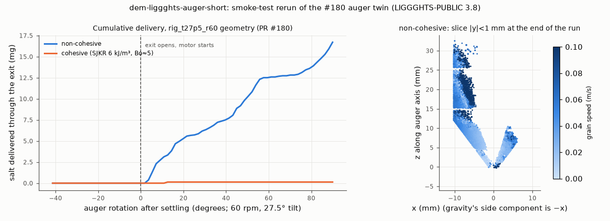

# dem-liggghts-auger-short: smoke-test rerun of the PR #180 auger twin (dry vs cohesive)

## What it models and why it matters here
The rig's rotating-tube auger: the CAD `threaded-auger-final` geometry with its 12 mm cone and the core tip
inside the Ø3 mm exit, tilted 27.5° and turning at 60 rpm. This is case `rig_t27p5_r60` of the PR #180
LIGGGHTS twin. The run checks two things:
* that the twin can be regenerated and rerun from the #180 branch's scripts;
* how a Bond-number-about-5 SJKR cohesion changes the mass delivered in a partial revolution. Dosing per
  revolution, its pulsing and stalled increments are the dosing fingerprint that the paper relates to powder cohesion.

## Code and version
LIGGGHTS-PUBLIC 3.8.0, Debian/Ubuntu package `liggghts`, run serially (1 core, STL meshes).
`geometry.py` and `run_case.py` are copied unchanged from branch `claude/issue-158-20261010-0534` (`sim/dem/`).

## Setup
* **Geometry, grains, contacts, gravity and feed** are exactly those of `rig_t27p5_r60` (see `auger_short_*.json`
  and the generated decks `in.auger_short_*`):
  * bore 20.9 mm, core 7.96 mm, pitch 10.4 mm, 1.5 flight turns meshed, 12 mm cone to the Ø3 mm exit, core tip
    radius 0.43 mm;
  * about 28.9 k real-size salt grains prefilled (0.361/0.425/0.489 mm), plus a feed region at the top;
  * Hertz–Mindlin, E = 2×10⁵ Pa, ν = 0.3, e = 0.5, μ_pp = 0.5, μ_pw = 0.4, EPSD2 μ_roll = 0.3,
    dt = 2.06×10⁻⁵ s.
* **Changed for this smoke test:** `revs` 1.5 → 0.25, `stop_s` 0.6 → 0 (no afterflow phase), dumps every
  12.5 ms, `mesh_format` "stl" and `np` 1.
* **Schedule:** settle 0.12 s with the exit plugged, then the plug is removed and the auger turns for 0.25 s
  (90°). Grains crossing a counting disk below the exit are counted and deleted (`fix massflow/mesh`).
* **Cohesive variant:** the same, plus SJKR cohesion with k = 6000 J/m³ on all contacts (grain–grain and
  grain–auger). The pull-off Bond number is about 5 at this stiffness; see `../dem-liggghts-aor/README.md`.

## How to rerun
```
sudo apt-get install -y liggghts openmpi-bin
/tmp/venv-liggghts/bin/python run_case.py auger_short_dry.json --workdir /tmp/sims-scratch/dem-liggghts-auger-short/auger_short_dry
/tmp/venv-liggghts/bin/python run_case.py auger_short_coh.json --workdir /tmp/sims-scratch/dem-liggghts-auger-short/auger_short_coh
/tmp/venv-liggghts/bin/python figures.py      # auger_short.png, auger_short.gif/.mp4 (dry), result.json
```
(or `run.sh`, which does all three).

## Runtime
COH_RUNTIME

## Result


COH_RESULT

Animation of the dry run (slice |y| < 1 mm through the auger axis, coloured by speed): [auger_short.gif](auger_short.gif), [auger_short.mp4](auger_short.mp4).

## Status
COH_STATUS

## Limitations
* **Short window.** A quarter revolution is not a per-revolution dose. #180 found strong pulsing within each
  revolution, so 0.25 rev values cannot be scaled to mg/rev with any accuracy.
* **One seed, no afterflow phase.**
* **Cohesion value.** k = 6000 J/m³ is illustrative (Bond number about 5 at the softened E), not calibrated
  to salt. Real dry salt is nearly cohesionless, and humid salt would need the capillary model (see `../dem-liggghts-capillary`).
* **Model limits inherited from #180:** spheres with rolling friction, E reduced, 1.5 flight turns meshed,
  and the rig's fill level not modelled.
