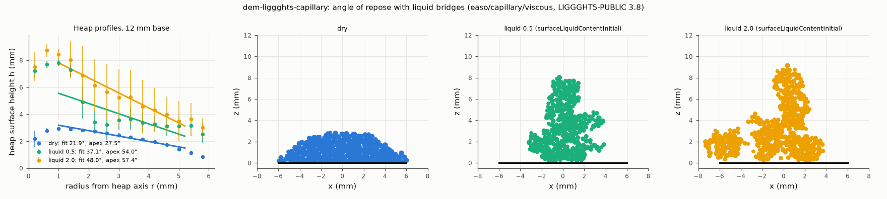

# dem-liggghts-capillary: liquid-bridge (moisture) cohesion in the angle-of-repose test

## What it models and why it matters here
Salt is hygroscopic. At humid conditions, liquid (brine) bridges form between grains. The resulting capillary
cohesion is the main way humidity changes the salt's flow, the dosing fingerprint and the standard tests. Here
the poured-heap test of `../dem-liggghts-aor` is repeated with LIGGGHTS's liquid-bridge contact model at two
liquid contents.

## Code and version
LIGGGHTS-PUBLIC 3.8.0, Debian/Ubuntu package `liggghts`, run serially (1 core).
* **The model is in the Debian build.** `liggghts -h` lists the cohesion models `easo/capillary/viscous`,
  `washino/capillary/viscous`, `sjkr` and `sjkr2`. `easo/capillary/viscous` was used.
* **How to set it up** (found by trial; the binary's strings list the property names):
  * It needs these global properties: `surfaceTension`, `fluidViscosity`, `contactAngle` (peratomtype, in
    degrees: LIGGGHTS checks 0 ≤ θ ≤ 180), `maxSeparationDistanceRatio`, `minSeparationDistanceRatio` and
    `surfaceLiquidContentInitial`.
  * Two attempts failed:
    * `set group all property/atom surfaceLiquidContent ...` before insertion gives
      `ERROR: Set command with no atoms existing`.
    * A pair-style keyword `initial_liquid_content` gives
      `ERROR: Unknown argument or wrong keyword order: 'initial_liquid_content'`. That keyword belongs to the
      mesh liquid-transfer module.
  * Grain–wall contacts stay dry; the code prints "Using cohesion model easo/capillary/viscous for walls only
    supports dry walls".

## Setup
* **Pour and heap:** identical to `../dem-liggghts-aor`. 4000 real-size salt grains (0.361/0.425/0.489 mm)
  are poured at 8000 grains/s onto a 12 mm base. Hertz–Mindlin, E = 2×10⁵ Pa, ν = 0.3, e = 0.5, μ = 0.5/0.4,
  EPSD2 μ_roll = 0.3, dt = 2.06×10⁻⁵ s. Run for 0.85 s.
* **Liquid** (water-like): surface tension 0.072 N/m, viscosity 1 mPa s, contact angle 20°.
  * Bridges rupture at 1.1 × the contact distance (`maxSeparationDistanceRatio` 1.1).
  * `minSeparationDistanceRatio` is 1.01.
* **Liquid content:** `surfaceLiquidContentInitial` = **0.5** (`cap_low`) and **2.0** (`cap_high`). The
  LIGGGHTS documentation describes this as liquid volume in % of the particle volume; I did not check that
  against the source.
* **Expected strength:** a capillary bridge between two 0.425 mm grains pulls with up to about
  2πRγcos θ ≈ 9×10⁻⁵ N. That is about 100 times the grain weight (granular Bond number of order 100), far above
  the Bo ≈ 5 of the SJKR variant.
* **Dry baseline:** the dry run of `../dem-liggghts-aor` (same deck without cohesion).

## How to rerun
```
/tmp/venv-liggghts/bin/python run.py dry        # writes to /tmp/sims-scratch/dem-liggghts-aor/<variant>/
/tmp/venv-liggghts/bin/python run.py cap_low
/tmp/venv-liggghts/bin/python run.py cap_high
/tmp/venv-liggghts/bin/python figures.py        # capillary.png, capillary.gif/.mp4, result.json
```
(`run.py` and `ligcommon.py` are copies of the ones in `../dem-liggghts-aor`.)

## Runtime
61 s (`cap_low`) and 82 s (`cap_high`) wall clock, 1 core each. The dry run took 96 s.

## Result


| variant | grains left on base | profile-fit angle (± sector scatter) | apex angle atan(H/R) | apex height |
|---|---|---|---|---|
| dry | 2530 of 4000 | 21.9° ± 1.4° | 27.5° | 3.13 mm |
| liquid 0.5 | 2173 of 4000 | 37.1° ± 10.5° | 54.0° | 8.26 mm |
| liquid 2.0 | 2488 of 4000 | 48.0° ± 16.2° | 57.4° | 9.39 mm |

Animation of the two wet pours (slice |y| < 0.6 mm, coloured by speed): [capillary.gif](capillary.gif), [capillary.mp4](capillary.mp4).

* **The wet grains do not form a cone.** They clump already in the pour stream, build a column (stalagmite)
  under the pour point and leave clumps, overhangs and a ragged plateau around it.
  * In both wet runs the insertion region was repeatedly blocked by clumped grains ("Less insertions than
    requested" 28 and 27 times; none in the dry and SJKR runs). All 4000 grains were inserted in the end, but
    in bursts, and clumps fell off the rim.
  * In the 0.5 run the number of grains in the domain dropped by about 500 within 0.05 s (0.35–0.40 s).
    That is a clump leaving over the rim, not an instability: the kinetic energy stayed at about 1×10⁻⁶ J.
* **The "angles" above are line fits to non-conical heaps.** Their sector-to-sector scatter is 10–16°, against
  1.4° dry. They should be read as "much steeper and irregular", not as repose angles.
* **More liquid gave a taller, steeper heap in this single pair of runs.** In the pendular regime the
  bridge force barely depends on volume, but the rupture distance grows with volume. The difference between
  0.5 and 2.0 is within the irregularity of one run each.
* **The ISO 4324 method itself breaks down at this level of moisture.** A powder at Bo of order 100 would not
  pour through the standard funnel either. That is consistent with humid salt bridging in the doser.

## Status
**Ran** (dry baseline + two liquid contents), at reduced scale: a 12 mm base.

## Limitations
* The bridge force is about 100 × the grain weight with a water-like liquid. Lower moisture levels (thin
  adsorbed films, Bo of about 1–10) would need a smaller effective surface tension or contact-angle factor;
  those were not run.
* Liquid content and contact angle are nominal, not measured for brine on NaCl. The dissolution and
  recrystallisation (caking) of salt bridges are not modelled.
* Grain–wall contacts are dry, and the base is small (28 grain diameters). There is one run per liquid
  content, and the pour rate and drop height were not varied.
* E is reduced to 2×10⁵ Pa, so the capillary forces cause overlaps of a few % of d.
