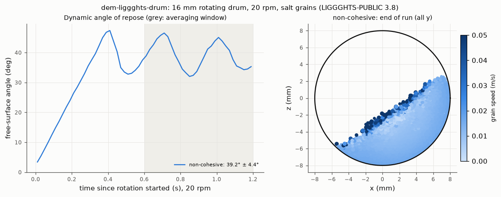

# dem-liggghts-drum: rotating drum, dynamic angle of repose

## What it models and why it matters here
This is a slowly rotating, partly filled drum, as in the GranuDrum or the Revolution Powder Analyzer. The free
surface angle and its avalanche-to-avalanche swings are standard dynamic flowability measures. In the drum the
powder flows continually under its own weight at low stress, as it does in the auger doser's flights. That
makes it a closer analogue of the dosing fingerprint than a static heap.

## Code and version
LIGGGHTS-PUBLIC 3.8.0, Debian/Ubuntu package `liggghts`, run serially (1 core).

## Setup
* **Drum:** 16 mm inner diameter, axis along y, simulated as a 2.55 mm thick slice (6 mean diameters) that is
  periodic in y, so there are no end walls.
* **Drum wall:** a ring of 2030 frozen 0.3 mm spheres (203 around × 10 along y, alternate rows offset). They are
  rotated rigidly with `fix move rotate`. A rough wall like this stops the bed from slipping, as the knurled or
  rough walls of real drums do. A smooth mesh with μ_wall = 0.4 would slip.
* **Fill:** 2400 real-size salt grains (about 35 % of the drum cross-section), filled under gravity for 0.25 s.
  Then 1.2 s of rotation at 20 rpm.
  * Froude number ω²R/g = 0.0036. In an 84 mm GranuDrum that is about 9 rpm.
* **Grains:** the reference salt. Diameters 0.361/0.425/0.489 mm (0.3/0.4/0.3), 2165 kg/m³, Hertz–Mindlin,
  E = 2×10⁵ Pa, ν = 0.3, e = 0.5, μ = 0.5, EPSD2 μ_roll = 0.3, dt = 2.06×10⁻⁵ s.
* **Angle:** in each 0.02 s dump, the top of the bed is taken in 24 bins across the central 60 % of the drum
  width, and a line is fitted to it. The angles are averaged over 0.6–1.2 s after the start of rotation.

## How to rerun
```
/tmp/venv-liggghts/bin/python run.py dry     # writes /tmp/sims-scratch/dem-liggghts-drum/dry/{in.drum,dump/,run.json}
/tmp/venv-liggghts/bin/python figures.py     # drum.png, drum.gif, drum.mp4, result.json
```
`run.py coh` runs the same drum with SJKR cohesion (6 kJ/m³). It was queued last as optional; see Status.

## Runtime
239 s wall clock, 1 core, 1.45 s of physical time, 4430 spheres (2400 grains and 2030 wall spheres). The
runner was shared (load average about 10).

## Result


* After about 0.4 s of rigid rotation the bed reaches the slumping (avalanching) regime that is typical of
  very low Froude numbers. The surface angle saw-tooths with a period of about 0.3 s.
* Mean surface angle over 0.6–1.2 s: **39.2° ± 4.4°** (mean ± standard deviation over the dumps).
* Maximum angle before an avalanche: **46.5° and 45.1°** (two avalanches in the window).
* Angle after an avalanche: **32.0° and 34.3°**.
* The swing between those two angles, about 12°, is the avalanche amplitude that GranuDrum-type indices are based on.

Animation (all y projected, coloured by speed; wall spheres grey): [drum.gif](drum.gif), [drum.mp4](drum.mp4).

The mean dynamic angle (39°) is well above this parameter set's static poured angle (22–28°,
`../dem-liggghts-aor`). The two numbers differ partly because the drum is a different test (rest angle against
maximum angle of stability). The other part is geometry: the rough rotating wall and the thin periodic slice.

## Status
**Ran** (non-cohesive), at reduced scale: a 16 mm drum and a thin periodic slice. A cohesive drum run was
optional and only queued after the required runs.

## Limitations
* **Short run.** Only two avalanches fall in the averaging window, which is less than half a revolution, so
  the mean and the extrema are rough.
* **Geometry.**
  * The drum is 38 grain diameters across.
  * There are no end walls: real drums have glass side walls, which raise the angle.
  * The rough wall of glued spheres differs from a real drum surface.
* **Stiffness.** E is reduced to 2×10⁵ Pa.
* **Rotation speed.** Only one speed was run; the rpm dependence was not explored.
* **Angle definition.** The angle comes from a straight-line fit. At higher rpm the surface becomes S-shaped
  and this definition would need revisiting.
