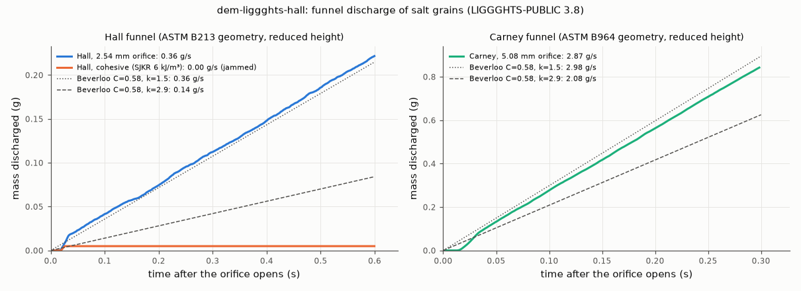

# dem-liggghts-hall: Hall and Carney funnel discharge (ASTM B213 / B964 geometry)

## What it models and why it matters here
The Hall flowmeter (2.54 mm orifice) and the Carney funnel (5.08 mm) time 50 g of powder through a 60° funnel.
They are the most common flow-rate tests, and the paper compares the doser's fingerprint against them. A small
orifice relative to the grain size is also the regime of the doser's Ø3 mm cone exit with the core tip in it:
#180 found arching and a jamming cliff at about 4 grain diameters there. Free-fall discharge is checked against
the Beverloo correlation.

## Code and version
LIGGGHTS-PUBLIC 3.8.0, Debian/Ubuntu package `liggghts`, run serially (1 core).

## Setup
* **Funnel (STL mesh):** a 60° included-angle cone (30° from vertical) with a 3.2 mm long cylindrical orifice,
  2.54 mm (Hall) or 5.08 mm (Carney) in diameter.
  * The funnel is truncated at a reduced top radius (7 mm Hall, 9 mm Carney; cone heights 9.9 and 11.2 mm),
    with a short cylinder on top. The real funnels hold 50 g.
  * Grain–wall friction 0.4.
* **Fill:**
  * Hall: 5000 real-size salt grains. Carney: 12 000.
  * The grains are placed at random in the top cylinder, fall into the funnel with the orifice plugged by a
    plane, and settle for 0.25 s.
  * The plug is then removed. Discharge runs for 0.6 s (Hall) or 0.3 s (Carney).
* **Counting:** a disk 1.8 mm below the orifice counts and deletes the grains (`fix massflow/mesh`).
* **Flow rate:** a linear fit of discharged mass over 0.05 s after opening to the end of the run. Steadiness
  is checked from 25 ms windows.
* **Grains:** diameters 0.361/0.425/0.489 mm (0.3/0.4/0.3), 2165 kg/m³, Hertz–Mindlin, E = 2×10⁵ Pa, ν = 0.3,
  e = 0.5, μ = 0.5, EPSD2 μ_roll = 0.3, dt = 2.06×10⁻⁵ s.
* **Beverloo:** W = C ρ_b √g (D₀ − k d)^2.5 with C = 0.58, d = 0.425 mm, and k = 1.5 (spheres) to 2.9
  (angular grains).
  * ρ_b = 1249 kg/m³, the loose-poured packing fraction 0.577 from `../dem-liggghts-tap`.
  * This is the flat-bottomed form. A 30° cone usually flows somewhat faster.
* **Cohesive Hall variant:** SJKR k = 6000 J/m³ between grains (no grain–wall cohesion), same fill and discharge time.

## How to rerun
```
/tmp/venv-liggghts/bin/python run.py hall   --rho-b 1249
/tmp/venv-liggghts/bin/python run.py carney --rho-b 1249
/tmp/venv-liggghts/bin/python run.py hall_coh --rho-b 1249     # optional cohesive case
/tmp/venv-liggghts/bin/python figures.py                          # hall.png, hall.gif, hall.mp4, result.json
```
The exact LIGGGHTS input decks that were run are in [`decks/`](decks/). Meshes (STL) and data are regenerated by `run.py`; dumps and logs stay in `/tmp/sims-scratch/`.
Bulky output goes to `/tmp/sims-scratch/dem-liggghts-hall/<case>/`.

## Runtime
172 s (Hall, 5000 grains), 178 s (Carney, 12 000 grains) and 116 s (cohesive Hall, 5000 grains) wall clock, 1 core each. The runner was shared (load average about 10).

## Result


| funnel | orifice D₀ (D₀/d) | simulated mass flow | time per 50 g (extrapolated) | Beverloo k = 1.5 | Beverloo k = 2.9 | 25 ms window rates | jammed? |
|---|---|---|---|---|---|---|---|
| Hall | 2.54 mm (6.0) | **0.363 g/s** | **138 s** | 0.358 g/s | 0.140 g/s | 0.29–0.45 g/s, none zero | no (2461 grains out in 0.6 s) |
| Carney | 5.08 mm (12.0) | **2.87 g/s** | **17.4 s** | 2.98 g/s | 2.08 g/s | 2.78–2.94 g/s | no (9243 grains out in 0.3 s) |
| Hall, cohesive (Bo ≈ 5) | 2.54 mm (6.0) | **0** after the first 0.05 s | no flow | (0.358 g/s if free-flowing) | | 0 in every window after 0.05 s | **yes** (56 grains out, then an arch) |

* **Both funnels flow steadily.** With these sphere-like grains, the Hall orifice at D₀/d = 6 neither jammed
  nor stalled in any 25 ms window over 0.6 s.
* **The rates match Beverloo** with C = 0.58 and the sphere value k = 1.5, within 1 % (Hall) and 4 % (Carney).
  The 2.9 used for angular sands would predict 40–60 % less. The simulation is therefore consistent with free
  sphere flow; it does not check angular salt.
* **Cohesive Hall (SJKR 6 kJ/m³, Bo ≈ 5): it jams.**
  * 56 grains (4.9 mg) fell out within about 0.05 s of opening.
  * After that an arch held, and nothing more came out in the remaining 0.55 s, with 4933 grains still in the funnel.
  * A mildly cohesive version of the same salt therefore gives "no flow" in the Hall funnel, as cohesive powders
    do in practice. This is the same Bond number that cut the auger's quarter-revolution output from 182 grains
    to 1 (`../dem-liggghts-auger-short`).
* **For the paper:** 50 g of 0.43 mm salt would take about 2.3 min through a Hall funnel. This is slow but
  measurable: the Hall test is specified for metal powders roughly 3 × denser.
  * About 17 s through a Carney funnel.
  * Both scale with bulk density and with (D₀ − k d)^2.5.

Animation (Hall and Carney side by side, slice |y| < 0.6 mm, coloured by speed): [hall.gif](hall.gif), [hall.mp4](hall.mp4).

## Status
**Ran** (Hall and Carney, non-cohesive), at reduced funnel height (0.2–0.8 g discharged and extrapolated to 50 g). The optional cohesive Hall case: **ran**: it jammed (see Result).

## Limitations
* **Reduced height.** The funnels are cut short and hold 0.5–1 g instead of 50 g, so the time per 50 g is an
  extrapolation of the steady rate. Head and fill effects on the real 50 g test are not captured, although
  Beverloo flow is nearly independent of head.
* **Short runs and one seed.** Only 0.3–0.6 s of discharge was run. Rare jamming events (arches that need
  seconds to form) cannot be excluded at D₀/d = 6.
* **Grains.** Spheres with rolling friction instead of angular salt (angular grains have a larger k, which
  slows the flow). E is reduced to 2×10⁵ Pa.
* **No humidity or electrostatics.** Their effects on these funnels are not modelled.
