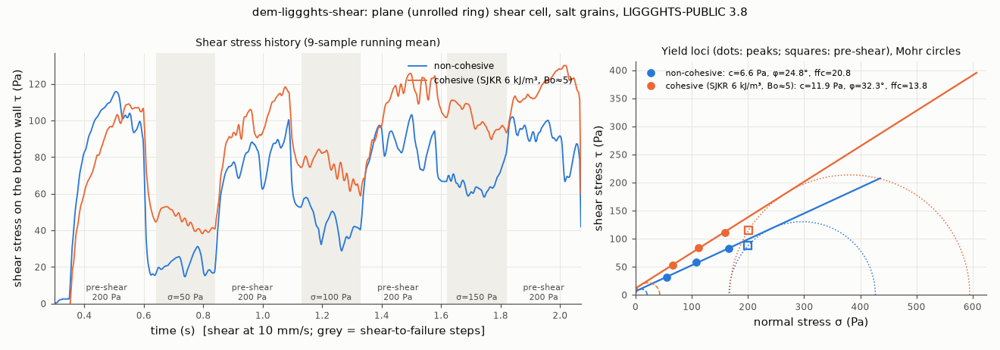

# dem-liggghts-shear: plane shear cell (unrolled Schulze ring shear), yield locus and ffc

## What it models and why it matters here
This is a virtual shear test following the Jenike/Schulze procedure (ASTM D6773 / D7891 style). The sample is
pre-sheared at a consolidation stress, unloaded, and sheared to failure at lower normal stresses. The peak
shear stresses give the yield locus, and from it the cohesion, the internal friction angle and, through Mohr
circles, the flow function coefficient ffc. These are the shear-cell numbers that the paper's dosing
fingerprint and inferred cohesion/friction are compared against.

## Code and version
LIGGGHTS-PUBLIC 3.8.0, Debian/Ubuntu package `liggghts`, run serially (1 core).

## Setup
* **Cell:** 6.8 × 3.4 mm, periodic in x (shear direction) and y. That makes it an annular ring cell unrolled
  into a plane, with no curvature and no side walls.
* **Walls:**
  * Bottom: a frozen square layer of 128 grains, 0.425 mm (rough wall).
  * Lid: the same layer. Its x and y motion is prescribed (`fix move linear vx 0 NULL`). Its z motion is
    integrated under a constant applied force (`fix aveforce`), which gives a constant normal stress, plus a
    weak dashpot (`fix viscous` 1.2×10⁻³ N s/m per lid grain) to stop it bouncing.
* **Fill:** 1800 real-size salt grains, filled under gravity. Gravity is then switched off, so the normal
  stress is uniform through the sample, as in a kPa-loaded cell.
* **Stresses:** τ and σ are the summed contact forces on the frozen bottom layer, divided by the cell area
  (the lid dashpot does not enter them).
* **Procedure:**
  * Consolidate 0.2 s at σ_pre = 200 Pa.
  * Then three times: pre-shear 0.25 s at 10 mm/s and 200 Pa (2.5 mm, shear strain about 0.5), stop,
    relax 0.04 s at σ_i, and shear 0.2 s at 10 mm/s at σ_i = 50, 100 or 150 Pa.
  * A final pre-shear closes the run.
  * Inertial number I ≈ 0.003–0.006 (quasi-static).
* **Grain properties:** as the reference salt. Diameters 0.361/0.425/0.489 mm (0.3/0.4/0.3), 2165 kg/m³,
  Hertz–Mindlin, E = 2×10⁵ Pa, ν = 0.3, e = 0.5, μ = 0.5, EPSD2 μ_roll = 0.3, dt = 2.06×10⁻⁵ s.
* **Cohesive variant:** SJKR k = 6000 J/m³ between all grains, including the wall grains. Pull-off Bond
  number about 5; see `../dem-liggghts-aor/README.md` for the derivation.
* **Analysis:**
  * Peak τ is the maximum of a 9-sample running mean during each shear-to-failure step. σ is the value
    measured at the peak, which differs from the set value because the lid moves.
  * A straight yield locus τ = c + σ tan φ is fitted through the three points.
  * The unconfined yield strength σ_c comes from the Mohr circle through the origin tangent to the locus.
  * The major consolidation stress σ₁ comes from the Mohr circle through the mean pre-shear point, tangent
    to the locus.
  * ffc = σ₁/σ_c.

## How to rerun
```
/tmp/venv-liggghts/bin/python run.py dry      # writes /tmp/sims-scratch/dem-liggghts-shear/dry/{in.shear,stress.txt,dump/,run.json}
/tmp/venv-liggghts/bin/python run.py coh
/tmp/venv-liggghts/bin/python figures.py      # shear.png, shear.gif, shear.mp4, result.json
```

## Runtime
194 s (dry) and 146 s (cohesive) wall clock, 1 core each, 2.07 s of physical time, 2056 grains. The runner was
heavily shared (load average 10–14 on 4 cores).

## Result


| variant | yield-locus points (σ, τ_peak) Pa | c (Pa) | φ_i | pre-shear (σ, τ) Pa | σ_c (Pa) | σ₁ (Pa) | ffc |
|---|---|---|---|---|---|---|---|
| non-cohesive | (55, 31), (108, 58), (166, 82) | 6.6 | 24.8° | (200, 87.5) | 20.5 | 427 | **20.8** |
| cohesive, SJKR 6 kJ/m³ (Bo ≈ 5) | (67, 53), (112, 84), (159, 111) | 11.9 | 32.3° | (201, 115) | 43.0 | 595 | **13.8** |

Animation (slice 0 < y < 1 mm, coloured by v_x / v_lid, showing where the sample shears): [shear.gif](shear.gif), [shear.mp4](shear.mp4).

* Cohesion at Bo ≈ 5 doubles the yield-locus intercept, raises the friction angle by about 7° and the steady
  pre-shear stress by about 30 %, and halves ffc.
* At this 200 Pa consolidation both samples still class as free-flowing on Jenike's scale (ffc > 10).
* The non-cohesive intercept (6.6 Pa) is not zero. Three noisy points and a slightly curved locus give an
  apparent cohesion, so a c difference of about 5 Pa is near the resolution of this small cell.

## Status
**Ran** (both variants), at reduced scale. Normal stresses are 50–200 Pa, not the 1–15 kPa of an FT4 or Schulze test.

## Limitations
* **Stress level.**
  * With E reduced to 2×10⁵ Pa, overlaps reach a few % of d at 200 Pa, and kPa stresses would need a stiffer
    (slower) model.
  * The tested range equals a few mm to a few cm of powder head, which is the doser's operating range rather
    than the shear tester's.
  * SJKR cohesion grows with overlap, so these c and ffc values should not be extrapolated to kPa.
* **Small cell.** About 16 × 8 × 12 grain diameters, so τ fluctuates by ±10–20 %.
* **Short steps.**
  * In two of the three dry steps (50 and 150 Pa) the maximum came late in the 0.2 s step (0.14 and 0.20 s),
    so there was no clear peak and those τ values approximate the failure stress.
  * The pre-shear did not fully reach steady state in 0.25 s: dry τ_ss drifted from 99 to 80 Pa over the four
    pre-shears, cohesive from 106 to 124 Pa.
* **Mohr analysis.** A straight locus through three points gives only rough c, σ_c and ffc, and there is one seed per variant.
* **Grains.** Spheres with rolling friction stand in for the angular salt grains.
