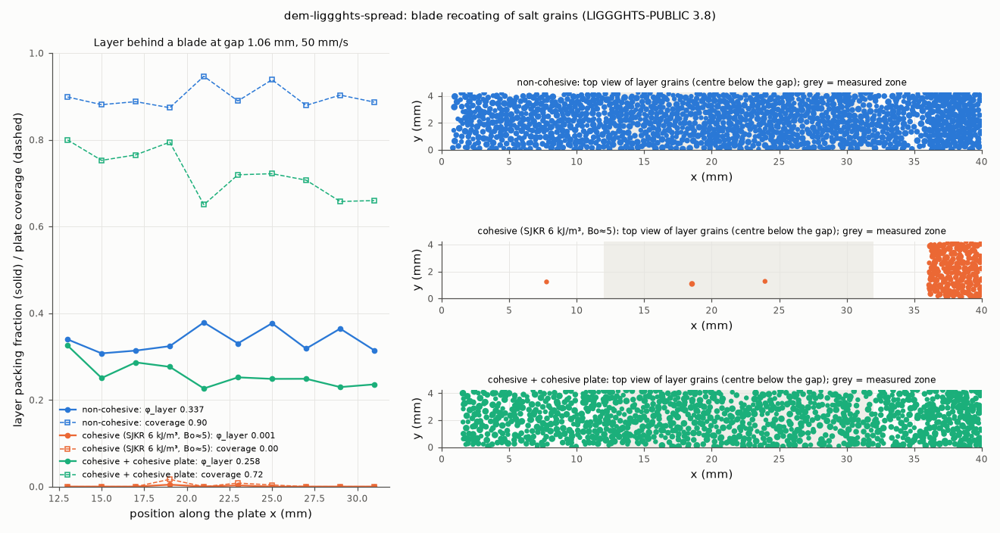

# dem-liggghts-spread: blade recoating of a powder layer (powder-bed AM spreadability)

## What it models and why it matters here
In powder-bed additive manufacturing, a recoater blade spreads each layer. How densely and evenly it fills a
gap of a few grain diameters is the "spreadability" of the powder. It responds to cohesion and friction much as
the auger's metering of a few grains per increment does. The paper discusses it as another dosing-like
flowability probe.

## Code and version
LIGGGHTS-PUBLIC 3.8.0, Debian/Ubuntu package `liggghts`, run serially (1 core).

## Setup
* **Domain:** a 40 mm long slice, 4.25 mm wide (10 mean diameters) and periodic in y. The flat build plate is
  a primitive plane: μ_wall = 0.4, μ_roll = 0.3.
* **Heap:** 2500 grains were requested in a block in front of the blade, and 2291 fitted (`insert/pack`
  reported "Less insertions than requested"). They settle for 0.2 s against a temporary dam.
* **Blade:**
  * Built as a dense wall of frozen 0.2 mm spheres on a 0.17 mm grid (25 × 35 = 875 spheres, 6 mm tall). This
    avoids mesh/periodic-boundary issues; it makes the blade slightly bumpy.
  * The lower edge sits **1.06 mm (2.5 mean diameters, 2.2 × the largest grain)** above the plate.
  * It is moved with `fix move linear` at **50 mm/s** from x = 1 to 36 mm, then held for 0.06 s.
* **Grains:** the reference salt. Diameters 0.361/0.425/0.489 mm (0.3/0.4/0.3), 2165 kg/m³, Hertz–Mindlin,
  E = 2×10⁵ Pa, ν = 0.3, e = 0.5, μ = 0.5, EPSD2 μ_roll = 0.3, dt = 2.06×10⁻⁵ s. Grain–blade contacts use the
  grain–grain values.
* **Cohesive variants:**
  * `coh`: SJKR k = 6000 J/m³ between grains and between grains and blade spheres, with a non-cohesive plate
    (Bond number about 5; see `../dem-liggghts-aor`).
  * `coh_sub`: the same, plus SJKR grain–plate cohesion. This variant was added after `coh` left no layer, to
    check whether the bare plate is the cause.
* **Measurement** in 2 mm bins over x = 12–32 mm, behind the initial heap and before the end pile:
  * layer packing fraction = grain volume inside 0 < z < gap / (bin area × gap);
  * coverage = fraction of the plate covered by the projected discs of grains whose centre lies below the gap
    (rasterised at 20 µm);
  * CV of the deposited mass per area between bins.

## How to rerun
```
/tmp/venv-liggghts/bin/python run.py dry     # writes /tmp/sims-scratch/dem-liggghts-spread/dry/{in.spread,dump/,run.json}
/tmp/venv-liggghts/bin/python run.py coh
/tmp/venv-liggghts/bin/python run.py coh_sub
/tmp/venv-liggghts/bin/python figures.py     # spread.png, spread.gif, spread.mp4, result.json
```
The exact LIGGGHTS input decks that were run are in [`decks/`](decks/). Meshes (STL) and data are regenerated by `run.py`; dumps and logs stay in `/tmp/sims-scratch/`.

## Runtime
121 s (dry), 113 s (cohesive) and 68 s (cohesive + cohesive plate) wall clock, 1 core each. 2291 grains + 875 blade spheres, 0.96 s of physical time. The runner was shared.

## Result


| variant | layer packing fraction (mean ± sd over 10 bins) | plate coverage (mean, worst bin) | CV of mass per area |
|---|---|---|---|
| non-cohesive | **0.337 ± 0.026** | 0.90, 0.87 | 7.6 % |
| cohesive, SJKR 6 kJ/m³ (Bo ≈ 5), plate not cohesive | **0.001** (no layer) | 0.003, 0.00 | — |
| cohesive grains + cohesive plate (SJKR grain–plate) | **0.258 ± 0.029** | 0.72, 0.65 | 11.5 % |

* **Non-cohesive salt** spreads into a continuous single-to-double grain layer: φ_layer 0.34, 90 % plate coverage.
* **The cohesive powder on a non-adhesive plate left no layer at all.**
  * The whole heap moved in front of the blade as one block, sliding on the smooth plate.
  * 734 grains ended in front of the blade at x = 36–40 mm, and the rest were pushed off the end of the domain.
  * Only 2 grains stayed on the 12–32 mm strip (3 on the whole plate).
  * Bo ≈ 5 is enough to make the heap act as a solid at a gap of 2.5 mean grain diameters.
* **Adhesion to the substrate changes that.** Making the plate cohesive too (standing in for a powder bed
  underneath) restores a layer, but one that is 23 % less dense, covers 0.72 of the plate instead of 0.90, and is
  1.5× more uneven (CV 11.5 against 7.6 %). That direction is what spreadability studies report for cohesive feedstocks.
* **For the paper:** the same Bo ≈ 5 that raises the repose angle by about 17° and the Hausner ratio from 1.07
  to 1.16 decides here between "spreads" and "does not spread at all", depending on the substrate. Thin-layer
  metering is far more cohesion-sensitive than the bulk tests.

Animation (side view, grains coloured by speed, blade grey): [spread.gif](spread.gif), [spread.mp4](spread.mp4).

## Status
**Ran** (non-cohesive, cohesive, and cohesive with a cohesive plate), at reduced scale: a 4.25 mm periodic slice and a 40 mm plate.

## Limitations
* **Smooth plate.** A real AM recoat goes over the previous rough powder layer.
* **Bumpy blade.** It is made of 0.2 mm spheres rather than a smooth steel edge.
* **Small domain.** One 20 mm long, 4.25 mm wide measured strip gives 10 bins of about 70 grains each (dry run).
* **One setting.** Only one gap, one speed and one seed were run, and the heap was smaller than requested
  (2291 grains), although enough to lay the whole 35 mm layer.
* **Grains.** These are 0.4 mm salt grains, roughly 10× coarser than AM metal powders (15–45 µm). At AM sizes,
  cohesion matters far more (Bo ≫ 1).
* **Stiffness.** E is reduced to 2×10⁵ Pa.
