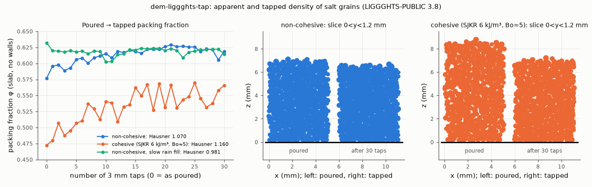

# dem-liggghts-tap: apparent (poured) and tapped density, Hausner ratio

## What it models and why it matters here
The apparent density (ASTM B212) and the tap density (ASTM B527) give the Hausner ratio and the Carr index, the
cheapest flowability numbers in the paper's comparison set. How much a powder compacts under taps also bears on
the doser directly: the auger's mass per revolution depends on the bulk density in the flights, and the rig's
tapper frees mass by compacting and fluidising.

## Code and version
LIGGGHTS-PUBLIC 3.8.0, Debian/Ubuntu package `liggghts`, run serially (1 core).

## Setup
* **Column:** 5.1 × 5.1 mm (12 mean diameters), periodic in x and y, with no side walls and so no wall-ordered
  layer. The floor is a flat primitive plane (μ_wall = 0.4).
* **Grains:** 2500 real-size salt grains, diameters 0.361/0.425/0.489 mm (0.3/0.4/0.3), 2165 kg/m³.
  Hertz–Mindlin, E = 2×10⁵ Pa, ν = 0.3, e = 0.5, μ = 0.5, EPSD2 μ_roll = 0.3, dt = 2.06×10⁻⁵ s.
* **Fill** ("apparent density" state):
  * Default, "cloud": all grains are placed at random (solid fraction 0.25) between 0.3 and 16.3 mm, then
    settle together for 0.35 s.
  * A first run used a slow rain instead (10 000 grains/s from 20–28 mm with 0.3 m/s). It is kept as
    `dry_rain` (`TAP_FILL=rain`).
* **Taps:** 30 taps. Each lifts the whole bed rigidly by 3 mm (`displace_atoms`; contacts are kept) and lets it
  free-fall onto the fixed floor, so it lands at 0.24 m/s, like a 3 mm drop of a tap-density cylinder onto its
  stop. Each is followed by 0.05 s of settling.
* **Packing fraction:** the exact grain volume in a slab from 1 mm above the floor to 1 mm below the mean free
  surface. Hausner = φ_tapped/φ_poured, with φ_tapped the mean of the last 5 taps. A whole-bed version (from
  the bed height) is also reported.
* **Cohesive variant:** SJKR k = 6000 J/m³ between grains (Bond number about 5; see `../dem-liggghts-aor`).

## How to rerun
```
/tmp/venv-liggghts/bin/python run.py dry                  # cloud fill, writes /tmp/sims-scratch/dem-liggghts-tap/dry/
/tmp/venv-liggghts/bin/python run.py coh
TAP_FILL=rain /tmp/venv-liggghts/bin/python run.py dry    # slow-rain fill -> .../dry_rain/
/tmp/venv-liggghts/bin/python figures.py                  # tap.png, tap.gif, tap.mp4, result.json
```
The exact LIGGGHTS input decks that were run are in [`decks/`](decks/). Meshes (STL) and data are regenerated by `run.py`; dumps and logs stay in `/tmp/sims-scratch/`.

## Runtime
182 s (dry), 246 s (cohesive) and 235 s (dry, rain fill) wall clock, 1 core each, 2500 grains, 2.6–2.8 s of
physical time. The runner was shared (load average about 10).

## Result


| variant | φ poured | φ tapped (taps 26–30) | bulk / tapped density (kg/m³) | Hausner | Carr index | Hausner from bed height |
|---|---|---|---|---|---|---|
| non-cohesive (cloud fill) | 0.577 | 0.617 | 1249 / 1337 | **1.070** | 6.5 % | 1.058 |
| cohesive, SJKR 6 kJ/m³ (Bo ≈ 5) | 0.472 | 0.548 | 1023 / 1186 | **1.160** | 13.8 % | 1.171 |
| non-cohesive, slow rain fill | 0.632 | 0.620 | 1368 / 1343 | 0.981 | −1.9 % | 0.978 |

Animation (non-cohesive vs cohesive, slice 0 < y < 1.2 mm, coloured by speed): [tap.gif](tap.gif), [tap.mp4](tap.mp4).

* **Cohesion at Bo ≈ 5:**
  * The loose packing drops from 0.58 to 0.47, because cohesive contacts hold an open structure.
  * The Hausner ratio rises from 1.07 to 1.16 (Carr index from 6.5 to 13.8 %).
  * That moves the powder from "excellent" (H < 1.11) to "good" (1.12–1.18) on the USP <1174> scale.
* **The cohesive bed was still compacting after 30 taps** (φ rose from 0.47 to about 0.55–0.57, with ±0.02
  scatter from tap to tap). Its tapped density and Hausner ratio are therefore lower bounds. ASTM B527 taps
  until the volume stops changing.
* **The "poured" state depends on how it is poured.**
  * Slow pluviation (rain) of frictional spheres already reaches 0.632, denser than 30 taps achieve (0.620),
    so that run gives H < 1.
  * The cloud fill is closer to a loosely filled cup and was used for the main comparison.
  * The same sensitivity is why ASTM B212 fixes the funnel and drop height.

## Status
**Ran** (both variants plus the rain-fill check), at reduced scale: a 5 mm periodic column and 30 taps instead
of up to 3000.

## Limitations
* **Few taps.** 30 taps is too few for the cohesive bed to converge, and there is one seed per variant. The
  slab φ fluctuates by about ±0.01–0.02 between taps in this small cell.
* **Idealised taps.** Each tap is an ideal rigid lift and drop onto a hard floor, with no cylinder or tapper
  dynamics. The 0.05 s settling between taps is short for the cohesive bed.
* **Periodic column.** Real cylinders have wall friction and wall-induced loosening.
* **Grains.** Spheres with rolling friction instead of cubes. Shape affects both packings, so absolute φ
  values are not salt's. E is reduced to 2×10⁵ Pa.
