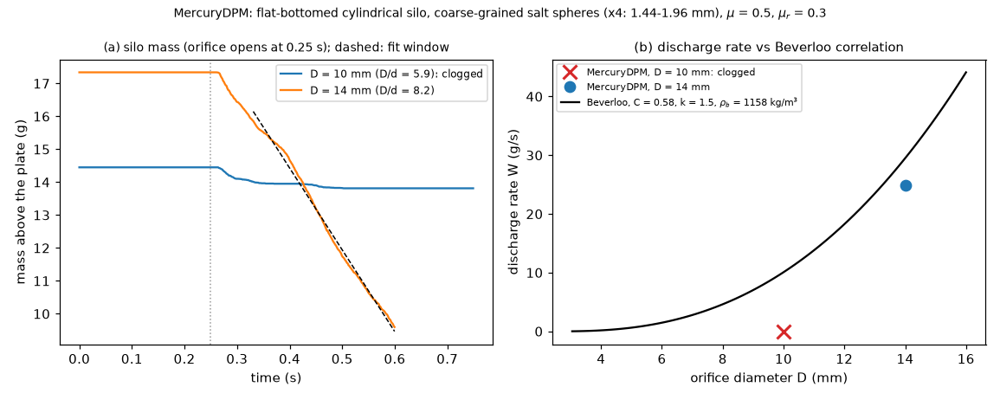

# dem-mercurydpm: silo discharge through a circular orifice vs Beverloo (MercuryDPM)

## What it models and why it matters here

Coarse-grained salt spheres settle in a flat-bottomed cylindrical silo, then drain through a
central circular orifice. The run measures the discharge rate W and compares it with the Beverloo
correlation W = C ρb √g (D − k d)^{5/2}. It also shows whether the orifice clogs. Orifice flow is
the gravity-driven limit of the doser's hopper-to-auger feed and of the Hall/Carney funnel tests.
Clogging at small D/d, discrete arching, is a candidate mechanism for stalled dosing increments.

## Code and version

* MercuryDPM, git master `c801fe682cb3` (2026-10-13), cloned from the official repository
  <https://bitbucket.org/mercurydpm/mercurydpm>. The URL in the task, `github.com/MercuryDPM/MercuryDPM`,
  does not exist: the GitHub API returns 404 and `git clone` stopped with
  `fatal: could not read Username for 'https://github.com'`.
* Built with CMake 3.31, GCC 13 and `-DCMAKE_BUILD_TYPE=Release`. Only the kernel and one demo
  (`make -j2 HourGlass3DDemo`) were built, in 185 s.
* The driver is our own, [`SaltSilo.cpp`](SaltSilo.cpp). It uses `Mercury3D`,
  `AxisymmetricIntersectionOfWalls`, `InfiniteWall`, `DeletionBoundary` and
  `LinearViscoelasticFrictionSpecies`. It was copied into `Drivers/MercurySimpleDemos/`, cmake was
  re-run, and `make SaltSilo` built it (re-linked with `-j1`).

## Setup

| Item | Value |
|---|---|
| Grains | the salt PSD coarse-grained ×4: 1.444/1.700/1.956 mm in number fractions 0.3/0.4/0.3, ρp = 2165 kg/m³ |
| Silo | cylinder of radius Rs, flat bottom plate 2 mm thick with a central hole of diameter D. Grains start on rings, fall, and settle with the hole closed by a plane; the hole opens at t = 0.25 s. Grains are deleted 30 mm below the plate. |
| Runs | D = 10 mm (D/d = 5.9), Rs = 12.5 mm, N = 2500, 0.5 s after opening; D = 14 mm (D/d = 8.2), Rs = 15 mm, N = 3000, 0.35 s after opening |
| Contact | linear spring-dashpot with restitution e = 0.5 and collision time 1 ms for the mean grain (k = 28.8 N/m). Sliding friction 0.5 between grains and 0.4 against walls; rolling friction μr = 0.3. Tangential and rolling stiffness are 2/7 and 2/5 of k. MercuryDPM's linear model has no Young's modulus, so stiffness is set through the collision time. |
| Time step | t_c,min/25 = 3.2×10⁻⁵ s (MercuryDPM's own demos use t_c/50; halved to fit the time budget) |
| Measurement | mass above the plate bottom every 50 steps (`*.flow`); W from a linear fit starting 0.08 s after opening, while more than 50 % of the fill remains. ρb comes from the settled fill before opening. Beverloo uses C = 0.58 and k = 1.5, the commonly quoted values from Beverloo et al. (1961). |

## How to rerun

`bash run.sh` clones, builds, runs both orifices and analyses, in that order. By hand:

```bash
git clone --depth 1 https://bitbucket.org/mercurydpm/mercurydpm.git src
cp SaltSilo.cpp src/Drivers/MercurySimpleDemos/
mkdir build && cd build && cmake ../src -DCMAKE_BUILD_TYPE=Release && make -j2 SaltSilo
mkdir run && cd run
SILO_D_MM=10 SILO_N=2500 ../Drivers/MercurySimpleDemos/SaltSilo
SILO_D_MM=14 SILO_N=3000 SILO_RS_MM=15 SILO_T_DISCHARGE=0.35 ../Drivers/MercurySimpleDemos/SaltSilo
python analyze.py <dir with the .flow/.data files> .   # silo_beverloo.png, analysis_summary.json, animation
```

## Runtime

* D = 10 mm: 212 s wall clock on 1 core (0.75 s simulated).
* D = 14 mm: 192 s wall clock on 1 core (0.60 s simulated).
* Build: 185 s with `make -j2`.
* A first D = 10 mm attempt at t_c/50 and 0.9 s simulated was stopped after about 100 s, because
  it would have taken about 11 min.

## Result



Animation (side view of a 6 mm central slice): [GIF](silo_animation.gif), [MP4](silo_animation.mp4).

* **D = 10 mm (D/d = 5.9): the orifice clogged.** 112 of 2500 grains (0.64 g of the 14.45 g fill)
  left in a short burst after opening. An arch then formed and nothing more left: the last grain
  was deleted at t = 0.55 s, and there was no further outflow to 0.75 s. Beverloo predicts
  10.0 g/s for this D with ρb = 1155 kg/m³ (fill φ = 0.53).
* **D = 14 mm (D/d = 8.2): steady discharge at W = 24.9 g/s.** The fit covers t = 0.33–0.60 s,
  during which 1169 of 3000 grains (7.7 g of 17.3 g) left. The flow slowed briefly at about
  0.37–0.40 s, a partial arch, then resumed. Beverloo with C = 0.58, k = 1.5 and ρb = 1161 kg/m³
  gives 29.6 g/s, so **W_sim/W_Beverloo = 0.84**. Keeping k = 1.5, the fitted coefficient is
  C = 0.49, slightly below the 0.55–0.65 range commonly quoted for C.
* Together: with μ = 0.5 and μr = 0.3, these coarse spheres clog at D/d = 5.9 and flow at a
  near-Beverloo rate at D/d = 8.2.

## Status

**Ran** at reduced scale (coarse-grained ×4; 2500–3000 grains).

## Limitations

* Coarse-graining ×4 changes D/d relative to real salt. A 10 mm orifice is 24 real grain
  diameters wide, but 5.9 coarse-grained ones, and clogging depends on D/d. The results apply to
  the coarse-grained material, not to salt in the rig.
* The linear contact with a 1 ms collision time is soft: overlaps are a few percent of d at the
  silo bottom. The time step is t_c/25.
* Rolling friction 0.3 is high and favours arching. Clogging is stochastic, so one run per
  orifice is a single sample of the clogging probability.
* Short discharge windows (about 0.3 s), a small silo (Rs/R_o = 2.1–2.5, near the wall-effect
  limit) and a shallow fill (2.5 D for D = 10 mm, 1.5 D for D = 14 mm) bias W.
