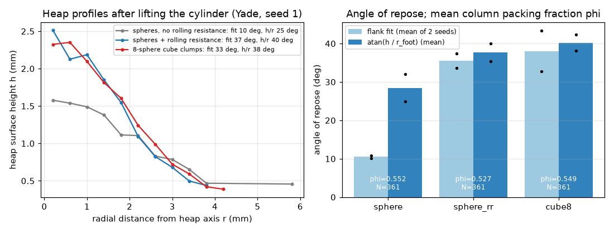

# dem-nonspherical: cube-shaped salt grains (multi-sphere clumps) vs spheres (Yade)

## What it models and why it matters here
Table-salt grains are near-cubic. Sphere-based DEM twins, including the repo's LIGGGHTS auger twin, make
up for missing shape with a rolling-friction coefficient (0.3 there). This run checks whether cube-like clumps
*without* rolling resistance give the heap angle and packing fraction that rolling-resistant spheres give. Those
two quantities feed the auger fill level and the doser's bulk-density and avalanche behaviour, so this decides
whether a shape-resolved twin is needed or a calibrated rolling parameter is enough.

## Code and version
- Yade `yadedaily 20261024-9637~157eec7~noble1` (Debian/PPA package, Python 3.12), one thread.
- LIGGGHTS check: Debian `liggghts 3.8.0+repack1-9.1build2` lists `atom_style superquadric`, but **no**
  `fix nve/superquadric` or `particletemplate/superquadric`, so superquadric DEM cannot actually be run with this build.
  The multisphere styles (`fix multisphere`, `particletemplate/multisphere`) are present.

## Setup
- Lifted-cylinder heap: grains rain from a loose random cloud into a vertical facet cylinder (R = 1.6 mm,
  column height/radius about 2.3) on a flat facet floor, settle, then the cylinder is lifted at 0.05 m/s and removed.
  The run continues until kinetic energy < 1e-10 J or 0.35 s after lift start.
- 361 particles per case, volume-equivalent diameter 0.36–0.49 mm (uniform, d50 = 0.425 mm), ρ = 2165 kg/m³.
  Cases:
  `sphere`: spheres, Coulomb friction only.
  `sphere_rr`: spheres + elastic-plastic rolling resistance (CohFrictMat, η_roll = 0.15, which equals the
  LIGGGHTS `epsd2` μ_r = 0.3 of the twin because Yade uses min(R) and LIGGGHTS uses R1R2/(R1+R2)).
  `cube8`: rigid clumps of 8 overlapping spheres (radius 0.3a at (±0.2a)³, a rounded cube of side a). a is chosen so that the
  clump volume (Monte-Carlo union volume) equals the sphere volume. Mass and inertia come from grid integration (`discretization=12`).
- Contact: linear spring (E = 2e5 Pa, as in the repo's LIGGGHTS twin; ks/kn = 0.3), friction 0.5 particle–particle and 0.4 particle–wall
  (from the twin). Dissipation from Cundall non-viscous damping 0.3 (stands in for restitution). GlobalStiffnessTimeStepper, safety 0.5.
- Angle of repose, two estimates: (i) a line fitted to the heap surface (max particle top per 0.4 mm radial bin) between 20 % and
  80 % of the heap height; (ii) atan(heap height / foot radius), with the foot where the surface falls below 1.5 d50.
  Packing fraction φ is the solid fraction of the settled column inside r < R − d50 and d50 < z < z_top − d50 (top = 95th percentile).

## How to rerun
`bash run.sh` runs the three cases one after another and then `post_yade.py` for the figure and animation.

## Runtime
1 core each, on a shared runner, in-script wall time. Seed 1: cube8 69 s, sphere 20 s, sphere_rr 36 s. Seed 2: 22 s, 12 s, 22 s.
The cube8 runs have 2888 member spheres.

## Result

Animation (seed 1): [dem_nonspherical_heaps.gif](dem_nonspherical_heaps.gif) / [dem_nonspherical_heaps.mp4](dem_nonspherical_heaps.mp4).

Main set: N = 361 each, identical generation, two random seeds.

| case | AoR atan(h/r_foot), seed 1 / 2 (mean) | AoR flank fit, seed 1 / 2 (mean) | column φ, seed 1 / 2 (mean) |
|---|---|---|---|
| spheres | 24.9° / 32.1° (28.5°) | 10.1° / 10.8° (10.5°) | 0.556 / 0.548 (0.552) |
| spheres + rolling resistance | 40.0° / 35.4° (37.7°) | 37.4° / 33.6° (35.5°) | 0.521 / 0.532 (0.527) |
| 8-sphere cube clumps | 38.1° / 42.4° (40.3°) | 32.7° / 43.4° (38.1°) | 0.560 / 0.538 (0.549) |

Earlier runs of the same script, kept as sensitivity checks:
- Half-height initial cloud: spheres 28.9° / 17.3° (φ 0.557), spheres + RR 41.8° / 33.2° (φ 0.514), cubes with only 219 of 361 placed 36.5° / 23.5° (φ 0.527).
- R = 3 mm cylinder, where the column was too squat to collapse fully: spheres (N = 920) 27.1° / 16.0° (φ 0.556), cubes (N = 361) 34.7° / 38.3° (φ 0.479).

Cube clumps with *no* rolling resistance raise the heap angle over plain spheres by about 12° (atan(h/r_foot), mean of two seeds) or
28° (flank fit). That puts them level with spheres that carry the twin's rolling resistance (40.3° vs 37.7°, within the seed-to-seed scatter
of 4–5°). So the twin's rolling-friction parameter stands in for grain shape at the heap scale. Packing: rolling-resistant spheres packed slightly
looser (mean φ 0.527) than cubes or spheres (0.549, 0.552). The gap was 1–7 % depending on seed, which is suggestive but not established at this size.

## Status
**Ran at reduced scale** (361 particles per heap, so the heaps are only about 4–6 grains tall).

## Limitations
- Small heaps make the angle estimates noisy. The same case moved by up to 7° (h/r) or 11° (flank fit) between seeds, and the
  0.4 mm radial bins quantise r_foot. These are trends, not calibrated values. More and larger heaps are needed for a calibration-grade angle.
- An 8-sphere clump is a crude, rounded cube with surface bumps. More spheres per clump, or polyhedra, would sharpen the edges.
- E = 2e5 Pa and global damping instead of a restitution law match the existing twin, not real NaCl.
- The packing fraction comes from a column only about 8 grains high and about 7.5 grains wide, so wall effects lower it. Use it for comparison between cases only.
