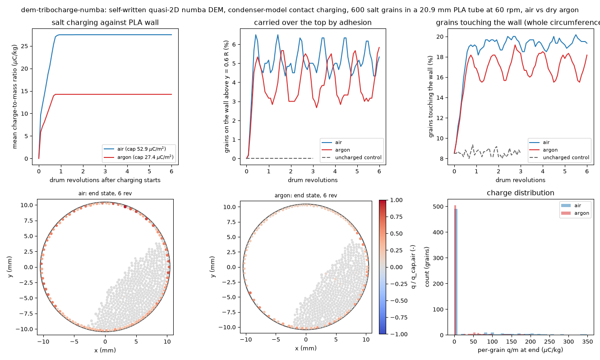

# dem-tribocharge-numba: contact charging of salt in a rotating PLA tube, air vs dry argon

## What it models and why it matters here

In the July glove-box trial, salt stuck to the auger walls through static. The lab may later dose in dry argon. Issue #158 sketched adding a charging model to the DEM. This run is a compact, self-written DEM that charges salt grains against a PLA wall in a rotating cross-section of the auger bore. The aim is to see what the charge-to-mass ratio does over the first revolutions, how many grains end up held on the wall, and whether argon's lower breakdown field changes either.

## Code and version

Self-written Python/numba ([`run.py`](run.py) for the simulation, [`plot_charge.py`](plot_charge.py) for the figure, animation and result.json), numba 0.68.1, numpy 1.26.4, Python 3.12.3.

## Setup

**Geometry and motion**:
- Quasi-2D monolayer of 600 spheres (centres in one plane) inside a circle of the auger-bore radius, 10.45 mm.
- The wall turns at 60 rpm (Froude number Ω²R/g = 0.04, rolling regime).
- Grains settle and flow for 0.75 rev uncharged, then charging is switched on and runs for 6 rev.
- A 3-rev control run never charges.

**Grains and contacts**:

| parameter | value | source |
|---|---|---|
| salt density | 2165 kg/m³ | given |
| grain diameter | uniform 0.36–0.49 mm | given |
| friction, particle–particle / particle–wall | 0.5 / 0.4 | LIGGGHTS twin (PR #180) |
| normal contact | linear spring-dashpot, k_n = 5 N/m, restitution 0.5 | soft for speed; overlap < 2 % of d |
| tangential contact | viscously regularised Coulomb friction | — |
| grain rotation | none | — |
| time step | 1.52×10⁻⁵ s (65,654 steps per rev) | — |

**Charging (condenser model)**, after Matsusaka et al. (2010, *Chem. Eng. Sci.* 65:5781, review), Korevaar et al. (2014, *Powder Technol.* 258:144) and Pei, Wu & Adams (2016, *Powder Technol.*):
- Charge transferred at a grain–wall contact: Δq = ε₀ ΔS / z₀ · (V_c − z₀(σ_p − σ_w)/ε₀).
- ΔS is the newly loaded Hertzian contact area, plus the area swept while the contact slides (contact diameter × slip distance).
- Contact area uses real moduli at the DEM contact force: NaCl E = 39 GPa, ν = 0.25; PLA E = 3.5 GPa, ν = 0.36 (typical handbook and datasheet values).
- z₀ = 0.4 nm, the usual cut-off gap. V_c = 0.5 V is assumed, a work-function difference of the usual 0.1–1 V order; it is not measured for NaCl–PLA, and its sign (salt charging positive) is also assumed.
- Grain–grain contacts (same material) only share charge: Δq = ΔS (σ_j − σ_i)/2.
- Charge is conserved exactly. The wall's counter-charge is stored in 120 wall patches that rotate with the wall. Each patch is one arc segment, 0.55 mm long and one grain diameter deep (0.23 mm²).
- There is no time compression: the acceleration factor K_ACC is 1.

**Gas-breakdown caps**: |σ| ≤ ε₀E_b, applied to every grain and every wall patch. E_b comes from Paschen's law at 1 atm over a gap of one mean grain diameter (0.42 mm), with Townsend coefficients from Raizer (1991, *Gas Discharge Physics*: air A = 15, B = 365; argon A = 12, B = 180, in cm⁻¹ Torr⁻¹ and V cm⁻¹ Torr⁻¹) and secondary-emission coefficient γ = 0.01:

| gas | breakdown voltage V_b | breakdown field E_b | surface-charge cap σ_cap | single-grain q/m cap (d = 0.42 mm) |
|---|---|---|---|---|
| dry air | 2.51 kV | 5.98 MV/m | 52.9 µC/m² | 349 µC/kg |
| argon | 1.30 kV | 3.10 MV/m | 27.4 µC/m² | 181 µC/kg |

(For cm-scale gaps the usual macroscopic figure for air is 3 MV/m, and argon's dielectric strength is a fraction of air's. The Paschen ratio of 0.52 at this gap is the one used here.)

**Forces**:
- Coulomb force between all grain pairs (direct sum, softened at contact).
- Coulomb force between grains and wall patches (softened over half a patch arc).
- Image attraction to the dielectric wall, F = β q²/(4πε₀(2s)²), with β = (ε_r − 1)/(ε_r + 1) = 0.5 for PLA (ε_r ≈ 3).
- Electrostatic forces are refreshed every 25 steps.

**Metrics**:
- Mean q/m.
- Grains touching the wall anywhere.
- "Stuck" grains: touching the wall above y = 0.6 R. The bed's highest point reaches about 0.4 R, so only adhesion can hold a grain there; the uncharged control gives 0 %.

## How to rerun

```bash
python3 -m venv /tmp/venv-bayes && /tmp/venv-bayes/bin/pip install numpy numba matplotlib imageio imageio-ffmpeg
export OMP_NUM_THREADS=1 NUMBA_NUM_THREADS=1
S=/tmp/sims-scratch/dem-tribocharge-numba
/tmp/venv-bayes/bin/python run.py . $S/out 600 6 1 air,argon          # N, revolutions, K_ACC, gases
/tmp/venv-bayes/bin/python run.py . $S/control 600 3 1 uncharged      # control without charge transfer
/tmp/venv-bayes/bin/python plot_charge.py $S/out . $S/control/charge_runs.json   # PNG, GIF, MP4, result.json
```

## Runtime

Single thread on a shared, oversubscribed 4-core runner: air 101 s and argon 108 s (6.75 rev each including settling), control 69 s (3.75 rev), 15–18 s per revolution. Total 279 s of simulation plus about 40 s of plotting.

## Result



Animation (air left, argon right; colour shows each grain's charge relative to the air cap): [GIF](tribocharge.gif) / [MP4](tribocharge.mp4).

| | dry air | argon | uncharged control |
|---|---|---|---|
| saturated mean q/m (rev 1–6) | **27.5 µC/kg** | **14.2 µC/kg** (0.52 × air) | 0 |
| revolutions to 95 % of saturation | 0.75 | 0.67 | — |
| grains stuck above 0.6 R (mean ± sd, rev 1–6) | **5.2 ± 0.6 %** | **4.0 ± 1.0 %** | 0.0 % |
| grains touching the wall (mean ± sd) | 19.3 ± 0.4 % | 17.1 ± 1.0 % | 8.6 ± 0.3 % |
| wall patches at the breakdown cap at the end | 100 % | 100 % | — |
| grains at their own cap at the end | 0 % | 2 % | — |
| charge-conservation error | 4×10⁻²⁴ C | 2×10⁻²⁵ C | — |

- **Charging saturates within the first revolution** in both gases, with no time compression. Every wall patch reaches the breakdown cap after one pass of the wall under the bed (q/m 95 % saturated at 0.67–0.75 rev).
- In this closed cross-section, the counter-charge the PLA wall can hold sets the limit, not the charge a grain can hold. Wall-contact grains reach only 41 % (air) and 44 % (argon) of their own cap on average. The saturated q/m therefore scales with σ_cap, and argon gives 0.52 × air, the Paschen ratio.
- **Charged grains coat the wall.** At the end, 99 % of the charge sits on the 110–116 grains touching the wall. These grains form a monolayer around the whole circumference, held by the opposite-signed wall patches and by their image charges. Only 16–18 % of all grains carry more than 5 % of their own cap; the bulk of the bed stays nearly neutral. Wall contact doubles from 8.6 % (control) to 17–19 %, and 4–5 % of grains are carried over the top. This matches what the July glove-box trial saw (salt sticking to the auger walls).
- **Argon lowers but does not remove the sticking.** It halves q/m, and the electrostatic forces go as q², so roughly a quarter. Yet the stuck fraction falls only from 5.2 % to 4.0 %, and wall contact from 19.3 % to 17.1 %. Why: take a wall-contact grain at its mean charge next to a saturated patch, and add patch attraction and image force. That gives about 1.5×10⁻⁵ N in air and 4×10⁻⁶ N in argon, roughly 18× and 5× a grain's weight (8×10⁻⁷ N). These are back-of-envelope estimates from the caps above, not simulation outputs. Either way, adhesion still beats gravity in argon.

## Status

**ran.** The full intended scope ran: 600 grains, 6 revolutions per gas, no time compression, plus an uncharged control.

## Limitations

- The model is a monolayer drum cross-section, not a screw. Grains never leave, so charge builds up in a closed system and the wall's capacity limits it. In the real doser, charged powder leaves the auger and fresh powder comes in, and the auger's helical surface adds more area that can hold counter-charge.
- Absolute q/m depends on the assumed wall-patch depth (one grain diameter) and on the fill. The air/argon ratio just restates the Paschen ratio of 0.52, and that ratio depends on the assumed gap and γ.
- There is no humidity. "Air" means dry air. In ambient air, adsorbed water would bleed charge away, so dry argon versus humid lab air could differ in the opposite direction to the breakdown argument. No charge decay or wall relaxation is modelled.
- V_c (0.5 V) and its sign are assumptions, and salt–salt bipolar charging is not modelled. The soft contacts (k_n = 5 N/m) lengthen contact durations; real moduli are used only to compute contact areas. The friction is regularised and grains do not rotate.
- The image force uses a semi-infinite dielectric (β = 0.5). A grounded metal behind the PLA would push β toward 1.
