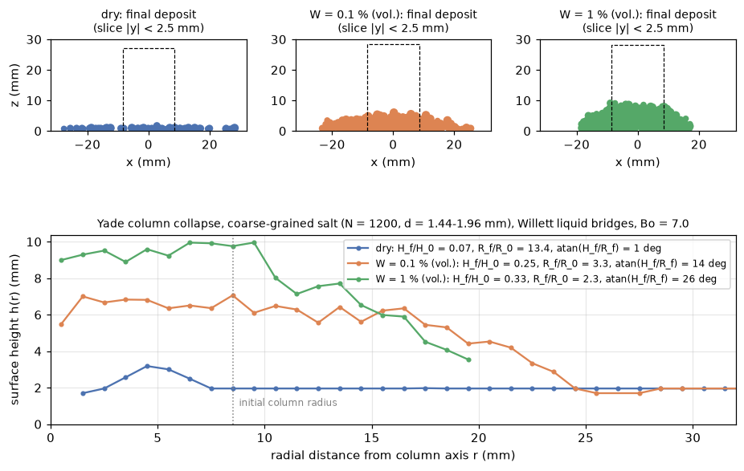

# dem-yade-capillary: column collapse with liquid bridges (Yade)

## What it models and why it matters here
Humid air puts water on hygroscopic powders like salt. The water forms liquid bridges between grains, and the bridges
make the powder cohesive. That cohesion changes the doser's fingerprint (stalls, afterflow, mass per tap) and the
standard flow tests (angle of repose, Hausner ratio). Sterling's proposed experiment, dosing a powder before and after
it sits in humid air, is the physical version of this run. A column of grains is released from a cylinder. The final
deposit is then measured: its height H_f, its runout R_f and its aspect angle atan(H_f/R_f). The run is done dry and at
two liquid contents. Column collapse is a cheap numerical stand-in for an angle-of-repose or heap test.

## Code and version
* Yade `20261024-9637~157eec7~noble1` (the `yadedaily` build), run single-threaded and headless:
  `yadedaily -j1 -n -x`.
* Ubuntu 24.04 has no `yade` package (`apt-cache policy yade` gives `Candidate: (none)`). Yade was installed from the
  Yade project's own repository, http://www.yade-dem.org/packages/ (dists/noble). The `libyadedaily`,
  `python3-yadedaily` and `yadedaily` .debs were downloaded and installed with `sudo apt-get install ./*.deb`.
* Contact law: `ViscElCapMat`, `Ip2_ViscElCapMat_ViscElCapMat_ViscElCapPhys` and
  `Law2_ScGeom_ViscElCapPhys_Basic`, with `CapillarType="Willett_numeric"` (Willett et al. 2000). This model needs no
  capillary tables.

## Setup
* **Particles.** N = 1200 spheres. Diameters are 4 x (0.361 / 0.425 / 0.489) mm = 1.444 / 1.700 / 1.956 mm, number
  fractions 0.3 / 0.4 / 0.3. The 4x coarse-graining keeps the run short and sets the Bond number (see below).
  Density 2165 kg/m3.
* **Geometry.** The spheres start on a lattice inside a facet cylinder of radius R0 = 8.5 mm (5 mean diameters) and
  settle for 0.2 s. That gives a column H0 = 27-28 mm high (H0/R0 = 3.3). The cylinder is then deleted instantly and
  the column collapses onto a smooth floor (an infinite plane) for 0.4 s.
* **Contact.** Linear spring-dashpot with the stiffness set by the contact time: tc = 5e-4 s, giving kn of about
  120 N/m for a mean pair. Normal and tangential restitution 0.5. Sliding friction 0.5 between particles and 0.4
  against the floor and wall. dt = tc/20 = 2.5e-5 s. The estimated overlap at the column base (column weight against kn) is below 1 % of d.
* **Liquid bridges.** Water, surface tension 0.072 N/m, contact angle 0. A bridge forms when two grains touch and
  breaks at Willett's rupture distance. Each bridge has volume V_b = W V_p,mean / 3, assuming about 3 bridges per
  particle (coordination about 6).
  * W = 0.001 (0.1 % liquid by volume of solid): V_b = 8.9e-13 m3.
  * W = 0.01 (1 %): V_b = 8.9e-12 m3.
* **Bond number.** Bo = 2 pi R gamma cos(theta) / (m g) = **7.0** for the mean particle, inside the requested 1-10.
  At the real salt size, the same water bridges would give Bo of about 110. So the coarse-grained case stands for
  weaker bridges, such as bridges at surface asperities after humid-air exposure, not for a fully wetted bed.
* **Rolling resistance: none (mR = 0).** As written in `ViscoelasticPM.cpp`, Yade's ViscEl rolling resistance is
  viscous: the result of `relAngVel.normalized()` is thrown away, so the moment is M = -mR |Fn| omega_rel. The
  reference rolling friction of 0.3 therefore has no equivalent in this law.

## How to rerun
```
bash run.sh [scratch_dir]    # three cases (wet1, wet01, dry), then analyze.py writes the PNG/GIF/MP4
```
One case on its own: `OMP_NUM_THREADS=1 yadedaily -j1 -n -x column_collapse.py wet1 0.01 /tmp/out`. Plots and
animation: `python analyze.py /tmp/out .`, using a venv with numpy, matplotlib, imageio and imageio-ffmpeg.

## Runtime
Single core on a shared, oversubscribed 4-core runner (load average 10-12). Each case was 24,200 steps:

| Case | Wall time |
|---|---|
| W = 1 % | 211 s |
| W = 0.1 % | 194 s |
| dry | 80 s |
| Total | 485 s |

## Result


| Case | H_f / H0 | Runout R_f / R0 | atan(H_f / R_f) | Separated bridges at end |
|---|---|---|---|---|
| dry | 0.07 | 13.4 | 1.0 deg | 0 |
| W = 0.1 % | 0.25 | 3.3 | 13.9 deg | 406 |
| W = 1 % | 0.33 | 2.3 | 25.9 deg | 868 |

* The deposit gets taller and narrower as the liquid content rises.
* At Bo = 7, 0.1 % liquid already cuts the runout by a factor of 4.
* At 1 % liquid the deposit is a flat-topped mound with a flank of about 26-28 deg.
* The dry column spreads into a near-monolayer. With no rolling resistance on a smooth plane, spheres roll away
  freely.

Animation: [GIF](capillary_column_collapse.gif), [MP4](capillary_column_collapse.mp4).

## Status
**Ran at reduced scale** (coarse-grained 4x, N = 1200). In `result.json` it is marked `partial`: all three cases ran
to the end, but the dry baseline gives no repose angle. All three cases ran to the 0.4 s cap rather than meeting the
at-rest test (kinetic energy below 1e-9 J). The kinetic energy at the end differs a lot between cases:

| Case | Kinetic energy at end | Peak after release | State at end |
|---|---|---|---|
| W = 1 % | 6e-9 J | about 5e-4 J | at rest |
| W = 0.1 % | 8e-7 J | about 5e-4 J | still creeping |
| dry | 3.7e-5 J | about 5e-4 J | grains still rolling outward |

So the dry runout (13.4 R0) is a lower bound, and the W = 0.1 % numbers are close to final but not final. The first attempt used tc = 3e-4 s and an interaction detection factor of 1.3. It ran at
about 100 steps/s and was stopped and replaced by the settings above.

## Limitations
* **The dry case is not a salt heap.** It has no rolling resistance on a smooth floor. Real salt, angular grains on a
  rough base, would heap at about 30-35 deg. The dry-to-wet contrast here is therefore exaggerated. A fair repose
  comparison needs a rough base and a Coulomb-type rolling resistance, which is not available in this Yade law.
* **Capillary force only between separated grains.** Yade applies the bridge force only while the grains are
  separated (0 < s < s_crit). Touching grains feel only the visco-elastic force.
* **Bridge model simplifications.**
  * The bridge volume is the same at every contact.
  * The liquid does not migrate.
  * NaCl dissolution, recrystallisation and caking are not modelled.
  * The surface tension is that of pure water. Saturated brine is about 0.08 N/m.
* **Deposit angle.** The deposits are flat-topped, so a flank fit is poorly defined at N = 1200. The aspect angle
  atan(H_f/R_f) is reported instead.
* **No statistics.** Each case is a single run, with no ensemble average.
* **Stiffness.** The contact is linear with stiffness set by tc, not Hertz with E = 2e5 Pa.
