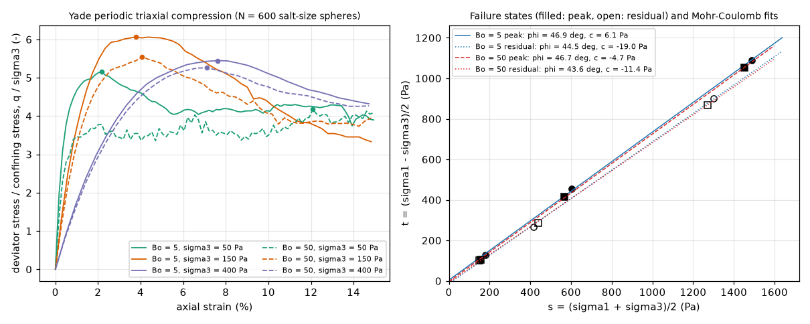

# dem-yade-directshear: periodic triaxial test with cohesive-frictional contacts (Yade)

## What it models and why it matters here
The FT4 shear cell (ASTM D7891) and the Schulze ring shear tester (D6773) give a powder's yield locus. A Mohr-Coulomb
fit of that locus gives the friction angle phi and the cohesion c, and from them the flow function ffc. This run is a
numerical counterpart. A periodic cube of salt-sized spheres with adhesive contacts is compressed triaxially at three
confining stresses. Mohr-Coulomb envelopes are then fitted to the peak and residual (end-of-test) stress states. The
stresses chosen, 50-400 Pa, are those in the doser's hopper and auger (rho_b g h for h of a few cm), not the kPa range
of the FT4. At these stresses an inter-particle adhesion of a few weights per grain is visible as an intercept, which
is the regime the doser fingerprint probes. A periodic triaxial test was used instead of a direct-shear box because
it needs no walls and runs as one small periodic cell.

## Code and version
* Yade `20261024-9637~157eec7~noble1` (the `yadedaily` build), single thread, headless (`yadedaily -j1 -n -x`).
* Ubuntu 24.04 has no `yade` package. The `libyadedaily`, `python3-yadedaily` and `yadedaily` .debs were downloaded
  from the Yade project's repository, http://www.yade-dem.org/packages/ (dists/noble), and installed with
  `apt-get install ./*.deb`.
* Contact law: `CohFrictMat`, `Ip2_CohFrictMat_CohFrictMat_CohFrictPhys` with `setCohesionOnNewContacts=True`, and
  `Law2_ScGeom6D_CohFrictPhys_CohesionMoment`. The stress control is `PeriTriaxController`.

## Setup
* **Particles.** N = 600 spheres at real salt size, with no coarse-graining. Diameters 0.361 / 0.425 / 0.489 mm,
  number fractions 0.3 / 0.4 / 0.3.
* **Material.** Density 2165 kg/m3, E = 2e5 Pa (the twin's reduced value), Poisson 0.3. Contact normal stiffness is
  kn = E R for equal spheres. No gravity, in a periodic cube.
* **Friction.** Sliding friction 0.5 while shearing. Rolling resistance `etaRoll` = 0.3, so the rolling moment is
  limited to 0.3 R Fn. The rolling stiffness is `alphaKr` = 2.
* **Cohesion.** Bond strength F_adh = Bo m g, with granular Bond number **Bo = 5** and, as a strong-adhesion
  variant, **Bo = 50** for the mean grain: F_adh = 4.3e-6 N and 4.3e-5 N. In Yade this is `normalCohesion` = `shearCohesion` = F_adh / R_mean^2 = 94.5 Pa or 945 Pa. Yade scales the
  bond strength as normalCohesion x min(R1, R2)^2. Bonds are brittle (`fragile=True`). Every new contact becomes
  cohesive, so broken bonds re-form when grains touch again. This mimics van der Waals adhesion more than cementation.
* **Procedure.**
  1. A random loose cloud (solid fraction 0.22) is compacted isotropically to sigma3 by the periodic cell's stress
     servo. Inter-particle friction is 0 during compaction, to get a dense sample.
  2. Friction is set to 0.5 on all materials and contacts.
  3. The cell is shortened along z, strain-controlled, to a log strain of 0.15, with sigma_xx = sigma_yy = sigma3
     held constant.
* **Stresses and rates.** sigma3 = 50, 150 and 400 Pa. The axial strain rate keeps the inertial number at
  I = eps_dot d sqrt(rho / sigma3) = 2.5e-3 (quasi-static). Local damping is 0.2. dt = 0.5 x P-wave time step.
* **Mohr-Coulomb fit.** t = (s1 - s3)/2 is fitted linearly against s = (s1 + s3)/2. Then sin(phi) = slope and
  c = intercept / cos(phi).
  * Peak: the state at maximum deviator stress.
  * Residual: the mean over the last 3 % of axial strain.

## How to rerun
```
bash run.sh [scratch_dir]       # 2 Bond numbers x 3 confining stresses, then analyze.py -> triaxial_mohr_coulomb.png
```
One run on its own: `OMP_NUM_THREADS=1 yadedaily -j1 -n -x peri_triax.py <sigma3_Pa> <out> <N> <Bo> <mu_compaction>`, for example `peri_triax.py 150 /tmp/out 600 5 0.0`.

## Runtime
Single core on a shared 4-core runner. Each run took 15-41 s; the 6 reported runs add up to 144 s. Each run was
15,000-39,000 steps: 7,500-21,000 for compaction plus 6,300-17,900 for shear. An earlier 3-run set
(see Status) took another 58 s.

## Result


**Mohr-Coulomb parameters**

| Bond number (bond strength) | Peak phi | Peak c | Residual phi | Residual c |
|---|---|---|---|---|
| Bo = 5 (F_adh = 4.3e-6 N, `normalCohesion` 94.5 Pa) | 46.9 deg | 6.1 Pa | 44.5 deg | -19.0 Pa |
| Bo = 50 (F_adh = 4.3e-5 N, `normalCohesion` 945 Pa) | 46.7 deg | -4.7 Pa | 43.6 deg | -11.4 Pa |

**Per-run states**

| Bo | sigma3 (Pa) | Solid fraction after compaction | sigma1 peak (Pa) at axial strain | sigma1 residual (Pa) | Bonded contacts, start / end of shear |
|---|---|---|---|---|---|
| 5 | 50 | 0.635 | 308 at 2.2 % | 255 | 6.2 % / 3.2 % |
| 5 | 150 | 0.642 | 1060 at 3.8 % | 681 | 1.6 % / 1.2 % |
| 5 | 400 | 0.651 | 2579 at 7.6 % | 2199 | 0.2 % / 0.1 % |
| 50 | 50 | 0.571 | 259 at 12.1 % (no clear peak) | 249 | 41.5 % / 25.4 % |
| 50 | 150 | 0.621 | 982 at 4.1 % | 725 | 18.4 % / 10.1 % |
| 50 | 400 | 0.641 | 2504 at 7.1 % | 2139 | 9.3 % / 4.9 % |

* **Friction angles.** Dense samples, sliding friction 0.5 and rolling resistance 0.3 give phi = 47 deg at peak and
  44 deg at 15 % strain. That is above the 35-40 deg usually quoted for salt, because the rolling resistance and the
  dense packing both raise the angle.
* **No measurable cohesion.** Neither Bond number gives a cohesion intercept larger than the scatter: |c| < 20 Pa,
  with one sample of 600 grains per stress.
  * The brittle bonds break as soon as a contact slides, so few bonded contacts are left while the sample shears.
  * At Bo = 50 the adhesion's main effect is a looser compacted packing (solid fraction 0.571 against 0.635 at
    50 Pa). The looser sample is less dilatant, which lowers its peak and offsets the extra bond strength.
  * So, in this contact model, adhesion of 5-50 particle weights barely moves the yield locus at doser stresses. A
    JKR-type attraction, which pulls grains together even after a bond breaks, is the better candidate for an
    adhesion-driven yield locus (see dem-lammps-shear-mui).

## Status
**Ran at reduced scale** (N = 600). All 6 runs finished compaction (stress tolerance 1 %, unbalanced force below
0.02) and sheared to 14.7-15 % axial log strain.

An earlier set (Bo = 5 only, compacted with friction 0.1) gave looser samples (solid fraction 0.590-0.604). It gave
peak phi = 41.5 deg, c = -1.6 Pa and residual phi = 41.2 deg, c = -5.1 Pa, with almost no peak. Those runs were
replaced by the frictionless-compaction runs above, so that a distinct peak forms. Their raw files are in scratch
only. Yade printed one warning per run: "rolling moment is bounded but twisting moment is not". Twisting resistance
was intentionally left elastic.

## Limitations
* **Small sample.** N = 600 in a periodic cube about 9 grains wide: the stress-strain curves are noisy and there is no
  ensemble average. Strain localisation, which matters for the peak in a real shear cell, cannot form.
* **Not a shear-cell protocol.**
  * The test is triaxial compression, not an FT4/Schulze shear test, and there is no pre-shear.
  * The "residual" state is the state at 15 % axial strain, close to critical state but not a large-strain ring-shear
    residual.
  * Without pre-consolidation the run gives no ffc. The yield-locus-at-consolidation procedure would need a further
    unloading step.
* **Adhesion model.** Cohesion is a brittle bond strength that re-forms on new contacts, scaling with R^2. It is not
  JKR/DMT (no attraction at a distance, no load-dependent contact area). Bo = 5 is an assumption, not a measurement for
  the rig's salt.
* **Sample preparation.** The stiffness is reduced (E = 2e5 Pa), and compacting without friction gives a dense
  sample. Both choices change the peak.
