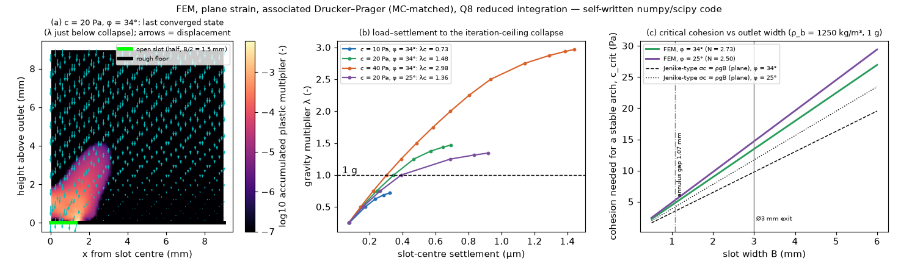

# fem-druckerprager: FEM with Drucker–Prager plasticity, arching over the outlet

## What it models and why it matters here
A cohesive powder can hold a stable arch (bridge) over the doser's outlet. Then flow stops until the auger
or a tap breaks the arch, which feeds the stalled increments (I_stop) and the mass freed per tap.
- **Question:** how much cohesion a powder needs to arch across an opening of width B, the continuum
  version of Jenike's critical-outlet criterion.
- **Model:** a plane-strain "trapdoor" problem. A layer of powder rests on a rough floor with an open slot
  of width B = 3 mm (the exit diameter), and its self-weight is raised by a factor λ until no equilibrium
  exists.
- **Scaling:** for a perfectly plastic material the collapse depends only on the stability number
  N = λ_c ρ g B / c, so one N gives the critical cohesion for any opening.

## Code and version
**Route used: a self-written 2D finite-element code in numpy/scipy (`run.py`).**
- **Why not FEniCSx or scikit-fem:** neither was tried. Both would still need the same hand-written return
  mapping, and a direct numpy implementation was the fastest way to a checked result in the time box.
- **Elements:** 8-node serendipity quadrilaterals with 2×2 reduced Gauss integration, the element used for
  collapse loads in Griffiths & Lane 1999 (Géotechnique 49:387).
- **Plasticity:** associated Drucker–Prager matched to Mohr–Coulomb in plane strain
  (α = tan φ/√(9 + 12 tan²φ), k = 3c/√(9 + 12 tan²φ)), with closed-form return mapping to the cone or
  the apex.
- **Solver:** modified Newton iterations using the elastic stiffness, factorised once with
  `scipy.sparse.linalg.splu`.
- **Collapse criterion:** no convergence (relative residual 1e-4) within 800 iterations, the usual
  "iteration ceiling" criterion. It is bracketed by 4 bisections of the load step, to ±0.016 in λ.
- **Software:** numpy 2.5.4, scipy 1.18.1, Python 3.12. `plots.py` makes the figure and `result.json`.

## Setup
- **Mesh:** a symmetric half model, 9 mm wide and 9 mm high (3B × 3B), with 36 × 36 Q8 elements of
  0.25 mm. That gives 1296 elements, 8066 DOFs and 5184 Gauss points.
- **Boundaries:** symmetry plane at x = 0 and a smooth far wall (u_x = 0). The floor is fixed in both
  directions for x > B/2 and is open over the half-slot 0 ≤ x ≤ 1.5 mm.
- **Material:** ρ_b = 1250 kg/m³ (assumed salt-bed bulk density), E = 1 MPa and ν = 0.3. Elasticity does
  not affect the collapse load of a perfectly plastic material.
- **Cases:** φ = 34° with c = 10, 20 and 40 Pa, to check the N scaling, and φ = 25° with c = 20 Pa.

## How to rerun
```
/tmp/venv-continuum/bin/pip install numpy scipy matplotlib
OMP_NUM_THREADS=1 /tmp/venv-continuum/bin/python run.py   # raw output in /tmp/sims-scratch/fem-druckerprager
/tmp/venv-continuum/bin/python plots.py                    # figure + result.json
```

## Runtime
70 s wall clock on 1 core (15–21 s per case). A 12 × 12-element smoke test took 1.3 s.

## Result


| φ | c (Pa) | λ_c (collapse gravity multiplier) | N = λ_c ρgB/c | c_crit at 1 g for B = 3 mm |
|---|---|---|---|---|
| 34° | 10 | 0.73 | 2.70 | 13.6 Pa |
| 34° | 20 | 1.48 | 2.73 | 13.5 Pa |
| 34° | 40 | 2.98 | 2.74 | 13.4 Pa |
| 25° | 20 | 1.36 | 2.50 | 14.7 Pa |

- **Scaling check:** N is the same within 1.6 % across a 4× change in c, as perfect-plasticity scaling
  requires.
- **Arch over the 3 mm exit:** at φ = 34°, a plane slot needs **c_crit = 13.5 Pa** to arch. That
  corresponds to an unconfined yield strength σ_c = 2c cos φ/(1 − sin φ) = **51 Pa**.
- **Comparison with Jenike:** the simple plane arch criterion σ_c = ρgB gives c = 9.8 Pa, so the FEM needs
  38 % more cohesion.
- **Failure mechanism:** panel (a) shows the plastic zone as a dome rising from the slot edge, the
  continuum picture of a collapsing arch.
- **In flow-function terms:** at an assumed consolidation stress σ1 = 400 Pa (the Janssen estimate in
  `analytic-orifice-screw`), any powder with **ffc below about 8** can bridge a 3 mm slot.
  - The cohesive powders of interest (ffc 1–4) should therefore arch over the exit. The doser has to break
    those arches mechanically, which is consistent with stalls (I_stop) and with mass released by taps.
  - Free-flowing salt (c ≈ 0) cannot hold a continuum arch at any width. Its flow limitation at the
    1.07 mm core-tip annulus (about 2.5 grains) is a grain-scale jamming effect, which the DEM twin
    (PR #180) captures and this model cannot.
- **Narrower openings:** c_crit scales linearly with B, so it would be 4.8 Pa for a 1.07 mm slot if a
  continuum still applied there.

## Status
**Ran.** All 4 cases converged up to collapse, and collapse was bracketed.
- **Mesh dependence:** a 12 × 12-element smoke test (c = 20 Pa, φ = 34°) gave N = 3.19 (c_crit = 11.5 Pa)
  against 2.73 on the 36 × 36 mesh, so refining lowered the collapse load by 15 %.
- **Not converged:** the mesh is not converged. The stress singularity at the slot edge makes collapse
  loads converge from above, so the converged c_crit is probably a few per cent higher than 13.5 Pa.

## Limitations
- **Geometry:** plane strain, so the outlet is a slot. A round outlet with an axisymmetric dome arch is
  stronger. Jenike's H(θ) factor is roughly 2–2.6 for cones against 1–1.2 for slots (quoted from memory,
  not re-checked), so the 3 mm round exit probably needs about half this cohesion.
- **What is left out:** the 37° funnel wall and the conical core tip are not modelled; the slot sits in a
  flat floor. The material is perfectly plastic and associated, with no consolidation hardening, no
  cohesion that depends on stress history (a real powder's c depends on its consolidation), and no
  moisture.
- **Collapse criterion:** the iteration-ceiling criterion is a convention (Griffiths & Lane 1999), not an
  exact limit-analysis bound.
