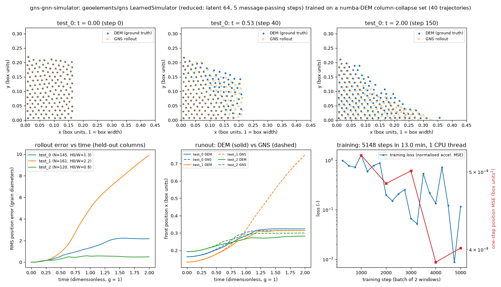

# gns-gnn-simulator: learned graph-network simulator for granular flow (GNS)

## What it models and why it matters here

A graph-network simulator (GNS) learns to step a particle system forward in time. It is trained on short simulation trajectories and then rolled out much faster than the solver that made them (Sanchez-Gonzalez et al., 2020, "Learning to simulate complex physics with graph networks", ICML; Kumar & Vantassel, 2023, *J. Open Source Softw.* 8:5025, [geoelements/gns](https://github.com/geoelements/gns)). The doser's LIGGGHTS twin costs about 30 CPU-min per revolution, so a trained GNS could stand in for it inside calibration or optimisation loops. This run asks a narrower question: on a CPU runner, in minutes, can you build a granular dataset, train a GNS and roll it out against DEM?

## Code and version

- [geoelements/gns](https://github.com/geoelements/gns), commit `3b8fb5c` (2024-12-12), `gns.learned_simulator.LearnedSimulator` and `gns.noise_utils`.
- torch 2.5.1+cpu, torch_geometric 2.6.1, torch_cluster 1.6.3 (pt25cpu wheel), numba 0.68.1.
- torch_geometric 2.7 was tried first and failed: its `radius_graph` raised `ImportError: 'radius_graph' requires 'pyg-lib>=0.6.0'`. Pinning 2.6.1, which calls torch_cluster, fixed it.
- Files:
  - [`dem_collapse.py`](dem_collapse.py): data generator.
  - [`train_gns.py`](train_gns.py): training loop and rollouts.
  - [`plot_gns.py`](plot_gns.py): figure and animation.
  - [`make_result.py`](make_result.py): writes result.json.
  - [`run.sh`](run.sh): reruns everything.

**Route taken.** No small pretrained 2D-sand GNS was found to download. [geoelements/gns-sample](https://github.com/geoelements/gns-sample) holds only the `WaterDropSample` dataset (a fluid, no checkpoint). The Sand/SandRamps data sit on DesignSafe (PRJ-3702) behind its data-depot interface, which was not tried. So the dataset was generated here.

## Setup

**Ground-truth DEM** ([`dem_collapse.py`](dem_collapse.py), self-written, numba):
- 2D discs, radius 0.007–0.009 in a unit box, g = 1.
- Linear spring-dashpot contacts: k_n = 300, restitution 0.5.
- Viscously regularised Coulomb friction, μ = 0.5 (the salt value), the same on the walls.
- Translational degrees of freedom only, with no disc rotation (a crude proxy for rolling resistance).
- Columns of width W = 0.12–0.22 and requested aspect H/W = 0.73–2.39 settle behind a gate, which is then removed.
- 151 frames per trajectory, Δt_frame = 0.0133.
- 40 training, 2 validation and 3 test trajectories with 36–264 grains each.

**GNS** (reduced from the paper's latent 128 and 10 message-passing steps):
- Latent and MLP width 64, 5 message-passing steps, 2-layer MLPs, 215,250 parameters.
- Connectivity radius 0.035 (about 2.2 grain diameters), 6-frame input history.
- Random-walk input noise σ = 2.5×10⁻⁴, with the same loss and noise treatment as `gns/train.py`.
- Adam with learning rate 10⁻³ decaying exponentially to 10⁻⁴, batches of 2 windows.
- Training stopped after 13 min of wall clock.

**Held-out test columns**: test_0 (W 0.17, H/W 1.6) and test_2 (W 0.20, H/W 1.0) lie inside the training range. test_1 (W 0.14, H/W 2.6) is taller than any training column, so it is an extrapolation.

## How to rerun

```bash
bash run.sh        # venv/pip commands are listed at the top of run.sh; bulky outputs go to /tmp/sims-scratch/gns-gnn-simulator
```

## Runtime

All on 1 CPU thread of a shared, oversubscribed 4-core runner (load average about 14):

| step | wall clock |
|---|---|
| dataset (45 DEM trajectories) | 69 s |
| training (5,148 steps) | 780 s |
| rollouts (3 cases, 145 steps each) | 9 s |

The full rerun takes about 15 min.

## Result



Animation: [GIF](gns_rollout.gif) / [MP4](gns_rollout.mp4). The top row is test_0, inside the training range. The bottom row is test_1, the tall extrapolation case. DEM is on the left, GNS on the right.

Runout error is the error in final front position, as a fraction of the DEM runout distance.

| test case | grains | final RMS position error | runout DEM → GNS (box units) | runout error |
|---|---|---|---|---|
| test_0 (in range) | 145 | 2.2 d | 0.324 → 0.314 | −6 % |
| test_2 (in range) | 120 | 0.49 d | 0.282 → 0.300 | +20 % |
| test_1 (taller than training) | 161 | 9.9 d | 0.314 → 0.749 | +238 % (rollout blows up) |

- For the two columns inside the training range, the GNS reproduces the collapse and final pile shape to within a few grain diameters, and the final pile heights agree within 0.007.
- For the taller column the rollout leaves the training distribution after t ≈ 0.6. Grains keep flowing and spread across the box, so the runout comes out more than twice the DEM value.
- Rolling out 145 steps takes about 3 s per case on 1 thread. The DEM takes 1–6 s per trajectory here, so this tiny system shows no speed-up. Any speed gain only appears for large, expensive DEM such as the LIGGGHTS auger.

## Status

**Ran at reduced scale** (result.json `"partial"`). The whole pipeline worked: dataset, training, rollout, comparison and animation. But the model is about 200× under-trained compared with the published GNS (about 5×10³ steps vs 10⁶ or more), and one of the three held-out rollouts is unstable.

## Limitations

- The dataset is tiny (40 trajectories, at most 264 grains) and comes from a simplified DEM: no rotation, regularised friction, a single μ. The GNS has learned this toy DEM, not salt in an auger.
- The training budget is minutes on 1 thread. Error accumulation and the failure to extrapolate (test_1) are the known GNS failure modes, and they are worse when under-trained.
- 2D only. A doser surrogate would need 3D, rotating screw boundaries (kinematic particles or mesh boundaries; MeshGraphNets/GNS variants) and orders of magnitude more training data and GPU time.
