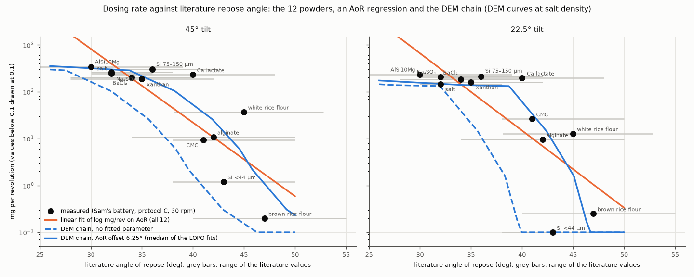
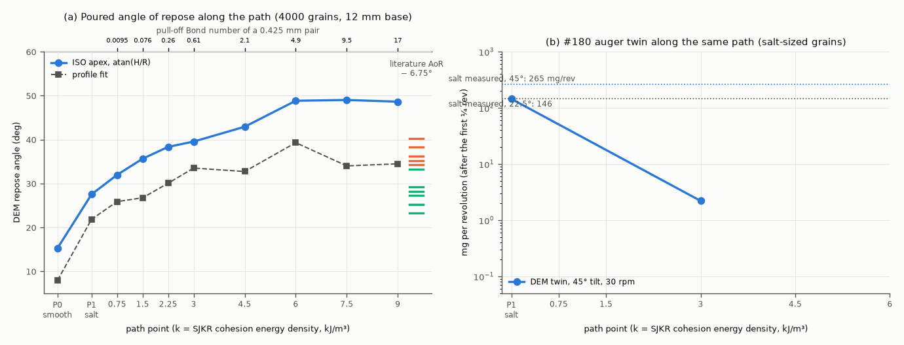
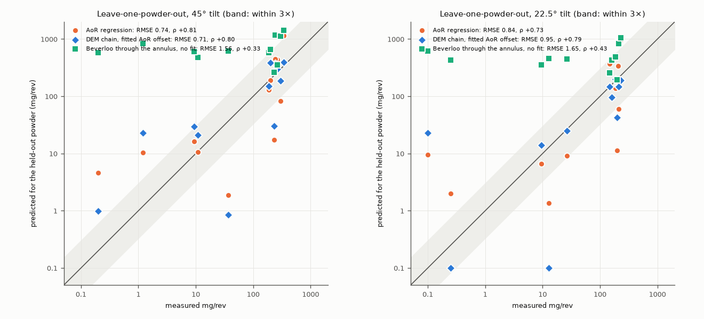
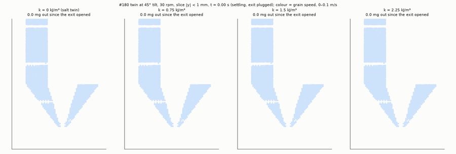

# heldout-powders: can the simulations predict powders held out of Sam's 13-powder battery?

## What it models and why it matters here
Sterling asked on #196 whether the simulation results can help predict the behaviour of held-out powders
from the larger dataset Sam collected for his paper, and whether there are meaningful correlations. That dataset
is the #116 battery on `copilot/draft-base-manuscript` @ `963fdba`: 13 powders, each run through the same frozen
protocol. Battery protocol C (30 rpm, six single revolutions at each of 0, 22.5 and 45° tube tilt) ran on the
cone-exit auger, which is the geometry of the #180 DEM twin, so the twin can be run for other powders.

Every model below predicts each powder **without seeing its dosing data** (leave one powder out, LOPO). The
inputs are the #163 literature properties, which were not measured on the lab's lots. The simulation route is:

1. **The DEM path.** One line through contact-parameter space, from smooth grains through the #180 salt twin
   (μ = 0.5, μ<sub>roll</sub> = 0.3) to salt friction plus SJKR cohesion k = 0.75–9 kJ/m³. The grains are salt-sized
   (0.361/0.425/0.489 mm) at every point, so cohesion and friction are what change.
2. **The DEM angle of repose** (ISO 4324 apex method, the reduced test of `../dem-liggghts-aor`) at every path point.
   A powder's literature repose angle then gives its position on the path.
3. **The #180 twin** at protocol C conditions (30 rpm, 45° and 22.5°) at the path points. That gives the DEM's
   mg/rev at the powder's position, multiplied by the powder's particle density over salt's.

So each powder costs no new DEM run: the path is simulated once, and any new powder is placed on it by its
repose angle.

## Code and version
LIGGGHTS-PUBLIC 3.8.0 (Debian/Ubuntu package `liggghts`), serial, STL meshes. The twin's `geometry.py` and
`run_case.py` are copied unchanged from `../dem-liggghts-auger-short` (themselves unchanged from #180's
`sim/dem/`). Analysis: numpy, scipy, matplotlib.

## Setup
* **Powders and responses.** The 12 powders with #163 literature properties (fumed silica has none, so it is
  left out). Responses come from Sam's `rate_summary.csv`:
  * mg/rev at 0, 22.5 and 45° (protocol C, 30 rpm, six single revolutions per tilt);
  * the speed exponent of protocol D (mg/s ∝ rpm<sup>a</sup> at 22.5°);
  * 1 g closed-loop doses from `dose_summary_by_powder_target.csv`.

  Values below 0.1 mg/rev (one salt grain is 0.087 mg) are set to 0.1. All copies and their commits are in
  [`data/SOURCES.md`](data/SOURCES.md).
* **DEM path, repose angle** ([`aor_path.py`](aor_path.py)). The test of `../dem-liggghts-aor`: 4000 grains poured
  onto a 12 mm base, read with the ISO 4324 apex formula atan(H/R) (handbook values are usually measured that way)
  and with a profile fit. Path points:

  | point | μ (grain–grain) | μ<sub>roll</sub> | SJKR k (kJ/m³) | pull-off Bo, 0.425 mm pair | DEM repose angle, apex (fit) |
  |---|---|---|---|---|---|
  | P0 | 0.3 | 0.1 | 0 | 0 | 15.3° (8.0°) |
  | P1 = salt twin | 0.5 | 0.3 | 0 | 0 | 27.5° (21.9°) |
  | k0.75 | 0.5 | 0.3 | 0.75 | 0.01 | 32.0° (25.9°) |
  | k1.5 | 0.5 | 0.3 | 1.5 | 0.08 | 35.6° (26.7°) |
  | k2.25 | 0.5 | 0.3 | 2.25 | 0.26 | 38.3° (30.1°) |
  | k3 | 0.5 | 0.3 | 3 | 0.61 | 39.5° (33.5°) |
  | k4.5 | 0.5 | 0.3 | 4.5 | 2.1 | 42.9° (32.7°) |
  | k6 | 0.5 | 0.3 | 6 | 4.9 | 48.8° (39.3°) |
  | k7.5 | 0.5 | 0.3 | 7.5 | 9.6 | 49.0° (34.0°) |
  | k9 | 0.5 | 0.3 | 9 | 16.5 | 48.6° (34.5°) |

  The apex angle rises steadily to k = 6 kJ/m³ and then saturates (the heaps grow cliffs and columns). The
  chain uses its running maximum, so the map from repose angle to path position is monotone.
* **DEM path, doser** ([`doser_path.py`](doser_path.py)). The #180 `rig_t27p5_r60` geometry: Ø3 mm exit with the
  core tip inside it (a 1.07 mm annulus, about 2.5 grain diameters), 1.5 flight turns meshed and about 29 k grains.
  Run at 30 rpm with tilted gravity. The exit is plugged for a 0.12 s settle, then the auger turns 0.75 revolution.
  The rate is taken **after the first quarter revolution** (as #180 did, which drops the start-up burst). Stalled
  cases that were stopped early to free a core use the rate after the first 0.1 revolution. The time step is 0.3 of
  the Rayleigh time (#180 used 0.2); everything else is #180's salt twin.
* **The chain** ([`predict.py`](predict.py)) for a powder with literature repose angle A:
  1. path position u where the DEM apex angle equals A − Δ;
  2. log<sub>10</sub> mg/rev of the twin at u (linear in log between the simulated points, continued past the
     last one and floored at 0.1);
  3. plus log<sub>10</sub>(ρ<sub>p</sub>/2165), the powder's particle density over salt's. The DEM delivers a solid
     volume, and salt-sized grains of another density deliver the same volume.

  Δ = 0 is the **no-fit** chain. **dem_shift** fits Δ on the 11 training powders of each fold (one parameter),
  and **dem_shift_scale** adds a log scale (two parameters).
* **Baselines**, also LOPO:
  * the training mean;
  * log mg/rev regressed on the literature repose angle (2 parameters), and with log particle density added (3);
  * a monotone (isotonic) fit on the repose angle;
  * a granular Bond number from d50 and particle density (van der Waals at one 0.1 µm asperity);
  * run 24's Beverloo flow through the core-tip annulus with each powder's d50 and bulk density (no fit, and
    with a fitted log offset).
* **Inverse direction (the paper's claim):** predict each held-out powder's literature repose angle from its
  measured mg/rev. The baseline is linear in log mg/rev at 45°. The DEM version finds the path position whose
  twin output matches the powder's (density-corrected) mg/rev at both tilts, then reads the DEM repose angle there
  and adds the mean training offset.


## Result


*The 12 powders (black) against their literature repose angle, with the range of the literature values (grey). Orange
is the regression of log mg/rev on the repose angle. Blue is the DEM chain at salt density, with no fitted parameter
(dashed) and with the fitted offset (solid).*



*(a) DEM repose angle along the path. Coloured ticks: each powder's literature value minus the fitted offset. (b) The
#180 twin along the same path at protocol C conditions, with salt's measured values dotted.*





*The twin at 45° and 30 rpm at four points on the path, slice through the auger axis, coloured by grain speed
([MP4](dem_path_doser.mp4)). Even the weakest cohesion slows the exit, and from k = 1.5 kJ/m³ only a trickle gets
through.*

**Correlations ([`correlations.md`](correlations.md)).** One property stands out: the **literature angle of repose** correlates with everything Sam's battery measured.
* mg/rev: ρ = −0.75, −0.80 and −0.84 at 0, 22.5 and 45°.
* 1 g dose time: +0.92 (the 9 powders that convey).
* The 1 g pass rate: −0.84.
* The speed exponent: +0.76.

Two of these (45° mg/rev and dose time) pass a Bonferroni correction for the 60 tests in the table. Moisture
(−0.67 with 45° mg/rev) and the densities (−0.8 with dose time) come next, without passing it. Grain size shows
nothing (|ρ| ≤ 0.34), and neither do the closed-form physics that run on it: a van der Waals Bond number from d50
(|ρ| ≤ 0.34) and Beverloo through the annulus (|ρ| ≤ 0.58). Cohesion, not grain size, sets this exit. The DEM
chain's predictions correlate as strongly as the repose angle (+0.84 at 45°). That is by construction, since the
chain is a monotone function of it.

**The twin at protocol C.** With salt's own parameters and no fitting, the #180 twin reproduces Sam's salt numbers at protocol C:

| | twin | measured (salt) |
|---|---|---|
| 45°, 30 rpm | 286 mg/rev | 265 mg/rev |
| 22.5°, 30 rpm | 138 mg/rev | 146 mg/rev |
| speed exponent, 22.5° (30 vs 90 rpm) | 0.82 | 0.78 |

Along the path, the twin's output collapses at very weak cohesion. At 45° it gives 400 / 286 / 103 / 26 / 6 / 2 mg/rev
for smooth grains, salt, and k = 0.75 / 1.5 / 2.25 / 3 kJ/m³ (Bo 0.01–0.6). The k = 4.5 and 6 kJ/m³ runs were
stopped after their opening bursts (13 and 5 grains in 0.1 revolution). At 22.5° the k = 0.75 point barely differs from salt (132 vs 138 mg/rev), and k = 1.5 drops to 14.

With salt-sized grains the 1.07 mm annulus is 2.5 grains wide, and an arch across it needs almost no cohesion. The
repose angle meanwhile rises steadily (27.5° → 39.5° over the same range). So the twin acts as a threshold
detector for cohesion, sitting at the low end of the repose-angle scale.

**Coarse-graining check (0.35 mm grains).** To test whether the early cliff comes from the grain size, salt and
k = 1.5 kJ/m³ were rerun at 45° with 0.35 mm grains: about 55 k grains, 0.5 revolution, 2 MPI ranks each, about
20 min. That makes the annulus 3.1 grains wide instead of 2.5. Over the same window (0.25–0.49 revolution,
[`coarse_graining_check.json`](coarse_graining_check.json)):

| grain d50 | annulus width | salt (k = 0) | k = 1.5 kJ/m³ | cohesive / salt |
|---|---|---|---|---|
| 0.425 mm | 2.5 grains | 293 mg/rev | 16 mg/rev | 0.056 |
| 0.35 mm | 3.1 grains | 543 mg/rev | 104 mg/rev | 0.19 |

Grains 18 % smaller let the cohesive case through 6.4× faster, against 1.85× for salt, even though each pair's Bond
number rises slightly (0.076 → 0.092). So the twin's cliff position depends strongly on how many grains span the
annulus. The fine powders, with 4–43 grains across it, should tolerate far more cohesion than the salt-sized twin
suggests, which is the direction of the fitted offset. Salt's own rate is just as sensitive to grain size, so the
twin's agreement with salt depends on salt's PSD, which has not been measured (#180). The windows are short (about
a quarter revolution) and there is one seed per case, so treat the factors as rough.

**Held-out powders.** Predicting each powder from its literature properties alone, leave one out:
* **With one fitted parameter, the DEM chain is as good as the best regression, not better.**
  * The fitted parameter is the offset Δ between literature and DEM repose angle: 6.25° at 45° and 6.75° at 22.5°,
    stable across folds (4.5–8°).
  * At 45°: RMSE 0.71 log<sub>10</sub>, median error 1.9×, 11 of 12 flow classes right.
  * The two-parameter regression on the repose angle: 0.74, 2.5×, 11 of 12.
  * At 22.5° the chain's median error is smaller (1.4× vs 3.2×), but its RMSE is larger (0.95 vs 0.84).
  * None of the differences is significant: Wilcoxon p = 0.79 at 45° and 0.11 at 22.5°.
  * Redrawing every literature repose angle within its published range changes the RMSE of both by ±0.2–0.3. The
    chain wins 42 % of the draws at 45°.
* **Without any fitted parameter, the chain ranks the powders (ρ = 0.84 at 45°) but under-predicts.**
  * It gets 9 of 12 flow classes. It sends Si 75–150 µm, xanthan and Ca lactate (literature 35–40°) to
    1–25 mg/rev, against 187–302 measured.
  * The offset of about 6° that the fits find is close to the 4.5° by which the salt twin's repose angle (27.5°) sits
    below salt's handbook value (32°). Most of it is the spheres' lower repose angle.
  * The rest is probably the coarse-graining: the finer powders see an annulus about 4–43 grains wide, not 2.5.
* **Closed-form physics without cohesion is worse than knowing nothing.** Beverloo through the annulus (RMSE 1.56) and
  the d50 Bond number (1.07) do no better than the training mean (1.12).
* **Inverse (AoR from the dosing fingerprint), the paper's direction: the DEM is worse than a straight line.**
  * The line on log mg/rev: RMSE 3.5°. The DEM path: 7.0°. The mean: 5.9°.
  * Once the twin stalls, mg/rev carries no information about how cohesive a powder is.
  * At 22.5° the salt and k = 0.75 points are almost equal, so the inversion is flat over much of the path.
* **Few-shot (45° from the same powder's 22.5° value): the DEM is worse than the median ratio.** RMSE 0.48 vs 0.36;
  the ratio is better for 10 of 12 powders.
* **Speed: the twin gets salt right but not the cohesive powders.**
  * Salt: 0.82 against 0.78 measured.
  * Measured, the poor powders deliver more per revolution at higher speed: exponent 0.85–1.36, against 0.53–0.80
    for the powders that convey.
  * At k = 0.75 the twin does the opposite (exponent 0.06): its flow is outlet-limited, at about 70 mg/s at both
    speeds.
  * Whatever helps cohesive powders out at higher speed on the rig (agitation, vibration, the flight sweeping the
    funnel more often) is missing from the twin.

#### Leave-one-powder-out scores (12 powders)

RMSE and median error are in log<sub>10</sub>(mg/rev) and as a factor; ρ is the Spearman rank correlation of the held-out predictions with the measurements; the last column counts powders put on the right side of 50 mg/rev at 45° (7 convey, 5 do not).

| model | 45°: RMSE | median error | ρ | flow class | 22.5°: RMSE | median error | ρ | flow class |
|---|---|---|---|---|---|---|---|---|
| training mean (no information) | 1.12 | 6.3× | -1.00 | 2/12 | 1.23 | 7.4× | -1.00 | 4/12 |
| log mg/rev linear in literature AoR (2 fitted) | 0.74 | 2.5× | +0.81 | 11/12 | 0.84 | 3.2× | +0.73 | 11/12 |
| … plus log particle density (3 fitted) | 0.73 | 3.7× | +0.82 | 10/12 | 0.85 | 6.4× | +0.73 | 9/12 |
| monotone (isotonic) fit on AoR | 0.82 | 1.4× | +0.78 | 11/12 | 0.88 | 1.6× | +0.70 | 11/12 |
| linear in log Bond number from d50 (2 fitted) | 1.07 | 4.5× | +0.13 | 7/12 | 1.21 | 4.2× | -0.04 | 7/12 |
| Beverloo through the core-tip annulus, no fit | 1.56 | 4.5× | +0.33 | 7/12 | 1.65 | 4.3× | +0.43 | 7/12 |
| Beverloo, fitted log offset (1 fitted) | 1.13 | 5.1× | +0.03 | 6/12 | 1.25 | 5.6× | +0.03 | 5/12 |
| **DEM chain, no fitted parameter** | 1.23 | 5.5× | +0.84 | 9/12 | 1.53 | 6.0× | +0.63 | 9/12 |
| DEM chain, no fit, bulk-density scaling | 1.35 | 8.6× | +0.86 | 9/12 | 1.55 | 8.3× | +0.75 | 8/12 |
| **DEM chain, fitted AoR offset (1 fitted)** | 0.71 | 1.9× | +0.80 | 11/12 | 0.95 | 1.4× | +0.79 | 11/12 |
| DEM chain, fitted offset and log scale (2 fitted) | 0.72 | 1.8× | +0.76 | 11/12 | 1.02 | 3.4× | +0.60 | 11/12 |

Fitted AoR offset Δ across the 12 folds: median 6.25° (range 4.5–7°) at 45°, median 6.75° (range 5.25–8°) at 22.5°.

Paired comparison of per-powder absolute errors (Wilcoxon signed-rank, 12 powders):

| tilt | comparison | powders where the first is better / worse | median difference (log<sub>10</sub>) | p |
|---|---|---|---|---|
| 45° | dem_shift vs aor_ols | 7 / 5 | -0.08 | 0.79 |
| 45° | dem_shift vs aor_iso | 5 / 7 | +0.03 | 0.68 |
| 45° | dem0 vs aor_ols | 3 / 9 | +0.50 | 0.08 |
| 22.5° | dem_shift vs aor_ols | 9 / 3 | -0.27 | 0.11 |
| 22.5° | dem_shift vs aor_iso | 6 / 6 | -0.00 | 0.97 |
| 22.5° | dem0 vs aor_ols | 5 / 7 | +0.56 | 0.20 |

Literature AoR redrawn uniformly within each published range (200 draws), LOPO repeated:

| tilt | model | median RMSE | 10–90 % | median flow class | DEM chain better in |
|---|---|---|---|---|---|
| 45° | aor_ols | 0.87 | 0.66–1.05 | 10/12 |  |
| 45° | dem_shift | 0.92 | 0.57–1.23 | 10/12 | 42 % of draws |
| 22.5° | aor_ols | 1.00 | 0.79–1.15 | 10/12 |  |
| 22.5° | dem_shift | 1.18 | 0.73–1.57 | 10/12 | 26 % of draws |

#### Per powder at 45° (mg/rev; held-out predictions)

| powder | literature AoR (range) | measured | DEM chain, no fit | DEM chain, fitted offset | AoR regression | DEM no-fit over the AoR range |
|---|---|---|---|---|---|---|
| AlSi10Mg | 30° | 339 | 200 | 391 | 1.14e+03 | 4.25–378 |
| Si (110/200 mesh) | 36° | 302 | 23 | 185 | 82.6 | 0.57–110 |
| NaCl (control) | 32° | 265 | 102 | 300 | 437 | 7.11–162 |
| Sodium sulfate | 32° | 244 | 126 | 369 | 446 | 26.2–200 |
| Calcium lactate | 40° | 232 | 1.17 | 30.2 | 17.2 | 0.1–70.5 |
| Barium chloride | 34° | 200 | 68.9 | 390 | 191 | 2.43–368 |
| Xanthan gum | 35° | 187 | 23.2 | 152 | 129 | 0.37–181 |
| White rice flour | 45° | 37.1 | 0.103 | 0.847 | 1.86 | 0.1–4.51 |
| Sodium alginate | 42° | 10.9 | 0.4 | 20.8 | 10.6 | 0.1–36.7 |
| CMC | 41° | 9.35 | 0.697 | 29.4 | 16.2 | 0.1–5.26 |
| Si (-325 mesh) | 43° | 1.2 | 0.321 | 23 | 10.3 | 0.11–7.66 |
| Brown rice flour | 47° | 0.2 | 0.1 | 0.982 | 4.63 | 0.1–1.14 |

#### Inverse: each held-out powder's literature AoR from its measured mg/rev

| model | RMSE (deg) | MAE (deg) | ρ |
|---|---|---|---|
| training mean | 5.9 | 5.4 | – |
| linear in log mg/rev at 45° | 3.5 | 2.9 | +0.70 |
| DEM path, both tilts, mean offset | 7.0 | 5.7 | +0.64 |
| DEM path, no offset | 10.5 | 8.4 | +0.64 |

#### Few-shot: 45° from the same powder's measured 22.5° value

| model | RMSE | median error | ρ |
|---|---|---|---|
| training powders' median 45/22.5 ratio | 0.36 | 1.24× | +0.90 |
| DEM path (22.5° → position → 45°) | 0.48 | 1.57× | +0.93 |

#### Speed: effective exponent a (mg/s ∝ rpm<sup>a</sup>) at 22.5°

| | 30 rpm (mg/rev) | 90 rpm (mg/rev) | a |
|---|---|---|---|
| DEM P1 | 138.4 | 114.2 | 0.82 |
| DEM k750 | 132.1 | 47.1 | 0.06 |
| measured, the 7 powders that convey (protocol D, 15–90 rpm) | | | 0.65 (range 0.53–0.80) |
| measured, the 4 poor powders with an exponent | | | 1.11 (range 0.85–1.36) |


## Runtime
* **Twin cases** (about 29 k grains, serial, four at a time on the runner's 4 vCPUs, which are 2 physical cores):
  * 1650–2350 s each for 0.75 revolution at 30 rpm;
  * 650–800 s each at 90 rpm.
* **Repose-angle runs:** 46–73 s each.
* **Totals:** 5.0 h of twin wall time and 10 min of repose-angle runs, finished in about 85 min of
  elapsed time.
* **Analysis:** `predict.py` takes about 30 s, mostly the 200 resampling draws; `figures.py` about 20 s.

## Status
**Ran.** Thirteen twin cases and ten repose-angle points; 10 of the 13 twin cases ran the full 0.75 revolution.
The two 0.35 mm grain cases of the coarse-graining check ran their planned 0.5 revolution.
* Stopped early to free cores once they had stalled: k = 3 (0.32 rev), 4.5 and 6 kJ/m³ at 45° (0.1 rev).
* The k = 4.5 and 6 cases are not used.
* The 22.5° path has only salt, k = 0.75 and k = 1.5; past k = 1.5 its last slope is continued.
* No 0° cases: the twin's outlet counting is unreliable there (#180).

## Limitations
* **Literature inputs, not same-lot measurements.** Every predictor is a handbook or supplier value for the material
  class (#163). Several repose angles are marked "rough-estimate" there, and the ranges are 6–15° wide (grey
  bars in the figure). That spread is as large as the step between powders that convey and powders that do not.
* **One line through parameter space.** The path ties friction and cohesion together, so the chain is a monotone
  function of the repose angle (times density). It can't rank powders differently from the repose angle itself,
  and the inverse can't separate friction from cohesion (run 29's identifiability result).
* **Coarse-graining at the exit** (see the 0.35 mm check above). Every powder is simulated with salt-sized grains, so the 1.07 mm annulus is
  always about 2.5 grains wide. By literature d50 the other 11 powders are 1.4–17× finer than salt, so their real
  annulus is about 4–43 grains wide (8–43 for the nine finer than 150 µm). Narrow openings jam far more easily, so the coarse-grained twin is probably too
  arch-prone for fine powders. The fitted offset Δ absorbs this.
* **Short windows and one seed.** 0.75 revolution per case, measured over the last 0.5 revolution. #180 found
  ±15–20 % pulse-to-pulse scatter within a revolution. Rare arch-breaking events that let cohesive powders
  trickle on the rig (9–37 mg/rev) need many revolutions to sample. Stalled cases were stopped after 0.1–0.3
  revolution.
* **The density factor** assumes salt-sized grains of another density deliver the same volume. Bulk-density
  scaling is reported as `dem0_bulk`.
* **n = 12.** With this few powders, a difference of one misclassified powder or 0.1 in RMSE between models is
  within the noise of the comparison.
* **Not modelled:** fill level, humidity history (BaCl₂'s caking), electrostatics, particle shape beyond rolling
  friction, and air (which matters for the finest powders, see `../cfd-dem`).


## How to rerun
```
sudo apt-get install -y liggghts
python3 -m venv /tmp/venv && /tmp/venv/bin/pip install numpy scipy matplotlib imageio imageio-ffmpeg pillow
/tmp/venv/bin/python aor_path.py run P0 P1 k750 k1500 k2250 k3000 k4500 k6000 k7500 k9000   # about 1 min each
/tmp/venv/bin/python doser_path.py run d45_P1      # one case per process; 13-30 min each when 4 run at once
/tmp/venv/bin/python doser_path.py run d45_P1_d035 d45_k1500_d035   # coarse-graining check (2 MPI ranks each)
/tmp/venv/bin/python aor_path.py summarize && /tmp/venv/bin/python doser_path.py summarize
/tmp/venv/bin/python predict.py                    # LOPO comparison, correlations.md, predictions.json
/tmp/venv/bin/python figures.py                    # figures and the animation (reads the scratch dumps)
```
`python doser_path.py list` prints every case. Scratch output goes to `/tmp/sims-scratch/heldout-powders/`.
