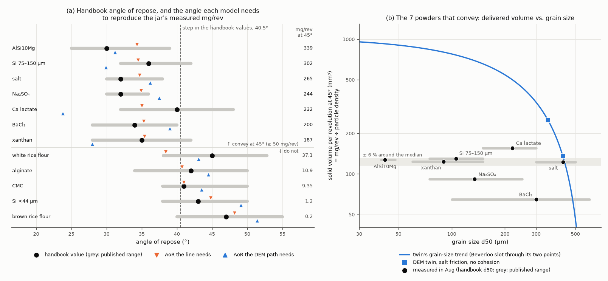

# Same-jar measurements: what to measure, and what the models predict before anyone measures

Sterling on #196 (4 Nov 2026), after run 32: *"so basically, run real experiments instead of relying on
literature values"*. Yes, for the powder properties. The dosing side of run 32 is already real: Sam's battery,
run 4–21 Aug 2026. The property side is handbook values for each material class (#163), not measurements on the
lab's jars. This page covers three things:

* which measurements to make, and what each one settles;
* the models' predictions, written down before the jars are measured, so that the measurements test them;
* what measured inputs will not fix on their own.

It uses only the data and DEM runs already in this folder; nothing new was simulated. The numbers come from
[`same_jar.py`](same_jar.py), with full tables in [`same_jar_tables.md`](same_jar_tables.md) and the predictions
in [`same_jar_predictions.json`](same_jar_predictions.json).

The paper plan already has this step: [`OUTLINE.md`](https://github.com/vertical-cloud-lab/powder-doser/blob/252f75f/paper/optimization/OUTLINE.md)
(#184) §4.A1 (exit geometry), §4.A2 ("characterize the lots, same jars that are dosed") and §4.A5 (fingerprints
with a same-day reference), and its Fig. 6 plan says "swap literature AoR for measured". What follows ranks those tests for the 13 jars that already have
fingerprints, and fixes the predictions in advance.

*(a) Black: each powder's handbook angle of repose (AoR); grey: its published range. Orange: the AoR that a line
fitted to all 12 needs in order to reproduce the jar's measured mg/rev at 45°. Blue: the AoR that the DEM path needs
to reproduce the jar's mg/rev at both tilts. (b) Solid volume delivered per revolution at 45° (mg/rev divided by
particle density) for the 7 powders that convey, against handbook d50. Blue: the DEM twin without cohesion at two
grain sizes, and a Beverloo slot through those two points.*

## Why the handbook values are the bottleneck

* **The ranges are as wide as the effect.**
  * Published AoR ranges are 6–16° wide (median 13°). Read as the uncertainty in a jar's AoR, that is 3.2–3.7° RMS.
  * In the dosing data, the 7 powders that convey at 45° have handbook AoRs of 30–40°, and the 5 that do not have
    41–47°. That puts the step at 40.5°.
  * The published ranges of 8 of the 12 powders straddle that step.
* **The doser already reads AoR about as well as the handbooks allow.**
  * A line fitted to the 12 powders, AoR = 45.15 − 4.30 log10(mg/rev at 45°), misses the handbook
    values by 3.1° RMS (3.5° leave-one-out). The handbook spread alone (3.2–3.7°) is that large.
  * The doser's own repeatability (RSD 2–18 % at 22.5° for the powders that convey) is worth under 1° of AoR on
    that line.
  * So the current data cannot say how well the doser reads AoR. Only AoR measured on the jars can.
* **The spread can account for all of the scatter.**
  * Correcting the AoR trend for the spread (errors in variables) leaves no residual scatter: the residual share
    is −0.19 to 0.00. Of the handbook AoR's variance across the 12 powders, 32–43 % would be spread rather than real
    differences between powders.
  * With n = 12, and a trend that looks more like a step than a line, read this as "the handbook data can't rule
    out a near-perfect relation". It does not prove one.
* **Precision needed.** To predict mg/rev at 45° within a factor of 2 from AoR, the AoR has to be known to about
  ±2°. That follows from the slope of the handbook fit, 0.157 decades per degree. On the steepest part of the DEM's
  cliff the slope reaches 0.24 decades per degree, which tightens this to about ±1.3°.

## What to measure, in priority order

| # | Measurement | Jars | What it settles here | Protocol points from the runs |
|---|---|---|---|---|
| 1 | **Angle of repose** | all 13 | The step and the inverse (C1–C4 below) | One method for every jar, ideally the fixed-base cone (ISO 4324). The handbook values mostly use it, and so does the DEM's apex angle. At least three pours per jar; report mean and SD. Log RH |
| 2 | **PSD** (d10, d50, d90) | all 13 | How many grains span the 1.07 mm exit annulus. On handbook d50 ranges that is 1.8–10.7 for BaCl₂ and 2.1–3.6 for salt. Panel (b) shows why it matters. The twin's match to salt rests on salt's PSD, which nobody has measured (#180) | Sieves for salt, BaCl₂, Ca lactate and Na₂SO₄ (sieves on order, byu-vcl#262); images or laser diffraction for the fine powders |
| 3 | **Bulk and tapped density** | all 13 | Converts mg/rev into delivered volume; Hausner ratio. Five handbook Hausner ratios are marked "assumed-circular" in #163 | Use the same pour every time: in run 5 the fill method alone moved the DEM bed from φ 0.577 to 0.632. Fix the tap count and record the whole curve; the cohesive DEM bed was still compacting after 30 taps |
| 4 | **The same-day fingerprint** | all 13 | The jars are 2.5–3 months older than the August data. BaCl₂ caked after humidity cycling (`OUTLINE.md` §4.A10), and the five hygroscopic powders hold 11.5–15 % water by the handbook | Protocol C (six single revolutions at 45° and 22.5°, 30 rpm) on the day of tests 1–3, plus a salt reference (salt drifted about 10 % between days, §4.A5) |
| 5 | **RH and temperature** at every test; loss on drying for the hygroscopic jars | all | Run 27: pure NaCl should not change below about 73.5 % RH | A hygrometer by the doser |
| 6 | **As-printed exit**: bore and core-tip gap | the auger used | The twin's most sensitive input: moving the core tip 1 mm doubles delivery in the DEM (#180, §4.A1) | Calipers or a microscope photo |
| 7 | Hall/Carney flow | the jars that flow | A held-out check for the AM audience, not an input | The bought funnel set from the 28 Oct meeting |
| 8 | Shear cell | 2–3 jars | A held-out check, outsourced | The doser works at tens to hundreds of Pa; shear cells test at kPa (runs 6, 22, 24) |

Tests 1 and 3–6 need only what the lab already has; test 2 waits on the sieves for the coarse powders. The #163
discussion judged the full suite for every powder unreasonable, so tests 7 and 8 are for a subset.

## Predictions, written before the jars are measured

The line is AoR = 45.15 − 4.30 log10(mg/rev at 45°), fitted on the 12 handbook values. The DEM value comes
from the path position whose twin output matches the jar's density-corrected mg/rev at 45° and 22.5°: its DEM
repose angle plus the mean offset to the handbook values (+8.4°). Both are on the handbook scale. If the lab uses a
different AoR method, every value should move by about the same amount.

| jar | handbook AoR (range) | mg/rev at 45°, Aug | side of the step | AoR, line | AoR, DEM path |
|---|---|---|---|---|---|
| AlSi10Mg | 30° (25–39) | 339 | below | 34.3° | 31.2° |
| Si 75–150 µm | 36° (32–42) | 302 | below | 34.5° | 29.9° |
| salt | 32° (30–38) | 265 | below | 34.7° | 36.2° |
| Na₂SO₄ | 32° (30–36) | 244 | below | 34.9° | 37.5° |
| Ca lactate | 40° (32–48) | 232 | below | 35.0° | 23.8° |
| BaCl₂ | 34° (28–40) | 200 | below | 35.3° | 39.0° |
| xanthan | 35° (28–42) | 187 | below | 35.4° | 28.0° |
| white rice flour | 45° (38.1–52.8) | 37.1 | above | 38.4° | 43.1° |
| alginate | 42° (34–50) | 10.9 | above | 40.7° | 44.5° |
| CMC | 41° (38–50) | 9.35 | above | 41.0° | 43.5° |
| Si <44 µm | 43° (38–50) | 1.2 | above | 44.8° | 49.1° |
| brown rice flour | 47° (40–55) | 0.2 | above | 48.2° | 51.4° |
| fumed silica | none | 5.57 (under its 6.1 mg noise floor) | above | ≥ 41.8° | – |

**Pass/fail criteria**, each with what the outcome would mean:

* **C1 (step).** One AoR threshold separates the 7 jars that convey at 45° from the other 6, fumed silica
  included (13 of 13).
  * **Pass:** the doser's flow/no-flow split is an AoR threshold, and a single AoR on a new jar predicts which side
    it lands on.
  * **Fail:** something other than AoR decides whether a jar conveys. Look at PSD and moisture first.
* **C2 (rank).** Spearman ρ between measured AoR and log10 mg/rev at 45° is at least as strong as with
  the handbook values: ρ ≤ −0.84 over the 12 jars above the floor.
  * **Fail:** the handbook spread was not what limited the correlation.
* **C3 (inverse, the paper's direction).** The line above predicts measured AoR with RMSE below 3.5° once one
  common offset is removed, and also when refitted leave-one-jar-out on the measured values.
  * **Pass:** this is the first direct test of "the doser as a cheap AoR probe".
  * **Caveat:** at 45° the 7 jars that convey all deliver 187–339 mg/rev, so the line puts all of them at
    34–35.5°. If their real AoRs spread over several degrees, C3 can fail on them alone. Reading AoR within the
    free-flowing group then needs a second observable, such as the speed exponent or mass per tap.
* **C4 (does the DEM read friction among free flowers?).** Among the 7 jars that convey, measured AoR rises with
  the DEM path's value: Spearman ρ ≥ +0.71, one-sided p < 0.05 for 7 jars.
  * The twin reads their spread in delivered volume as a spread in friction. For example, it puts Ca lactate
    lowest (23.8°) and BaCl₂ highest (39.0°). The line treats the same spread as noise.
  * **Fail:** that spread comes from grain size, shape or the exit, not friction (see the next section).

## What measured inputs won't fix on their own

1. **One input can't make the DEM chain better than a regression on that input.** The chain is a monotone function
   of AoR. It earns its keep only when the physics combines several measured inputs, such as PSD, density and AoR,
   that 12 jars are too few to fit freely; or when it extrapolates to settings the battery never ran.
2. **Grain size and cohesion are confounded** (panel b).
   * **The data are flat in grain size.** Four of the 7 powders that convey deliver the same solid volume per
     revolution within ±6 %: salt, xanthan, AlSi10Mg and Si 75–150 µm, at 122–130 mm³. Their handbook d50 spans
     42–425 µm. The CV over all 7 is 25 % when divided by particle density and 52 % when divided by handbook bulk
     density.
   * **The twin is not.** Without cohesion, the twin delivers 1.85× more when its grains shrink from 0.425 to
     0.35 mm. A Beverloo slot through those two points gives about 920 mm³ at 42 µm, roughly 7× what AlSi10Mg
     delivers.
   * **Two explanations fit the data.** Either the fine powders' cohesion almost exactly cancels the wider
     effective opening, or the real exit is not the CAD's 1.07 mm annulus.
   * **What separates them:** measured PSD, AoR and exit geometry, then sieved salt fractions (same material,
     different size), which the q10 answer also suggested.
3. **The twin doesn't reproduce the speed effect of the cohesive powders** (run 32: measured exponent 0.85–1.36,
   twin 0.06). No property measurement fixes that; the twin needs whatever lets cohesive powders out faster at
   higher speed on the rig.

## A prospective test: powders that have never been dosed

The cleanest test of any of this is a powder whose dosing no model has seen.

1. Measure its AoR and particle density.
2. Run `python same_jar.py new <AoR> <density in g/cm³>` and commit the output.
3. Then run protocol C.

The 28 Oct meeting's metals (Al 4047, Al 6063, 630 bronze) and the campaign powders in §4.A3 are candidates. For
example, a measured AoR of 32° at 2.70 g/cm³ gives these predictions at 45°:

| model | mg/rev |
|---|---|
| monotone fit | 244 |
| solid-volume rule (123 mm³ × density, if it conveys) | 332 |
| DEM chain | 374 |
| line | 397 |

## Files

* [`same_jar.py`](same_jar.py): the analysis, the tables, the figure and the `new` command. It runs in about
  2 s with numpy, scipy and matplotlib.
* [`same_jar_predictions.json`](same_jar_predictions.json): every number on this page, including the predictions,
  written 2026-11-04 before any same-jar measurement.
* [`same_jar_tables.md`](same_jar_tables.md): the tables as generated.
* [`same_jar.png`](same_jar.png): the figure.
