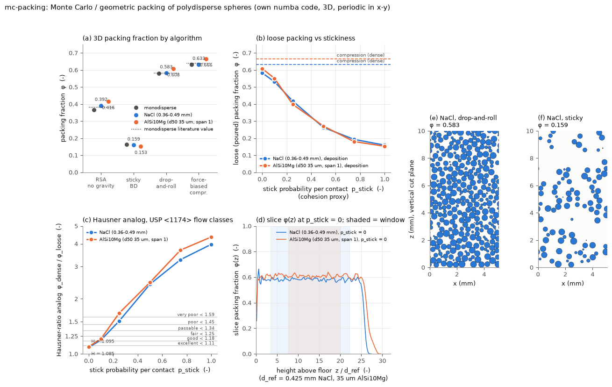

# mc-packing: Monte Carlo / geometric packing of polydisperse spheres

## What it models and why it matters here

Bulk (poured) density, tapped density and their ratio, the Hausner ratio, are standard
flowability tests (USP <1174>). Bulk density also sets the doser's delivery directly, since
mg per revolution is roughly bulk density times fill fraction times swept volume per pitch.
These runs compute the purely geometric part of those numbers for rigid spheres with the
measured size distributions (PSDs):

- **Random sequential addition (RSA):** spheres placed at random positions without overlap, no
  gravity. A loosest-random reference.
- **Gravitational drop-and-roll deposition** (Visscher and Bolsterli 1972; Jullien and Meakin
  1987): each sphere falls vertically, rolls down the first sphere it hits, then along the groove
  of two, and stops on a stable three-contact (or floor) position. This is the poured,
  cohesionless loose packing. As a cohesion proxy, a grain stops at each new contact with
  probability `p_stick`. `p_stick = 1` is ballistic deposition (it sticks at first touch), the
  strongly cohesive limit.
- **Force-biased compression** (in the Jodrey-Tory / Mościński-Bargieł family): grow all
  spheres and push overlaps apart until they jam. This gives a random close packing, used as the
  dense, tapped analog.

The Hausner-ratio analog is phi_dense / phi_loose. Geometric packings are scale-free, so NaCl
(0.43 mm) and AlSi10Mg (35 µm) differ here only through the shape of their PSDs. Real fine powders
are loose because of cohesion (van der Waals, capillary). This model has no cohesion forces;
`p_stick` stands in for them and is not calibrated to a Bond number.

## Code and version

Own code: `packing_kernels.py` (numba kernels), `run.py` (driver), `plots.py` (figure,
animation, `result.json`). Python 3.12.3, numpy 2.5.4, numba 0.68.1, matplotlib 3.11.2,
imageio 2.38.1 with imageio-ffmpeg. Everything is 3D.

## Setup

- **PSDs** (lengths are dimensionless in units of `d_ref` in the code):
  - NaCl: diameter uniform by number on 0.36-0.49 mm, so the number median is 0.425 mm
    (`d_ref` = 0.425 mm). The generated sample has volume d10/d50/d90 = 0.379/0.436/0.481 mm.
  - AlSi10Mg-like: log-normal with volume median 35 µm and sigma_ln = asinh(0.5)/1.2816 = 0.3755,
    so span (d90-d10)/d50 = 1. It is truncated at 35 µm × exp(±2.5 sigma) = 13.7-89.5 µm and
    sampled by number (number median 22.9 µm). `d_ref` = 35 µm, size ratio 6.5.
  - Monodisperse spheres, for validation against literature values.
  - Solid densities: NaCl 2165 kg/m3, AlSi10Mg 2670 kg/m3 (lead's brief).
- **RSA:** fully periodic cube of side 12 `d_ref`. Each attempt draws a new size from the PSD
  (so accepted grains are biased small). 10^7 attempts, cell list. Also reported: the Feder-type
  extrapolation phi(n) = phi_inf - A n^(-1/3), fitted over the last decade of attempts.
- **Deposition:** square box of side L = 12 `d_ref`, periodic in x and y, with a flat floor.
  N = 4000 (monodisperse, NaCl) or 8000 (AlSi10Mg). Contact events (first touch, contact during
  rolling on one sphere or along a two-sphere groove, leaving a contact, reaching the floor)
  are computed analytically. There is no time stepping. With three contacts, the grain is stable
  if the normal forces solving sum(f_i n_i) = z-hat are all >= 0. Otherwise it continues on the
  subset of contacts whose forces are >= 0 and whose motion does not enter the others. `p_stick`
  takes the values 0, 0.1, 0.25, 0.5, 0.75 and 1 (0 and 1 only for monodisperse). phi is the exact
  sphere-slab volume in a bulk window from 3 d_max above the floor to 2 d_max below the
  10th-percentile surface height. That leaves out the layered wall zone (panel d) and the rough top.
- **Compression:** N = 2000, fully periodic cube, starting from random positions at phi = 0.45.
  Radii grow by a factor (1 + ds), with ds = 0.01 halved after each failure down to 10^-4. After
  every growth step the harmonic overlap energy is minimised with FIRE (Bitzek et al. 2006). The
  packing counts as jammed when the largest overlap cannot be brought below 2×10^-4 of the contact
  distance within 4000 FIRE steps. This is a growth-plus-minimisation protocol (as in O'Hern et
  al. 2003), not event-driven Lubachevsky-Stillinger.

## How to rerun

```bash
python3 -m venv /tmp/venv-continuum
/tmp/venv-continuum/bin/pip install numpy numba matplotlib imageio imageio-ffmpeg
cd docs/physics-simulations/runs/mc-packing
OMP_NUM_THREADS=1 NUMBA_NUM_THREADS=1 /tmp/venv-continuum/bin/python run.py        # sim + plot + anim + result.json
# or by stage: run.py sim | plot | anim | result   (raw data go to /tmp/sims-scratch/mc-packing)
```

## Runtime

RUNTIME_PLACEHOLDER

## Result



Animation: [GIF](mc_packing_deposition.gif), [MP4](mc_packing_deposition.mp4). Both show NaCl
deposition in a vertical cut plane, cohesionless and sticky, frames matched by bed height.

RESULT_PLACEHOLDER

## Status

STATUS_PLACEHOLDER

## Limitations

- Geometry only: rigid frictionless spheres, with no contact mechanics, inertia, friction or
  cohesion forces. Drop-and-roll is a quasi-static sequential algorithm (grains already placed
  never move), and it ignores the cubic shape of real salt grains.
- The dense value is a frictionless jammed packing, an upper bound for real tapping. Real tapped
  beds of frictional grains usually stay below it. Compression protocols also matter: more
  relaxation per step would raise phi slightly.
- `p_stick` is an uncalibrated cohesion knob. A Bond-number-dependent stopping rule (for example
  from the capillary or van der Waals force over the weight) would be needed to predict the
  measured densities of fine or humid powders. Without cohesion, the 35 µm AlSi10Mg powder comes
  out denser than the salt, which is the opposite of real fine powders.
- The boxes are small. For AlSi10Mg, L is only 4.7 d_max and the bulk window only about 12 `d_ref`
  thick. The two monodisperse ballistic runs (smoke test L = 8, N = 2000: 0.151; final L = 12,
  N = 4000: 0.162) suggest finite-size or sampling scatter of about 0.01 in the sticky limit.
- RSA is not saturated after 10^7 attempts (the n^(-1/3) extrapolation is a rough estimate), and
  for polydisperse PSDs the accepted grains are smaller than the input PSD.
