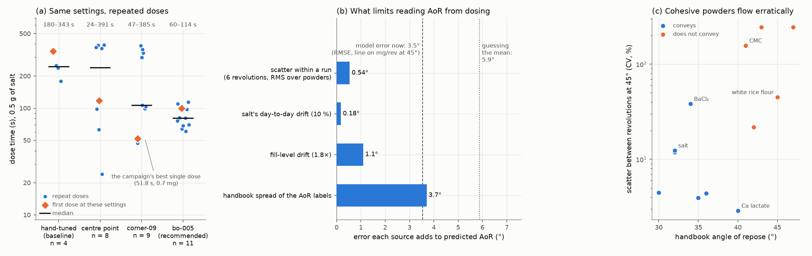

# Would optimizing for consistent doses help the predictor?

William asked on #196 (6 Nov 2026) whether the BO should look for settings at which a powder doses consistently and
predictably, instead of fast and accurately, and whether that would help build a good simulator or predictor. This
note measures what consistency is worth, on data that already exist. Nothing new is dosed or simulated.
[`consistency.py`](consistency.py) makes every number here and the figure (about 10 s), and writes
[`consistency.json`](consistency.json).

## In short
* **For the BO: yes, and the paper already plans it.** Repeated doses at one set of salt settings varied up to
  16-fold in time. The campaign's best-looking single dose (`corner-09`, 51.8 s) came from the second most erratic
  settings: 4 of its 9 doses took 298–385 s. The objectives score single doses, and Ax is given no noise level,
  so it fits one noise level for all settings: it cannot tell a repeatable setting from an erratic one with the same
  average. Moving to a repeatability objective, P(|error| ≤ tolerance), is item B1 of
  [`OUTLINE.md`](https://github.com/vertical-cloud-lab/powder-doser/blob/ec30713/paper/optimization/OUTLINE.md#L133)
  on the #179 branch.
* **For the predictor: hardly at all, today.** If every powder's six revolutions had delivered exactly the same mass,
  the AoR predictor's error would fall from 3.53° to 3.44°, and the forward one from 0.736 to 0.725 decades
  (simulation–extrapolation). The handbook labels alone are worth 3.7°. The labels and the number of powders limit
  the predictor, not the doser's scatter.
* **The consistency that does matter for the predictor is the fingerprint's, between sessions.** Salt's 10 %
  day-to-day drift costs almost nothing here, but a 1.8-fold fill-level effect (seen on #140) would add 0.2° and
  0.05 decades, and would swamp the small differences between batches of one alloy.
* **The fingerprint has to stay at fixed settings.** Erratic flow at fixed settings is a symptom of the powder:
  the scatter between revolutions at 45° rises with handbook AoR (Spearman 0.61). Measuring each powder at its own
  most consistent settings would hide that, and the numbers would no longer be comparable between powders.

*(a) Dose time of every dose at the four settings the salt campaign repeated (0.5 g target). Diamond: the first dose
at those settings; bar: median. (b) How much each source of error adds to the AoR read from mg/rev at 45° (run 33's
line, −4.30° per decade), against the model's held-out error and the error of guessing the mean. The sources add in
quadrature, not linearly. (c) Scatter between the six protocol C revolutions at 45° against handbook AoR; "conveys"
is at least 50 mg/rev at 45°. The two highest points (brown rice flour, Si −325 mesh) deliver almost nothing, so
their scatter is mostly the balance's.*

## (a) The same settings, dosed again

Campaign `salt-20260929T014732Z` (#166), from its [records](data/SOURCES.md). Each row is one set of the eight
controller settings.

| settings | what they are | doses | dose time | median | final error |
|---|---|---|---|---|---|
| hand-tuned | before the campaign; ±5 mg band | 4 | 180–343 s | 245 s | −3.6 to −4.8 mg |
| centre point | every setting mid-range; ±9 mg band | 8 | 24–391 s | 241 s | −6.8 to −9.5 mg, and 2 ran out of taps (−21, −26.5 mg) |
| `corner-09` | a screening corner; ±3 mg band | 9 | 47–385 s | 106 s | −0.7 to −2.8 mg |
| `bo-005` | the model's recommendation; ±3 mg band | 11 | 60–114 s | 81 s | −0.6 to −2.6 mg |

* **The single-dose objective was fooled once.** `corner-09`'s campaign dose (51.8 s, 0.7 mg) is the fastest single
  dose inside 3 mg. Its validation block (asked for on #166) split into 47–106 s and 298–385 s.
  The validation note traces the split to the afterflow after the bulk halt: when only 22–31 mg fell, the taps had
  45–59 mg left to cover at 0.37–0.85 mg per tap. `bo-005`'s taps move 1.6–3.6 mg each.
* **The recommendation was not fooled**, because it came from the model's averaged predictions rather than from the
  best observed dose. But the model did not know which settings are erratic. It treats every setting as equally
  noisy, because each dose goes to Ax as a bare value, with no noise estimate
  ([`ax_raw_data`](https://github.com/vertical-cloud-lab/powder-doser/blob/d14a50d/scripts/opt_common.py#L390-L404)).
* **Caveat:** the hand-tuned, centre-point and `corner-09` rows mix doses on the earlier afterflow constant (τ 0.30 s)
  and the refitted one (0.834 s). The spread is as wide on one τ: `corner-09`'s eight validation doses, all on
  0.834 s, span 47–385 s.

## (b) What limits the predictor

Run 33's single-input lines, each powder held out. "Scatter" is the standard error of log10 mg/rev at
45° from the six protocol C revolutions. The drift rows apply a random per-powder offset of that size, 400 times.

| source | inverse: AoR from mg/rev at 45° | forward: mg/rev at 45° from AoR |
|---|---|---|
| model error now (RMSE) | 3.53° | 0.736 decades |
| guessing the mean | 5.88° | 1.125 decades |
| handbook spread of the AoR labels (RMS) | 3.71° | 0.58 decades (× the line's slope) |
| scatter between revolutions: median powder / RMS over powders | 0.13° / 0.54° | 0.030 / 0.125 decades |
| RMSE if that scatter were zero (SIMEX) | **3.44°** | **0.725 decades** |
| RMSE with 10 % day-to-day drift added | 3.54° | 0.737 decades |
| RMSE with 1.8-fold fill-level drift added | 3.72° | 0.782 decades |

* **SIMEX** (simulation–extrapolation) adds more scatter, at 0.5, 1, 2 and 4 times the measured variance, refits,
  and extrapolates the error back to zero scatter. Removing all of it is worth 0.09° and 0.011 decades.
* The DEM twin is in the same position: #180 matches salt at the centre point but is off by −35 to +18 % at other
  settings, against a standard error of 5–8 % for salt's mean mg/rev at 22.5 and 45°. The model's own error
  dominates.

## (c) Is the scatter noise, or information?
* Scatter at 45° rises with handbook AoR (Spearman 0.61, 12 powders) and falls with mg/rev at 45° (−0.75). At 22.5°
  it shows nothing (0.05).
* With these 12 powders it adds nothing beyond the rate: the partial correlation with AoR, given mg/rev at 45°, is
  −0.08, and a two-input ridge on rate and scatter does worse than the rate alone (3.73° against 3.53°).
* So it is a symptom of cohesion, measured at fixed settings, not something to optimize away in the fingerprint.
  The draft already lists it as a fingerprint descriptor (Table 2), along with the interruption fraction.

## Options for a consistency objective, and their cost

| option | what it measures | cost |
|---|---|---|
| repeats at every evaluated setting (e.g. 3) | median time and P(\|error\| ≤ tolerance), directly | 3× the doses: 42 doses buy 14 settings |
| repeats only for promising settings | the validation block, moved inside the loop (e.g. 2 repeats of the model's current best after every 6 BO doses) | about a third more doses |
| a noise model that depends on the settings | how erratic each region is, learned from all doses | needs repeats to learn from; not one of Ax's standard models |
| per-dose signals that predict the spread | afterflow, mg per tap and tap count, already logged in every dose | no extra doses; a proxy, not the outcome |

Robust settings also help when a predictor is used: if the forward model's guess for a new powder is somewhat off, a
setting whose outcome barely changes nearby still doses well. That is the practical link between consistency and
prediction, more than cleaner training data.

## The hidden score of the 1-factor model (for the explanation on #196)

Run 33's joint model, fitted on all 12 powders, with one hidden score per powder. Loadings say how closely each
measured quantity follows the score (standardized; ±1 is perfect): bulk and tapped density +0.95, particle density
+0.86, moisture −0.79, AoR and Hausner ratio −0.73, mg/rev at 0, 22.5 and 45° +0.50, +0.42, +0.48, speed exponent
−0.50, d50 +0.12. Higher means dense, dry and free-flowing.

| powder | score from the fingerprint | score from the handbook properties | handbook AoR | mg/rev at 45° |
|---|---|---|---|---|
| AlSi10Mg | +0.93 | +1.32 | 30° | 339 |
| salt | +0.64 | +0.71 | 32° | 265 |
| xanthan gum | +0.85 | −0.80 | 35° | 187 |
| calcium lactate | +0.69 | −1.39 | 40° | 232 |
| white rice flour | −0.89 | −0.68 | 45° | 37 |
| brown rice flour | −1.49 | −0.66 | 47° | 0.2 |

The uncertainty (posterior SD) of a score is 0.66 from the fingerprint and 0.06 from the properties, against a spread
of 1 across powders. Xanthan and calcium lactate dose like salt but have the densities and moisture of the
biopolymers, so the two ways of reading their score disagree. This is the confound run 33 describes.

## Data
* [`data/salt_campaign_records.jsonl`](data/SOURCES.md): the 60 doses of the salt campaign, a byte-identical copy.
* [`data/trials.csv`](data/SOURCES.md) and [`../heldout-powders/data/`](../heldout-powders/data/SOURCES.md): Sam's
  battery and the #163 handbook properties, as in run 33.
* Drift sizes are from the #179 draft ("Limits of the present data"): about 10 % for salt between two days, and up to
  1.8-fold across sessions with different fill levels (#140).

## Limitations
* Four repeated settings, on one powder and one target. Other powders may differ.
* The error budget uses run 33's simplest models and handbook labels. With measured labels, the scatter's share will
  grow, and this budget should be redone then.
* The drift rows are what-ifs with an assumed size, not drift measured in the battery data.
